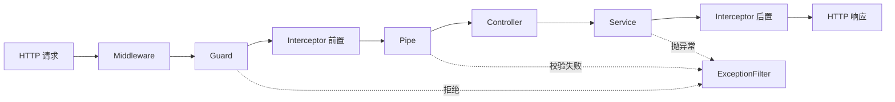

# 第 1 章 开篇词

你接手一个跑了三年的 Node 后端项目。主文件 `app.js` 一千二百行，里面塞了三十七个接口；每个接口都要自己写一遍"参数对不对"的检查，登录判断靠一句 `if (req.path !== '/login')` 绕过去。产品要加一个"取消预订"：你从接口改到业务逻辑，再改到数据库语句，改完发现还有两个定时任务在写同一张表。改了两天，测了三天，上线前没人敢点发布。

这不是你一个人的问题。任何一个不划边界的 Node 后端，写到第三个月都会长成这样：目录看着分了层，对象还是靠 `new` 手工串起来；日志、鉴权、校验散落在每个接口里；换一个数据库客户端，要改十几处 import。Nest 不承诺让增删改查少写几行，它解决的是另一个问题：**需求变、人变、部署方式变的时候，代码还能不能便宜地改**。

这一章先把后面每章都要用的地基打掉：程序是怎么跑起来的、终端里一条命令在干什么、一个 HTTP 请求有哪几个位置能放数据、JSON 是什么、进程和端口是什么。这几件事弄明白了，后面看代码才不会卡在"这行到底在干嘛"。然后我们看 Nest 把一次请求拆成了哪几段，最后把项目骨架真跑起来。

## 程序是一份菜谱，Node 是照着念的人

你写出来的 `.ts` 文件，就是一段文本，里面一行行写着"先这样、再那样"。它自己是死的，放在硬盘上什么也不会发生。

要它动，得请一个能读懂它的程序来执行。Node.js 就是那个东西：你让它打开一个文件，它从第一行开始往下做。所以"运行程序"这四个字，实际动作很简单——**让一个能读它的程序，打开它、照着做**。

菜谱和厨师的关系，是这里最值得记住的一条：文件是菜谱，Node 是厨师，厨师能把菜谱做成菜。同一个菜谱可以给两个厨师做，做出来是两盘菜（这就是后面要讲的进程）。

TypeScript 还多一道手续。`node` 只认 JavaScript，不认 `: string` 这种类型标注。所以要么先"翻译"一遍再执行（翻译这个动作叫**编译**，`nest build` 干的就是它），要么让工具边翻译边跑（`pnpm start:dev` 干的是这个）。这两种方式跑的是同一份代码，只是快慢和用途不同。

## 终端里的命令，是"让某个程序做一件事"

**终端**（Terminal）是一个只认文字的窗口：你敲一行，它把那行交给系统，系统找到对应的程序，跑起来，把输出贴回来。没有按钮，没有菜单，全靠打字。

一行命令通常长这样：

```bash
pnpm exec nest generate module quotes
```

第一个词 `pnpm` 是"要运行哪个程序"，后面用空格隔开的全是"顺便告诉它的话"，这些词叫**参数**。上面这句连起来读：用 `pnpm` 这个程序，让它执行项目里的 `nest` 工具，告诉 `nest` 去生成（generate）一个模块（module），名字叫 quotes。

命令之间必须用空格分开，顺序也有讲究：第一个词永远是"谁来做"，后面才是"做什么、对谁做"。

几条你一定会用到的：

- `cd meeting-booking`：`cd` 是 change directory，切换"当前目录"。后面所有相对路径都从当前目录算起。
- `ls`：列出当前目录里有什么。Windows 的 PowerShell 里叫 `dir`。
- `node -v`：跑 `node` 这个程序，问它版本（`-v` 是 version 的缩写）。
- `curl http://localhost:3000`：跑 `curl`，让它去访问这个地址，把返回的内容打出来。

如果系统回你 `command not found`，意思是它在约定的几个目录里没找到这个名字的程序。这时候要么把它装上，要么用完整路径，要么用 `pnpm dlx`（临时下载再运行，不装到全局）。

## 一个 HTTP 请求，只有四个能放东西的地方

前端和后端说话，用的是 HTTP。你可以把它想成一封格式固定的信，整封信只有四块：

- **方法（method）**：这封信来干嘛的。`GET` 是"我要看"，`POST` 是"我要新建"，`PATCH` 是"改一部分"，`DELETE` 是"删掉"。
- **路径（path）**：找谁。`/bookings/42` 就是"42 号预订"。
- **头（header）**：信封上的备注。`Content-Type: application/json` 告诉后端"信纸是 JSON 写的"；`Authorization` 里放身份凭证。
- **体（body）**：信纸本身，真正的那坨数据。`GET` 一般没有，`POST`、`PATCH` 才有。

一个请求就是这四块凑起来的，没有第五块。前端说"参数传不过去"、后端说"我没收到"，九成是这四块里有一块放错了位置。第 4 章会把每个位置怎么取值，一种一种跑给你看。

## JSON 是一种写数据的格式

```json
{"name": "光", "age": 20, "tags": ["前端"]}
```

JSON 就是长这样的文本：大括号包一个对象，冒号左边是字段名，右边是值。值可以是字符串、数字、`true`/`false`、`null`、数组，或者再套一个对象。

它跟 JavaScript 里写对象几乎一模一样，区别只有两条：字段名必须用双引号包起来；里面不能写函数、不能写注释、不能有 `undefined`。所以浏览器开发者工具里看到的接口返回，就是它。

没有它会卡在哪：如果双方没有一种都认的格式，前端发过去的东西后端只能靠猜。JSON 就是那份"说好都这么写"的约定，现在几乎所有接口都用它。

## 进程和端口

**进程**（process）是"正在跑的那一份程序"。菜谱是文件，进程是正在炒的那锅菜。同一个程序可以同时开好几份，每份是一个独立进程，互相不知道对方的存在。

**端口**（port）是一台电脑上区分不同服务的编号，范围 0 到 65535。IP 地址负责找到哪台机器，端口负责找到机器上的哪个服务。`http://localhost:3000` 里，`localhost` 是"本机"，`3000` 是端口。

为什么老用 3000？没有规定，只是前端工具链的习惯。端口被别的程序占了，启动会报 `EADDRINUSE`，换一个就行：`PORT=3001 pnpm start:dev`。

## 一次改动要经过的那些层

现在回到开头的"取消预订"，把它从头走一遍，你会撞上一串名词，每个都对应链上的一段。

请求从 `PATCH /bookings/:id/cancel` 进来，落到的第一个文件是**控制器（Controller）**。控制器只做 HTTP 适配：从 `@Param`、`@Body` 里取参数，调用下一个人，把返回值交回去。路由、状态码、参数装饰器都归它；它不该判断"这个预订还能不能取消"。

`@Param()`、`@Body()` 这种带 `@` 的写法叫**装饰器（decorator）**。你就当它是贴在代码上的一张便利贴：便签上写着"这个方法的路径是 `/bookings`"，运行时由框架撕下来读，读完决定怎么干活。装饰器自己不取参数、也不查路由，真正干活的是读便签的框架代码——这个分工别搞反。它是 TypeScript 的语法，官方说明在 [TypeScript 装饰器](https://www.typescriptlang.org/docs/handbook/decorators.html)，本章末尾那几段代码里会大量出现。

"这单还能不能取消"属于**服务（Service）**。服务装业务规则：订单状态是不是 `PENDING`、发起人是不是本人、取消要不要退积分。服务不碰 `req`/`res`，也不拼 HTTP 响应。这样同一条规则，今天从 HTTP 进来能调用，明天从消息队列或定时任务进来也能调用。规则一旦写进 Controller，它就跟 HTTP 绑死了，想复用只能重写。

服务要读预订记录，会把活交给**仓储（Repository）**。仓储的方法名是业务语言：`findActiveByRoom(roomId)`，调用方不用关心底下是 SQL、Redis 还是内存数组。**DAO（Data Access Object）**长得像，但更贴表：`selectById`、`insertRow`，粒度是"表 + 条件"。两者的区别只在抽象高度——一个说"业务要什么"，一个说"表里取什么"。小项目里合成一个文件也没问题，关键是别让 SQL 散在业务代码里。

再往下是数据的形状。数据库里一行预订叫 **PO（Persistent Object，持久化对象）**，跟表结构一一对应；**实体（Entity）**则是有唯一标识、生命周期可追踪的业务对象，可以带自己的行为。两者经常是同一个类，但概念别混。请求体传进来的那个形状是 **DTO（Data Transfer Object）**，只装数据、不带逻辑，比如 `CancelBookingDto`；返回给前端前裁过的结果叫 **VO**（View Object；在领域驱动里 VO 也指值对象，遇到时先看语境）。从 PO 到 VO 的转换代码叫 **Mapper**，手写一个 `toDto()` 就够了，别在 Controller 里现拼对象。

这些类不会各自 `new`。谁创建它们、按什么顺序创建、创建几份，交给 Nest 的**容器**。这套"依赖由外部送进来"的做法叫**依赖注入（DI，Dependency Injection）**，第 5 章会展开。凡是交给容器管理、可以被注入的类，Nest 统称 **Provider（提供者）**：Service 是 Provider，Repository、工厂、Guard 也是。`@Injectable()` 只是给容器的一张通行证——这个类允许被注入。**模块（Module）**是装载单元：它声明这个业务单元有哪些 Controller、哪些 Provider、对外导出什么。模块不是文件夹，类只有写进模块才会被容器创建。

把边界写在文档里没用，Nest 把它写进了运行时：Controller 没进 `controllers`，路由就不存在；Provider 没进 `providers`，构造器里就注入不进来；模块没被 `imports`，里面的一切都不生效。代价是前三个接口会显得啰嗦，收益要等项目活过三个月才看得出来。

## 一次请求要过几道关

装好之后，Nest 把每个 HTTP 请求拆成固定阶段。你的代码放在哪一层，决定了它能拿到什么、能改什么。

> **图 1-1** 一次请求在 Nest 里的处理顺序。
>



**中间件（Middleware）**在最外层，参数只有 `req`、`res`、`next`，拿不到 Nest 的上下文。它适合干跟业务无关的事：访问日志、请求 ID、CORS、请求体大小限制。**守卫（Guard）**在路由匹配之后、进入 handler 之前执行，只回答一个问题——这次请求能不能进。它能读到路由上的元数据（比如 `@Roles('ADMIN')`），所以登录校验、角色判断放这里。**管道（Pipe）**在 handler 之前处理参数，`ValidationPipe` 是最常见的一种，把字符串 `"18"` 转成数字，顺手挡掉多余的字段。**拦截器（Interceptor）**包住 handler，前后各执行一段，能拿到 `ExecutionContext`（Nest 对"当前这次调用"的抽象，第 11 章展开），响应包装、耗时统计、缓存都归它。**异常过滤器（ExceptionFilter）**接住没人处理的异常，翻译成统一的响应体。

顺序不能乱：未登录的请求不该先跑一遍参数校验，所以 Guard 在 Pipe 前面；拦截器的后置逻辑按注册的逆序执行，像剥洋葱；过滤器是唯一反着走的一层，异常从哪层抛出，它就在哪层接。排查问题时先判断异常是在哪一层抛的，比在三十七个 handler 里加日志快得多。

## 把骨架跑起来

先确认工具链。Nest 12 的核心包是 ESM-only，运行时需要 Node 20.19+ 或 22.12+，但 CLI 生成器要求更高：22.22.3 起。教程统一用 Node 22.22.3 和 pnpm 11，别在 23、25 这类奇数版本上浪费时间。

```bash
node -v
# v22.22.3
pnpm -v
# 11.0.0
```

ESM 这个词先记住一句话：它是 JavaScript 的"模块写法"，规定 `import` 从哪个文件拿东西。Nest 12 默认用它，所以你后面会看到导入路径都带 `.js` 后缀。没有它行不行？行，老写法叫 CommonJS，但 Nest 12 的新项目默认不走那条路。

生成项目。`--package-manager pnpm` 让 CLI 直接写对 lockfile 和脚本；交互里选 ESM，NestJS Observe 选 No。

```bash
pnpm dlx @nestjs/cli@12.3.0 new meeting-booking --package-manager pnpm --language TS --skip-tests
cd meeting-booking
```

生成出来的 `src` 只有四个文件：`main.ts`、`app.module.ts`、`app.controller.ts`、`app.service.ts`。这一期不写测试，后面统一用 `curl` 和日志验证行为。

先改入口。`main.ts` 是整个程序的起点——Node 从这里开始念菜谱。Nest 12 脚手架默认用 `async function bootstrap()`，教程统一成箭头函数加顶层 `await`；启动失败时不要吞异常，让进程以非零码退出，容器编排才能发现。

```ts
// src/main.ts
import { Logger, ValidationPipe } from '@nestjs/common';
import { NestFactory } from '@nestjs/core';
import { AppModule } from './app.module.js';

const bootstrap = async (): Promise<void> => {
  const app = await NestFactory.create(AppModule);

  app.useGlobalPipes(
    new ValidationPipe({
      whitelist: true,
      forbidNonWhitelisted: true,
      transform: true,
    }),
  );

  const port = Number(process.env.PORT ?? 3000);

  if (!Number.isInteger(port) || port < 1 || port > 65535) {
    throw new Error('PORT must be an integer between 1 and 65535');
  }

  await app.listen(port);
  Logger.log(`API ready at http://localhost:${port}`, 'Bootstrap');
};

await bootstrap();
```

注意 `./app.module.js` 这个后缀。源码里写的是 `.js`，指向的却是编译后那个文件：ESM 不做扩展名猜测，不给后缀就找不到文件，运行时直接报 `ERR_MODULE_NOT_FOUND`。同理，`package.json` 里必须有 `"type": "module"`，否则 Node 会把 `.js` 当成老式的 CommonJS 来解析。

## 先验证，再往里填

```bash
pnpm start:dev
```

终端里出现下面三行，说明容器把模块、控制器和依赖都装配完了：

```text
[Nest] 48211  - 11/06/2026, 9:14:02 AM     LOG [NestFactory] Starting Nest application...
[Nest] 48211  - 11/06/2026, 9:14:02 AM     LOG [NestApplication] Nest application successfully started
[Nest] 48211  - 11/06/2026, 9:14:02 AM     LOG [Bootstrap] API ready at http://localhost:3000
```

另开一个终端：

```bash
curl -s http://localhost:3000
# Hello World!
```

再验证生产入口。`nest build` 把 TypeScript 编到 `dist`，生产环境直接跑 `node dist/main.js`，不需要装 CLI：

```bash
pnpm build
node dist/main.js
curl -s http://localhost:3000
# Hello World!
```

`pnpm build` 报类型错误时不要跳过。SWC 构建器不做类型检查，`nest build` 默认用 tsc，错误会在这里暴露；如果团队把构建切到了 SWC，CI 里要单独跑一次 `tsc --noEmit`。

## 几个容易踩的坑

| 现象 | 原因 | 处理 |
| --- | --- | --- |
| `nest: command not found` | 全局没装 CLI，或 pnpm 的 bin 不在 PATH | 用 `pnpm dlx @nestjs/cli@12.3.0 ...` 或 `pnpm exec nest ...` |
| `ERR_MODULE_NOT_FOUND` | 相对导入漏了 `.js` 后缀 | 所有相对导入都写编译后的文件名 |
| `Cannot use import statement outside a module` | `package.json` 缺 `"type": "module"` | 补上，并确认 Node 版本达标 |
| `Nest can't resolve dependencies of ...` | Provider 没注册、没导出，或模块没导入 | 按报错里的 token、参数下标、模块三项排查 |

这四类错误占了新项目启动失败的大半。它们和业务无关，却最容易在第一天劝退人。先把环境、ESM 和依赖注入这三关过掉，后面的内容才有意义。

接下来的二十八章只做一件事：把 Nest 的七个角色讲清楚——模块负责边界，控制器负责 HTTP，Provider 负责能力，管道、守卫、拦截器、过滤器负责横切。每一章都落在同一个会议室预订项目上，从内存数组开始，逐步换成 PostgreSQL 17 和 Prisma 8，再往后拆微服务、接实时通信。你不会看到"先背一遍装饰器列表"的章节，所有概念都在解决一个具体故障时出现。

下一章先回答一个更现实的问题：市面上有 Express、Fastify、Egg，为什么这个项目选 Nest，以及什么情况下不该选。这个问题想不清楚，后面的约束都会变成负担。


<!-- chapter-nav:start -->
---

[本 Part 目录](_part.md) · 下一篇：[002 给你5个学习Nest的理由，你会心动么](002-给你5个学习Nest的理由，你会心动么.md) →
<!-- chapter-nav:end -->
