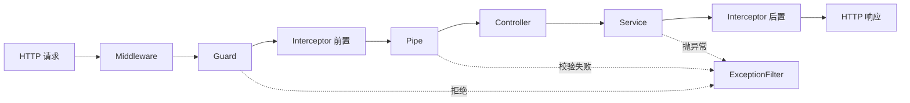

# 第 1 章 开篇词

周一早上，你接手一个跑了三年的 Express 项目。`app.js` 一千二百行，三十七个路由；参数校验在每个 handler 里复制了一遍，登录判断靠一段 `if (req.path !== '/login')`。产品要加一个“取消预订”字段：你从路由改到 service，再改到 SQL，发现还有两个定时任务在写同一张表。改完两天，回归三天，上线前没人敢点发布。

这不是你一个人的问题。任何一个不设边界的 Node 后端，写到第三个月都会长成这样：目录看起来分了层，依赖却靠 `new` 手工串；日志、鉴权、校验散落在每个 handler 里；换一个数据库客户端，要改十几处 import。Nest 不承诺让 CRUD 少写几行，它解决的是另一个问题：**当需求变、人变、部署方式变时，代码还能不能低成本地改**。

先别急着看装饰器。把“取消预订”这次改动从头走一遍，你会撞上一串名词，每一个都对应链上的一段。

## 一次改动经过的那些层

请求从 `PATCH /bookings/:id/cancel` 进来，落到的第一个文件是**控制器（Controller）**。控制器只做 HTTP 适配：从 `@Param`、`@Body` 里取参数，调用下一个人，把返回值交回去。路由、状态码、参数装饰器都归它；它不该判断“这个预订还能不能取消”。

`@Param()`、`@Body()` 这种带 `@` 的写法叫**装饰器（decorator）**：TypeScript 的语法，把一段元数据（描述这段代码的数据，比如“这个方法的路径是 `/bookings`”）贴在类、方法或参数上，运行时由框架读出来决定行为（[TypeScript 装饰器](https://www.typescriptlang.org/docs/handbook/decorators.html)）。装饰器自己不取参数，也不查路由；真正干活的是读元数据的框架代码。Nest 的路由、依赖注入、参数绑定都建立在这套机制上，后面会反复见到。

这个判断属于**服务（Service）**。服务装业务规则：订单状态是不是 `PENDING`、发起人是不是本人、取消要不要退积分。服务不碰 `req`/`res`，也不拼 HTTP 响应。这样同一条规则今天从 HTTP 进来能调用，明天从消息队列或定时任务进来也能调用——一旦把规则写进 Controller，它就跟 HTTP 绑死了。

服务要读预订记录，会把活交给**仓储（Repository）**。仓储面向领域对象，方法名是业务语言：`findActiveByRoom(roomId)`，调用方不关心底下是 SQL、Redis 还是内存数组。**DAO（Data Access Object）**长得像，但更贴表：`selectById`、`insertRow`，方法粒度是“表 + 条件”。两者都为了把 SQL 从 Service 里挤出去，区别只在抽象高度；小项目里合成一个文件也没问题，关键是别让 SQL 散在业务代码里。

再往下是数据的形状。数据库里一行预订叫 **PO（Persistent Object，持久化对象）**，与表结构一一对应；**实体（Entity）**则是有唯一标识、生命周期可追踪的业务对象，可以带领域行为。两者经常是同一个类，但概念别混。请求体传进来的形状是 **DTO（Data Transfer Object）**，只装数据、不带逻辑，比如 `CancelBookingDto`；返回给前端的裁剪结果叫 **VO**（View Object；在领域驱动里 VO 也指值对象，遇到时先看语境）。从 PO 到 VO 的转换代码叫 **Mapper**，手写一个 `toDto()` 就够，别在 Controller 里现拼对象。

这些类不会各自 `new`。谁创建它们、按什么顺序创建、创建几份，交给 Nest 的**容器**。这套“依赖由外部送进来”的做法叫**依赖注入（DI，Dependency Injection）**，第 5 章会展开。凡是交给容器管理、可以被注入的类，Nest 统称 **Provider（提供者）**：Service 是 Provider，Repository、工厂、Guard 也是。`@Injectable()` 只是给容器的一个标记——这个类允许被注入。而**模块（Module）**是装载单元：它声明这个业务单元有哪些 Controller、哪些 Provider、对外导出什么。模块不是文件夹，类只有写进模块才会被容器创建。

把边界画在文档里没用，Nest 把它们写进了运行时：Controller 没进 `controllers`，路由就不存在；Provider 没进 `providers`，构造器里就注入不进来；模块没被 `imports`，里面的一切都不生效。代价是前三个接口显得啰嗦，收益要等项目活过三个月才看得出来。

## 一次请求要过几道关

装好之后，Nest 把每个 HTTP 请求拆成固定阶段。你的代码放在哪一层，决定了它能拿到什么、能改什么。

> **图 1-1** 一次请求在 Nest 里的处理顺序。
>



**中间件（Middleware）**在最外层，参数只有 `req`、`res`、`next`，拿不到 Nest 的上下文。它适合干与业务无关的事：访问日志、请求 ID、CORS、请求体大小限制。**守卫（Guard）**在路由匹配之后、进入 handler 之前执行，只回答一个问题——这次请求能不能进。它能读到路由上的元数据（比如 `@Roles('ADMIN')`），所以登录校验、角色判断放这里。**管道（Pipe）**在 handler 之前处理参数，`ValidationPipe` 是最常见的一种，把字符串 `"18"` 转成数字并挡掉多余字段。**拦截器（Interceptor）**包住 handler，前后各执行一段，能拿到 `ExecutionContext`（Nest 对“当前这次调用”的抽象，第 11 章展开），响应包装、耗时统计、缓存都归它。**异常过滤器（ExceptionFilter）**接住没人处理的异常，翻译成统一的响应体。

顺序不能乱：未登录的请求不该先跑一遍参数校验，所以 Guard 在 Pipe 前面；拦截器的后置逻辑按注册的逆序执行，像剥洋葱；过滤器是唯一反着走的一层，异常从哪层抛出，它就在哪层接。排查问题时先判断异常在哪一层抛出，比在三十七个 handler 里加日志快得多。

## 把骨架跑起来

先确认工具链。Nest 12 的核心包是 ESM-only，运行时需要 Node 20.19+ 或 22.12+，但 CLI 生成器要求更高：22.22.3 起。教程统一用 Node 22.22.3 和 pnpm 11，避免在 23、25 这类奇数版本上浪费时间。

```bash
node -v
# v22.22.3
pnpm -v
# 11.0.0
```

生成项目。`--package-manager pnpm` 让 CLI 直接写对 lockfile 和脚本；交互里选 ESM，NestJS Observe 选 No。

```bash
pnpm dlx @nestjs/cli@12.3.0 new meeting-booking --package-manager pnpm --language TS --skip-tests
cd meeting-booking
```

生成出来的 `src` 只有四个文件：`main.ts`、`app.module.ts`、`app.controller.ts`、`app.service.ts`。这一期不写测试，后面统一用 `curl` 和日志验证行为。

先改入口。Nest 12 脚手架默认用 `async function bootstrap()`，教程统一成箭头函数加顶层 `await`；启动失败时不要吞异常，让进程以非零码退出，容器编排才能发现。

```ts
// src/main.ts
import { Logger, ValidationPipe } from '@nestjs/common';
import { NestFactory } from '@nestjs/core';
import { AppModule } from './app.module.js';

const bootstrap = async (): Promise<void> => {
  const app = await NestFactory.create(AppModule);

  app.useGlobalPipes(
    new ValidationPipe({
      whitelist: true,
      forbidNonWhitelisted: true,
      transform: true,
    }),
  );

  const port = Number(process.env.PORT ?? 3000);

  if (!Number.isInteger(port) || port < 1 || port > 65535) {
    throw new Error('PORT must be an integer between 1 and 65535');
  }

  await app.listen(port);
  Logger.log(`API ready at http://localhost:${port}`, 'Bootstrap');
};

await bootstrap();
```

注意 `./app.module.js` 这个后缀。TypeScript 源码里写 `.js`，因为它指向编译后的文件；ESM 不做扩展名猜测，漏掉就是运行时的 `ERR_MODULE_NOT_FOUND`。同理，`package.json` 里必须有 `"type": "module"`，否则 Node 会把 `.js` 当 CommonJS 解析。

## 先验证，再往里填

```bash
pnpm start:dev
```

终端里出现下面三行，说明容器把模块、控制器和依赖都装配完了：

```text
[Nest] 48211  - 11/06/2026, 9:14:02 AM     LOG [NestFactory] Starting Nest application...
[Nest] 48211  - 11/06/2026, 9:14:02 AM     LOG [NestApplication] Nest application successfully started
[Nest] 48211  - 11/06/2026, 9:14:02 AM     LOG [Bootstrap] API ready at http://localhost:3000
```

另开一个终端：

```bash
curl -s http://localhost:3000
# Hello World!
```

再验证生产入口。`nest build` 把 TypeScript 编到 `dist`，生产环境直接跑 `node dist/main.js`，不需要安装 CLI：

```bash
pnpm build
node dist/main.js
curl -s http://localhost:3000
# Hello World!
```

`pnpm build` 报类型错误时不要跳过。SWC 构建器不做类型检查，`nest build` 默认用 tsc，错误会在这里暴露；如果团队把构建切到了 SWC，CI 里要单独跑一次 `tsc --noEmit`。

## 几个容易踩的坑

| 现象 | 原因 | 处理 |
| --- | --- | --- |
| `nest: command not found` | 全局没装 CLI，或 pnpm 的 bin 不在 PATH | 用 `pnpm dlx @nestjs/cli@12.3.0 ...` 或 `pnpm exec nest ...` |
| `ERR_MODULE_NOT_FOUND` | 相对导入漏了 `.js` 后缀 | 所有相对导入都写编译后的文件名 |
| `Cannot use import statement outside a module` | `package.json` 缺 `"type": "module"` | 补上，并确认 Node 版本达标 |
| `Nest can't resolve dependencies of ...` | Provider 没注册、没导出，或模块没导入 | 按报错里的 token、参数下标、模块三项排查 |

这四类错误占了新项目启动失败的大半。它们和业务无关，却最容易在第一天劝退人。先把环境、ESM 和依赖注入这三关过掉，后面的内容才有意义。

接下来的二十八章只做一件事：把 Nest 的七个角色讲清楚——模块负责边界，控制器负责 HTTP，Provider 负责能力，管道、守卫、拦截器、过滤器负责横切。每一章都落在同一个会议室预订项目上，从内存数组开始，逐步换成 PostgreSQL 17 和 Prisma 8，再往后拆微服务、接实时通信。你不会看到“先背一遍装饰器列表”的章节，所有概念都在解决一个具体故障时出现。

下一章先回答一个更现实的问题：市面上有 Express、Fastify、Egg，为什么这个项目选 Nest，以及什么情况下不该选。这个问题想不清楚，后面的约束都会变成负担。

想更深入的话，官方文档里有这几页可以接着看：[First steps](https://docs.nestjs.com/first-steps)（从装 CLI 到第一个接口跑通要执行的几条命令，对应本章“把骨架跑起来”那几步）、[Request lifecycle](https://docs.nestjs.com/faq/request-lifecycle)（一个请求依次经过中间件、守卫、管道、控制器、拦截器和过滤器，对应本章“一次请求要过几道关”）。

<!-- chapter-nav:start -->
---

[本 Part 目录](_part.md) · 下一篇：[002 给你5个学习Nest的理由，你会心动么](002-给你5个学习Nest的理由，你会心动么.md) →
<!-- chapter-nav:end -->
