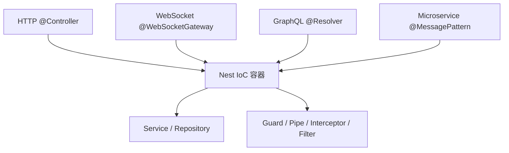

# 第 2 章 给你5个学习Nest的理由，你会心动么

三个 Express 项目摆在一起，功能都正常：一个把校验写在路由里，一个抽了 `validators/`，第三个放进了中间件。三个人都没错，但新人进来时不知道该跟谁，代码 review 也谈不到点上——同一个需求三种写法都能跑，讨论最后变成口味之争。

选框架真正要解决的就是这件事：语法糖只影响你写得多顺手，约定才影响五个人、两年、几十次需求变更之后，代码还能不能改。Nest 卖的是这套约定。它不提供什么 Express 做不到的能力，而是提前规定好“什么代码放哪、谁能依赖谁”，并且在启动时真的检查。

先用一个具体需求看这套规定怎么落地：给会议室加一个“取消预订”接口。Express 里你可能顺手写在路由回调里；Nest 会逼你把它拆成四站——`BookingsController` 收请求，`BookingsService` 判断“这单还能不能取消”，`BookingsRepository` 读写数据，`BookingsModule` 声明这三者归谁管。**Controller（控制器）**只做 HTTP 适配，**Service（服务）**只装业务规则，**Repository（仓储）**只碰数据，**Module（模块）**是装载单元，不是文件夹。**Provider（提供者）**是更上一层的说法：凡是交给容器创建、可以被注入的类都算，Service 只是其中一种。

这套分工不是文档建议。控制器没进 `controllers`，路由就不存在；Provider 没进 `providers`，构造器里就注入不进来；模块没被 `imports`，整块代码都不生效。约定被写进了运行时，这是它和“团队口头规范”最大的区别。代价是前三个接口会显得啰嗦，收益要等项目活过三个月才看得出来。下面五条，是这套约定在真实项目里能兑现的东西，也一并说清代价。

## 一、新人能猜中代码在哪

按 Nest 约定写的项目，文件位置是可预测的：HTTP 入口在 `*.controller.ts`，业务在 `*.service.ts`，数据访问在 `*.repository.ts`，模块边界在 `*.module.ts`，请求结构在 `dto/`。新人接到“取消预订”，会先找 `bookings.controller.ts`，再顺着构造器进 `bookings.service.ts`，而不是全局搜索路由字符串。

review 也从此有共同语言。控制器里出现 SQL，或者 Service 里出现 `@Res()`，都是可以直接打回的明确问题，不用争论风格。Service 一旦拿到 `res`，它就绑死在 HTTP 上，同一个方法没法再被消息队列或定时任务调用，拦截器也包不住它返回的东西——等你想复用时才发现，代价是重写。

代价同样具体：一个查询要写 controller、service、module 三个文件，Express 里可能十行就完了。接口活过三个月、维护者超过两个人，约束开始回本；如果只是给内部工具写两个临时接口，Nest 的骨架确实偏重。

## 二、换传输协议，不换业务代码

HTTP、WebSocket、GraphQL、微服务，在 Nest 里是四种入口装饰器（第 1 章讲过，`@Xxx()` 就是往类或方法上写元数据的标记），不是四套架构。HTTP 是你已经熟的请求-响应；WebSocket 是一条长连接上双向推消息，入口是 `@WebSocketGateway()`；GraphQL 让客户端在请求里声明“我要哪些字段”，服务端用 `@Resolver()` 描述图；微服务是进程之间收发消息，入口是 `@MessagePattern()` 这类传输层装饰器。这四种入口最后都注册进同一个 IoC 容器：IoC（控制反转）指对象的创建权从业务类手里收走，交给容器统一组装；第 5 章会展开。

> **图 2-1** 四个入口共用同一套依赖容器与横切逻辑。
>



同一个 `BookingsService`，今天被 `BookingsController` 调用，明天可以挂到 `@MessagePattern('booking.created')` 上处理消息，后天可以包一层 GraphQL resolver。业务代码不动，换的是入口和传输层。等系统从单体拆到微服务，模块的 `exports` 本来就已经是一份契约，迁移时不用先把业务逻辑从路由里刨出来。

这层抽象也有边界。能共用的是“对象怎么创建、依赖怎么注入、守卫和拦截器怎么挂”；不能共用的是各传输层自己的语义：HTTP 有状态码和 header，RPC 没有；HTTP 是请求-响应，WebSocket 是一条连接上多次消息；GraphQL 的“错误”可以部分成功，HTTP 只能整体失败。所以异常过滤器、管道校验、响应包装，换传输层时通常要重写一份，Service 才是真正不动的那部分。

## 三、换实现只改装配，不改业务

Nest 的生态确实全：配置用 `@nestjs/config`，数据库接 PostgreSQL 17 + Prisma 8，认证接 Passport + JWT，文档用 `@nestjs/swagger`，定时任务、队列、健康检查、限流各有官方包。但“生态好”本身不构成选型理由——每引入一个包，就多一份配置、一个版本约束、一个故障点。

真正值得看的是替换成本。支付通道从 A 换到 B，不需要全局搜索 `new PaymentClient()`；在模块里把这一行换掉：

```ts
{ provide: PAYMENT_GATEWAY, useClass: BGateway }
```

业务代码一行不动。`PAYMENT_GATEWAY` 是一个 **token（令牌）**，容器查找实例用的键；默认 token 就是类本身，所以平时写 `private readonly users: UserService` 就够了。当你要面向接口、或者一个类需要多个配置不同的实例时，才需要显式 token 加 `@Inject()`（第 7 章展开）。这个能力的价值在接第三方、做灰度、写本地假实现时最明显。

更稳的引包顺序是：先用框架自带的模块、管道、过滤器把问题解决；确实缺能力，再引包；引入时写一行 ADR（架构决策记录，一页纸写清为什么选它、替代方案是什么、出问题怎么退回），半年后有人问“为什么有这行依赖”时能答上来。

## 四、团队换人时见真章

框架的收益，在人员流动时最明显。一个按 Nest 约定写的项目，新人猜代码位置的命中率很高，半小时内能找到要改的地方，不需要先读一遍架构文档。

依赖注入让交接也变得具体。某个人把缓存逻辑写在 Service 的私有字段里，单例下会影响所有请求；换成 Nest 的写法，这个字段要么是注入进来的 Provider，要么就得说明为什么该留在进程内。review 时能看见依赖，就能看见影响面。

反过来，如果团队全是刚接触 TypeScript 的新人，装饰器、元数据、依赖注入会同时增加学习和排查成本。这时候先用更薄的框架把业务跑顺，可能比强行上 Nest 更划算。选型要看团队当下能维护什么，不是看招聘 JD 上写了什么。

## 五、你学走的是架构判断

DI、AOP、适配器、模块契约，这些概念不是 Nest 发明的。Spring、Angular、Laravel 里都有对应物，只是名字和写法不同。把 Nest 学明白，换到这些框架时，你带走的是“依赖应该由容器组装”“横切逻辑应该从业务里抽走”“模块应该只暴露稳定契约”这些判断，而不是某几个装饰器的拼写。

这也是这套教程花很多篇幅讲“为什么”的原因。API 会随版本变，Nest 12 就已经把核心包切到 ESM-only，CLI 生成器也抬高了 Node 版本要求；但“请求先过守卫再过管道”“Provider 默认在模块内私有”这些规则，过去几年没有变。

## 什么情况下别选 Nest

- 只有两三个接口的 Serverless 函数：冷启动和包体积比分层重要，Nest 的启动开销不划算。
- 部署在强 Edge Runtime：V8 isolate 里没有完整的 Node API，依赖注入和部分生态包跑不起来。
- 团队里没人写过 TypeScript 后端：装饰器和元数据会让排错变慢，先用更简单的方案把业务跑通。
- 已经稳定运行、没有扩展计划的 Express 单体：重写收益低，先补日志、校验和边界，比换框架现实。

选型不是站队。把团队规模、维护周期、部署形态、招聘难度四项打个分，再决定要不要这套约束；只看 benchmark 或 GitHub star，通常会选错。

## 用十行代码验证这套模型

嘴上说模块边界太虚，直接加一个报价接口。先生成模块，再补 service 和 controller；生成器已经把 `QuotesModule` 加进了 `AppModule`。

```bash
pnpm exec nest generate module quotes
pnpm exec nest generate controller quotes --no-spec
pnpm exec nest generate service quotes --no-spec
```

```ts
// src/quotes/quotes.service.ts
import { Injectable, InternalServerErrorException } from '@nestjs/common';

export interface Quote {
  id: number;
  author: string;
  text: string;
}

@Injectable()
export class QuotesService {
  private readonly quotes: Quote[] = [
    { id: 1, author: 'Martin Fowler', text: 'Any fool can write code that a computer can understand.' },
    { id: 2, author: 'Linus Torvalds', text: 'Talk is cheap. Show me the code.' },
  ];

  list(): Quote[] {
    return this.quotes;
  }

  random(): Quote {
    const quote = this.quotes[Math.floor(Math.random() * this.quotes.length)];

    if (quote === undefined) {
      throw new InternalServerErrorException('No quotes available');
    }

    return quote;
  }
}
```

```ts
// src/quotes/quotes.controller.ts
import { Controller, Get } from '@nestjs/common';
import { QuotesService, type Quote } from './quotes.service.js';

@Controller('quotes')
export class QuotesController {
  constructor(private readonly quotes: QuotesService) {}

  @Get()
  list(): Quote[] {
    return this.quotes.list();
  }

  @Get('random')
  random(): Quote {
    return this.quotes.random();
  }
}
```

```ts
// src/quotes/quotes.module.ts
import { Module } from '@nestjs/common';
import { QuotesController } from './quotes.controller.js';
import { QuotesService } from './quotes.service.js';

@Module({
  controllers: [QuotesController],
  providers: [QuotesService],
  exports: [QuotesService],
})
export class QuotesModule {}
```

`QuotesController` 没有 `new QuotesService()`，它只在构造器里声明“给我一个”。容器启动时按模块声明把实例建好，再送进来。机制值得多看一眼：脚手架默认开了 `emitDecoratorMetadata`（[tsconfig 说明](https://www.typescriptlang.org/tsconfig/#emitDecoratorMetadata)），TypeScript 编译时会为带装饰器的类生成一份 `design:paramtypes` 元数据，记下构造器每个参数的类型；Nest 读这份元数据，知道 `QuotesController` 要的是 `QuotesService`，就去**当前模块的作用域**里找同名 Provider。找不到，启动直接失败并报 `Nest can't resolve dependencies of the QuotesController (?)`。这也解释了一个常见困惑：构造器里写接口没用，因为 interface 编译后就被擦掉了，元数据里只剩 `Object`——那种情况得用字符串或 `Symbol` 令牌加 `@Inject()`。

```bash
pnpm start:dev

curl -s http://localhost:3000/quotes
# [{"id":1,"author":"Martin Fowler","text":"Any fool can write code that a computer can understand."},{"id":2,"author":"Linus Torvalds","text":"Talk is cheap. Show me the code."}]

curl -s http://localhost:3000/quotes/random
# {"id":2,"author":"Linus Torvalds","text":"Talk is cheap. Show me the code."}
```

现在把 `QuotesModule` 从 `AppModule.imports` 里删掉，重启，再请求同一个地址：404。控制器代码没动，路由却消失了。模块没被装入，里面的控制器就不会注册。这个实验比任何架构图都直接：**模块不是文件夹，是装载单元**。

## 几个常见的误判

| 现象 | 真实原因 | 处理 |
| --- | --- | --- |
| 路由 404 | 模块没进 `imports`，或控制器没进 `controllers` | 先查模块装载，再查路由声明 |
| 两个模块状态不一致 | 各自 `new` 了一份 Service，而不是共享 Provider | 只在一个模块注册，其他模块 `imports` |
| 响应结构突然变成 `{ data: ... }` | 某处加了全局拦截器包装 | 找 `useGlobalInterceptors`，确认是否所有接口都需要 |
| 业务全堆在 Controller | 把 Nest 当 Express 用，Service 只做转发 | 把规则、异常、事务下沉到 Service |

下一章回到工具链。先把 `nest generate`、构建产物和 ESM 配置跑顺，后面每加一个模块，都靠这套命令和目录约定保持节奏。

想更深入的话，官方文档里有这几页可以接着看：[Introduction](https://docs.nestjs.com/)（官方对 Nest 的定位、它和 Express 这类框架的分工，对应本章开头为什么选 Nest 的那笔账）、[Modules](https://docs.nestjs.com/modules)（模块怎么把控制器和 Provider 圈进一个边界、哪些能对外导出，对应“模块不是文件夹，是装载单元”那个实验）。

<!-- chapter-nav:start -->
---

← 上一篇：[001 开篇词](001-开篇词.md) · [本 Part 目录](_part.md) · 下一篇：[003 快速掌握NestCLI](../part-01/003-快速掌握NestCLI.md) →
<!-- chapter-nav:end -->
