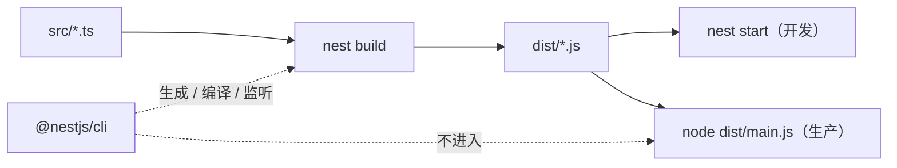

# 第 3 章 快速掌握NestCLI

一个 Nest 项目从源码到线上，中间要过三步：按模板把文件生成出来、把 TypeScript 编译成 JavaScript、用 Node 启动编译产物。`nest` 这个命令就是干这三件事的——它来自 `@nestjs/cli` 包，是个开发期工具，不参与处理业务请求（[Nest CLI 文档](https://docs.nestjs.com/cli/overview)）。编译的产物默认落在 `dist/`，线上跑的是 `node dist/main.js`，不是 `src/` 里的 `.ts`。

先把"编译"这个词说清楚。你写的 `.ts` 带类型标注，Node 读不懂，得先翻译成纯 JavaScript，翻译这个动作叫**编译**，翻出来的那堆文件叫**产物**。就像你把中文稿翻成英文交给外国同事，之后他手上拿的是英文稿，中文原稿他不看。`dist/` 里装的就是英文稿。

**镜像（image）**和**容器（container）**是另一对。镜像是打包好的整套运行环境，像一份冷冻好的套餐，微波一下就能吃；容器是解冻后真的摆在桌上的那一份。同一份镜像可以起很多个容器。

依赖也分两摞：`dependencies` 是运行时真正要用的包，`devDependencies` 只在开发和构建时用。打个比方，`dependencies` 是店里营业要用的锅碗，`devDependencies` 是装修队带来的电钻——店开起来之后，电钻就不该摆在客人桌上。`pnpm install --prod` 只装前者。

把 CLI、TypeScript、构建器留在生产镜像里，镜像会变大，攻击面也多一块；可要是在生产容器里执行 `nest start`，又等于要求一个已经被裁掉的命令存在——两种做法都会在发布时出问题。所以这一章不背命令，先把"哪些东西该进生产、哪些不该"这条线划清楚。

## 一个真实事故

凌晨一点，发布流水线停在第十四步。进生产容器手动重启，报错只有一行 `sh: nest: not found`——镜像里根本没有 `nest` 这个命令。

有人把生产启动命令从 `pnpm start:prod` 改成了 `pnpm start`，容器起来了，镜像却从 380MB 涨到 1.1GB，还多了一堆 TypeScript 和构建工具。问题不在命令，在于你把开发工具带进了生产镜像——`@nestjs/cli`（命令名 `nest`）只在开发机和构建阶段有用，生产容器只需要 `dist` 和运行时依赖。

> **图 3-1** CLI 在开发与生产中的位置。
>



`nest start` 和 `node dist/main.js` 跑的是同一份产物，这点很容易搞混。区别只在 `nest start` 会先编译一遍，再替你拉起一个子进程；生产环境没必要多这一层——CLI 装在 `devDependencies` 里，`pnpm install --prod` 之后它根本不存在，这就是那句 `sh: nest: not found` 的由来。

修法是**多阶段构建**：Dockerfile 里写多个 `FROM`，一个阶段装全量依赖、跑 `nest build`，另一个阶段只拷 `dist`、`package.json`、`pnpm-lock.yaml`，执行 `pnpm install --prod`，最后 `CMD ["node", "dist/main.js"]`。装修在一个房间做，做完只把成品搬进另一个房间，电钻和边角料都不搬。镜像能小一半，攻击面也少一半。

## ESM 的三条硬约束

Nest 12 的核心包是 ESM-only。**ESM** 是 JavaScript 语言标准里的模块系统，用 `import`/`export`，用 URL 定位模块；**CommonJS** 是 Node 用了十年的老规范，用 `require()`，扩展名可以省略。新项目默认生成 ESM，旧 CommonJS 项目靠 Node 的 `require(esm)` 继续跑（Node 22.12+ 默认开启），但新代码别再混着写。

ESM 下有三条规则，违反任何一条都会在启动时炸。它们看着像刁难，其实都来自同一个设计：ESM 不做任何猜测。

1. `package.json` 必须有 `"type": "module"`。Node 靠这个字段决定 `.js` 文件按哪种规范解析；少了它，ESM 语法会被当成 CommonJS 执行，报 `Cannot use import statement outside a module`。相当于没告诉对方"这封信是英文写的"，他就按中文读，自然读不通。
2. 相对导入必须写编译后的扩展名，比如 `./app.module.js`。解析器不会去猜 `./app.module` 到底是文件还是目录。第 1 章踩过的 `ERR_MODULE_NOT_FOUND` 就是漏了这个后缀。
3. 没有 `__dirname` / `__filename` / `require`。CommonJS 的每个模块被包在一个函数里，Node 顺手注入了这几个变量；ESM 没有这层包裹，改用 `import.meta.dirname`，需要 `require` 时用 `createRequire(import.meta.url)` 造一个。

第三条最容易在"读一个模板文件"时踩到。旧代码 `path.join(__dirname, 'templates')` 在 ESM 里直接报 `__dirname is not defined`，改成 `path.join(import.meta.dirname, 'templates')` 就好。前提是 Node 20.11+，教程用的 22.22.3 没问题。顺带提醒：`import.meta.dirname` 指向**编译后**文件所在目录，`dist` 和 `src` 的层级关系会影响拼出来的路径，读资源文件时先打印一次确认。

## 生成项目，先看四个文件

```bash
pnpm dlx @nestjs/cli@12.3.0 new meeting-booking --package-manager pnpm --language TS --skip-tests
cd meeting-booking
```

交互里选 ESM，NestJS Observe 选 No。生成完先别急着写业务，`src` 里只留四个业务文件；再打开 `package.json`、`tsconfig.json`、`nest-cli.json` 和 `main.ts` 看一遍。这四个文件是这栋楼的水电图纸，看不懂它们，后面所有怪问题都只能靠猜。

也别把 `nest` 装成全局命令来图省事。项目里的 CLI 版本由 `package.json` 锁定，全局版本很容易和它打架；统一用 `pnpm exec nest` 或 `pnpm dlx @nestjs/cli@12.3.0`，换项目时不会串版本。

`package.json` 里最重要的是 `type`、`engines` 和脚本：

```json
{
  "name": "meeting-booking",
  "type": "module",
  "packageManager": "pnpm@11.0.0",
  "engines": { "node": ">=22.22.3" },
  "scripts": {
    "build": "nest build",
    "start": "nest start",
    "start:dev": "nest start --watch",
    "start:debug": "nest start --debug --watch",
    "start:prod": "node dist/main.js"
  }
}
```

`start:prod` 没有 `nest`，这是对的。`start` 和 `start:dev` 是开发脚本，别拿它们做生产入口。`scripts` 就是给命令起的小名，`pnpm build` 等于把 `nest build` 打一遍——省打字，也让团队用同一套命令。

`tsconfig.json` 决定编译结果。关键项是 `module` / `moduleResolution` 用 `nodenext`、打开 `emitDecoratorMetadata` 和 `experimentalDecorators`、`outDir` 指向 `dist`。

```json
{
  "compilerOptions": {
    "module": "nodenext",
    "moduleResolution": "nodenext",
    "target": "ES2023",
    "outDir": "./dist",
    "strict": true,
    "strictPropertyInitialization": false,
    "emitDecoratorMetadata": true,
    "experimentalDecorators": true,
    "sourceMap": true
  }
}
```

两个装饰器开关缺一不可：`experimentalDecorators` 打开 TypeScript 的旧版装饰器（Nest 的 `@Controller()`、`@Injectable()` 都建立在它上面），`emitDecoratorMetadata` 让编译器额外产出构造器参数类型。少了后者，Nest 拿到的类型全是 `Object`，依赖注入会以"不知道为什么"的方式失败——报错通常是 `Nest can't resolve dependencies of the XxxController (?)`，而代码看上去毫无问题。注意 TS 5 里还有一套标准化的 stage 3 装饰器，那套**不带**参数类型元数据，不能拿来替代。

`strictPropertyInitialization` 关掉，是因为控制器里的依赖由容器注入，TypeScript 看不到赋值。别顺手把整个 `strict` 关了，那会把空值检查一起丢掉。

`nest-cli.json` 控制生成器和编译器：

```json
{
  "collection": "@nestjs/schematics",
  "sourceRoot": "src",
  "compilerOptions": {
    "deleteOutDir": true,
    "builder": "tsc"
  },
  "generateOptions": {
    "spec": false
  }
}
```

`deleteOutDir` 避免旧产物残留；`generateOptions.spec` 手动设成 `false`，生成器就不再带 spec 文件，省得每条命令都补 `--no-spec`。SWC 构建更快，但**不做类型检查**，切过去之后 CI 里要单独跑 `tsc --noEmit`，否则类型错误会一路带到运行时——快是快，等于把体检省了。

入口文件沿用第 1 章那份。这里只强调一条：`nest build` 默认用 tsc，类型错误会在构建时报出来；`nest start --watch` 为了快，类型检查并不完整，别把"开发服务器能跑"当成类型没问题。

## 生成器只给骨架，不给架构

`nest generate` 背后是 **schematics**：一组带模板、还能改写已有文件的小生成器，能新建文件，也能把新模块自动注册进 `AppModule`。它省的是样板，不是设计。好比装修队能帮你把墙砌好，但房间怎么分、哪面墙该砸，它不管。

先 dry-run，确认它要改哪些文件：

```bash
pnpm exec nest generate module quotes --dry-run
# CREATE src/quotes/quotes.module.ts
# UPDATE src/app.module.ts

pnpm exec nest generate module quotes
pnpm exec nest generate controller quotes --no-spec
pnpm exec nest generate service quotes --no-spec
```

`--dry-run` 只打印，不落盘。团队里养成这个习惯，能避免"生成器把 `AppModule` 改乱了我还不知道"。生成之后按业务改方法名和 DTO，别把 `CreateQuotesDto` 这种占位名一起提交。

需要一整套 CRUD 时用 `resource`：

```bash
pnpm exec nest generate resource bookings --type rest --no-spec
```

它一次生成 module、controller、service、DTO 和 CRUD 方法。每个方法体都抛 `NotImplementedException`，路由和 DTO 都是占位符——适合起骨架，不适合直接上线：分页、权限、状态机这些都得自己补。

`nest add` 用来装带 schematics 的集成包，装完会顺手改模块；`nest upgrade` 把 `@nestjs/*` 拉到同一大版本。前者要看清它改了哪些文件，后者升级前先跑一遍构建，别把大版本跳跃和业务改动混在一次提交里。

## 编译、启动、验证

```bash
pnpm exec nest info
# Nest CLI     : 12.3.0
# @nestjs/core : 12.3.0
# Node         : v22.22.3

pnpm build
node dist/main.js
curl -s http://localhost:3000
# Hello World!
```

`nest info` 同时打印 CLI 和 `@nestjs/*` 的版本。两者大版本不一致时，生成器可能生成当前框架不认识的代码，先对齐再排查业务。

`pnpm start:dev` 的日志里应该出现 `Nest application successfully started`。如果只看到编译成功、没有监听端口，通常是 `main.ts` 里的 `await bootstrap()` 没执行，或者端口被占用（第 1 章讲过端口被占会报 `EADDRINUSE`）。

`--watch` 监听的是 `src` 下的源码，改完自动重编译、重启进程。它不监听 `.env`，也不会因为 `tsconfig` 或 `nest-cli.json` 改动就重启。改环境变量、换构建器之后手动停一次，别对着旧进程调半天——改了半天没反应，八成是它在跑旧代码。

## 入口路径对不上，先查 tsconfig

生产报 `Cannot find module '/app/dist/main.js'`，很多人第一反应是 Dockerfile 拷错了。先 `ls dist` 看一眼，如果里面是 `dist/src/main.js`，那就是 TypeScript 的输出根目录被抬高了。

`outDir` 只决定"输出到哪个文件夹"，真正的根目录由所有被 `include` 的文件的公共路径决定。主 `tsconfig.json` 如果没限定 `include`，根目录下的 `scripts/seed.ts` 也会进编译，公共根就从 `src` 上移到了项目根，产物自然多一层 `src`。想象你把三个城市的货装进一个箱子，箱子上会印"覆盖三个城市"；多塞一个城市的货，标签就变了，里面每件货的地址也跟着变。开发时你盯着编译成功的日志，不一定注意到入口路径；部署时才第一次暴露。

标准做法是让 `tsconfig.build.json` 继承主配置，只保留 `src`：

```json
{
  "extends": "./tsconfig.json",
  "include": ["src/**/*.ts"],
  "exclude": ["node_modules", "dist", "scripts"]
}
```

`nest build` 默认读这个文件。改完删掉 `dist` 重新构建，确认 `dist/main.js` 就在第一层。另一个同样症状的原因是镜像漏了 `COPY --from=build /app/dist ./dist`；先确认产物存在，再怀疑路径配置，能少走一半弯路。

## 坑与边界

| 现象 | 原因 | 处理 |
| --- | --- | --- |
| `ERR_MODULE_NOT_FOUND` | 相对导入漏了 `.js` | 所有相对导入写编译后文件名 |
| 生产报 `Cannot find module '/app/dist/main'` | 没构建，或只拷了 `dist` 没拷 `package.json` | 多阶段构建里先 `pnpm build`，runner 保留运行时依赖 |
| 入口变成 `dist/src/main.js` | `tsconfig` 的 `include` 把根级脚本也收进来，公共根上移 | 用 `tsconfig.build.json` 只 include `src`，或显式设 `rootDir` |
| SWC 构建通过，运行时类型错 | SWC 不检查类型 | CI 加 `tsc --noEmit` |
| `--webpack` 报未知选项 | v12 已改用 `--builder` | 用 `--builder tsc` 或 `--builder swc` |
| CLI 与 core 版本不一致 | 全局 CLI 太旧，或 `pnpm dlx` 没锁版本 | `pnpm dlx @nestjs/cli@12.3.0`，并在 `package.json` 固定版本 |

还有一条边界：生成器不是架构工具。它不知道你的业务怎么划分，也不该知道。模块边界、Provider 的可见性、哪些逻辑放 Service，仍然要你判断。CLI 只保证文件放对位置，不保证依赖方向对。

下一章开始处理真实请求。五种常见的 HTTP 数据传输方式，会从 `@Param` 一路讲到文件上传，中间夹着一个最容易出错的细节：HTTP 传过来的数字，其实都是字符串。


<!-- chapter-nav:start -->
---

← 上一篇：[002 给你5个学习Nest的理由，你会心动么](../part-00/002-给你5个学习Nest的理由，你会心动么.md) · [本 Part 目录](_part.md) · 下一篇：[004 5种HTTP数据传输方式](004-5种HTTP数据传输方式.md) →
<!-- chapter-nav:end -->
