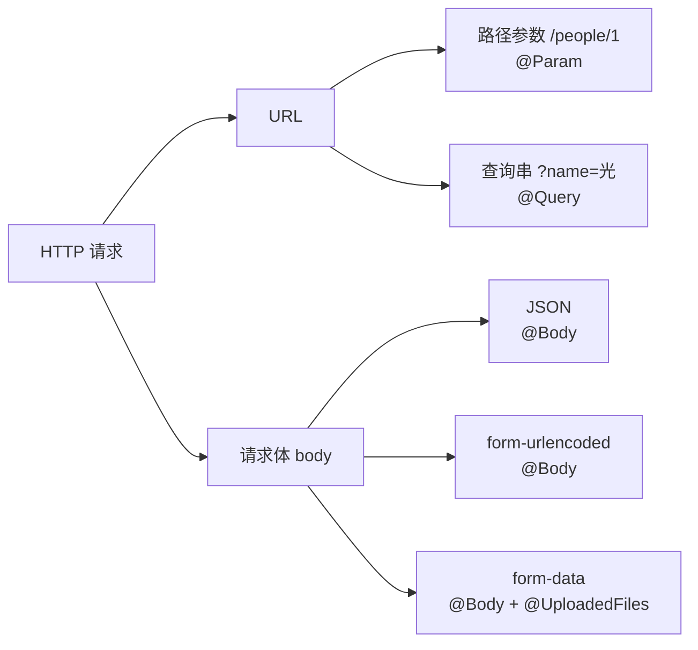

# 第 4 章 5种HTTP数据传输方式

前端往后端送数据，靠的就是 HTTP 请求。一个请求能带数据的地方，其实只有两个：**URL** 和**请求体（body）**。

可以拿寄快递打比方。URL 是快递单上那几行字——收件人、地址、备注，路上谁都能看见，也能抄下来；body 是箱子里装的东西，得拆开才知道是啥。往单子上写字和往箱子里塞东西，规矩完全不一样。

把这两个位置再往下分，日常开发里常见的就是下面 5 种：

- URL 里的**路径参数**（url param），比如 `/people/1` 里的 `1`
- URL 里的**查询串**（query），比如 `?name=光&age=20`
- 请求体里的**表单编码**（form-urlencoded）
- 请求体里的 **JSON**
- 请求体里的**多部分表单**（form-data，传文件用）

这一章把这 5 种都实现一遍：先看它长什么样、数据放在哪，再用 Nest 写接收代码，最后真发一个请求出去，看看服务端收到了什么。做完之后，前端怎么传、后端怎么取，你应该能自己判断，而不是照着抄。

> **图 4-1** 5 种数据位置和 Nest 的取法。
>



## 先把项目跑起来

沿用第 3 章创建的 `meeting-booking` 项目，先生成一个 `people` 模块，专门拿来演示这 5 种方式：

```bash
cd meeting-booking
pnpm exec nest generate resource people --type rest --no-spec
```

生成完，`src` 里会多出一个 `people/` 目录，里面有 `people.module.ts`、`people.controller.ts`、`people.service.ts`、`dto/` 和 `entities/`。里面那些方法现在都是占位符，一调就抛 `NotImplementedException`——别慌，CLI 生成的本来就是一副骨架，方法体得你自己填。

先把服务跑起来：

```bash
pnpm start:dev
```

编译完，日志里会出现 `Nest application successfully started`，服务监听在 `http://localhost:3000`。

现在打开 `src/people/people.controller.ts`，把内容换成下面这段。里面是两个接口：按 id 取一个人、按条件查人。

```ts
// src/people/people.controller.ts
import { Controller, Get, Param, Query } from '@nestjs/common';
import { PeopleService } from './people.service.js';

@Controller('people')
export class PeopleController {
  constructor(private readonly peopleService: PeopleService) {}

  // 注意：这条必须写在 :id 前面，后面会解释原因
  @Get('find')
  find(@Query('name') name: string, @Query('age') age: string) {
    return { received: { name, age } };
  }

  @Get(':id')
  findOne(@Param('id') id: string) {
    return this.peopleService.findOne(Number(id));
  }
}
```

再改 `src/people/people.service.ts`，用一个数组假装数据库：

```ts
// src/people/people.service.ts
import { Injectable, NotFoundException } from '@nestjs/common';

export interface Person {
  id: number;
  name: string;
  age: number;
}

@Injectable()
export class PeopleService {
  private readonly people: Person[] = [
    { id: 1, name: 'Ada Lovelace', age: 36 },
    { id: 2, name: 'Alan Turing', age: 41 },
  ];

  findOne(id: number): Person {
    const person = this.people.find((item) => item.id === id);

    if (person === undefined) {
      throw new NotFoundException(`Person ${id} not found`);
    }

    return person;
  }
}
```

保存后 `start:dev` 会自动重新编译。接下来 5 种方式，一种一种来。

## 方式一：url param，把参数放进路径

`/people/1` 里的 `1` 就是 url param。它不是一个单独的键值对，而是路径的一段——像门牌号，等于在说"我找 1 号这位"。资源 id、slug 这种"这个请求针对谁"的信息，最适合放这儿。

那用 query 传行不行？`/people?id=1` 也能跑，但"找谁"和"怎么筛"混在一句话里，缓存、访问日志、按资源做权限都不好归位。路径上的 id 才是这个资源的身份。

Nest 里用 `:参数名` 在路由上声明，再用 `@Param('参数名')` 取出来：

```ts
@Get(':id')
findOne(@Param('id') id: string) {
  return this.peopleService.findOne(Number(id));
}
```

`@Controller('people')` 和 `@Get(':id')` 拼在一起，实际路由就是 `GET /people/:id`。

打开终端试一下：

```bash
curl http://localhost:3000/people/1
```

```text
{"id":1,"name":"Ada Lovelace","age":36}
```

服务端拿到了 `id=1`，查到了对应的人。这里有个小细节：`@Param('id')` 声明成 `string`，因为 URL 里取出来的东西**永远是字符串**，`Number(id)` 是你自己转的。如果顺手写成 `id: number`，TypeScript 会骗你说它是数字，运行时 `id + 1` 会拼出 `"11"`，所以这一步转换省不得（第 19 章会讲更规范的 `ParseIntPipe`，那才是让框架替你做这件事的写法）。

## 方式二：query，把参数放进查询串

`?name=光&age=20` 这种 `?` 开头、`&` 分隔的键值对就是 query。如果说路径参数是门牌号，query 就是门牌号后面补的那句"要 2 楼以上的"——附加条件，能加、能减、也能不写。搜索、分页、筛选这类条件都放这儿。

Nest 里用 `@Query('键名')` 取单个值：

```ts
@Get('find')
find(@Query('name') name: string, @Query('age') age: string) {
  return { received: { name, age } };
}
```

跑一下：

```bash
curl 'http://localhost:3000/people/find?name=%E5%85%89&age=20'
```

```text
{"received":{"name":"光","age":"20"}}
```

`%E5%85%89` 是"光"经过 URL 编码后的样子。中文、空格、`&`、`#` 这类字符直接写进 URL 会被截断或解析错，所以得先编码。前端用 `URLSearchParams` 或 axios 的 `params` 时会自动编码，你手写 curl 时才要自己盯着。

这里还有两个容易踩的点：

- **路由顺序**。`/people/find` 和 `/people/:id` 都能匹配 `/people/find`，Nest 按声明顺序匹配，谁写在前面谁生效。要是把 `@Get('find')` 写在 `@Get(':id')` 后面，请求就被 `:id` 吃掉了，`id` 变成字符串 `"find"`。
- **query 里的值也都是字符串**。上面 `age` 拿到的是 `"20"` 而不是 `20`，要参与计算得自己转。

## 请求体里的三种方式

前两种数据都在 URL 里，下面三种都在**请求体**里。请求体就是 POST/PUT 请求里携带的那段数据。可同样是"一段数据"，按什么格式编码也分好几种——服务端怎么知道该按哪种拆？

靠请求头里的 `Content-Type`。它作用就一句话：**告诉服务端 body 是按哪种格式编码的**。像快递箱外面贴的标签，"内有易碎品""冷藏"，分拣的人看标签决定怎么搬。Nest 读到这个头，会挑对应的解析器，拆完再通过 `@Body()` 把结果交给你。标签贴错了，箱子照样到，但拆法不对，你拿到手的可能是空的。

在写代码之前，先定义请求体的形状，也就是 **DTO**。DTO 是 Data Transfer Object（数据传输对象）的缩写，说人话就是"**用来装这次请求数据的类**"：客户端能传哪些字段、每个字段什么类型，写在里面。它像一张收货单模板，栏位是固定的，对方照着填。

为什么不用 `any` 直接收？请求体是对外契约，把字段和类型写清楚，后面的校验、编辑器提示、接口文档才有依据；写成 `any` 等于不设栏位，来什么收什么，出了事只能靠翻日志猜。

```ts
// src/people/dto/create-person.dto.ts
export class CreatePersonDto {
  name!: string;
  age!: number;
}
```

注意这里是 `class` 而不是 `interface`。原因先记结论：Nest 运行时需要这个类的信息来做校验和转换，`interface` 编译完就消失了，运行时根本不存在（第 20 章会详细解释）。`!` 是 TypeScript 的"我保证这里会被赋值"，先照写。

### 方式三：form-urlencoded，表单编码

浏览器里最传统的表单提交，`Content-Type` 是 `application/x-www-form-urlencoded`。它的格式和 query 一模一样：`name=光&age=20`，只是从地址栏挪进了 body 里，所以同样要做 URL 编码。

Nest 里用 `@Body()` 接收，指定 DTO 类型就行：

```ts
import { Body, Controller, Post } from '@nestjs/common';
import { CreatePersonDto } from './dto/create-person.dto.js';

@Controller('people')
export class PeopleController {
  // ...前面的代码

  @Post()
  create(@Body() dto: CreatePersonDto) {
    return { received: dto };
  }
}
```

顺手把 `Post` 补进 `@nestjs/common` 的导入里。保存后试一下：

```bash
curl -X POST http://localhost:3000/people \
  -H 'content-type: application/x-www-form-urlencoded' \
  --data 'name=%E5%85%89&age=20'
```

```text
{"received":{"name":"光","age":"20"}}
```

服务端收到了。但注意 `age` 是字符串 `"20"`——表单编码里没有"数字"这个概念，所有值都是字符串。想做类型转换，要么在 Service 里转，要么让 DTO 配合转换规则（第 20 章）。

前端等价的发法：

```js
await fetch('http://localhost:3000/people', {
  method: 'POST',
  headers: { 'content-type': 'application/x-www-form-urlencoded' },
  body: new URLSearchParams({ name: '光', age: '20' }),
});
```

`URLSearchParams` 会自动做 URL 编码，不用自己拼 `%E5%85%89`。

### 方式四：JSON，最常用的一种

把 `Content-Type` 换成 `application/json`，body 里直接放 JSON。JSON 是前后端都认的一种文本格式，长得跟 JavaScript 的对象字面量几乎一样，但现在它已经跟 JS 没关系了，哪种语言都能读。前后端分离的项目，九成接口都用它。

后端代码**不用改**，还是那个 `@Body() dto`：

```bash
curl -X POST http://localhost:3000/people \
  -H 'content-type: application/json' \
  -d '{"name":"光","age":20}'
```

```text
{"received":{"name":"光","age":20}}
```

这次 `age` 是数字 `20`，因为 JSON 本身区分字符串和数字。这背后是 Nest 根据 `Content-Type` 选了不同的 body parser：JSON 走 JSON 解析器，表单走表单解析器，`@Body()` 只是把解析结果端给你。

有两点要注意：

- **`Content-Type` 写错，`@Body()` 就是空对象**。比如 JSON 数据发了 `text/plain`，解析器不认，body 解析不出来，你收到 `{}`，然后对着字段名找半天。这种情况先看请求头，别急着改 DTO。
- **JSON 体有大小上限**。Express 默认 100KB 左右，超了直接返回 413。所以图片、批量导入这种大块数据不要硬塞 JSON。

前端发 JSON 最简单：

```js
await fetch('http://localhost:3000/people', {
  method: 'POST',
  headers: { 'content-type': 'application/json' },
  body: JSON.stringify({ name: '光', age: 20 }),
});
```

### 方式五：form-data，传文件用

前面两种方式传文件都不合适：form-urlencoded 要把文件内容做一次 URL 编码，体积暴涨；JSON 得把文件转成 Base64，同样又大又慢。传文件要用 **multipart/form-data**。

它和前面两种的区别在分隔方式：body 里不再用 `&`，而是用一串 `------` 加随机字符（boundary）把每段数据隔开。boundary 就像每一段前面贴的封箱胶带，服务端靠它知道从哪儿切开。因为不做 URL 编码，文件可以按原始字节传，体积不会涨。

Nest 里处理 form-data 要挂一个拦截器，把文件字段解析出来：

```ts
import {
  Body,
  Controller,
  Post,
  UploadedFiles,
  UseInterceptors,
} from '@nestjs/common';
import { AnyFilesInterceptor } from '@nestjs/platform-express';
import { CreatePersonDto } from './dto/create-person.dto.js';

@Controller('people')
export class PeopleController {
  // ...前面的代码

  @Post('file')
  @UseInterceptors(AnyFilesInterceptor())
  upload(
    @Body() dto: CreatePersonDto,
    @UploadedFiles() files: Array<Express.Multer.File>,
  ) {
    return {
      received: dto,
      files: files.map((file) => ({
        name: file.originalname,
        type: file.mimetype,
        size: file.size,
      })),
    };
  }
}
```

`AnyFilesInterceptor()` 会把请求里所有文件字段都解析出来，`@UploadedFiles()` 取到的就是文件信息数组，普通字段还是从 `@Body()` 里拿。如果只想收某一个固定字段的文件，换成 `FileInterceptor('file')`，再用 `@UploadedFile()` 取单个文件。拦截器现在不用深究，知道它是在"进控制器之前顺手把文件拆出来"就够了，第 18 章讲。

先装一下 Multer 的类型声明（Nest 的 `platform-express` 已经带了 Multer，这里只是补 TypeScript 类型）：

```bash
pnpm add -D @types/multer
```

装完还要补一步。这个项目脚手架的 `tsconfig.json` 里 `types` 只写了 `["vitest/globals", "node"]`，multer 的类型不在里面，直接写 `Express.Multer.File` 会报：

```text
error TS2694: Namespace 'global.Express' has no exported member 'Multer'.
```

把 `"multer"` 加进数组就行：

```jsonc
// tsconfig.json
"types": ["vitest/globals", "node", "multer"]
```

然后试一下。先随便造一个文件，再用 `-F` 发送：

```bash
printf 'hello' > hello.txt

curl -X POST http://localhost:3000/people/file \
  -F 'name=光' \
  -F 'age=20' \
  -F 'file=@hello.txt'
```

```text
{"received":{"name":"光","age":"20"},"files":[{"name":"hello.txt","type":"text/plain","size":5}]}
```

普通字段和文件都收到了。文件默认会被 Multer 暂存在内存里，真实项目里通常配 `dest` 或 `storage` 写到磁盘/对象存储——这些在第 23–25 章讲上传时会展开。

前端等价的发法是用 `FormData`：

```js
const data = new FormData();
data.set('name', '光');
data.set('age', '20');
data.set('file', new Blob(['hello'], { type: 'text/plain' }), 'hello.txt');

await fetch('http://localhost:3000/people/file', {
  method: 'POST',
  body: data,
});
```

注意这里**不要手动设置 `content-type`**。浏览器会自动加上 `multipart/form-data; boundary=...`，你手写 boundary 反而会出错——这跟前面几种方式正好相反，容易记混。

## 5 种方式怎么选

| 方式 | 数据在哪 | Content-Type | Nest 怎么取 | 典型场景 |
| --- | --- | --- | --- | --- |
| url param | URL 路径 | 无 | `@Param()` | 按 id/slug 取某个资源 |
| query | URL 查询串 | 无 | `@Query()` | 搜索、分页、筛选 |
| form-urlencoded | body | `application/x-www-form-urlencoded` | `@Body()` | 传统表单、简单键值 |
| json | body | `application/json` | `@Body()` | API 最常用 |
| form-data | body | `multipart/form-data` | `@Body()` + `@UploadedFiles()` | 上传文件、文件加字段 |

## 几个常见的坑

- **URL 和表单里的值都是字符串**。`age + 1` 变成 `"301"` 不是玄学，转换这一步必须自己补。
- **`@Body()` 是空对象，先看 `Content-Type`**。解析器没命中时，body 根本不会被解析。
- **`/people/find` 写在 `:id` 后面会被吃掉**。Nest 按声明顺序匹配路由，静态路径要放在动态参数前面。
- **文件不要转成 Base64 塞进 JSON**。体积变大、内存翻倍，还容易撞上 JSON 大小上限；文件走 form-data。
- **DTO 用 class**。`interface` 运行时不存在，后面接 `ValidationPipe` 做校验时会被静默跳过。
- **Webhook 验签要原始 body**。签名算的是原始字节，用 `@Body()` 解析后的对象去验签，字段顺序一变就对不上（第 227 章讲 Webhook 时会细说）。

## 顺手分清几个词

这一章出现了 DTO，后面的章节还会出现 Entity、VO、DAO、Repository。先用一句话记住它们分别是什么，混一次就够了：

| 词 | 一句话理解 | 在本教程里的位置 |
| --- | --- | --- |
| DTO | 用来装一次请求数据的类，本章的 `CreatePersonDto` 就是 | 第 20 章讲校验 |
| Entity / PO | 数据库表的映射对象，一个实例对应表里一行 | 第 44、45 章的 Prisma model 和行类型 |
| VO | 返回给前端看的裁剪结果，比如不把 `passwordHash` 返回 | 第 22 章细讲 |
| DAO / Repository | 把数据库查询包一层的类，Service 只调方法、不写 SQL | 第 22、50 章 |
| Mapper | 把 Entity 转成 VO 的转换函数 | 第 22 章 |

现在只要记住一句话：**请求进来是 DTO，存进库是 Entity/PO，返回给前端的是 VO，中间查库的封装叫 Repository/DAO**。后面每遇到一个，都会再解释一次它为什么存在。

## 这一章带走了什么

5 种方式实现完，回头看其实只判断两件事：**数据在 URL 还是 body**，以及 **body 的 `Content-Type` 是什么**。位置决定用哪个装饰器，编码决定服务端能不能解析。这两点记牢，以后接口不通、参数收不到，先查这里，比到处乱改代码快得多。

到这里，数据已经能从客户端顺利送到服务端了。但你可能会好奇：`PeopleController` 里的 `peopleService` 是谁创建的？构造函数里为什么只声明一下就能用？这就是下一章要讲的依赖注入（IoC）。


<!-- chapter-nav:start -->
---

← 上一篇：[003 快速掌握NestCLI](003-快速掌握NestCLI.md) · [本 Part 目录](_part.md) · 下一篇：[005 IoC解决了什么痛点问题](005-IoC解决了什么痛点问题.md) →
<!-- chapter-nav:end -->
