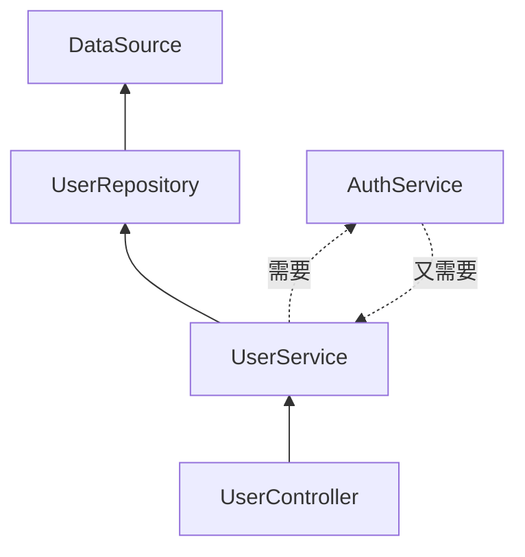

# 第 5 章 IoC解决了什么痛点问题

周二下午，运营把用户昵称从 Ada 改成 Ada L.，保存成功，刷新列表又变回 Ada。数据库里查出来是新值，接口返回的却是旧的。你依次排掉 Redis、事务隔离级别、主从延迟，最后在代码里看到两行 `new`：后台管理模块自己创建了一个 `UserService`，前台接口模块也创建了一个。两份对象，两份内存缓存，改的是这一份，读的是另一份。

这种 bug 单看每一行都没问题，review 也抓不住，因为出错的是“谁有权创建对象”这件事没有统一入口。小项目里“谁用谁 new”能跑，规模一上来，创建顺序、实例份数、替换实现、初始化与销毁会同时变成手工活。Nest 的答案是把这部分控制权从业务类手里拿走，交给运行时容器。

先把三个词摆清，后面才不会混。**IoC（Inversion of Control，控制反转）**是一条设计原则：对象不主动创建依赖，创建权交给外部。**DI（Dependency Injection，依赖注入）**是落实它的手段：依赖不从类内部 new，而是从构造器、属性或方法参数送进来。**IoC 容器**是真正干活的运行时组件：读模块上的元数据（`@Module` 里写的依赖信息，第 1 章讲过）、建依赖图、按顺序实例化、缓存实例。三者是原则、手段、实现的关系，不是同义词。Nest 里的具体写法见 [Dependency injection](https://docs.nestjs.com/fundamentals/dependency-injection)。

容器里还有两个词。**Provider（提供者）**是所有交给容器管理的对象的统称，Service、Repository、Guard、Pipe 只要被 `@Injectable()` 标记并注册，都算；**token（令牌）**是容器查找实例用的键，默认就是类本身，所以构造器里的 `private readonly users: UserService` 同时完成了“声明依赖”和“指定 token”。容器默认按**单例**管理：一个 token 在应用生命周期内只实例化一次，所有消费者拿到同一个对象。这个默认值既是上面那个 bug 的解药，也是很多“状态串了”事故的源头。

## 手工装配的五笔账

一个用户查询接口，依赖链通常是四层：`UserController → UserService → UserRepository → DataSource`。不用容器时，入口处得写成一串：

```ts
const config = new ConfigService();
const dataSource = new DataSource(config.get('DB_URL'));
const repository = new UserRepository(dataSource);
const service = new UserService(repository);
const controller = new UserController(service);
```

五个对象、四层依赖，第一次写还能接受。业务长起来之后，五个问题会同时出现。

**顺序**。谁先创建、谁后创建全靠人工保证。某天 `UserRepository` 多了一个 `CacheService` 参数，所有装配点都要改；漏掉一处，运行时才报 `undefined`。

**单例**。两个模块各自 `new` 一次，内存缓存、连接池、计数器全变成两份。开头那个昵称 bug 就是这么来的——你以为是缓存不一致，其实是对象不一致。

**替换**。想把内存仓库换成 PostgreSQL 实现，只能改 `UserService` 的源码，或者把构造器改成可选参数。业务类被迫知道所有实现。

**生命周期**。想在创建时读配置、连数据库、注册关闭钩子，只能把逻辑塞进构造器，越塞越乱；容器级别统一初始化、统一销毁的能力完全没有。

**循环依赖**。`UserService` 需要 `AuthService` 校验密码，`AuthService` 又需要 `UserService` 查用户。手工 `new` 会无限递归；即使绕过去，也没人画得清完整的依赖图。

> **图 5-1** 四层依赖链，以及一处典型的循环依赖。
>



这五笔账正好对应容器的五项能力：依赖图解析解决顺序，实例缓存解决单例，token 间接解决替换，生命周期钩子解决初始化与销毁，循环依赖检测把栈溢出变成启动期报错。所以 IoC 不是“写法更优雅”，它把一类运行时错误提前到了启动期。

## 反转的是哪一段控制权

没有容器时，`UserService` 决定自己 `new` 哪个仓库，也决定什么时候创建；有容器时，这个决定被移到模块声明里，`UserService` 只声明“我需要一个能按 id 查用户的东西”。这就是**依赖倒置原则（DIP）**在代码里的落点：高层模块依赖抽象，不依赖具体实现。

要分清的是，DI 不等于“非有容器不可”。`new UserService(new UserRepository())` 这种构造器传参本身就是依赖注入，容器只是把“谁来传、传哪一份”自动化了。几十行的脚本手工装配完全成立；Nest 要解决的是对象图大到手工装配不划算、且需要统一生命周期的场景。

在 Nest 里，一个注入单元由三样东西组成：

| 角色 | 写法 | 作用 |
| --- | --- | --- |
| Token | 类本身、字符串、`Symbol` | 容器里的唯一标识 |
| Provider | `@Injectable()` 类，或 `{ provide, useClass/useValue/useFactory/useExisting }` | 告诉容器这个 token 怎么创建 |
| Consumer | 构造器参数 `private readonly users: UserService` | 声明“我需要这个 token” |

Token 的选择有边界。类做 token 最直观，重构时类型检查会跟着走；字符串 token（`'USER_REPOSITORY'`）适合跨包、双方没有共同类引用的场景，但拼错不会报错，只能在启动时暴露；`Symbol` 唯一且不可拼错，代价是必须导出这个 Symbol 供双方 import。默认优先用类。

`useClass` / `useValue` / `useFactory` / `useExisting` 是四种**配方**：分别对应“换另一个类实现”“直接给一个现成值”“调工厂函数造”“复用已有 token 的实例”。第 7 章逐个展开，现在只需记住：Provider 回答的是“这个 token 怎么造”，消费者不关心答案。

`@Injectable()` 也不是装饰一下好看（第 1 章讲过，带 `@` 的是装饰器，负责往类上写元数据）。它把类标记成可被容器管理的 Provider；配合 `tsconfig` 里的 `emitDecoratorMetadata`，TypeScript 会把构造器参数类型写进 `design:paramtypes` 元数据，Nest 启动时才知道每个位置要注入什么。少了这层元数据，容器拿到的类型是 `Object`，解析直接失败。这也是为什么第 3 章反复强调那两个装饰器开关不能关。

容器启动时做的事可以简化成一条链：从 `AppModule` 开始深度优先扫 `imports`，收集每个模块的 `controllers` 和 `providers`，读构造器参数类型，递归解析依赖并自底向上实例化，最后把实例注入控制器、注册路由、开始监听。为什么是深度优先：只有依赖全部就绪，才能构造当前对象，所以必须先递归到最底层再往回建。为什么每个 token 只建一次：容器建完就放进内部缓存，下次遇到同一个 token 直接取，这就是单例的来源。

这也解释了为什么依赖错误总在启动阶段爆炸。容器必须在 `listen` 之前把整张图建好；缺一个 Provider、少一个 `export`，进程就起不来，不会等到第一个请求。

单例的边界要说清：它是**进程内**单例。部署三个副本就是三份实例，各自的内存缓存互不可见；把“全局计数器”“本地缓存”放在单例里，多副本下立刻失真。需要跨进程共享的状态得放 Redis 或数据库，而不是指望容器。单例也只是默认作用域，请求作用域和瞬态作用域会让每个请求新建实例，依赖链上所有对象都会被带着降级，代价不小。

## 模块不是文件夹，是注入器的作用域

Provider 默认只在注册它的模块内可见。别的模块想用，必须两步都做到：提供方在 `exports` 里导出，使用方在 `imports` 里导入。少一步，就是那句熟悉的 `Nest can't resolve dependencies`。

这条规则经常被嫌麻烦，但它换来了可读的依赖方向：看一个模块的 `imports`，就知道它依赖谁；看 `exports`，就知道它对外承诺了什么。如果所有 Provider 全局可见，任何模块都能悄悄依赖任何实现，删一个类时根本不知道谁在用。模块作用域强迫你把公开面写出来。第 8 章的 `@Global()` 是例外，不是默认。

拆模块时按业务能力拆，不要按技术层拆。`UsersModule` 里同时放控制器、服务、仓库，改一个用户需求只动一个目录；如果拆成 `ControllersModule`、`ServicesModule`、`RepositoriesModule`，每次改业务都要跨三个模块，边界反而更模糊。

## 把依赖图交给容器

生成器会创建目录并把 `UsersModule` 加进 `AppModule`：

```bash
pnpm exec nest generate module users
pnpm exec nest generate controller users --no-spec
pnpm exec nest generate service users --no-spec
```

仓库是最底层，只有它知道数据从哪来：

```ts
// src/users/user.repository.ts
import { Injectable } from '@nestjs/common';

export type UserRole = 'ADMIN' | 'USER';

export interface User {
  id: number;
  name: string;
  email: string;
  role: UserRole;
}

@Injectable()
export class UserRepository {
  private readonly users: User[] = [
    { id: 1, name: 'Ada Lovelace', email: 'ada@example.com', role: 'ADMIN' },
    { id: 2, name: 'Alan Turing', email: 'alan@example.com', role: 'USER' },
  ];

  findById(id: number): User | undefined {
    return this.users.find((user) => user.id === id);
  }

  findByEmail(email: string): User | undefined {
    return this.users.find((user) => user.email === email);
  }
}
```

这里用内存数组，是为了把注意力放在依赖怎么进来。真实项目里它注入 Prisma 8 客户端，角色不变：最底层的数据访问被上层依赖，不依赖上层。

顺带分清两个容易混的词。`UserRepository` 是 **Repository**：暴露 `findById`、`findByEmail` 这类业务语义的方法，内部用数组还是 Prisma 由它决定；**DAO（Data Access Object）**更贴表，方法名往往长成 `selectById`、`insertRow`，调用方得知道表结构。Repository 让上层按领域语言说话，换存储时只改一个类。这里的 `User` 是领域模型（**Entity** 的雏形）：有唯一标识 `id`，字段按业务需要定义，不跟着表结构走。接 Prisma 后，数据库那边的 PO（与表一一对应的持久化对象）是另一套生成类型，两者之间靠 Mapper 转；现在用内存数组，两者恰好长得一样，所以先不引入这层。

服务只声明“我需要什么”，不负责造：

```ts
// src/users/user.service.ts
import { Injectable, NotFoundException } from '@nestjs/common';
import { UserRepository, type User } from './user.repository.js';

@Injectable()
export class UserService {
  constructor(private readonly users: UserRepository) {}

  findById(id: number): User {
    const user = this.users.findById(id);

    if (!user) {
      throw new NotFoundException(`User ${id} not found`);
    }

    return user;
  }

  findByEmail(email: string): User {
    const user = this.users.findByEmail(email);

    if (!user) {
      throw new NotFoundException(`User ${email} not found`);
    }

    return user;
  }
}
```

注意两件事。`UserService` 里没有 `new UserRepository()`，也没有 import 数据库驱动；创建权交出去了，使用方式没变。另外，`UserRepository` 要用普通 `import`，不能用 `import type`：类型导入编译后会被擦除，装饰器元数据拿不到运行时引用，容器会把它当成 `Object`。只当类型用的 `User` 才加 `type`。

`private readonly` 这两个修饰符也不是随手写的。`private` 让依赖只在类内部可用，外部改不了；`readonly` 保证构造完成后不会被重新赋值——Nest 的注入正好发生在构造阶段，注入完就固定，和这个约束天然吻合。如果哪天你看到 `this.users = ...` 出现在业务方法里，那基本是把依赖当可变状态用了，单例下会直接影响其他请求。

还有一处取舍值得说明：`NotFoundException` 来自 `@nestjs/common`，严格说这让 Service 知道了 HTTP 语义。Nest 社区普遍接受这种便利写法，因为它省掉一层异常映射；更纯粹的做法是抛领域异常，再在异常过滤器里统一翻译成状态码。两种都能用，关键是团队内保持一致，别一半抛 HTTP 异常、一半抛自定义错误。

控制器只做 HTTP 适配：

```ts
// src/users/user.controller.ts
import { Controller, Get, Param, ParseIntPipe } from '@nestjs/common';
import type { User } from './user.repository.js';
import { UserService } from './user.service.js';

@Controller('users')
export class UserController {
  constructor(private readonly users: UserService) {}

  @Get(':id')
  findOne(@Param('id', ParseIntPipe) id: number): User {
    return this.users.findById(id);
  }
}
```

模块把依赖图声明出来，根模块负责把它装进应用：

```ts
// src/users/users.module.ts
import { Module } from '@nestjs/common';
import { UserController } from './user.controller.js';
import { UserRepository } from './user.repository.js';
import { UserService } from './user.service.js';

@Module({
  controllers: [UserController],
  providers: [UserRepository, UserService],
  exports: [UserService],
})
export class UsersModule {}
```

```ts
// src/app.module.ts
import { Module } from '@nestjs/common';
import { PeopleModule } from './people/people.module.js';
import { QuotesModule } from './quotes/quotes.module.js';
import { UsersModule } from './users/users.module.js';

@Module({
  imports: [QuotesModule, PeopleModule, UsersModule],
})
export class AppModule {}
```

`providers` 的数组顺序不重要，容器按依赖关系解析，不按书写顺序。`exports` 只导出 `UserService`，不导出 `UserRepository`：别的模块不需要知道数据访问细节，这是模块的公开 API。

## 先让它跑通，再让它报错

```bash
pnpm start:dev

curl -s http://localhost:3000/users/1
# {"id":1,"name":"Ada Lovelace","email":"ada@example.com","role":"ADMIN"}

curl -i http://localhost:3000/users/99
# HTTP/1.1 404 Not Found
# {"message":"User 99 not found","error":"Not Found","statusCode":404}
```

现在做一个故意失败的实验：把 `UserRepository` 从 `UsersModule.providers` 里删掉，重启。

```text
Nest can't resolve dependencies of the UserService (?). Please make sure that the argument UserRepository at index [0] is available in the UsersModule module.
```

这句报错信息量很足：token 是 `UserRepository`，参数下标是 `0`，模块是 `UsersModule`。按这三项查，比全文搜索快得多。`(?)` 里列的是没解析成功的依赖位置；如果写成 `(?, ?)`，说明构造器两个参数都没找到。末尾那句 “available in the UsersModule module” 则告诉你容器是在哪个上下文里找的——同一个类在 A 模块注册、在 B 模块注入，同样会报这句，所以别只盯着 `providers`，也看 `imports` / `exports`。

把它加回去，应用恢复。这个“故意弄坏再修好”的动作值得保留成习惯：依赖错误在启动期暴露，代价是进程起不来；如果换成手工 `new`，同样的错误会推迟到某个请求进来才变成 `undefined`，排查成本高一个量级。

想换实现，也只改模块里的配方：把 `providers` 里的 `UserRepository` 换成 `{ provide: UserRepository, useClass: PrismaUserRepository }`，`UserService` 一行不动。这就是控制反转的实际收益：替换点收敛在模块声明里，业务代码依赖的是 token，不是某个具体类。

这里有个类型系统管不到的边界：`useClass` 不检查 `PrismaUserRepository` 是否真的和 `UserRepository` 兼容，编译期不会报错，跑起来缺方法才炸。稳妥做法是让两个类实现同一个抽象类或接口，或者干脆把 `UserRepository` 定义成抽象类，让 `useClass` 的目标继承它。只靠“方法名碰巧一样”，等于把风险留给运行时。

## 四条边界

**构造器注入是默认，属性注入是例外。** 构造器参数就是依赖清单，review 时一眼能看出这个类依赖多少东西；超过五个通常意味着职责过重。属性注入会隐藏依赖，strict 下还要用 `!`，只适合框架回调或可选依赖。

**默认单例，别在 Service 里存请求状态。** “当前用户”“当前租户”塞进单例，并发时一定串数据。请求级状态要么通过参数传，要么用请求作用域，代价是每个请求新建实例。

**循环依赖优先重构。** `forwardRef` 能让启动通过，但依赖图会更难读；把两个类共享的领域逻辑抽成第三个 Provider，通常更干净。

**模块类本身不是 Provider。** 模块可以注入别的 Provider，但不能被当作 Provider 注入到别处；需要跨模块能力，导出的是 Service，不是 Module 类。

| 现象 | 原因 | 处理 |
| --- | --- | --- |
| `Nest can't resolve dependencies of the X (?)` | Provider 没进 `providers`，或模块没导入 | 按报错里的 token、index、module 三项排查 |
| 在 A 模块注入 B 模块的 Service 失败 | B 没 `exports`，或 A 没 `imports: [B]` | 提供方导出、使用方导入，两步都要 |
| 两个模块各有一份 Service | Provider 在两个模块重复注册 | 只注册一次，其他模块导入 |
| 注入参数是 `undefined` | 用 `import type` 导入了要注入的类 | 改成普通 `import` |
| 用 interface 当 token 失败 | 接口编译后不存在 | 用类、抽象类或 `Symbol` |
| 启动时循环依赖 | A 依赖 B、B 又依赖 A | 抽第三个 Provider；确需保留时 `forwardRef` |

下一章不再加业务，而是在容器启动的瞬间停下来。你会看到 `nest start` 怎么拉起子进程、断点为什么打不中、`source map` 和 `9229` 端口各管什么，以及怎么用一条条件断点把 404 的分支单独拎出来。

想更深入的话，官方文档里有这几页可以接着看：[Dependency injection](https://docs.nestjs.com/fundamentals/dependency-injection)（构造器注入、`@Injectable()` 和自定义令牌的规范写法，对应本章“把依赖图交给容器”）、[Modules](https://docs.nestjs.com/modules)（`imports` 和 `exports` 怎么决定一个 Provider 对谁可见，对应“模块不是文件夹，是注入器的作用域”那一节）。

<!-- chapter-nav:start -->
---

← 上一篇：[004 5种HTTP数据传输方式](004-5种HTTP数据传输方式.md) · [本 Part 目录](_part.md) · 下一篇：[006 如何调试Nest项目](006-如何调试Nest项目.md) →
<!-- chapter-nav:end -->
