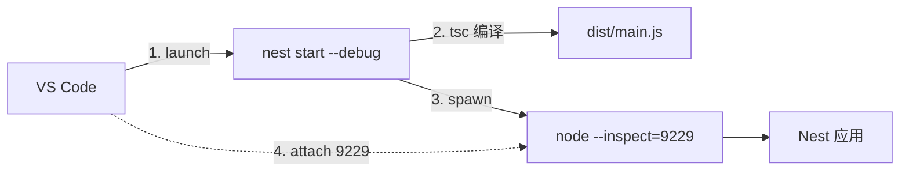

# 第 6 章 如何调试Nest项目

调试就一件事：让程序跑到某一行时先停住，你凑过去看这一刻每个变量是什么、调用栈是怎么一层层走到这儿的，看明白了再放它继续跑。

像修水管。不用把整面墙砸开，在几个接头处拧开看一眼，哪一段没水、哪一段漏水，一下就清楚。没有调试器的时候，你只能靠 `console.log` 打印，打完改代码、重启、再看，一个来回好几分钟；调试器把这一圈压缩成"点一下、看一眼"。

不过 Nest 项目里想按下这个暂停键，中间还隔着四样东西，先认清它们，后面配起来才不会瞎试。

**调试器（debugger）**是你在编辑器里操作的那个面板，负责下命令和看结果，相当于遥控器。**Node.js Inspector** 是 Node 自带的调试服务，启动时加 `--inspect`，它就在 `9229` 端口开一个 WebSocket，等客户端连上来下断点、单步、看作用域——遥控器得有台电视才能用，Inspector 就是那台电视。`--inspect-brk` 和它的区别只有一处：额外在第一行暂停，等你接上再走。

你在源码某一行点的**断点**，最终要落到 V8（Node 的 JavaScript 引擎）执行的编译后 JavaScript 上，中间靠 **source map**（`.js.map` 文件）把 `dist/users/user.service.js` 的某一行映射回 `src/users/user.service.ts`。这是译本和原稿的对照表：没有它，你拿着原稿的页码去译本里翻，永远翻不到那一页，断点就绑不上，显示成灰色空心圆。

Nest 还多一层进程关系：`nest start` 是个 CLI 进程，它先编译 TypeScript，再 `spawn` 一个子进程去跑 `dist/main.js`。`--debug` 传给的是子进程，不是 CLI 自己；调试器如果 attach（附加）到父进程，断点自然落不到业务代码——等于遥控器对准了电视机顶盒，而不是电视。`--watch` 让这件事更绕：每次改文件，CLI 重新编译并重启子进程，PID 变了，旧的调试连接就失效。

把这几层拆开，配置其实只有一句话：**让调试器连到正确的那个 node 进程，并让它读得到最新的 source map**。Node 官方的调试说明在 [Debugging](https://nodejs.org/en/learn/getting-started/debugging)，Nest 这边的入口是 [CLI usages](https://docs.nestjs.com/cli/usages) 里的 `--debug`。

现在看一个真实事故。

预发环境一个 `GET /users/99` 返回 404，日志里只有一行访问记录，没有堆栈。在 `UserService.findById` 上点了断点，按 F5，VS Code 提示 `Unbound breakpoint`，断点是个灰色空心圆。再按一次，它把整个 Nest 进程重启了，断点还是灰的。

灰色的断点就是上面几层没接上：要么客户端连错了进程，要么 source map 没被读到，要么 `dist` 里还是旧产物。后面按这个顺序查。

## 先用日志把现场留住

断点只能解决你能复现的问题。线上那 1% 的偶发错误，等你挂上调试器早就过去了，得靠日志把现场带回来，所以调试的第一步不是断点，是日志。

`Logger` 带上下文，输出里能直接看到是哪个类打的：

```ts
// src/users/user.service.ts
import { Injectable, Logger, NotFoundException } from '@nestjs/common';
import { UserRepository, type User } from './user.repository.js';

@Injectable()
export class UserService {
  private readonly logger = new Logger(UserService.name);

  constructor(private readonly users: UserRepository) {}

  findById(id: number, requestId: string): User {
    this.logger.debug(`findById id=${id} requestId=${requestId}`);

    const user = this.users.findById(id);

    if (!user) {
      this.logger.warn(`user not found id=${id} requestId=${requestId}`);
      throw new NotFoundException(`User ${id} not found`);
    }

    return user;
  }
}
```

`Logger` 有五个级别：`log`、`error`、`warn`、`debug`、`verbose`，默认全部开启；从高到低是 `error > warn > log > debug > verbose`，设了阈值之后更低的级别不再输出。生产可以在 `NestFactory.create` 的 `logger` 选项里只留 `['error', 'warn', 'log']`，或整体换成 pino、winston 这类结构化日志库。`new Logger(UserService.name)` 里的名字会成为每条日志的前缀，同一个请求跨多个类时靠它区分是谁打的。

`requestId` 从请求头带进来，把一次请求的多行日志串起来：

```ts
// src/users/user.controller.ts
import { Controller, Get, Headers, Param, ParseIntPipe } from '@nestjs/common';
import type { User } from './user.repository.js';
import { UserService } from './user.service.js';

@Controller('users')
export class UserController {
  constructor(private readonly users: UserService) {}

  @Get(':id')
  findOne(
    @Param('id', ParseIntPipe) id: number,
    @Headers('x-request-id') requestId = 'local',
  ): User {
    return this.users.findById(id, requestId);
  }
}
```

```bash
curl -s -H 'x-request-id: req-7f3a' http://localhost:3000/users/99
# 终端日志：
# [UserService] findById id=99 requestId=req-7f3a
# [UserService] user not found id=99 requestId=req-7f3a
```

两条日志带着同一个 `requestId`，比在一堆并发请求里猜哪行属于谁强得多。生产上也可以把它写进响应头，前端报错时直接把这串 ID 发给你。

日志有两条纪律。第一，不要出现密码、token、完整身份证号这类字段，排障时能看参数名和长度就够了；第二，`debug` 适合高频路径，`log` 留给关键状态变化，否则生产日志被噪声淹没，真出错时反而找不到。

## nest start 拉起的到底是谁

`pnpm start:debug` 实际执行 `nest start --debug --watch`。CLI 先编译，再启动子进程，把 `--inspect` 传给子进程。调试器要连的是子进程的 9229，不是 CLI 自己。

> **图 6-1** `nest start --debug` 的进程关系。
>



这也是 `Unbound breakpoint` 最常见的原因：调试器连上了 CLI 父进程，子进程没被接管；或者断点所在的 `.ts` 和 `dist` 里的 `.js` 对不上，source map 没加载。两种情况的表象一样，排查方法不同，后面分开说。

## 配置一次，之后按 F5

在项目根目录建 `.vscode/launch.json`，两套配置足够覆盖日常：

```json
{
  "version": "0.2.0",
  "configurations": [
    {
      "name": "Nest: launch",
      "type": "node",
      "request": "launch",
      "runtimeExecutable": "pnpm",
      "runtimeArgs": ["start:debug"],
      "autoAttachChildProcesses": true,
      "console": "integratedTerminal",
      "skipFiles": ["<node_internals>/**"],
      "sourceMaps": true,
      "outFiles": ["${workspaceFolder}/dist/**/*.js"]
    },
    {
      "name": "Nest: attach",
      "type": "node",
      "request": "attach",
      "port": 9229,
      "restart": true,
      "sourceMaps": true,
      "outFiles": ["${workspaceFolder}/dist/**/*.js"],
      "skipFiles": ["<node_internals>/**"]
    }
  ]
}
```

`launch` 由 VS Code 拉起 `pnpm start:debug`，适合从零开始调。几个字段各有各的活：

- `runtimeExecutable` / `runtimeArgs`：用 pnpm 跑脚本，和终端里的行为一致。GUI 环境里 PATH 不带 pnpm 时会报 `ENOENT`，改成 `node` 加 `dist/main.js` 的绝对路径，或者终端启动后改用 `attach`。
- `autoAttachChildProcesses: true`：Nest CLI 会 `spawn` 子进程，这个开关让调试器自动接管它。没有它，attach 到的只是 CLI 父进程。
- `console: integratedTerminal`：Nest 的输出带颜色、会读 TTY，集成终端里的行为和真实终端一致；`internalConsole` 下有些交互会丢。
- `skipFiles`：单步时跳过 `node_modules` 和 Node 内部，避免一脚踩进框架源码出不来。
- `sourceMaps` + `outFiles`：告诉调试器去 `dist` 找 `.map`，并把编译产物映射回 `src`。这两项是断点变实心的前提。

`attach` 连一个已经在跑的进程，适合"服务已经启动，只想上去看看"。`restart: true` 表示目标进程重启后自动重连——`--watch` 下每次改代码都会重启，没有它就得手动再点一次。用之前先手动开调试：

```bash
pnpm start:debug
# 输出里应该有：
# Debugger listening on ws://127.0.0.1:9229/...
```

这两个配置有一个共同前提：`tsconfig.json` 里的 `sourceMap` 必须是 `true`。Nest CLI 的默认模板会开，有人为了构建速度关掉，之后断点全灰却查不到原因。如果只是想在错误堆栈里看到 TS 行号（不挂调试器），Node 22 可以加 `--enable-source-maps` 启动。

## 断点打不中，按这个顺序查

先确认应用真的跑在 9229 上：

```bash
lsof -nP -iTCP:9229 -sTCP:LISTEN
# node  51234  ada  23u  IPv4 0x...  TCP 127.0.0.1:9229 (LISTEN)
```

没有输出，说明 `--inspect` 没生效，或者进程根本没起来。再看调试控制台有没有 `Debugger attached`。如果 attach 的是 CLI 父进程，进程列表里会出现两个 node，选错的那个不会有业务断点。

有监听、也 attached，断点还是灰的，删掉 `dist` 重新构建：

```bash
rm -rf dist
pnpm build
```

`nest start --watch` 的增量编译有时会留下旧的 `.js` 和 `.js.map`，断点行号对不上，调试器就放弃绑定。清掉重来比猜快。

如果问题发生在启动阶段——依赖注入失败、配置读取报错，应用还没开始监听——普通 `--inspect` 来不及。让进程在第一行停住：

```bash
pnpm build
node --inspect-brk=127.0.0.1:9229 dist/main.js
# Debugger listening on ws://127.0.0.1:9229/...
# 此时进程暂停，等调试器接入
```

然后用 `Nest: attach` 连上去，从 `main.ts` 第一行开始单步。`brk` 的区别就在这儿：`--inspect` 直接跑，`--inspect-brk` 等你。

## 条件断点、Logpoint 和异常断点

一个列表接口循环两百次，普通断点会停两百次，按到手酸。在红点上右键选 `Add Conditional Breakpoint`，表达式写 `id === 99`，只有目标数据才停。排查"只有某个用户出错"时特别省时间。

不想暂停、只想看值，用 `Add Logpoint`，表达式写 `id={id}, role={user?.role}`。它不中断执行，输出打到调试控制台，适合高频路径。它和 `console.log` 的区别是：不用改代码、不用重启，排查完把断点一删就没了。

异常断点要克制。VS Code 的 `Caught Exceptions` 会在 Nest 内部每次 `try/catch` 时停下来，包括框架自己的正常控制流，基本没法用。只看 `Uncaught Exceptions`，让真正冒到顶层的错误现形。

临时确认某一行有没有被执行，也可以直接写 `debugger;`。它不需要配置，但记得提交前删掉；留在代码里，生产没开 inspector 时不会停，开了就是灾难。

## 依赖解析的日志

依赖注入报错往往只有一句 `Nest can't resolve dependencies`，看不出容器到底找了哪些 token。开 `NEST_DEBUG` 再启动，日志会多出实例加载的细节：

```bash
NEST_DEBUG=1 pnpm start:dev
# [NestFactory] Starting Nest application...
# [InstanceLoader] UsersModule dependencies initialized
# [InstanceLoader] AppModule dependencies initialized
```

配合第 5 章那句报错里的 token、参数下标、模块名，基本能定位到是 `providers` 漏了，还是 `exports` / `imports` 少了一步。

## 生产的边界

inspector 是调试后门，绝不能在生产开放。`--inspect=0.0.0.0:9229` 等于把进程控制权交给整个网络；只绑 `127.0.0.1` 也不要在生产开，容器里更不要映射 9229 端口。还有一个容易忽略的入口：Node 允许对运行中的进程发 `SIGUSR1` 临时打开 inspector（默认还是 9229），所以生产的信号权限也要收住——能对进程发这个信号的人，等于能挂上调试器。

source map 同理。它能把编译后的代码还原成源码，连同注释、变量名、目录结构一起暴露。生产构建可以保留 map 给错误监控平台，但不要通过静态服务公开 `.map` 文件。

日志要反过来：生产必须留，而且要带 `requestId`、耗时、状态码。一行一条 JSON 最省事，字段固定成 `{ requestId, method, path, status, durationMs }`，采集端才能按请求聚合、按状态码报警。调试器只能解决你能复现的问题，线上偶发错误还是得靠日志把现场带回来。

| 现象 | 原因 | 处理 |
| --- | --- | --- |
| `Unbound breakpoint` | source map 没加载、`outFiles` 不对、`dist` 是旧的 | 检查 `sourceMaps` / `outFiles`，删 `dist` 重建 |
| 调试控制台没有 `Debugger attached` | 没传 `--debug`，或 9229 被占用 | `lsof -i :9229`，确认启动命令 |
| 断点停在 CLI 而不是应用 | 调试器连了父进程 | 开 `autoAttachChildProcesses`，或改用 attach 子进程 |
| `EADDRINUSE: 9229` | 上一个进程没退干净 | 杀掉旧 node，或换 `--debug 127.0.0.1:9230` |
| 启动就崩，断点来不及 | `--inspect` 不暂停 | `node --inspect-brk dist/main.js` 后 attach |
| watch 重启后断点失效 | 调试器没跟着重连 | attach 配置加 `"restart": true` |
| VS Code 报 `pnpm ENOENT` | GUI 环境 PATH 不含 pnpm | 用绝对路径，或终端启动后 attach |
| 生产日志找不到请求 | 没传 / 没打 `requestId` | 入口生成并透传，日志统一带上 |

调试解决的是"我看见的这个对象为什么长这样"。下一章换个问题：这个对象是谁造的、为什么是这个实现、能不能在不动业务代码的情况下换掉。答案在 `providers` 数组里。


<!-- chapter-nav:start -->
---

← 上一篇：[005 IoC解决了什么痛点问题](005-IoC解决了什么痛点问题.md) · [本 Part 目录](_part.md) · 下一篇：[007 使用多种Provider，灵活注入对象](007-使用多种Provider，灵活注入对象.md) →
<!-- chapter-nav:end -->
