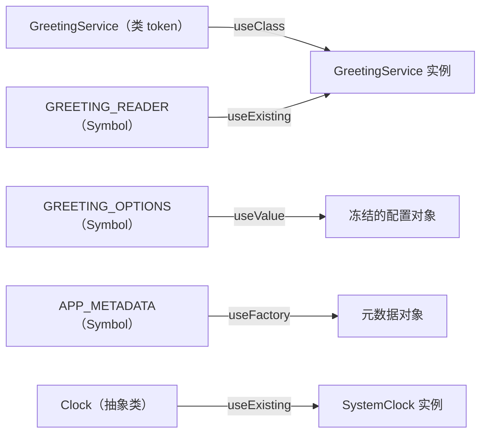

# 第 7 章 使用多种Provider，灵活注入对象

支付 SDK 的初始化比普通依赖麻烦：要读三个环境变量，要在启动时拉一次证书，还要能切沙箱。第一版你顺手写在 `PaymentService` 的构造器里：

```ts
this.client = new PaymentClient(process.env.PAY_KEY, process.env.PAY_SECRET, cert);
```

第一周没问题。第二周加沙箱模式，构造器里多一个 `if`；第三周运维要轮换密钥，得重启所有实例；第四周你发现结算模块和退款模块各自建了一个客户端，各握一份连接池，关都关不干净。业务类不该知道这些，它只需要一个能收款的客户端。

第 5 章讲的是容器怎么找对象，这一章讲另一半：**这个对象到底怎么造**。在模块的 `providers` 数组里，Provider 更准确的意思是“一条创建规则”，而不是对象本身。最简写 `GreetingService` 等价于 `{ provide: GreetingService, useClass: GreetingService }`；`provide` 那一项是 **token（令牌）**，容器查找实例用的键；配方是 `useClass` / `useValue` / `useFactory` / `useExisting` 四选一，决定实例从哪来。`@Inject()` 用在消费端：token 不是类时，TypeScript 的类型标注给不了运行时线索，必须显式告诉容器用哪把钥匙。

四种配方对应四种复杂度：换实现只要换个类名；配置对象已经现成，没必要再包一层；要读环境变量、异步拉证书、按条件选实现，得用函数；多个 token 指向同一个实例时，只能用别名，否则会悄悄多造一份。选错的后果不是语法错误，是实例数量或初始化时机不对，这类 bug 往往过几天才浮现。

## `providers: [X]` 只是一句简写

先记住这个等式：`providers: [GreetingService]` 就是 `providers: [{ provide: GreetingService, useClass: GreetingService }]`。

`provide` 是 token，`useClass` 是配方。类名做 token 时两者同名，所以能简写；一旦 token 不是类，或者创建方式不是 `new`，就必须写完整对象。

| 配方 | 适用场景 | 是否新建实例 | 工厂 / 值能否注入依赖 |
| --- | --- | --- | --- |
| `useClass` | 换实现，实例交给容器管理 | 是 | 是 |
| `useValue` | 现成配置、常量、第三方客户端 | 否，直接用这个值 | 否 |
| `useFactory` | 需要计算、异步、按条件选实现 | 是，用返回值 | 是，通过 `inject` |
| `useExisting` | 给已注册的实例起别名 | 否，复用同一个 | 否 |

选错的代价很具体：该用 `useExisting` 的地方写了 `useClass`，你会得到两个实例，内存状态各一份；该用 `useFactory` 的地方写了 `useValue`，异步初始化来不及，应用启动时拿到一个半成品。

机制再补两句。`useValue` 的值不经过容器实例化，所以它内部的依赖不会被注入——你在值里塞一个类实例，那个实例的构造器参数得自己解决。`useFactory` 的返回值就是实例，Nest 不会对它做二次注入；需要什么依赖，在 `inject` 数组里列，工厂函数按位置接收。`useClass` 和 `useExisting` 都会让容器参与依赖装配，区别只在“新建”还是“复用”。

## token 不一定是类

类做 token 最省事，但有两种情况类名不够用：你想面向接口编程，或者一个类需要有多个配置不同的实例。

token 有四种常见写法：

- **类**：`provide: GreetingService`，最常见。
- **抽象类**：`provide: Clock`，运行时仍然存在，可以当 token。
- **字符串**：`provide: 'GREETING_OPTIONS'`，简单，但容易拼错、容易冲突。
- **Symbol**：`provide: GREETING_OPTIONS`，唯一且可读，本教程首选。

接口不行。TypeScript 的 `interface` 编译后完全消失，运行时没有这个值，容器无法用它做 key。想要“面向接口”，用抽象类或 `Symbol` 做 token，接口只用来约束类型。

字符串 token 的风险在全局命名空间：两个库都写 `'CONFIG'`，后注册的覆盖先注册的，而且拼错不会编译报错，只能在启动时暴露。Symbol 在模块加载时创建，天然唯一；把 Symbol 集中定义在一个文件里导出，双方 import 同一个引用，既唯一又可读。

非类 token 注入时必须显式告诉 Nest 用哪把钥匙，在构造器参数上写 `@Inject(GREETING_OPTIONS)`。只写 `private readonly options: GreetingOptions`，Nest 看到的是 `Object`，解析必然失败。这不是装饰器语法问题，是类型在运行时不存在。机制和前面一样：Nest 读构造器参数的 `design:paramtypes`，非类 token 在元数据里是 `Object`，`@Inject` 的作用就是覆盖这个默认推断。字符串 token 按值比较，Symbol 按引用比较，所以 Symbol 必须双方 import 同一个，复制一份 `Symbol('X')` 是两把不同的钥匙。

> **图 7-1** 四种配方与 token 的对应关系。
>



## 把四种配方放进一个模块

先生成 `greetings` 模块，再按下面的路径建文件。token 和类型统一定义在一处，模块、服务、控制器都从这里导入，避免各写各的字符串：

```ts
// src/greetings/greeting.constants.ts
export const APP_METADATA = Symbol('APP_METADATA');
export const GREETING_OPTIONS = Symbol('GREETING_OPTIONS');
export const GREETING_READER = Symbol('GREETING_READER');

export interface AppMetadata {
  name: string;
  version: string;
}

export interface GreetingOptions {
  prefix: string;
  locale: string;
}

export interface GreetingReader {
  read(name: string): string;
}
```

时钟用抽象类做 token。需要固定时间时换成另一个实现，业务代码不用改：

```ts
// src/greetings/clock.ts
import { Injectable } from '@nestjs/common';

export abstract class Clock {
  abstract now(): Date;
}

@Injectable()
export class SystemClock extends Clock {
  now(): Date {
    return new Date();
  }
}
```

`Clock` 是抽象类，编译后仍然以函数形式存在，所以能当 token；`abstract` 只是 TS 层的约束，禁止你 `new Clock()`，运行时的类本身还在。`SystemClock` 之所以要单独注册，是因为 `Clock` 那条配方只是别名，真正被实例化的是 `SystemClock`；如果 `providers` 里没有它，`useExisting` 指向一个不存在的 token，启动就会报错。别名不创建目标，只改指向。

服务同时消费配置和时钟。两个构造器参数用的是不同的注入方式：一个是 `@Inject(Symbol)`，一个是类 token 直接注入：

```ts
// src/greetings/greeting.service.ts
import { BadRequestException, Inject, Injectable } from '@nestjs/common';
import { Clock } from './clock.js';
import {
  GREETING_OPTIONS,
  type GreetingOptions,
  type GreetingReader,
} from './greeting.constants.js';

@Injectable()
export class GreetingService implements GreetingReader {
  constructor(
    @Inject(GREETING_OPTIONS) private readonly options: GreetingOptions,
    private readonly clock: Clock,
  ) {}

  read(name: string): string {
    const trimmed = name.trim();

    if (!/^[a-zA-Z0-9_-]{1,30}$/.test(trimmed)) {
      throw new BadRequestException('name must be 1-30 letters, digits, _ or -');
    }

    const hour = this.clock.now().getHours();
    const part = hour < 12 ? 'morning' : hour < 18 ? 'afternoon' : 'evening';

    return `${this.options.prefix}, ${trimmed}! Good ${part} (${this.options.locale})`;
  }
}
```

控制器再注入一次 `GREETING_READER`，用来验证“别名是不是同一个实例”。`_meta/instances` 有两个路径段，不会被 `:name` 抢走：

```ts
// src/greetings/greeting.controller.ts
import { Controller, Get, Inject, Param } from '@nestjs/common';
import { GreetingService } from './greeting.service.js';
import {
  APP_METADATA,
  GREETING_READER,
  type AppMetadata,
  type GreetingReader,
} from './greeting.constants.js';

@Controller('greetings')
export class GreetingController {
  constructor(
    private readonly greetings: GreetingService,
    @Inject(GREETING_READER) private readonly reader: GreetingReader,
    @Inject(APP_METADATA) private readonly meta: AppMetadata,
  ) {}

  @Get('_meta/instances')
  instances(): { shared: boolean; app: AppMetadata } {
    return { shared: Object.is(this.greetings, this.reader), app: this.meta };
  }

  @Get(':name')
  read(@Param('name') name: string): { message: string } {
    return { message: this.greetings.read(name) };
  }
}
```

模块声明把五种写法放在一起，每一种都有明确目的：

```ts
// src/greetings/greetings.module.ts
import { Module } from '@nestjs/common';
import { Clock, SystemClock } from './clock.js';
import {
  APP_METADATA,
  GREETING_OPTIONS,
  GREETING_READER,
  type AppMetadata,
  type GreetingOptions,
} from './greeting.constants.js';
import { GreetingController } from './greeting.controller.js';
import { GreetingService } from './greeting.service.js';

@Module({
  controllers: [GreetingController],
  providers: [
    GreetingService,
    SystemClock,
    { provide: Clock, useExisting: SystemClock },
    {
      provide: GREETING_OPTIONS,
      useValue: Object.freeze<GreetingOptions>({
        prefix: 'Hello',
        locale: 'zh-CN',
      }),
    },
    { provide: GREETING_READER, useExisting: GreetingService },
    {
      provide: APP_METADATA,
      useFactory: (options: GreetingOptions): AppMetadata => ({
        name: 'meeting-booking',
        version: `locale-${options.locale}`,
      }),
      inject: [GREETING_OPTIONS],
    },
  ],
  exports: [GreetingService, GREETING_READER, GREETING_OPTIONS],
})
export class GreetingsModule {}
```

`useExisting` 和 `useClass` 的区别就在实例数量：`Clock` 指向已经注册的 `SystemClock`，`GREETING_READER` 指向已经注册的 `GreetingService`，两处都不新建。`useClass` 会再 `new` 一次，依赖照样注入，但对象是另一个了。

`useFactory` 的 `inject` 数组顺序就是工厂函数参数顺序。这里 `options` 是第一个参数，所以数组里放 `GREETING_OPTIONS`；顺序写反，注入的就是另一个 token，类型检查也救不了你，因为运行时只按位置传。

工厂可以是 `async`。Nest 会等 Promise resolve 完再继续启动，适合连数据库、拉远程配置、初始化 SDK。代价是启动变慢，失败会直接让应用起不来；要把超时和重试写进工厂，不要让它无限等。

把 `GreetingsModule` 加进根模块的 `imports`。接法和前面 `PeopleModule`、`UsersModule` 一样，不再重复整段代码。

## 验证：两个 token 是不是一份对象

```bash
pnpm start:dev

curl -s http://localhost:3000/greetings/Ada
# {"message":"Hello, Ada! Good afternoon (zh-CN)"}

curl -s http://localhost:3000/greetings/_meta/instances
# {"shared":true,"app":{"name":"meeting-booking","version":"locale-zh-CN"}}
```

`shared: true` 说明 `GreetingService` 和 `GREETING_READER` 解析到同一个实例。现在做一次对照实验：把模块里 `GREETING_READER` 的配方从 `useExisting` 改成 `useClass`：

```ts
{ provide: GREETING_READER, useClass: GreetingService },
```

重启，再请求同一个地址：

```bash
curl -s http://localhost:3000/greetings/_meta/instances
# {"shared":false,"app":{"name":"meeting-booking","version":"locale-zh-CN"}}
```

两个 token 各自创建了一个 `GreetingService`。它们的状态暂时一样，所以业务看不出问题；等 `GreetingService` 里加了缓存、计数器或连接，bug 才会以“数据偶尔不对”的形式出现。`useExisting` 就是用来消灭这种隐性双实例的。

再试一个：把 `Clock` 的 `useExisting` 改成 `useClass: SystemClock`。时钟没有状态，多一个实例不影响结果，但你可以用同样的方法检查任何有状态的 Provider。

## 几个容易踩的边界

**`useValue` 不复制对象。** 容器把同一个引用注入给所有消费者。一个消费者改了配置对象，其他消费者立刻看到脏数据。用 `Object.freeze` 把它冻住，或者只读约定；别把可变对象当配置。

**`useFactory` 的返回值可以是 `undefined`。** 工厂里忘了 `return`，Nest 不会报“工厂没返回值”，只会在注入处给你 `undefined`。工厂写短一点，最后一行明确 `return`。

**可选依赖要判空。** `inject: [{ token: METRICS, optional: true }]` 在没注册时给 `undefined`，不是抛错。适合“有监控就上报，没有就跳过”的场景，但消费方必须处理空值。

**跨模块要导出 token，不只是类。** A 模块导出 `GreetingService`，B 模块能注入类 token；如果 B 要注入 `GREETING_OPTIONS`，A 的 `exports` 里也得有 `GREETING_OPTIONS`。只导出类，Symbol 在 B 模块里依然找不到。

**工厂里不要做请求级的事。** Provider 默认单例，工厂只在启动时跑一次。把“当前用户”塞进工厂，等于把第一个请求的用户发给所有人。

| 现象 | 原因 | 处理 |
| --- | --- | --- |
| `Nest can't resolve dependencies ... (?)` | 非类 token 忘了 `@Inject` | 构造器参数加 `@Inject(TOKEN)` |
| 注入参数错位、拿到另一个对象 | `inject` 数组顺序和工厂参数不一致 | 按参数顺序排列，必要时拆成多个工厂 |
| 启动卡住或报 `undefined` | 异步工厂没 resolve，或忘了 `return` | 给工厂加超时、明确返回值 |
| 两个消费者状态不一致 | `useClass` 创建了第二份实例 | 改成 `useExisting`，只注册一次 |
| `useExisting` 启动报错 | 目标 token 没在 `providers` 注册 | 先把目标注册进去，再起别名 |
| `useValue` 数据被改脏 | 所有消费者共享同一个引用 | `Object.freeze`，或改用工厂返回新对象 |
| interface 当 token 失败 | 接口编译后不存在 | 用抽象类或 `Symbol` |
| 注入的是 `Object` 而不是类 | 用了 `import type` | 改成普通 `import` |
| 跨模块注入 Symbol 失败 | 提供方只导出了类，没导出 token | `exports` 里补上 token |

Provider 解决的是“对象怎么来”。对象来了之后，还有两个问题没回答：它什么时候初始化、进程退出时谁来收尾。下一章把 `@Global()` 和五个生命周期钩子放回同一条时间线上看。

想更深入的话，官方文档里有这几页可以接着看：[Dependency injection](https://docs.nestjs.com/fundamentals/dependency-injection)（四种 Provider 写法各自解决什么问题、边界在哪，对应本章“把四种配方放进一个模块”）。

<!-- chapter-nav:start -->
---

← 上一篇：[006 如何调试Nest项目](006-如何调试Nest项目.md) · [本 Part 目录](_part.md) · 下一篇：[008 全局模块和生命周期](008-全局模块和生命周期.md) →
<!-- chapter-nav:end -->
