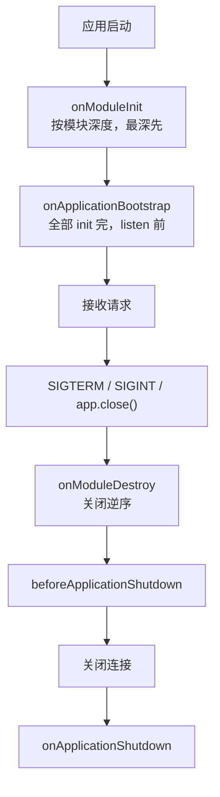

# 第 8 章 全局模块和生命周期

线上的进程不是一直活着的。每次发布新版本，平台会先启动一批新实例，再把旧实例逐个停掉，这叫滚动发布；跑在容器里的那个实例，通常叫 Pod。停旧实例时，平台不会直接拔电源，而是先发一个 `SIGTERM` 信号，意思是"请自己收尾，然后退出"，过一段时间（常见 10 到 30 秒）还没退，才强杀。

收尾包括关掉数据库连接、停掉定时器、把在途请求处理完。Node 进程收到 `SIGTERM` 时默认行为是直接退出，不会自动帮你做这些；框架就算提供了关闭钩子，也得显式打开才会执行。

另一边，模块的可见性决定了"谁看得见谁"：把所有东西都标成全局，代码里少写几行 `imports`，依赖方向也跟着从代码里消失了。

这两件事平时都不吭声，只在发布、缩容和排障时冒出来。

现在看一个真实事故。

凌晨的滚动发布，监控上 5xx 出现一个尖刺。旧 Pod 很快消失，数据库连接数却还挂在那里，十几分钟后才被服务端超时清掉。翻日志，最后一行是请求记录，没有关闭日志，也没有任何"正在退出"的提示。进程被 `SIGTERM` 杀掉了，但应用根本没来得及收尾。

排下去会发现两个默认值在起作用。第一，模块可见性：很多基础设施被标成了全局，依赖来源从 `imports` 里消失了，出问题时看不出谁依赖谁。第二，关闭钩子默认是关的：不显式开启，进程收到信号就直接退出，`onModuleDestroy` 一行都不会跑，连接池、定时器、消息消费者全留在半空。

**全局模块（global module）** 是给模块贴的一张"公共物资"标签，用 `@Global()` 标记。贴上之后，这个模块 `exports` 出去的东西，别的模块不用写 `imports` 也能直接注入。像公司把打印机放进公共区，谁都能用，不用每个部门各买一台。

没有它会卡在哪？配置、数据库连接、日志、指标这些每个模块都要用的东西，你得在几十个模块里重复写同样的 `imports`，噪音盖过业务。

它和"自动加载"最容易混：`@Global()` 只改可见性，不负责把模块装进应用。这个区别下面单独说。

**生命周期钩子（lifecycle hooks）** 是容器在启动、关闭的固定节点来敲门的几个方法，Nest 有五个：`onModuleInit`、`onApplicationBootstrap`、`onModuleDestroy`、`beforeApplicationShutdown`、`onApplicationShutdown`。像开店和打烊的固定流程：开门前查水电、正式营业前挂招牌、打烊先收银、送客、锁门。

没有它会卡在哪？进程被 `SIGTERM` 杀掉时，连接池、定时器、消息消费者全留在半空，下一次发布就是一次小型事故。

它和构造函数、析构函数最容易混：钩子不是 JS 对象的生老病死，而是容器在模块这一层按顺序调的；而且它认的是方法名，不认接口。

一个决定"谁能看见谁"，一个决定"谁在什么时候生、什么时候死"，共同点是都属于边界——用错时代码照样能跑，问题只在发布、缩容、排障时出现。

## `@Global()` 只解决可见性，不解决加载

先纠正一个常见误解。给模块加 `@Global()`，不会让它自动被加载，也不会让它的 Provider 凭空出现。

它做的只有一件事：模块 `exports` 出去的 Provider，在其他模块里可以直接注入，不用再写 `imports`。前提仍然是——根模块（或某个会被加载的模块）要 `imports` 它一次，而且它确实 `exports` 了那个 Provider。

给 `OpsModule` 加上 `@Global()`，在 `AppModule` 的 `imports` 里导入它一次，再在 `exports` 里导出 `OpsService`——三件事缺一不可。少了 `imports`，`OpsModule` 不会被实例化，`OpsService` 也不存在，别的模块注入时照样报 `Nest can't resolve dependencies`；少了 `exports`，模块加载了，Provider 仍是私有的，全局装饰器也救不了。

所以 `@Global()` 适合配置、数据库连接、日志、指标、运维探针这类"整个应用的基础设施"。它们确实到处都要用，逐个模块导入只会制造噪音。

不适合业务服务。把 `UsersService` 标成全局，任何模块都能注入它，依赖方向就消失了。三个月后你想知道"谁在用用户服务"，只能全文搜索。模块边界本来是用来回答这个问题的，别为了少写一行 `imports` 把它拆掉。

还有一个操作细节：全局模块只在根模块注册一次。Nest 的模块是单例，同一个静态模块被多个地方 `imports`，容器通常只会建一份，重复导入更多是让依赖来源变模糊；真正会多实例的，是对同一个动态模块反复调用 `forRoot()`（第 15 章讲动态模块），尤其是里面用工厂建连接的。基础设施模块尽量只在一个地方注册。

## 五个钩子，一条时间线

五个钩子的名字都很直白，难的是记住它们相对于"开始监听"和"关闭连接"的位置。

先澄清一个实现细节：这些钩子靠**方法名**在运行时被调用，`OnModuleInit` 这类接口只提供 TypeScript 类型约束，编译后并不存在。像门铃认的是"按下去"这个动作，不认你穿什么衣服。也就是说，没写 `implements` 但方法名恰好是 `onModuleInit`，Nest 也会调用；反过来，接口写对了但方法名拼错，编译能过，钩子不会跑。写 `implements` 的价值是让编译器帮你检查签名，比如 `beforeApplicationShutdown(signal?: string)` 的参数类型，别省。

> **图 8-1** 应用启动与关闭的钩子顺序。
>



| 钩子 | 触发时机 | 常见用途 |
| --- | --- | --- |
| `onModuleInit` | 本模块依赖解析完 | 建连接、预热缓存、校验配置 |
| `onApplicationBootstrap` | 所有模块 init 完、开始监听前 | 注册事件、启动消费者、打启动标记 |
| `onModuleDestroy` | 收到关闭信号后 | 停定时器、释放模块内资源 |
| `beforeApplicationShutdown` | 所有 `onModuleDestroy` 完成、连接关闭前 | 等待在途请求、停止收新任务 |
| `onApplicationShutdown` | 连接关闭后、`app.close()` 最后一步 | 最终清理、记录退出原因 |

顺序不是按 `providers` 数组，也不是按文件字母，而是按模块距离根模块的导入深度：最深的、被依赖的模块先初始化，根模块最后。像盖楼先打地基再起外墙，拆的时候反过来，先从外墙动。

关闭时完全反过来，根模块先收到 `onModuleDestroy`，最深的最后。为什么必须这样：容器要先构造依赖，才能构造依赖它的模块；初始化同理，被依赖的模块先完成 `onModuleInit`，上层才敢用它的能力。根模块最后初始化，因为它依赖所有人；关闭时先停根模块的入口，不再接新请求，再逐层释放底层资源。

同一个模块里，多个 Provider 的钩子调用顺序没有稳定契约。别写"A 的 `onModuleInit` 一定早于 B"这种假设；如果真有先后依赖，把 B 注入 A，在 A 的钩子里显式调用 B 的初始化方法。

每个钩子都会被 `await`。一个模块的 `onModuleInit` 没完成，下一个模块不会开始。这既是保证，也是风险：钩子里做十分钟的迁移，启动就卡十分钟。

## 关闭钩子默认不生效

这是最容易漏的一步。`onModuleDestroy`、`beforeApplicationShutdown`、`onApplicationShutdown` 不会自动触发，除非你在入口显式调用 `app.enableShutdownHooks()`，或者在某些场景下手动 `await app.close()`。前者监听 `SIGTERM`、`SIGINT` 等信号，后者用于脚本、CLI 或自定义退出流程。

为什么默认是关的？因为 `enableShutdownHooks()` 会在 `process` 上注册信号监听器、占用句柄；一个 Node 进程里跑多个 Nest 应用（本地同时起多个实例、单体里嵌多个服务）时，监听器会累积，Node 会抛 `MaxListenersExceededWarning`。这是有意的 opt-in，不是遗漏。开启之后，如果你自己也 `process.on('SIGTERM', ...)`，两个处理器都会执行，别在两边都做关闭，容易重复释放。

`app.close()` 本身不会终止 Node 进程。它只负责关容器、跑钩子、关连接。你在脚本里调用它，进程可能还活着，因为事件循环里还有定时器或句柄；需要退出时自己 `process.exit()`。Nest 的信号监听器在关闭完成后会重新抛出信号，所以生产环境通常能拿到正确的退出码。

还有一个连接层面的细节。HTTP/1.1 默认 keep-alive，`app.close()` 关闭服务器时会等在途连接结束。如果客户端挂着长连接，关闭可能一直卡着。创建应用时传 `{ forceCloseConnections: true }`，它会在关闭时强制断开空闲连接，适合容器滚动发布。代价是正在处理的请求可能被中断，所以 `beforeApplicationShutdown` 里要先停止接收新请求，再留一点时间给在途请求。

Windows 上收不到 `SIGTERM`，这是操作系统层面的差异；本地用 Ctrl+C 触发 `SIGINT` 验证即可，别把 Windows 的行为当成 Nest 的 bug。

## 把顺序跑出来

先建一个最深的探针模块，只做两件事：初始化打一行、销毁打一行。

```ts
// src/ops/probe.module.ts
import {
  Injectable,
  Logger,
  Module,
  OnModuleDestroy,
  OnModuleInit,
} from '@nestjs/common';

@Injectable()
export class ProbeService implements OnModuleInit, OnModuleDestroy {
  private readonly logger = new Logger(ProbeService.name);

  onModuleInit(): void {
    this.logger.log('probe init');
  }

  onModuleDestroy(): void {
    this.logger.log('probe destroy');
  }
}

@Module({
  providers: [ProbeService],
  exports: [ProbeService],
})
export class ProbeModule {}
```

运维服务实现全部五个钩子，并暴露一个状态接口。`signal` 只在关闭阶段有值，用它区分"正常退出"和"被谁杀的"。

```ts
// src/ops/ops.service.ts
import {
  BeforeApplicationShutdown,
  Injectable,
  Logger,
  OnApplicationBootstrap,
  OnApplicationShutdown,
  OnModuleDestroy,
  OnModuleInit,
} from '@nestjs/common';

export interface OpsStatus {
  bootedAt: string;
  uptimeMs: number;
  pid: number;
  node: string;
  signal: string | null;
}

@Injectable()
export class OpsService
  implements
    OnModuleInit,
    OnApplicationBootstrap,
    OnModuleDestroy,
    BeforeApplicationShutdown,
    OnApplicationShutdown
{
  private readonly logger = new Logger(OpsService.name);
  private readonly bootedAt = new Date();
  private signal: string | null = null;

  onModuleInit(): void {
    this.logger.log('module init');
  }

  onApplicationBootstrap(): void {
    this.logger.log('application bootstrap');
  }

  onModuleDestroy(): void {
    this.logger.log('module destroy');
  }

  beforeApplicationShutdown(signal?: string): void {
    this.signal = signal ?? null;
    this.logger.log(`before shutdown signal=${this.signal ?? 'none'}`);
  }

  onApplicationShutdown(signal?: string): void {
    this.signal = signal ?? this.signal;
    this.logger.log(`application shutdown signal=${this.signal ?? 'none'}`);
  }

  status(): OpsStatus {
    return {
      bootedAt: this.bootedAt.toISOString(),
      uptimeMs: Date.now() - this.bootedAt.getTime(),
      pid: process.pid,
      node: process.version,
      signal: this.signal,
    };
  }
}
```

控制器只有一个只读接口：

```ts
// src/ops/ops.controller.ts
import { Controller, Get } from '@nestjs/common';
import { OpsService, type OpsStatus } from './ops.service.js';

@Controller('ops')
export class OpsController {
  constructor(private readonly ops: OpsService) {}

  @Get('status')
  status(): OpsStatus {
    return this.ops.status();
  }
}
```

模块标成全局，但仍然要由根模块导入一次：

```ts
// src/ops/ops.module.ts
import { Global, Module } from '@nestjs/common';
import { OpsController } from './ops.controller.js';
import { OpsService } from './ops.service.js';
import { ProbeModule } from './probe.module.js';

@Global()
@Module({
  imports: [ProbeModule],
  controllers: [OpsController],
  providers: [OpsService],
  exports: [OpsService],
})
export class OpsModule {}
```

根模块也实现几个钩子，用来观察"根最后初始化、最先销毁"：

```ts
// src/app.module.ts
import {
  Logger,
  Module,
  OnApplicationBootstrap,
  OnApplicationShutdown,
  OnModuleDestroy,
  OnModuleInit,
} from '@nestjs/common';
import { GreetingsModule } from './greetings/greetings.module.js';
import { OpsModule } from './ops/ops.module.js';
import { UsersModule } from './users/users.module.js';

@Module({
  imports: [UsersModule, GreetingsModule, OpsModule],
})
export class AppModule
  implements
    OnModuleInit,
    OnApplicationBootstrap,
    OnModuleDestroy,
    OnApplicationShutdown
{
  private readonly logger = new Logger(AppModule.name);

  onModuleInit(): void {
    this.logger.log('app init');
  }

  onApplicationBootstrap(): void {
    this.logger.log('app bootstrap');
  }

  onModuleDestroy(): void {
    this.logger.log('app destroy');
  }

  onApplicationShutdown(signal?: string): void {
    this.logger.log(`app shutdown signal=${signal ?? 'none'}`);
  }
}
```

入口打开关闭钩子，并强制断开 keep-alive 连接：

```ts
// src/main.ts
import { Logger } from '@nestjs/common';
import { NestFactory } from '@nestjs/core';
import { AppModule } from './app.module.js';

const bootstrap = async (): Promise<void> => {
  const app = await NestFactory.create(AppModule, {
    forceCloseConnections: true,
  });
  app.enableShutdownHooks();

  const port = Number(process.env.PORT ?? 3000);

  if (!Number.isInteger(port) || port < 1 || port > 65535) {
    throw new Error('PORT must be an integer between 1 and 65535');
  }

  await app.listen(port);
  Logger.log(`Ops API listening on http://localhost:${port}`, 'Bootstrap');
};

await bootstrap();
```

## 看日志，而不是猜顺序

你在自己机器上跑出来的 `pid` 和 `bootedAt` 一定和下面不一样——这两个值每次启动都变，真正要对照的是**行的先后顺序**，不是具体数字。

```bash
pnpm start:dev
# [ProbeService] probe init
# [OpsService] module init
# [AppModule] app init
# [OpsService] application bootstrap
# [AppModule] app bootstrap
# [NestApplication] Nest application successfully started

# 另一个终端
curl -s http://localhost:3000/ops/status
# {"bootedAt":"2026-11-06T02:14:08.000Z","uptimeMs":1843,"pid":51234,"node":"v22.22.3","signal":null}

# 回到第一个终端，Ctrl+C
# [AppModule] app destroy
# [OpsService] module destroy
# [ProbeService] probe destroy
# [OpsService] before shutdown signal=SIGINT
# [AppModule] app shutdown signal=SIGINT
# [OpsService] application shutdown signal=SIGINT

# 生产环境换成 SIGTERM 再跑一遍
pnpm build
node dist/main.js &
kill -TERM $!
# [AppModule] app destroy
# [OpsService] module destroy
# [ProbeService] probe destroy
# [OpsService] before shutdown signal=SIGTERM
# [AppModule] app shutdown signal=SIGTERM
# [OpsService] application shutdown signal=SIGTERM
```

启动时 `Probe → Ops → App`，因为 `ProbeModule` 被 `OpsModule` 导入，`OpsModule` 又被 `AppModule` 导入；关闭时 `App → Ops → Probe`，完全逆序。`beforeApplicationShutdown` 在三个 `onModuleDestroy` 之后才出现，说明它确实在等所有模块释放完。

`signal=SIGTERM` 出现在日志里，才算真正验证了容器编排系统发送的终止信号被应用接住。只看"进程退出了"不够，进程可能是被内核直接杀掉的。

## 边界比用法更值得记

**请求作用域的 Provider 不触发这些钩子。** 它们随请求创建、随请求销毁，没有"模块初始化"这回事。要在请求结束时清理，用拦截器或 `AsyncLocalStorage`，别指望 `onModuleDestroy`。

**`onModuleInit` 抛错会阻止启动。** 连接失败、配置缺失都应该在这里暴露，而不是吞掉。让进程起不来，比带着半初始化状态接流量安全。

**关闭钩子里不要做长任务。** 容器编排通常只给 10 到 30 秒的宽限期，超时就是 `SIGKILL`。迁移数据、批量删文件这类事应该在独立任务里做；钩子里只做"停止接收、等待在途、关闭连接"。

**全局模块不要嵌套太深。** 全局模块 A 导入全局模块 B，B 又导入 C，最后谁在什么时候初始化很难从代码上看出来。基础设施模块尽量扁平，业务模块不要全局化。

| 现象 | 原因 | 处理 |
| --- | --- | --- |
| 标了 `@Global()` 仍注入不到 | 根模块没导入，或模块没 `exports` | 导入一次，并导出 Provider |
| 同一 Provider 被创建两次 | 全局模块在多个地方重复注册 | 只在根模块注册一次 |
| Ctrl+C 后没有关闭日志 | 没调用 `enableShutdownHooks()` | 入口显式开启 |
| 关闭日志有，进程不退 | `app.close()` 不终止进程，还有句柄 | 关闭后 `process.exit()`，或让信号监听器收尾 |
| `app.close()` 卡住 | keep-alive 连接未断 | `forceCloseConnections: true`，并先停在途请求 |
| 初始化顺序和预期相反 | 按模块深度，不按 `providers` 顺序 | 需要先后就显式注入、显式调用 |
| 请求作用域类没有钩子 | 钩子只作用于模块级单例 | 用拦截器 / 请求上下文清理 |
| `onModuleInit` 失败后进程退出 | 启动阶段错误默认退出码 1 | 修依赖或配置，别吞异常 |
| `MaxListenersExceededWarning` | 一个进程里多个 Nest 应用都开了关闭钩子 | 只开一次，或统一在宿主层处理信号 |
| Windows 收不到 `SIGTERM` | 系统信号差异 | 本地用 `SIGINT` 验证 |

模块边界解决了"谁能看见谁"，生命周期解决了"谁在什么时候活、什么时候死"。下一章把这两件事放到请求链路上：请求进来之前、方法执行前后、异常抛出之后，分别能插入什么，以及为什么这些切面能复用同一套容器。


<!-- chapter-nav:start -->
---

← 上一篇：[007 使用多种Provider，灵活注入对象](007-使用多种Provider，灵活注入对象.md) · [本 Part 目录](_part.md) · 下一篇：[009 AOP架构有什么好处](009-AOP架构有什么好处.md) →
<!-- chapter-nav:end -->
