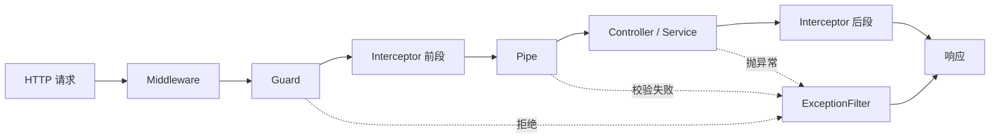

# 第 9 章 AOP 架构有什么好处

上周排查一个超时投诉：`POST /api/bookings` 偶发 5 秒才返回。日志里只有一行 `POST /api/bookings 201`，没有 handler 名、没有耗时、没有下游调用记录。你想先加个计时，翻了一遍代码——12 个 Controller、40 多个 handler，每个都得包一层 `performance.now()`，改完还得记得删。

这些动作有个共同点：**它们不属于任何一个业务方法，却要在几乎每个业务方法前后执行**。这类逻辑叫**横切关注点（cross-cutting concern）**。“横切”是相对业务功能的“纵向”而言：业务按用例竖着切（下单、取消、查询），日志、鉴权、校验则横着穿过所有用例。把它们抄进每个 handler，业务代码会被淹没；抽成普通函数，又拿不到 `Logger`、`ConfigService` 这些靠依赖注入才有的实例，也拿不到“当前是哪个类、哪个方法”的信息。

处理这类问题的编程范式叫**面向切面编程（AOP，Aspect-Oriented Programming）**：不改业务方法源码，在方法执行前、执行后或抛异常时插入统一逻辑。它常被拿来和 OOP 对比——OOP 用继承和组合复用“纵向”的结构，AOP 负责“横向”的公共行为，两者互补。边界要先说清楚：Nest 不是完整的 AOP 框架，它没有切点表达式（pointcut），不做编译期织入，也不生成代理类；它靠装饰器把元数据（贴在类上的描述信息，第 1 章讲过）写在类和参数上，请求进来时由运行时按固定顺序调用你注册的**切面类**。所以在 Nest 里，“切面”不是新语法，就是实现了 Middleware / Guard / Pipe / Interceptor / ExceptionFilter 接口、并注册到某个位置的类。

五类切面分别卡在请求链的不同位置，能看到的信息也不同。位置选错，代码可能编译通过、运行也像对的，但拿不到需要的信息，或者时序反了。这是这一章真正要练的判断。

## 五个插槽，各管一段

同样一件事，塞进中间件会拿不到路由元数据，塞进拦截器又太晚——请求已经进了业务方法。先看清楚每一段能看到什么、看不到什么：

| 切面 | 拿得到 | 适合做 | 做不到 |
| --- | --- | --- | --- |
| Middleware | 原始 `req` / `res`、`next` | 请求 ID、CORS、压缩、请求体大小限制 | 不知道最终命中哪个 Controller、哪个方法，拿不到路由元数据 |
| Guard | `ExecutionContext`（第 11 章细讲）、路由和方法元数据 | 登录校验、角色 / 权限判断、租户隔离 | 不能改响应体，也不该做查库式的重活 |
| Pipe | 参数值、参数的元类型 | 类型转换、DTO 校验（DTO 是请求体形状的类，第 1 章讲过）、默认值 | 只作用于参数，管不到响应 |
| Interceptor | `ExecutionContext`、`next.handle()` | 计时、缓存、响应包装、审计、统一加头 | 改不了已经发出的响应，默认拿不到参数值 |
| ExceptionFilter | 抛出的异常对象、`ArgumentsHost` | 统一错误体、异常分类、上报 | 只能接异常，接不到正常返回值 |

写第一行代码前先问一句：我需要的那个信息，这个位置有没有？答案是否，就换下一个插槽，别硬凑。

最容易混的是几组。登录校验放 Guard，因为它只需要请求头和路由元数据，而且拒绝得越早越省资源；参数校验放 Pipe，因为只有 Pipe 拿得到参数值和参数类型；统一错误体放 ExceptionFilter，因为只有它能保证无论异常从哪层抛出都被接住。反过来，把查库的权限判断放 Guard，会让每个请求先打一次库，连静态资源命中的请求也跑不掉；把计时放 Middleware，则拿不到 handler 名，日志里只剩 URL。

> **图 9-1** 一个 HTTP 请求穿过五类切面的位置。
>



顺序上还有三条规则，几乎所有“为什么没生效”都能从这里找到答案：

1. **Guard 由外向内**：全局 Guard → 控制器级 → 方法级，任何一层返回 `false` 或抛异常，后面的都不执行。
2. **Interceptor 进入正序、退出逆序**：先注册的在最外层。日志里看到 `A enter → B enter → B exit → A exit` 才是对的。
3. **ExceptionFilter 从最具体开始找**：方法级 → 控制器级 → 全局，命中第一个 `@Catch()` 匹配的就停，异常不会在过滤器之间接力。

还有一条更隐蔽的：路由没匹配上时，守卫、管道、拦截器、异常过滤器都不会执行，但中间件仍可能执行，因为它挂在路由匹配之前。这一点后面会用到，它解释了为什么某些 404 没有切面日志。

## 先把业务立起来

接着第 3 章的 `meeting-booking` 工程写。预订模块还没有的话，三条命令就能补出来：

```bash
cd meeting-booking
pnpm exec nest g module bookings
pnpm exec nest g controller bookings --no-spec
pnpm exec nest g service bookings --no-spec
```

先定类型。Service 的返回值不依赖任何 HTTP 细节，后面换适配器、换数据库都不用动它：

```ts
// src/bookings/booking.types.ts
export interface Booking {
  id: string;
  roomId: string;
  userId: string;
  startsAt: string;
  endsAt: string;
  status: 'confirmed' | 'cancelled';
}

export interface CreateBookingInput {
  roomId: string;
  userId: string;
  startsAt: string;
  endsAt: string;
}

export interface BookingFilter {
  roomId?: string;
  userId?: string;
}
```

数据先放内存 `Map`，这一章只关心切面。Part 02 会整体换成 PostgreSQL 17 + Prisma 8，接口形状不变：

```ts
// src/bookings/bookings.service.ts
import { BadRequestException, Injectable, NotFoundException } from '@nestjs/common';
import { randomUUID } from 'node:crypto';
import type { Booking, BookingFilter, CreateBookingInput } from './booking.types.js';

const SEED_ID = '3f1c2b9e-7d4a-4c1e-9b2a-1a2b3c4d5e6f';
const SEED_ROOM_ID = '9b2f4c6d-1e3a-4b5c-8d7e-2f4a6b8c0d1e';

@Injectable()
export class BookingsService {
  private readonly bookings = new Map<string, Booking>();

  constructor() {
    const seed: Booking = {
      id: SEED_ID,
      roomId: SEED_ROOM_ID,
      userId: '1a2b3c4d-5e6f-4a7b-8c9d-0e1f2a3b4c5d',
      startsAt: '2026-11-10T01:00:00.000Z',
      endsAt: '2026-11-10T02:00:00.000Z',
      status: 'confirmed',
    };
    this.bookings.set(seed.id, seed);
  }

  findAll(filter: BookingFilter = {}): Booking[] {
    return [...this.bookings.values()].filter(
      (booking) =>
        (filter.roomId === undefined || booking.roomId === filter.roomId) &&
        (filter.userId === undefined || booking.userId === filter.userId),
    );
  }

  findOne(id: string): Booking {
    const booking = this.bookings.get(id);
    if (booking === undefined) {
      throw new NotFoundException(`预订 ${id} 不存在`);
    }
    return booking;
  }

  create(input: CreateBookingInput): Booking {
    if (Date.parse(input.endsAt) <= Date.parse(input.startsAt)) {
      throw new BadRequestException('endsAt 必须晚于 startsAt');
    }
    const booking: Booking = { id: randomUUID(), ...input, status: 'confirmed' };
    this.bookings.set(booking.id, booking);
    return booking;
  }

  remove(id: string): void {
    if (!this.bookings.delete(id)) {
      throw new NotFoundException(`预订 ${id} 不存在`);
    }
  }
}
```

Controller 只做三件事：声明路由、声明参数、把活交给 Service。`@Param('id', ParseUUIDPipe)` 里的 Pipe 由框架实例化，以后换自定义 Pipe 不用改方法签名：

```ts
// src/bookings/bookings.controller.ts
import {
  Body,
  Controller,
  Delete,
  Get,
  Header,
  HttpCode,
  Logger,
  Param,
  ParseUUIDPipe,
  Post,
  Query,
} from '@nestjs/common';
import { CreateBookingDto } from './dto/create-booking.dto.js';
import { BookingsService } from './bookings.service.js';
import type { Booking } from './booking.types.js';

@Controller('bookings')
export class BookingsController {
  private readonly logger = new Logger(BookingsController.name);

  constructor(private readonly bookingsService: BookingsService) {}

  @Get()
  @Header('Cache-Control', 'no-store')
  findAll(@Query('roomId') roomId?: string): Booking[] {
    return this.bookingsService.findAll({ roomId });
  }

  @Get(':id')
  findOne(@Param('id', ParseUUIDPipe) id: string): Booking {
    return this.bookingsService.findOne(id);
  }

  @Post()
  create(@Body() dto: CreateBookingDto): Booking {
    this.logger.log(`create booking for room ${dto.roomId}`);
    return this.bookingsService.create(dto);
  }

  @Delete(':id')
  @HttpCode(204)
  remove(@Param('id', ParseUUIDPipe) id: string): void {
    this.bookingsService.remove(id);
  }
}
```

`nest g` 不会自动建 `dto` 目录，手动补一个。校验规则写在 DTO 上，入口统一开 `ValidationPipe`：

```ts
// src/bookings/dto/create-booking.dto.ts
import { IsISO8601, IsUUID } from 'class-validator';
import type { CreateBookingInput } from '../booking.types.js';

export class CreateBookingDto implements CreateBookingInput {
  @IsUUID()
  roomId!: string;

  @IsUUID()
  userId!: string;

  @IsISO8601()
  startsAt!: string;

  @IsISO8601()
  endsAt!: string;
}
```

```ts
// src/bookings/bookings.module.ts
import { Module } from '@nestjs/common';
import { BookingsController } from './bookings.controller.js';
import { BookingsService } from './bookings.service.js';

@Module({
  controllers: [BookingsController],
  providers: [BookingsService],
  exports: [BookingsService],
})
export class BookingsModule {}
```

```ts
// src/main.ts
import { Logger, ValidationPipe } from '@nestjs/common';
import { NestFactory } from '@nestjs/core';
import { AppModule } from './app.module.js';

const bootstrap = async (): Promise<void> => {
  const app = await NestFactory.create(AppModule);
  app.useGlobalPipes(
    new ValidationPipe({ whitelist: true, forbidNonWhitelisted: true, transform: true }),
  );
  app.enableShutdownHooks();

  const port = Number(process.env.PORT ?? 3000);
  await app.listen(port);
  Logger.log(`Bookings API listening on http://localhost:${port}`, 'Bootstrap');
};

await bootstrap();
```

`AppModule` 的 `imports` 里记得加上 `BookingsModule`。先确认没有切面时业务是通的：

```bash
pnpm start:dev

curl -s -o /dev/null -w '%{http_code}\n' http://localhost:3000/bookings
# 200

curl -s -o /dev/null -w '%{http_code}\n' http://localhost:3000/bookings/not-a-uuid
# 400

curl -s -w '\n%{http_code}\n' -X POST http://localhost:3000/bookings \
  -H 'content-type: application/json' \
  -d '{"roomId":"9b2f4c6d-1e3a-4b5c-8d7e-2f4a6b8c0d1e","userId":"1a2b3c4d-5e6f-4a7b-8c9d-0e1f2a3b4c5d","startsAt":"2026-11-10T03:00:00.000Z","endsAt":"2026-11-10T04:00:00.000Z"}'
# 201，body 里的 id 是随机 UUID，status 为 "confirmed"
```

拿到 `400` 却没有 `{"message": [...]}`，说明 `ValidationPipe` 没生效，回去看 `main.ts` 有没有真的调用 `useGlobalPipes`；`/bookings` 直接 404，检查 `AppModule` 的 `imports` 里有没有 `BookingsModule`。

## 加一个不绑平台的计时拦截器

拦截器实现 `NestInterceptor`，拿到两样东西：`ExecutionContext` 和 `CallHandler`。

`ExecutionContext` 是 Nest 对“当前这次调用”的抽象，不绑 HTTP：`getType()` 返回 `'http' | 'rpc' | 'ws'`，`switchToHttp()` 取请求和响应，`getHandler()` / `getClass()` 拿到即将执行的方法和类。守卫和拦截器能读路由元数据，靠的就是它；第 11 章会专门用它写跨协议切面，这里先记住，它给的是“这次调用的上下文”，不是原始 `req`。

`CallHandler` 的 `handle()` 返回一个 **RxJS `Observable`**。Observable 是惰性的推送流：`handle()` 返回时业务还没跑，真正执行发生在有人订阅时，而订阅是 Nest 在调用链末尾做的。`pipe` 用来组合操作符，`tap` 旁路观察流里的值、不改值，`finalize` 在流完成、出错或取消时都执行。计时必须围绕这条流，因为在 `intercept()` 前后用 `Date.now()` 只能量到“建流”的时间，handler 的同步部分、异步部分、抛错都没算进去。

```ts
// src/common/interceptors/timing.interceptor.ts
import {
  CallHandler,
  ExecutionContext,
  Injectable,
  Logger,
  NestInterceptor,
} from '@nestjs/common';
import { Observable, tap } from 'rxjs';

interface RequestLike {
  method: string;
  url: string;
}

interface ResponseLike {
  headersSent: boolean;
  setHeader(name: string, value: string): void;
}

@Injectable()
export class TimingInterceptor implements NestInterceptor {
  private readonly logger = new Logger(TimingInterceptor.name);

  intercept(context: ExecutionContext, next: CallHandler): Observable<unknown> {
    if (context.getType() !== 'http') {
      return next.handle();
    }

    const request = context.switchToHttp().getRequest<RequestLike>();
    const response = context.switchToHttp().getResponse<ResponseLike>();
    const startedAt = process.hrtime.bigint();

    this.logger.log(`enter ${request.method} ${request.url}`);

    const finish = (): void => {
      const durationMs = Number(process.hrtime.bigint() - startedAt) / 1e6;
      if (!response.headersSent) {
        response.setHeader('X-Response-Time', `${durationMs.toFixed(1)}ms`);
      }
      this.logger.log(`exit ${request.method} ${request.url} ${durationMs.toFixed(1)}ms`);
    };

    return next.handle().pipe(tap({ next: finish, error: finish }));
  }
}
```

几个细节值得说清楚：

- **用 `process.hrtime.bigint()`，不用 `Date.now()`**。系统时间被 NTP 回拨时，`Date.now()` 会算出负数，监控上就是一个尖刺。
- **写头之前判 `headersSent`**。Handler 里一旦用过 `@Res()` 直接 `res.end()`，再 `setHeader` 就抛 `ERR_HTTP_HEADERS_SENT`，表现成 500，而业务其实成功了。
- **`tap` 要同时挂 `next` 和 `error`**。只写成功分支，4xx / 5xx 不会进日志，线上排查直接少一半样本。
- **`tap` 的 `next` 是“每来一个值”触发，不是“响应结束”触发**。`@Get()` 返回单个对象时只触发一次；换成 SSE、`StreamableFile` 这类可能推送多个值的响应，`finish` 会重复执行、重复写头。这种场景改用 `finalize()` 收尾，它在流完成、报错、被取消时都只走一次。
- **请求响应用结构化接口描述**，别 `import type { Request } from 'express'`。第 16 章换 Fastify 时，这里一行都不用改。

## 注册成全局，顺便看清洋葱

再写一个只打日志的拦截器，专门用来看嵌套关系：

```ts
// src/common/interceptors/logging.interceptor.ts
import {
  CallHandler,
  ExecutionContext,
  Injectable,
  Logger,
  NestInterceptor,
} from '@nestjs/common';
import { Observable, tap } from 'rxjs';

@Injectable()
export class LoggingInterceptor implements NestInterceptor {
  private readonly logger = new Logger(LoggingInterceptor.name);

  intercept(context: ExecutionContext, next: CallHandler): Observable<unknown> {
    const handler = context.getHandler().name;
    const startedAt = Date.now();
    this.logger.log(`--> ${handler}`);

    return next.handle().pipe(
      tap(() => this.logger.log(`<-- ${handler} ${Date.now() - startedAt}ms`)),
    );
  }
}
```

注册用 `APP_INTERCEPTOR` 令牌，不要 `app.useGlobalInterceptors(new TimingInterceptor())`。前者走容器，构造器里将来要注入 `ConfigService`、`Reflector` 都拿得到；后者在 `main.ts` 里手工 `new`，依赖全是 `undefined`，而且这种错误只在运行到那行时才暴露。`APP_INTERCEPTOR` 是 multi-provider 令牌，Nest 会把所有注册项收集成一条链，顺序就是 `providers` 里的声明顺序；想调整执行顺序，调数组，不要改类名。

```ts
// src/app.module.ts
import { Module } from '@nestjs/common';
import { APP_INTERCEPTOR } from '@nestjs/core';
import { BookingsModule } from './bookings/bookings.module.js';
import { LoggingInterceptor } from './common/interceptors/logging.interceptor.js';
import { TimingInterceptor } from './common/interceptors/timing.interceptor.js';

@Module({
  imports: [BookingsModule],
  providers: [
    { provide: APP_INTERCEPTOR, useClass: TimingInterceptor },
    { provide: APP_INTERCEPTOR, useClass: LoggingInterceptor },
  ],
})
export class AppModule {}
```

请求一次列表接口，看响应头和日志：

```bash
curl -s -D - -o /dev/null http://localhost:3000/bookings
# HTTP/1.1 200 OK
# Cache-Control: no-store
# X-Response-Time: 0.3ms
#
# 应用终端里的日志：
# [TimingInterceptor] enter GET /bookings
# [LoggingInterceptor] --> findAll
# [LoggingInterceptor] <-- findAll 0ms
# [TimingInterceptor] exit GET /bookings 0.2ms
```

顺序是“Timing 进 → Logging 进 → Logging 出 → Timing 出”，注册时排在前面的在最外层。为什么退出必然逆序：拦截器不是框架挨个调用，而是前一个在 `next.handle()` 里调下一个，下一个的退出动作在前一个的 `next.handle()` 返回之前就完成了。哪天日志反过来，先查是不是有人把 `providers` 数组顺序调了，别怀疑框架。

响应头里没有 `X-Response-Time`，先看 `intercept()` 那个 `if` 分支是不是提前 `return` 了；日志里 `enter` 出现两次，说明同一个拦截器既注册成全局又挂在了控制器上，去掉一处。

## 错误路径才是切面的考场

分别请求“handler 抛 404”和“路由根本不存在”两个地址：

```bash
curl -s -D - -o /dev/null http://localhost:3000/bookings/00000000-0000-4000-8000-000000000000
# HTTP/1.1 404 Not Found，且有一行 X-Response-Time

curl -s -D - -o /dev/null http://localhost:3000/nope
# HTTP/1.1 404 Not Found，没有 X-Response-Time

pnpm build && node dist/main.js &
curl -s -D - -o /dev/null http://localhost:3000/bookings | grep -i 'x-response-time'
# x-response-time: 0.3ms
kill %1
```

差别不在状态码，在链条入口。`/bookings/:id` 匹配上了路由，拦截器已经执行，`NotFoundException` 从 `tap` 的 `error` 分支照样能写头；`/nope` 在路由匹配阶段就失败了，根本没进拦截器和守卫。

这里要纠正一个常见误会：未知路由的 404 不是“某个 handler 抛出的异常”，在 Express 适配器下全局异常过滤器也接不住它。Express 适配器下，未匹配请求最终由 Express 自己的 finalhandler 回 404；Fastify 适配器会把未匹配请求交回 Nest，行为不一样（第 16 章换适配器时会再看到）。所以要统一这类响应，只能在更外层做：Fastify 用 `setNotFoundHandler`，Express 得在所有路由之后追加一个兜底中间件；或者接受适配器的默认 404，别在拦截器里白费劲。

最后那条 `grep` 是顺手做的回归：构建产物用 `node dist/main.js` 直接启动，`X-Response-Time` 还在，说明 ESM 的相对导入在生产产物里没有断。`pnpm build` 报 `TS2307: Cannot find module './bookings.service.js'`，说明相对导入漏了 `.js` 后缀。

## 生产里真正会踩的坑

| 现象 | 原因 | 怎么处理 |
| --- | --- | --- |
| 请求一直挂起，最后 504 | `intercept()` 里忘了 `return next.handle()` | 补 `return`，副作用放进 `.pipe()` |
| 拦截器构造器里的依赖是 `undefined` | 用 `new TimingInterceptor()` 注册 | 改成 `{ provide: APP_INTERCEPTOR, useClass: TimingInterceptor }` |
| 4xx 响应没有 `X-Response-Time` | `tap` 只处理了 `next` | 改 `tap({ next: finish, error: finish })` |
| 设置响应头报 `ERR_HTTP_HEADERS_SENT` | Handler 已经用 `@Res()` 发过响应 | 判 `headersSent`，或改用 `@Res({ passthrough: true })` |
| 两条切面的日志顺序“反了” | 把注册顺序当成了退出顺序 | 记住洋葱：进入正序、退出逆序 |
| 未知路由的 404 没有切面日志 | 路由未匹配，守卫 / 拦截器不执行；Express 下过滤器也接不到 | 兜底放适配器层，别放拦截器 |

再补三条不那么显眼、但生产里绕不开的：

- **一个切面只做一类事**。计时拦截器别顺手写审计，Guard 别顺手查库。职责一混，出问题时你无法从日志判断是哪一层改的行为。
- **不要自己 `subscribe`**。`next.handle()` 返回的流由 Nest 订阅；你在拦截器里再订阅一次，handler 会执行两遍，还可能重复写响应。
- **全局切面要考虑顺序**。限流 → 认证 → 鉴权这个顺序有依赖关系，`providers` 里写反了，未登录请求会先撞权限检查，返回的错误码和日志都不对。

到这里，五类切面的位置和边界已经清楚了：要原始请求用中间件，要路由元数据用守卫，要参数转换用管道，要包裹返回值用拦截器，要兜异常用过滤器。计时只是个引子，真正的收益是以后遇到一个新的横切需求，你能在一分钟内判断它该放哪，而不是先写一个拦截器试试。

下一章把 Nest 的装饰器一次收全。你会看到 `@Header`、`@HttpCode`、`@Version` 这些小装饰器其实直接改了路由表和响应行为——它们和前面这些切面用的是同一套元数据机制。

想更深入的话，官方文档里有这几页可以接着看：[Interceptors](https://docs.nestjs.com/interceptors)（拦截器怎么包住方法调用、`next.handle()` 交回来的是什么，对应本章的计时拦截器）、[Guards](https://docs.nestjs.com/guards)（守卫在路由匹配之后、管道之前执行，能读到哪些路由信息，对应“五个插槽”的分工）、[Exception filters](https://docs.nestjs.com/exception-filters)（异常在哪一层被接住、过滤器怎么改写响应，对应“错误路径才是切面的考场”）、[Request lifecycle](https://docs.nestjs.com/faq/request-lifecycle)（五个切面在一条请求里的先后顺序，对应本章打印洋葱日志那段）。

<!-- chapter-nav:start -->
---

← 上一篇：[008 全局模块和生命周期](008-全局模块和生命周期.md) · [本 Part 目录](_part.md) · 下一篇：[010 一网打尽Nest全部装饰器](010-一网打尽Nest全部装饰器.md) →
<!-- chapter-nav:end -->
