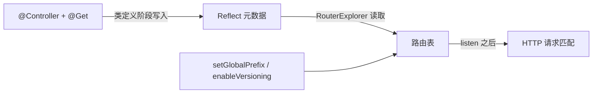

# 第 10 章 一网打尽 Nest 全部装饰器

`@Controller()`、`@Get()`、`@Injectable()` 这些以 `@` 开头的写法，是 TypeScript 的**装饰器（decorator）**。语法上它就是一个函数，贴在类、方法、属性或参数前面，在类定义阶段被调用；TypeScript 官方手册把它归为“给声明附加元数据的语法”（[Decorators](https://www.typescriptlang.org/docs/handbook/decorators.html)）。Nest 用的是 tsconfig 里 `experimentalDecorators` 打开的那套旧版装饰器（第 3 章讲过），不是 TS 5 的标准版。

它挂上去的东西叫**元数据（metadata）**：附加在类、方法或参数上的键值对，描述“这段代码是什么、该怎么用”。TypeScript 编译时可以额外产出构造器参数的类型元数据（`design:paramtypes`），前提是 tsconfig 打开 `emitDecoratorMetadata`（[说明](https://www.typescriptlang.org/tsconfig/#emitDecoratorMetadata)）；运行时要读这些元数据，得先 `import 'reflect-metadata'`，它提供 `Reflect.getMetadata()` / `Reflect.defineMetadata()` 这套 API；这种在运行时按名字读回元数据的能力，通常叫**反射（reflection）**，TypeScript 自己不做，靠这个库补上（[reflect-metadata](https://github.com/rbuckton/reflect-metadata)）。

读取发生在两个时刻。启动时，`RouterExplorer` 扫控制器，把 `@Get` 写的路径元数据翻译成路由表；请求进来后，`GuardsConsumer`、`PipesConsumer`、`InterceptorsConsumer` 按元数据决定调哪个守卫、用哪个管道；DI 容器则按 `design:paramtypes` 和 `@Inject` 解析依赖。Nest 的核心机制可以概括成一句话：**装饰器写元数据，反射读元数据，运行时按读到的内容干活**。所以装饰器只是声明，读的人没到位，声明就等于没写。

现在看一个真实事故。

联调那天下午，前端把同一份请求发到两个地址：`/api/bookings` 返回 200，`/api/v2/bookings` 返回 404。你检查了三遍，`@Version('2')` 确实加在控制器上，服务也重启过。真相很朴素：`enableVersioning()` 没调。

`@Version('2')` 就是一个往方法上写版本元数据的装饰器。它本身不会让路由多出版本段——真正读这段元数据的是启动时的 `RouterExplorer`，而它只在 `enableVersioning()` 之后才去读。没开版本，声明就是一段没人消费的键值对，路由落回无版本地址。

这也是上面 404 的来源，还是装饰器问题总表现为“静默失败”的原因：`@SetMetadata('roles', ['admin'])` 写在方法上，守卫却去读 `'role'`，键名差一个字母，权限就悄悄失效。不同装饰器改的是不同元数据、对应不同读取者，排查时先分类，比逐个怀疑装饰器有效。

按作用对象，常用装饰器可以分成六组：模块与类（依赖图、切面归属）、路由（URL、方法、状态码、响应头）、参数（从请求哪部分取值）、AOP 绑定（把切面挂到类或方法）、DI（注入什么、从哪找）、元数据（给守卫/拦截器留自定义标记）。

还有一个常被忽略的约束：装饰器在类定义阶段执行，那时没有容器、没有实例，也读不到环境变量。所以 `@Header('X-Build', process.env.BUILD_ID)` 这类写法不可靠——模块加载顺序稍有变化，拿到的就是 `undefined` 或旧值。这类运行时值要放拦截器里读。**排查装饰器问题，永远先问：谁在读这段元数据，它读到了吗？**

## 六类，按作用对象分

按字母背 `@Get`、`@Header`、`@Inject` 没有意义，它们作用的对象根本不同：

| 类别 | 常用装饰器 | 作用 |
| --- | --- | --- |
| 模块与类 | `@Module` `@Controller` `@Injectable` `@Global` `@Catch` | 声明依赖图与切面归属 |
| 路由 | `@Get` `@Post` `@Put` `@Patch` `@Delete` `@All` `@Header` `@HttpCode` `@Redirect` `@Sse` `@Version` `@Render` | 决定 URL、方法、状态码、响应头 |
| 参数 | `@Param` `@Query` `@Body` `@Headers` `@Ip` `@HostParam` `@Session` `@Req` `@Res` `@RawBody` | 把请求数据注入方法参数 |
| AOP 绑定 | `@UseGuards` `@UseInterceptors` `@UsePipes` `@UseFilters` | 把切面挂到类或方法 |
| DI | `@Inject` `@Optional` `@Self` `@SkipSelf` `@Host` | 控制注入什么、从哪找 |
| 元数据 | `@SetMetadata`、`Reflector.createDecorator()` | 给守卫和拦截器留自定义标记 |

前四类决定“请求怎么进来”，后两类决定“对象怎么被造出来、切面怎么知道该做什么”。第 12、13 章会拆开最后一行，这里先用熟。

表里有几个不常用但值得知道边界的：`@All()` 匹配所有 HTTP 方法；`@Sse()` 把返回的 Observable 转成 `text/event-stream`；`@Render()` 交给模板引擎（本项目不用）；`@RawBody()` 取未解析的原始请求体，前提是创建应用时传了 `rawBody: true`，Webhook 验签才用得上。`@Catch(HttpException)` 的括号是“能接哪些异常”，空着表示接所有；它只声明过滤器能力，挂载靠 `@UseFilters()`。

> **图 10-1** 装饰器在启动阶段被读成路由表。


三条规则先记住，后面每条都会在代码里出现一次：

1. `@Post` 默认 201，`@Delete` 默认 200。要 204 得显式 `@HttpCode(204)`，否则响应体里会多一个空对象。
2. 全局/控制器/方法级 Pipe 先跑，参数级 Pipe 最后跑；多个参数都带 Pipe 时，最后一个参数先处理、第一个最后。所以 `@Param('id', ParseUUIDPipe)` 的校验发生在 `@UsePipes()` 之后、方法体之前，失败直接 400，方法体一行都不跑。
3. `@Version` 只在 `enableVersioning()` 之后才被读。没开时它被静默忽略，路由落回无版本地址——这就是开头那个 404。

这三条背后是同一件事：执行顺序由“绑定层级 + 谁在读”决定，不由代码里谁先写。

## 先把启动配置收进一个函数

第 9 章把 `useGlobalPipes` 写在了 `main.ts`。这一章还要加全局前缀、版本、关停钩子，再过六章要换 Fastify，继续堆在 `main.ts` 里会越来越难改。抽出来：

```ts
// src/app.config.ts
import { INestApplication, ValidationPipe, VersioningType } from '@nestjs/common';

export const configureApp = (app: INestApplication): void => {
  app.setGlobalPrefix('api');
  app.enableVersioning({ type: VersioningType.URI });
  app.useGlobalPipes(
    new ValidationPipe({ whitelist: true, forbidNonWhitelisted: true, transform: true }),
  );
  app.enableShutdownHooks();
};
```

`main.ts` 缩成三行：`NestFactory.create(AppModule)`、`configureApp(app)`、`listen`。`INestApplication` 是平台无关接口，第 16 章换成 `FastifyAdapter` 时，这个文件一个字都不用动。别在里面写 `app.getHttpAdapter().getInstance()` 之类的 Express 专用调用，那会把适配器焊死。`setGlobalPrefix()` 只作用于路由：静态资源、`app.use()` 挂的中间件不受影响；要豁免健康检查这类路径，用它的 `exclude` 选项，别在控制器里手写 `/api`。

## 三种版本归属

Nest 支持四种版本化类型：URI（版本在路径里）、Header（自定义请求头）、Media Type（`Accept` 头）、Custom（自己写 extractor）。本章用 URI，因为它最好观察。URI 版本化会把版本段插在全局前缀之后、控制器路径之前，默认再带一个 `v` 前缀，所以 `version: '1'` 拼出来是 `/api/v1/bookings`；不想要 `v`，把 `prefix` 设成 `false` 或换成别的字符串。

新建 `pnpm exec nest g controller versions --no-spec`，把三个方法摆在一起对比：

```ts
// src/versions/versions.controller.ts
import { Controller, Get, VERSION_NEUTRAL, Version } from '@nestjs/common';

@Controller('versions')
export class VersionsController {
  @Get('default')
  defaultVersion(): { version: string } {
    return { version: 'no-version-segment' };
  }

  @Get('explicit')
  @Version('2')
  explicit(): { version: string } {
    return { version: 'v2' };
  }

  @Get('neutral')
  @Version(VERSION_NEUTRAL)
  neutral(): { version: string } {
    return { version: 'neutral' };
  }
}
```

启动后先看路由日志，Nest 会把每个路由的版本打印出来，这比猜快得多：

```bash
pnpm start:dev
# [RouterExplorer] Mapped {/api/versions/explicit, GET} (version: 2) route
# [RouterExplorer] Mapped {/api/versions/neutral, GET} (version: Neutral) route
# [RouterExplorer] Mapped {/api/versions/default, GET} route

curl -s -w ' %{http_code}\n' http://localhost:3000/api/versions/default
# {"version":"no-version-segment"} 200
curl -s -w ' %{http_code}\n' http://localhost:3000/api/v2/versions/explicit
# {"version":"v2"} 200
curl -s -w ' %{http_code}\n' http://localhost:3000/api/v1/versions/explicit
# {"message":"Cannot GET /api/v1/versions/explicit","error":"Not Found","statusCode":404} 404
curl -s -w ' %{http_code}\n' http://localhost:3000/api/versions/neutral
# {"version":"neutral"} 200
```

三个结论：不写版本的方法落在无版本地址；写了 `'2'` 的只认 `/api/v2`，访问 `/api/v1` 是 404 不是重定向；`VERSION_NEUTRAL` 在 URI 版本化下**不带版本段**，只挂在 `/api/versions/neutral`，请求 `/api/v1/versions/neutral` 同样是 404。换成 Header 或 Media Type 版本化时，neutral 才表现为“任何版本都能进”。

给业务控制器加版本时，用控制器选项而不是方法装饰器，否则每个方法都得抄一遍：

```ts
@Controller({ path: 'bookings', version: '1' })
```

`version` 写版本号本身，不要带 `v`——前缀由 `enableVersioning` 统一加，写 `'v1'` 会拼成 `/api/vv1/...`。方法级 `@Version()` 会覆盖控制器级；`@Version(['1', '2'])` 让同一方法同时响应两个版本。

第 9 章的 `/api/bookings` 就此变成 `/api/v1/bookings`。版本策略要在第一个接口上线前定死，别一半带版本一半不带——网关、缓存、日志都按 URL 分段，混着来以后没法统一。

## 让装饰器直接改响应

```ts
// src/bookings/bookings.controller.ts
import {
  Body,
  Controller,
  Delete,
  Get,
  Header,
  HttpCode,
  Ip,
  Logger,
  Param,
  ParseUUIDPipe,
  Post,
  Query,
} from '@nestjs/common';
import { CreateBookingDto } from './dto/create-booking.dto.js';
import { BookingsService } from './bookings.service.js';
import type { Booking } from './booking.types.js';

@Controller({ path: 'bookings', version: '1' })
export class BookingsController {
  private readonly logger = new Logger(BookingsController.name);

  constructor(private readonly bookingsService: BookingsService) {}

  @Get()
  @Header('Cache-Control', 'no-store')
  @Header('X-Resource', 'bookings')
  findAll(@Query('roomId') roomId?: string): Booking[] {
    return this.bookingsService.findAll({ roomId });
  }

  @Get('inspect')
  inspect(
    @Query('roomId') roomId: string | undefined,
    @Ip() ip: string,
  ): Record<string, string> {
    return { roomId: roomId ?? 'none', ip };
  }

  @Get(':id')
  findOne(@Param('id', ParseUUIDPipe) id: string): Booking {
    return this.bookingsService.findOne(id);
  }

  @Post()
  create(@Body() dto: CreateBookingDto, @Ip() ip: string): Booking {
    this.logger.log(`create booking from ${ip}`);
    return this.bookingsService.create(dto);
  }

  @Delete(':id')
  @HttpCode(204)
  remove(@Param('id', ParseUUIDPipe) id: string): void {
    this.bookingsService.remove(id);
  }
}
```

`inspect` 必须写在 `:id` 之前。路由按声明顺序注册到适配器，先匹配到的先赢；Nest 12 的 `routeConflictPolicy` 只负责在启动时报告重复或遮蔽（默认 `'off'`），不会帮你重排。写反了 `inspect` 会被当成 UUID 参数，`ParseUUIDPipe` 直接给你 400——这个坑第 11 章还会以别的形式出现。

`@Header` 的值类型是 `string`，写 `@Header('X-Rate-Limit', 100)` 编译不过，得写 `'100'` 或 `String(100)`。同一方法上写多个 `@Header` 会合并成一个对象，只有键相同才互相覆盖。`@HttpCode(204)` 之后返回值被丢弃，所以 `remove` 返回 `void`；同一个 id 删第二次拿到 404，是正确的。

```bash
curl -s -D - -o /dev/null http://localhost:3000/api/v1/bookings | grep -iE 'HTTP/|cache-control|x-resource'
# HTTP/1.1 200 OK
# X-Resource: bookings
# Cache-Control: no-store

curl -s -o /dev/null -w '%{http_code} %{size_download}\n' -X DELETE \
  http://localhost:3000/api/v1/bookings/3f1c2b9e-7d4a-4c1e-9b2a-1a2b3c4d5e6f
# 204 0
```

`204 0` 里的 `0` 很重要：如果打印成 `200 2`，说明 `@HttpCode` 没生效，返回的是 `{}`。

还有一种改响应的方式，`@Redirect`。老系统迁移时最常用：

```ts
// src/legacy/legacy.controller.ts
import { Controller, Get, Redirect } from '@nestjs/common';

@Controller({ path: 'legacy', version: '1' })
export class LegacyController {
  @Get('bookings')
  @Redirect('/api/v1/bookings', 302)
  redirectToBookings(): void {
    // 返回值会被 @Redirect 丢弃
  }
}
```

```bash
curl -s -o /dev/null -w '%{http_code} %{redirect_url}\n' http://localhost:3000/api/v1/legacy/bookings
# 302 http://localhost:3000/api/v1/bookings
```

如果 `redirect_url` 是空的，说明响应里压根没有 `Location` 头——先确认这个方法没有注入 `@Res()`，它会让 `@Redirect` 失效。

`@Redirect` 的地址也可以不写死：装饰器不传参时，方法返回 `{ url, statusCode }` 就能在运行时决定跳转目标，老系统按 id 拼详情页地址就是这种写法。注意返回对象的字段名必须是 `url` 和 `statusCode`，拼错不会报类型错（返回类型是 `any` 语义），只会跳到一个错误地址。

这三种装饰器有一个共同前提：**不要注入 `@Res()`**。一旦注入，Nest 就交出响应控制权，`@Header`、`@HttpCode` 全部失效，拦截器也包不到返回值。确实需要操作原生响应时，用 `@Res({ passthrough: true })`，把控制权留在框架手里。

## 参数装饰器只声明，不转换

`@Query('roomId')` 的静态类型永远是 `string | undefined`。想要数字、枚举、UUID，靠的是第二参数上的 Pipe，或者整包 DTO 加 `ValidationPipe`；装饰器只负责把值取出来，一个字符都不会帮你转。

`@Body()` 默认取整个请求体，`@Body('roomId')` 只取一个字段；`@Headers('x-tenant-id')` 同理。`@Session()` 在 Express 适配器下依赖 express-session 中间件，没挂就是 `undefined`；Fastify 适配器要换 `@fastify/secure-session` 并自己做类型声明，不能直接照搬。

```bash
curl -s -H 'x-tenant-id: t-1' 'http://localhost:3000/api/v1/bookings/inspect?roomId=r-9'
# {"roomId":"r-9","ip":"::1"}
```

`@Ip()` 在反向代理后面拿到的是代理地址，要拿到真实客户端 IP，得让适配器信任代理（Express 上是 `app.set('trust proxy', 1)`，第 16 章换 Fastify 后是另一个选项名）。这也是为什么 `@Ip()` 适合记日志，不适合做风控判断。

## DI 装饰器：非类依赖必须给令牌

类依赖靠类型元数据自动注入，接口、字符串常量、第三方实例没有类型，就得给令牌。

```ts
// src/common/metrics/metrics.service.ts
import { Global, Injectable, Module } from '@nestjs/common';

@Injectable()
export class MetricsService {
  private readonly counters = new Map<string, number>();

  increment(name: string): void {
    this.counters.set(name, (this.counters.get(name) ?? 0) + 1);
  }

  snapshot(): Record<string, number> {
    return Object.fromEntries(this.counters);
  }
}

@Global()
@Module({ providers: [MetricsService], exports: [MetricsService] })
export class MetricsModule {}
```

`@Global()` 让它不必在每个模块里重复 `imports`，代价是依赖关系变隐式——只给基础设施类模块用，业务模块别加。

```ts
// src/bookings/bookings.service.ts
import { BadRequestException, Injectable, NotFoundException, Optional } from '@nestjs/common';
import { randomUUID } from 'node:crypto';
import { MetricsService } from '../common/metrics/metrics.service.js';
import type { Booking, BookingFilter, CreateBookingInput } from './booking.types.js';

@Injectable()
export class BookingsService {
  private readonly bookings = new Map<string, Booking>();

  constructor(@Optional() private readonly metrics?: MetricsService) {}

  create(input: CreateBookingInput): Booking {
    if (Date.parse(input.endsAt) <= Date.parse(input.startsAt)) {
      throw new BadRequestException('endsAt 必须晚于 startsAt');
    }
    const booking: Booking = { id: randomUUID(), ...input, status: 'confirmed' };
    this.bookings.set(booking.id, booking);
    this.metrics?.increment('booking.create');
    return booking;
  }

  metricsSnapshot(): Record<string, number> {
    return this.metrics?.snapshot() ?? {};
  }
}
```

`@Optional()` 的语义是"解析不到就注入 `undefined`，别让启动失败"。它只适合指标、缓存、通知这类可降级依赖。`ConfigService`、数据库连接、`JwtService` 加 `@Optional()` 是自找麻烦：启动时一切正常，第一次请求才炸，排查成本翻几倍。

另外三个 DI 装饰器控制“从哪个模块找”：默认从当前模块开始向上找；`@Self()` 只看当前模块，找不到就报错，用来避免误用父模块的同名 provider；`@SkipSelf()` 跳过当前模块从上层找，用来打断“自己注入自己”的循环；`@Host()` 把查找范围限定在宿主模块——对挂在控制器上的切面来说，就是控制器所在的那个模块。

非类令牌用 `@Inject(BOOKING_CLOCK)` 注入，令牌本身用 `Symbol('BOOKING_CLOCK')` 定义在 provider 旁边——同一个文件里 export 出去，别在三个模块里各写一遍字符串字面量。改名那天，漏一处就是运行时 `Nest can't resolve dependencies`。类令牌不需要 `@Inject()`，靠 `design:paramtypes` 就够了；`@Inject()` 也可以覆盖类型元数据，让同一个类的不同实例按接口注入。

`@SetMetadata('roles', ['admin'])` 只是往方法上写一个自定义键，守卫用 `Reflector.getAllAndOverride()` 读；`Reflector.createDecorator<string[]>()` 是类型安全版本，原理相同。第 13 章会用它做角色守卫。

加个 `@Get('metrics')` 路由把计数读出来，验证注入成功：

```bash
curl -s -o /dev/null -X POST http://localhost:3000/api/v1/bookings \
  -H 'content-type: application/json' \
  -d '{"roomId":"9b2f4c6d-1e3a-4b5c-8d7e-2f4a6b8c0d1e","userId":"1a2b3c4d-5e6f-4a7b-8c9d-0e1f2a3b4c5d","startsAt":"2026-11-10T05:00:00.000Z","endsAt":"2026-11-10T06:00:00.000Z"}'
# 201
curl -s http://localhost:3000/api/v1/bookings/metrics
# {"booking.create":1}
```

## 一次构建，三条地址

```bash
pnpm build && node dist/main.js &
curl -s -o /dev/null -w '%{http_code}\n' http://localhost:3000/api/v1/bookings
# 200
curl -s -o /dev/null -w '%{http_code}\n' http://localhost:3000/api/bookings
# 404 —— 少了版本段
curl -s -o /dev/null -w '%{http_code}\n' http://localhost:3000/bookings
# 404 —— 少了全局前缀
kill %1
```

三条状态码是 200 / 404 / 404，说明前缀和版本同时生效。全是 404 就回头看 `configureApp` 有没有在 `listen` 之前调用；第一条也是 404，检查控制器上是不是写成了 `version: 'v1'`（版本值不要带 `v`，前缀由 `enableVersioning` 统一加，写 `'v1'` 会拼成 `/api/vv1/...`）。

## 生产里容易踩的坑

| 现象 | 原因 | 怎么处理 |
| --- | --- | --- |
| 请求一直挂着不返回 | 用了 `@Res()` 却没调用 `res.json()` / `res.end()` | 改 `@Res({ passthrough: true })`，或干脆不用 |
| `@Version('2')` 加了仍 404 | 没调 `enableVersioning()`，或 URL 少了版本段 | 开版本，按 `RouterExplorer` 日志核对地址 |
| `DELETE` 返回 200 和空对象 | 默认状态码是 200 | 加 `@HttpCode(204)` |
| `@Query('page')` 拿到 `'2'` | 参数装饰器不做类型转换 | DTO + `transform: true`，或显式 `ParseIntPipe` |
| `@Header('X-Count', 100)` 编译报错 | 值类型是 `string` | 写 `'100'` 或 `String(100)` |
| 请求体多传字段却静默通过 | `whitelist` 只剥离不报错 | 加 `forbidNonWhitelisted: true` |
| 换了启动入口后所有接口 404 | 新入口漏调 `configureApp` | 只保留一个启动入口，所有路径都走它 |

再补两条判断：

- **能用装饰器声明的响应，不要手写**。`@Header` 和 `@HttpCode` 是声明式的，拦截器、异常过滤器、Swagger 都能读到；`res.setHeader()` 是命令式的，框架一无所知。
- **不要给装饰器传运行时值**。`@Header('X-Build', process.env.BUILD_ID)` 在类定义阶段求值，那时 `.env` 还没加载完。这种值放拦截器里读。

装饰器到这里就铺完了：路由、参数、响应、版本、注入，各自改的是哪一段元数据，你心里应该有张表。下一章换个维度——同一个守卫，代码一模一样，为什么挂到 WebSocket 网关上就取不到 `req`。

想更深入的话，官方文档里有这几页可以接着看：[Controllers](https://docs.nestjs.com/controllers)（路由、参数、响应三类装饰器的完整清单，对应开头把装饰器分成六类那张表）、[Versioning](https://docs.nestjs.com/http/versioning)（按网址、请求头、媒体类型分版本的规则和默认值，对应“三种版本归属”那一节）、[Providers / DI](https://docs.nestjs.com/fundamentals/dependency-injection)（自定义令牌和 `@Inject()` 的写法，对应“DI 装饰器：非类依赖必须给令牌”）、[Custom decorators](https://docs.nestjs.com/custom-decorators)（怎么把几个参数装饰器合成一个自己的装饰器，补上本章只用内置装饰器的地方）。

<!-- chapter-nav:start -->
---

← 上一篇：[009 AOP架构有什么好处](009-AOP架构有什么好处.md) · [本 Part 目录](_part.md) · 下一篇：[011 ExecutionContext：切换不同上下文](011-ExecutionContext：切换不同上下文.md) →
<!-- chapter-nav:end -->
