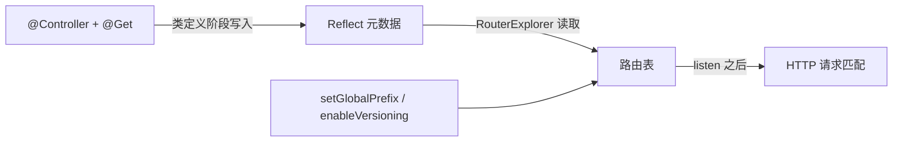

# 第 10 章 一网打尽 Nest 全部装饰器

同一个控制器挂了两个版本：`/api/bookings` 返回 200，`/api/v2/bookings` 返回 404。`@Version('2')` 就写在控制器上，服务也重启过，问题出在 `main.ts` 少了一行 `enableVersioning()`。

`@Version('2')` 只是往方法上贴了一张便签，写着"这条是 v2"。真正读这张便签的是启动时的 `RouterExplorer`，而它只在开了版本功能之后才会去读。没开，便签就是一张没人看的纸，路由还落在老地址上。

这就是装饰器的脾气：**它只负责写，读的人没来，它不会吵，只会安静地不生效**。

`@Controller()`、`@Get()`、`@Injectable()` 这些以 `@` 开头的写法，是 TypeScript 的**装饰器（decorator）**：一个函数，贴在类、方法、属性或参数前面，在类定义那一刻执行。它做的事只有一件——往目标上写一条信息。这条信息叫**元数据（metadata）**，你就当成贴在代码旁边的一张便签，上面写着"这是路由""这个参数从 URL 来""这个方法要 admin"。TS 官方手册把它归为"给声明附加元数据的语法"（[Decorators](https://www.typescriptlang.org/docs/handbook/decorators.html)），Nest 用的是 `experimentalDecorators` 打开的那套旧版装饰器，不是 TS 5 的标准版（第 3 章讲过这两个编译开关）。

便签本身不产生行为，干活的是来读它的人。启动时，`RouterExplorer` 扫控制器，把 `@Get('mine')` 翻译进路由表；请求进来后，守卫、管道、拦截器按元数据决定调谁；DI 容器按构造器参数的 `design:paramtypes` 决定注入什么。Nest 的核心机制可以压成一句：**装饰器写元数据，反射读元数据，运行时照读到的内容干活**。读的人没到位，或者读错了键，装饰器不报错——这正是上面那个 404 的来路，也是装饰器问题总表现为"静默失败"的原因。

> **图 10-1** 装饰器在启动阶段被读成路由表。


## 六组，先看全景

按字母背 `@Get`、`@Header`、`@Inject` 没什么用，因为它们作用的对象根本不是一回事。按"改的是哪段元数据、谁来读"分成六组，排查时先定位组，比逐个怀疑快得多：

| 类别 | 装饰器 | 管什么 | 谁来读 |
| --- | --- | --- | --- |
| 模块与类 | `@Module` `@Controller` `@Injectable` `@Global` `@Catch` | 依赖图、切面归属 | DI 容器、启动扫描器 |
| 路由 | `@Get` `@Post` `@Put` `@Patch` `@Delete` `@All` `@Header` `@HttpCode` `@Redirect` `@Sse` `@Version` `@Render` | URL、方法、状态码、响应头 | `RouterExplorer`、适配器 |
| 参数 | `@Param` `@Query` `@Body` `@Headers` `@Ip` `@HostParam` `@Session` `@Req` `@Res` `@RawBody` | 从请求哪一部分取值 | 参数解析器 |
| AOP 绑定 | `@UseGuards` `@UseInterceptors` `@UsePipes` `@UseFilters` | 把切面挂到类或方法 | 增强器扫描 |
| DI | `@Inject` `@Optional` `@Self` `@SkipSelf` `@Host` | 注入什么、从哪个模块找 | DI 容器 |
| 元数据 | `@SetMetadata`、`Reflector.createDecorator()` | 给守卫、拦截器留自定义标记 | `Reflector` |

前四组决定"请求怎么进来"，后两组决定"对象怎么被造出来、切面怎么知道该做什么"。第 9 章讲过五层切面，这里只补一句：装饰器是"贴在哪"，切面类是"干什么"。

下面每组一张小表，每个装饰器一句人话，后面跟最小写法。不用背，把它当查表用。

## 模块与类

`@Module()` 把一个类声明成模块：里面有什么控制器、提供者，往外给什么。`@Controller()` 声明 HTTP 控制器，括号里的字符串是这组路由的共同前缀。`@Injectable()` 告诉容器"这个类归你管"——它能被注入，也能注入别人（第 5 章讲过 IoC 容器怎么用它）。

| 装饰器 | 一句人话 | 最小例子 |
| --- | --- | --- |
| `@Module()` | 声明一个模块，写清里面有什么、往外给什么。 | `@Module({ controllers: [BookingsController] })` |
| `@Controller('bookings')` | 声明 HTTP 控制器，括号里是所有路由的共同前缀。 | `@Controller('bookings')` |
| `@Injectable()` | 让容器接管这个类，可以被注入，也可以注入别人。 | `@Injectable()` |
| `@Global()` | 让这个模块的导出全局可用，别的模块不用再 import。只给基础设施模块用。 | `@Global() @Module({ providers: [MetricsService] })` |
| `@Catch()` | 声明异常过滤器，括号里写能接哪些异常，空着接所有；挂载得靠 `@UseFilters()`。 | `@Catch(HttpException)` |

`@Global()` 的代价是依赖关系变隐式：谁都能拿到，也就没人知道谁在用。指标、配置这类基础设施可以，业务模块别加。

## 路由

这组管请求怎么进来。`@Get`、`@Post`、`@Put`、`@Patch`、`@Delete` 是同一件事的不同 HTTP 方法，括号里写路径，不写就是控制器的根路径。`@Post` 默认返回 201，其余默认 200；想换状态码，用 `@HttpCode()`。

| 装饰器 | 一句人话 | 最小例子 |
| --- | --- | --- |
| `@Get` `@Post` `@Put` `@Patch` `@Delete` | 声明这条路由用什么方法、什么路径；不写路径就是控制器根路径。 | `@Get(':id')` |
| `@All()` | 同一个路径，不管什么 HTTP 方法都进这个方法，探针和兼容老客户端时用。 | `@All('ping')` |
| `@Header('名', '值')` | 给响应加一个固定响应头，值只能是字符串。 | `@Header('Cache-Control', 'no-store')` |
| `@HttpCode(204)` | 改掉默认状态码；DELETE 想返回 204 就靠它。 | `@HttpCode(204)` |
| `@Redirect('/新地址', 302)` | 让这次请求跳到别处，方法返回值会被丢掉。 | `@Redirect('/api/v1/bookings', 302)` |
| `@Sse()` | 把返回的 Observable 转成 `text/event-stream`，服务端可以一直往客户端推。 | `@Sse('events')` |
| `@Version('2')` | 给路由贴版本标签，只有开了 `enableVersioning()` 才会被读。 | `@Version('2')` |
| `@Render('view')` | 交给模板引擎渲染 HTML，用之前得先配好引擎（本项目不用）。 | `@Render('bookings')` |

`@Header` 的值类型是 `string`，写 `@Header('X-Rate-Limit', 100)` 编译不过，得写 `'100'`。同一方法上多个 `@Header` 会合并，键相同才互相覆盖。

`@Redirect` 的地址也可以不写死：装饰器不传参时，方法返回 `{ url, statusCode }` 就能在运行时决定跳去哪。字段名必须是这两个，拼错不会报类型错，只会跳到错误地址。

这三种改响应的装饰器有一个共同前提：**别注入 `@Res()`**。一旦注入，Nest 就把响应控制权交出去了，`@Header`、`@HttpCode` 全部失效，拦截器也包不到返回值。确实要动原生响应，用 `@Res({ passthrough: true })`。

## 参数

`@Body()`、`@Query()` 这些，是把请求里的某一块塞进方法参数。它们只负责取，不负责转换：`@Query('page')` 拿到的永远是字符串 `'2'`，不是数字 `2`。要数字、要枚举、要 UUID，靠第二个参数上的 Pipe，或者整包 DTO 加 `ValidationPipe`（第 19、20 章）。

| 装饰器 | 一句人话 | 最小例子 |
| --- | --- | --- |
| `@Param('id')` | 取路径里的那一段；不写键就取全部，得到一个对象。 | `@Param('id')` |
| `@Query('page')` | 取查询串里的一个值，永远是字符串。 | `@Query('roomId')` |
| `@Body()` | 取解析好的请求体；`@Body('name')` 只取一个字段。 | `@Body() dto: CreateBookingDto` |
| `@Headers('x-tenant-id')` | 取请求头；Node 把名字都转成了小写。 | `@Headers('x-tenant-id')` |
| `@Ip()` | 取客户端 IP；在反向代理后面拿到的是代理地址。 | `@Ip() ip: string` |
| `@HostParam('account')` | 按域名路由时，取域名里的那一段。 | `@HostParam('account') account: string` |
| `@Session()` | 取 session 对象；Express 下要先挂 `express-session`，否则是 `undefined`。 | `@Session() session: Session` |
| `@Req()` | 取原始请求对象，只在框架没封装的东西上用。 | `@Req() req: Request` |
| `@Res()` | 取原始响应对象；给了它，Nest 就不再管响应。 | `@Res({ passthrough: true }) res: Response` |
| `@RawBody()` | 取没解析过的原始请求体（Buffer），Webhook 验签用；要先开 `rawBody: true`。 | `@RawBody() raw: Buffer` |

`@Ip()` 适合记日志，不适合做风控判断——代理一挡，"客户端 IP"就未必是客户端。`@HostParam()` 只在控制器上写了 `host` 时才有东西可取，比如 `@Controller({ host: ':account.example.com' })`。

`@Session()` 是适配器相关的：Express 下靠 `express-session`，Fastify 下要换 `@fastify/secure-session` 并自己做类型声明（第 16 章换适配器时会讲这类差异），不能直接照搬。

## AOP 绑定

`@UseGuards()`、`@UseInterceptors()`、`@UsePipes()`、`@UseFilters()` 只做一件事：把第 9 章讲的那几类切面类挂到某个控制器或方法上。它们自己不含逻辑，逻辑在被挂的类里。

| 装饰器 | 一句人话 | 最小例子 |
| --- | --- | --- |
| `@UseGuards()` | 挂守卫，决定这次请求让不让进。 | `@UseGuards(AuthGuard)` |
| `@UseInterceptors()` | 挂拦截器，在方法前后顺手做事。 | `@UseInterceptors(LoggingInterceptor)` |
| `@UsePipes()` | 挂管道，只管参数，做转换和校验。 | `@UsePipes(new ValidationPipe())` |
| `@UseFilters()` | 挂异常过滤器，接住抛出来的异常。 | `@UseFilters(HttpExceptionFilter)` |

挂载位置有三个：类上（这个控制器所有方法生效）、方法上（只这条）、全局（`app.useGlobalGuards()` 或 `APP_GUARD` 令牌）。中间件不在这套装饰器里，它用 `configure(consumer)` 挂（第 17 章）。

## DI

类依赖靠类型元数据自动注入，不用写装饰器。接口、字符串常量、第三方实例没有类型可读，就得手动给令牌。

| 装饰器 | 一句人话 | 最小例子 |
| --- | --- | --- |
| `@Inject(TOKEN)` | 手动指定注入哪个令牌；非类依赖必须给。 | `@Inject(BOOKING_CLOCK) clock: Clock` |
| `@Optional()` | 找不到就注入 `undefined`，别让启动失败；只给可降级的依赖用。 | `@Optional() metrics?: MetricsService` |
| `@Self()` | 只在当前模块找，找不到报错，避免误用父模块的同名提供者。 | `@Self() logger: Logger` |
| `@SkipSelf()` | 跳过当前模块往上找，用来打断"自己注入自己"。 | `@SkipSelf() config: ConfigService` |
| `@Host()` | 只在宿主模块找；挂在控制器上的切面，宿主就是控制器所在的模块。 | `@Host() reflector: Reflector` |

`@Optional()` 只适合指标、缓存、通知这类可降级依赖。给 `ConfigService`、数据库连接、`JwtService` 加 `@Optional()` 是自找麻烦：启动时一切正常，第一次请求才炸。

令牌用 `Symbol('BOOKING_CLOCK')` 定义在提供者旁边，同一个文件 export 出去。别在三个模块里各写一遍字符串——改名那天漏一处，就是运行时 `Nest can't resolve dependencies`。

## 元数据

`@SetMetadata('roles', ['admin'])` 只是往方法或类上写一个自定义键值对，Nest 不知道它是什么意思，得有人用 `Reflector` 去读（第 13 章展开）。`Reflector.createDecorator<string[]>()` 是类型安全版，写进去的还是同一种元数据。

| 装饰器 | 一句人话 | 最小例子 |
| --- | --- | --- |
| `@SetMetadata('roles', ['admin'])` | 往方法上贴一条自定义标签，守卫自己来读。 | `@SetMetadata('roles', ['admin'])` |
| `Reflector.createDecorator<string[]>()` | 同一个东西的类型安全版，键名由框架生成。 | `const Roles = Reflector.createDecorator<string[]>();` |

读取方长这样，`getAllAndOverride` 会先看方法、再看类：

```ts
// 守卫里（第 13 章展开）
const roles = this.reflector.getAllAndOverride<string[]>('roles', [
  context.getHandler(),
  context.getClass(),
]);
```

键名差一个字母，读出来就是 `undefined`，权限悄悄放宽——这是 `SetMetadata` 最常见的事故。

## 三小段代码串起来

路由、参数、响应三组放在一起，是日常写得最多的形状：

```ts
// src/bookings/bookings.controller.ts（节选）
import {
  Controller,
  Delete,
  Get,
  Header,
  HttpCode,
  Param,
  ParseUUIDPipe,
  Query,
} from '@nestjs/common';

@Controller({ path: 'bookings', version: '1' })
export class BookingsController {
  constructor(private readonly bookingsService: BookingsService) {}

  @Get()
  @Header('Cache-Control', 'no-store')
  findAll(@Query('roomId') roomId?: string): Booking[] {
    return this.bookingsService.findAll({ roomId });
  }

  @Delete(':id')
  @HttpCode(204)
  remove(@Param('id', ParseUUIDPipe) id: string): void {
    this.bookingsService.remove(id);
  }
}
```

`inspect` 这类固定路径必须写在 `@Get(':id')` 前面，否则会被当成 id 参数，`ParseUUIDPipe` 直接返 400。路由按声明顺序注册，先匹配到的先赢，Nest 不会帮你重排。

DI 和元数据的一组，看注入令牌、可降级依赖、自定义标签怎么落到代码里：

```ts
// src/bookings/bookings.service.ts（节选）
export const BOOKING_CLOCK = Symbol('BOOKING_CLOCK');

export interface Clock {
  now(): Date;
}

@Injectable()
export class BookingsService {
  constructor(
    @Inject(BOOKING_CLOCK) private readonly clock: Clock,
    @Optional() private readonly metrics?: MetricsService,
  ) {}

  create(input: CreateBookingInput): Booking {
    if (Date.parse(input.endsAt) <= Date.parse(input.startsAt)) {
      throw new BadRequestException('endsAt 必须晚于 startsAt');
    }
    const booking: Booking = { id: randomUUID(), ...input, status: 'confirmed' };
    this.metrics?.increment('booking.create');
    return booking;
  }
}
```

```ts
// src/bookings/bookings.controller.ts（节选）
@Get(':id')
@SetMetadata('roles', ['ADMIN'])
findOne(@Param('id', ParseUUIDPipe) id: string): Booking {
  return this.bookingsService.findOne(id);
}
```

## 前缀和版本：地址是怎么拼出来的

上面所有地址都以 `/api/v1` 开头，这两段不是自动来的，得在启动时配。攒在 `main.ts` 里会越来越乱，收进一个函数（第 9 章已经在里面放全局管道了）：

```ts
// src/app.config.ts
import { INestApplication, ValidationPipe, VersioningType } from '@nestjs/common';

export const configureApp = (app: INestApplication): void => {
  app.setGlobalPrefix('api');
  app.enableVersioning({ type: VersioningType.URI });
  app.useGlobalPipes(
    new ValidationPipe({ whitelist: true, forbidNonWhitelisted: true, transform: true }),
  );
  app.enableShutdownHooks();
};
```

`INestApplication` 是平台无关接口，第 16 章换成 `FastifyAdapter` 时这个文件一个字都不用动。`setGlobalPrefix()` 只作用于路由：静态资源、`app.use()` 挂的中间件不受影响；要豁免健康检查，用它的 `exclude` 选项，别在控制器里手写 `/api`。

URI 版本化会把版本段插在前缀之后、控制器路径之前，默认再带一个 `v`，所以 `version: '1'` 拼出来是 `/api/v1/bookings`。不想要 `v`，把 `prefix` 设成 `false` 或换个字符串。

三个方法摆在一起，最容易看清版本到底落在哪：

```ts
// src/versions/versions.controller.ts
import { Controller, Get, VERSION_NEUTRAL, Version } from '@nestjs/common';

@Controller('versions')
export class VersionsController {
  @Get('default')
  defaultVersion(): { version: string } {
    return { version: 'no-version-segment' };
  }

  @Get('explicit')
  @Version('2')
  explicit(): { version: string } {
    return { version: 'v2' };
  }

  @Get('neutral')
  @Version(VERSION_NEUTRAL)
  neutral(): { version: string } {
    return { version: 'neutral' };
  }
}
```

启动后先看路由日志，Nest 会把版本打印出来，比猜快：

```bash
pnpm start:dev
# [RouterExplorer] Mapped {/api/versions/explicit, GET} (version: 2) route
# [RouterExplorer] Mapped {/api/versions/neutral, GET} (version: Neutral) route
# [RouterExplorer] Mapped {/api/versions/default, GET} route

curl -s -w ' %{http_code}\n' http://localhost:3000/api/versions/default
# {"version":"no-version-segment"} 200
curl -s -w ' %{http_code}\n' http://localhost:3000/api/v2/versions/explicit
# {"version":"v2"} 200
curl -s -w ' %{http_code}\n' http://localhost:3000/api/v1/versions/explicit
# {"message":"Cannot GET /api/v1/versions/explicit","error":"Not Found","statusCode":404} 404
curl -s -w ' %{http_code}\n' http://localhost:3000/api/versions/neutral
# {"version":"neutral"} 200
```

三个结论：不写版本的方法落在无版本地址；写了 `'2'` 的只认 `/api/v2`，访问 `/api/v1` 是 404，不是重定向；`VERSION_NEUTRAL` 在 URI 版本化下**不带版本段**，只挂在 `/api/versions/neutral`，访问 `/api/v1/versions/neutral` 同样 404。换成 Header 或 Media Type 版本化，neutral 才表现为"任何版本都能进"。

给业务控制器加版本，用控制器选项，别每个方法抄一遍：

```ts
@Controller({ path: 'bookings', version: '1' })
```

`version` 写版本号本身，不要带 `v`——前缀由 `enableVersioning` 统一加，写 `'v1'` 会拼成 `/api/vv1/...`。方法级 `@Version()` 覆盖控制器级；`@Version(['1', '2'])` 让同一方法响应两个版本。

版本策略要在第一个接口上线前定死。一半带版本一半不带，网关、缓存、日志都按 URL 分段，以后没法统一。

## 默认值会咬人的地方

| 现象 | 原因 | 怎么处理 |
| --- | --- | --- |
| `@Version('2')` 加了仍 404 | 没调 `enableVersioning()`，或 URL 少了版本段 | 开版本，按 `RouterExplorer` 日志核对地址 |
| `DELETE` 返回 200 和空对象 | 默认状态码是 200 | 加 `@HttpCode(204)` |
| `@Query('page')` 拿到 `'2'` | 参数装饰器不做类型转换 | DTO + `transform: true`，或显式 `ParseIntPipe` |
| `@Header('X-Count', 100)` 编译报错 | 值类型是 `string` | 写 `'100'` 或 `String(100)` |
| 请求一直挂着不返回 | 用了 `@Res()` 却没调 `res.json()` / `res.end()` | 改 `@Res({ passthrough: true })`，或干脆不用 |
| 请求体多传字段却静默通过 | `whitelist` 只剥离不报错 | 加 `forbidNonWhitelisted: true` |
| 换了启动入口后所有接口 404 | 新入口漏调 `configureApp` | 只保留一个启动入口 |

还有两件与执行时机有关的事：

- **能用装饰器声明的响应，不要手写**。`@Header`、`@HttpCode` 是声明式的，拦截器、异常过滤器、Swagger 都能读到；`res.setHeader()` 是命令式的，框架一无所知。
- **不要给装饰器传运行时值**。`@Header('X-Build', process.env.BUILD_ID)` 在类定义阶段求值，那时 `.env` 还没加载完，拿到的是 `undefined` 或旧值。这类值放拦截器里读。

装饰器到这里就铺完了：路由、参数、响应、版本、注入，各自改的是哪一段元数据，心里应该有张表。下一章换个维度——同一个守卫，代码一模一样，为什么挂到 WebSocket 网关上就取不到 `req`。


<!-- chapter-nav:start -->
---

← 上一篇：[009 AOP架构有什么好处](009-AOP架构有什么好处.md) · [本 Part 目录](_part.md) · 下一篇：[011 ExecutionContext：切换不同上下文](011-ExecutionContext：切换不同上下文.md) →
<!-- chapter-nav:end -->
