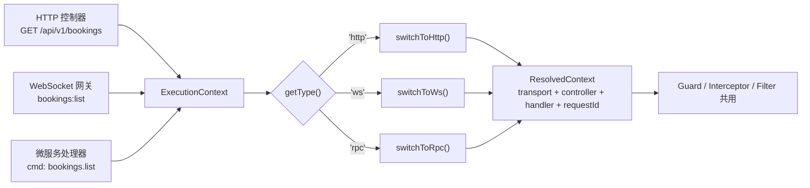
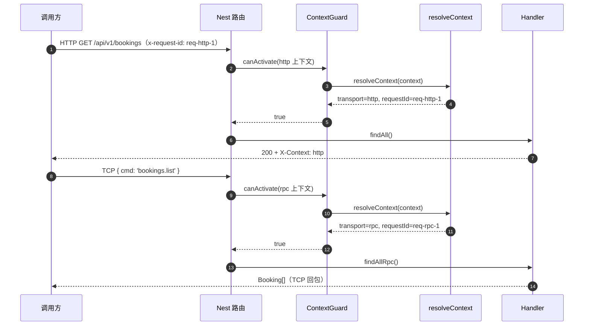

# 第 11 章 ExecutionContext：切换不同上下文

HTTP 之外，Nest 还能接 WebSocket、微服务和 GraphQL。WebSocket 是在一条长连接上双向收发消息，不像 HTTP 那样一次请求配一次响应；Nest 里接 WebSocket 的类叫网关（gateway），用 `@WebSocketGateway()` 标记，消息用 `@SubscribeMessage()` 声明。这里用的 socket.io 是 WebSocket 的一个常用封装，连接对象叫 `client`。

麻烦在于，守卫、拦截器、异常过滤器这些切面原本是照着 HTTP 写的：拿 `req.headers`、改 `res`、返回状态码。换到 WebSocket，根本没有 `req`/`res`，只有 socket 客户端和消息体；换到微服务，参数又变成消息和上下文。Nest 的解法是不把 `req`/`res` 直接交给切面，而是给一个统一的**执行上下文（ExecutionContext）**：它描述“这次调用发生在哪个传输层、哪个类、哪个方法、原始参数是什么”，切面按需切换（[Execution context](https://docs.nestjs.com/fundamentals/execution-context)）。

“上下文”在这里不是抽象名词，它就是这次调用的一组现场信息——传输层不同，这组信息的长相就不同。同一个守卫要跨入口复用，必须先问“现在是什么类型”，再决定从哪组参数里取值；取错了，代码要到你访问具体字段时才炸。

现在看一个真实事故。

凌晨一点半，监控上 WebSocket 连接数从 300 掉到 0。日志里全是同一行：`TypeError: Cannot read properties of undefined (reading 'headers')`。

那个 `AuthGuard` 在 HTTP 上跑了半年没出过事，代码长这样：`context.switchToHttp().getRequest().headers.authorization`。挂到网关上的那天，`switchToHttp()` 返回的 `getRequest()` 拿到的是 socket.io 的 `client` 对象，`headers` 自然不存在。一行取值，直接让所有连接在握手后被打断。

问题出在 Guard 的入参上：它拿到的是 `ExecutionContext`，而这段代码默认了它一定是 HTTP。Nest 的 Guard、Interceptor、ExceptionFilter 从设计上就不是 HTTP 专属——同一个守卫，可以挂在 HTTP Controller 上，也可以挂在 WebSocket 网关、微服务的消息处理器、GraphQL 的字段解析器（resolver）上。想让切面复用，就不能把传输层焊死在接口里；代价是切面里得自己判断“现在是什么传输层”。

先分清两个类。**ArgumentsHost** 是更底层的抽象：它只包装“这次调用拿到的原始参数”，提供 `getType()`、`getArgs()`、`getArgByIndex(i)`；异常过滤器拿到的就是它。**ExecutionContext** 继承 ArgumentsHost，多了 `getClass()` 和 `getHandler()`，所以守卫和拦截器才能知道“当前是哪个控制器、哪个方法”，`Reflector` 也才有地方读 `@Roles()` 这类元数据。一句话：ArgumentsHost 管“参数从哪来”，ExecutionContext 再补上“谁在处理”。

但光有统一接口还不够，参数形状随传输层变：HTTP 是 `[request, response, next]`，WebSocket 是 `[client, data]`，微服务是 `[data, context]`，GraphQL 是 `[root, args, context, info]`。`switchToHttp()`、`switchToWs()`、`switchToRpc()` 把这些数组收窄成带命名方法的视图；GraphQL 没有专用方法，只能按索引取。关键在这里：`getRequest<T>()` 的泛型只是**类型断言**，运行时不会检查你拿到的到底是不是 HTTP 请求——传错传输层它照样返回一个对象，直到你访问 `.headers` 才炸。

## 一次调用，三种形状

`ArgumentsHost` 是底层抽象，只做三件事：`getType()` 看传输层，`getArgs()` 拿原始参数数组，`getArgByIndex(i)` 按位置取。异常过滤器拿到的就是它——过滤器只需要原始参数来构造响应，不需要 handler 元数据，所以 Nest 在这里刻意只给到 ArgumentsHost。

`getArgs()` 的形状是理解所有分支的钥匙：

| 传输层 | `getType()` | `getArgs()` | 切换方法 | 取到什么 |
| --- | --- | --- | --- | --- |
| HTTP | `'http'` | `[request, response, next]` | `switchToHttp()` | `getRequest()` / `getResponse()` / `getNext()` |
| WebSocket | `'ws'` | `[client, data]` | `switchToWs()` | `getClient()` / `getData()` |
| 微服务 | `'rpc'` | `[data, context]` | `switchToRpc()` | `getData()` / `getContext()` |
| GraphQL | `'graphql'` | `[root, args, context, info]` | 无专用方法，用 `getArgByIndex(2)` | `context` |

两个细节值得记住。第一，`getArgs()` 的顺序随传输层变，别背索引，用 `switchToXxx()` 命名方法。第二，GraphQL 是特例：`getType()` 返回 `'graphql'`，没有 `switchToGraphql()`，社区惯例是从第 3 个参数取 context。另外，`getType()` 返回的是运行时字符串，`getType<'ws'>()` 的泛型只影响编译期；分支判断必须比较字符串，不能靠泛型。

之所以反复强调别用索引，是因为 `getArgByIndex` 太顺手。`getArgByIndex(0).headers` 看起来更短，但它在 WS 下拿到的是 `client`，在 RPC 下拿到的是消息体，同样是 `undefined`，报错位置却离真正的原因隔了两层。命名方法至少能让错误停在 `switchToWs` 那一行。

`ExecutionContext` 继承 `ArgumentsHost`，多两个方法：

```ts
context.getClass();    // 当前控制器/网关的类
context.getHandler();  // 当前处理方法
```

有了它们，守卫才能区分"这次是 `findAll` 还是 `remove`"，`Reflector` 也才有地方读 `@Roles()`、`@Public()` 这类元数据（第 13 章展开）。日志里写 `BookingsController.findAll` 比写 `GET /bookings` 有用得多——同一个 URL 可能对应多个版本、多个 handler。

> **图 11-1** 三种入口如何收敛到同一个 `ExecutionContext`。


## 把切换收成一个函数

先把依赖装上。WS 和 RPC 都要用到：

```bash
pnpm add @nestjs/microservices@^12.3.0 @nestjs/websockets@^12.3.0 @nestjs/platform-socket.io@^12.3.0 socket.io@^4.8.1
pnpm add -D socket.io-client@^4.8.1
```

然后写解析器。原则是：**所有 `switchToXxx` 调用只出现在这一个文件里**，切面本身只剩副作用。

这叫归一化（normalize）：把四种传输层的参数形状收敛成一个 `ResolvedContext`，切面只依赖这个结构。以后新增一种传输层（比如 GraphQL），只改这个文件，守卫和拦截器不用动；反过来，如果每个切面各自 `switchToXxx`，同一条判断会散在十几个地方，漏一个就是线上事故。

```ts
// src/common/context/resolve-context.ts
import type { ExecutionContext } from '@nestjs/common';

export type TransportType = 'http' | 'rpc' | 'ws';

export interface ResolvedContext {
  transport: TransportType;
  controller: string;
  handler: string;
  requestId: string;
}

export const resolveContext = (context: ExecutionContext): ResolvedContext => {
  const transport = context.getType<TransportType>();
  const base = {
    transport,
    controller: context.getClass().name,
    handler: context.getHandler().name,
  };

  switch (transport) {
    case 'http': {
      const request = context.switchToHttp().getRequest<{
        headers: Record<string, string | undefined>;
      }>();
      return { ...base, requestId: request.headers['x-request-id'] ?? 'n/a' };
    }
    case 'ws': {
      const client = context.switchToWs().getClient<{ id?: string }>();
      return { ...base, requestId: client.id ?? 'n/a' };
    }
    case 'rpc': {
      const data = context.switchToRpc().getData<{ requestId?: string }>();
      return { ...base, requestId: data.requestId ?? 'n/a' };
    }
    default: {
      const unreachable: never = transport;
      throw new Error(`Unsupported transport: ${String(unreachable)}`);
    }
  }
};
```

`default` 分支那个 `never` 赋值不是装饰。以后有人把 `TransportType` 扩成四类却忘了加分支，TypeScript 会在编译期报错，而不是等线上发现"新传输层没日志"。

但它只防类型层面的遗漏。GraphQL 场景下，一个泛型撒谎的调用方仍能把 `'graphql'` 传进来，运行时走到 `default` 抛错——所以 `throw` 那行必须留着，别为了"不可能发生"删掉兜底。

## 守卫和拦截器只写一次

```ts
// src/common/guards/context.guard.ts
import { type CanActivate, type ExecutionContext, Injectable, Logger } from '@nestjs/common';
import { resolveContext } from '../context/resolve-context.js';

@Injectable()
export class ContextGuard implements CanActivate {
  private readonly logger = new Logger(ContextGuard.name);

  canActivate(context: ExecutionContext): boolean {
    const resolved = resolveContext(context);
    this.logger.log(
      `${resolved.transport} ${resolved.controller}.${resolved.handler} requestId=${resolved.requestId}`,
    );
    return true;
  }
}
```

```ts
// src/common/interceptors/context.interceptor.ts
import {
  type CallHandler,
  type ExecutionContext,
  Injectable,
  type NestInterceptor,
} from '@nestjs/common';
import type { Observable } from 'rxjs';
import { resolveContext } from '../context/resolve-context.js';

interface HeaderWritable {
  setHeader(name: string, value: string): void;
}

@Injectable()
export class ContextInterceptor implements NestInterceptor {
  intercept(context: ExecutionContext, next: CallHandler): Observable<unknown> {
    const resolved = resolveContext(context);

    if (resolved.transport === 'http') {
      const response = context.switchToHttp().getResponse<HeaderWritable>();
      response.setHeader('X-Context', resolved.transport);
      response.setHeader('X-Request-Id', resolved.requestId);
    }

    return next.handle();
  }
}
```

注意拦截器里 `switchToHttp()` 外面包了一层 `transport === 'http'` 判断。类型收窄做不到"让 `switchToHttp` 只接受 http 上下文"——这是运行时约定，TypeScript 帮不了你，必须自己在每个跨上下文的地方守一遍。

> **图 11-2** 同一个守卫在 HTTP 与 RPC 下的执行时序。


## 三个入口，一份守卫

控制器里加一个 `@MessagePattern` 处理器。它和 HTTP 路由可以共存于同一个类：

```ts
// src/bookings/bookings.controller.ts
import {
  Body,
  Controller,
  Delete,
  Get,
  Header,
  HttpCode,
  Param,
  ParseUUIDPipe,
  Post,
  Query,
  UseGuards,
  UseInterceptors,
  Version,
} from '@nestjs/common';
import { MessagePattern, Payload } from '@nestjs/microservices';
import { ContextGuard } from '../common/guards/context.guard.js';
import { ContextInterceptor } from '../common/interceptors/context.interceptor.js';
import { BookingsService } from './bookings.service.js';
import { CreateBookingDto } from './dto/create-booking.dto.js';
import type { Booking } from './booking.types.js';

@Controller('bookings')
@Version('1')
@UseGuards(ContextGuard)
@UseInterceptors(ContextInterceptor)
export class BookingsController {
  constructor(private readonly bookingsService: BookingsService) {}

  @Get()
  @Header('Cache-Control', 'no-store')
  findAll(@Query('roomId') roomId?: string): Booking[] {
    return this.bookingsService.findAll({ roomId });
  }

  @Get(':id')
  findOne(@Param('id', ParseUUIDPipe) id: string): Booking {
    return this.bookingsService.findOne(id);
  }

  @Post()
  create(@Body() dto: CreateBookingDto): Booking {
    return this.bookingsService.create(dto);
  }

  @Delete(':id')
  @HttpCode(204)
  remove(@Param('id', ParseUUIDPipe) id: string): void {
    this.bookingsService.remove(id);
  }

  @MessagePattern({ cmd: 'bookings.list' })
  findAllRpc(@Payload() payload: { roomId?: string; requestId?: string }): Booking[] {
    return this.bookingsService.findAll({ roomId: payload.roomId });
  }
}
```

`@MessagePattern` 和 HTTP 路由写在一个类里，靠的是 Nest 启动时分两套扫描：`@Get` 这类进 HTTP 路由表，`@MessagePattern` 进微服务消息表。类级的 `@UseGuards`、`@UseInterceptors` 对两者都生效，但 `@Header`、`@HttpCode` 只对 HTTP 那几条路由有意义——RPC 没有状态码，写了也只是安静地不起作用。

`@MessagePattern({ cmd: 'bookings.list' })` 是微服务的“路由声明”：消息模式匹配到就调用这个方法，`@Payload()` 取消息体。它没有 HTTP 方法、URL、状态码，所以不要拿 HTTP 那套语义去理解它。

网关这边单独一个类，守卫同样挂类级：

```ts
// src/bookings/bookings.gateway.ts
import { Logger, UseGuards } from '@nestjs/common';
import {
  ConnectedSocket,
  SubscribeMessage,
  WebSocketGateway,
} from '@nestjs/websockets';
import type { Socket } from 'socket.io';
import { ContextGuard } from '../common/guards/context.guard.js';
import { BookingsService } from './bookings.service.js';
import type { Booking } from './booking.types.js';

@WebSocketGateway({ namespace: 'bookings' })
@UseGuards(ContextGuard)
export class BookingsGateway {
  private readonly logger = new Logger(BookingsGateway.name);

  constructor(private readonly bookingsService: BookingsService) {}

  @SubscribeMessage('bookings:list')
  handleList(@ConnectedSocket() client: Socket): Booking[] {
    this.logger.log(`socket=${client.id}`);
    return this.bookingsService.findAll();
  }
}
```

`@WebSocketGateway({ namespace: 'bookings' })` 让这个类成为一个 WebSocket 网关；只有被这个装饰器标记的类才会被 Nest 扫描并注册 socket.io 事件。`@SubscribeMessage('bookings:list')` 是事件名，`@ConnectedSocket()` 取当前 socket，返回值通过 socket.io 的 ack 回调送回客户端。把 `@SubscribeMessage` 写进普通 Controller 不会报错，但永远不会被调用。

```ts
// src/bookings/bookings.module.ts
import { Module } from '@nestjs/common';
import { ContextGuard } from '../common/guards/context.guard.js';
import { ContextInterceptor } from '../common/interceptors/context.interceptor.js';
import { BookingsController } from './bookings.controller.js';
import { BookingsGateway } from './bookings.gateway.js';
import { BookingsService } from './bookings.service.js';

@Module({
  controllers: [BookingsController],
  providers: [BookingsService, BookingsGateway, ContextGuard, ContextInterceptor],
})
export class BookingsModule {}
```

三处调用，一个守卫。日志里三行格式完全一致，出问题时按 `handler=...` 一搜就能定位。`controllers` 只放 HTTP 控制器；网关、守卫、拦截器都进 `providers`，否则容器不会实例化它们。

## 同一进程，两种传输

```ts
// src/main.ts
import { NestFactory } from '@nestjs/core';
import { type MicroserviceOptions, Transport } from '@nestjs/microservices';
import { AppModule } from './app.module.js';
import { configureApp } from './app.config.js';

const bootstrap = async (): Promise<void> => {
  const app = await NestFactory.create(AppModule);
  configureApp(app);

  app.connectMicroservice<MicroserviceOptions>({
    transport: Transport.TCP,
    options: { host: '127.0.0.1', port: 3001 },
  });

  await app.startAllMicroservices();
  await app.listen(Number(process.env.PORT ?? 3000));
};

void bootstrap();
```

`startAllMicroservices()` 必须在 `listen()` 之前。顺序反了不会报错，但 RPC 消息会在应用"看起来已启动"之后的一小段时间里超时，很难复现。

这叫 hybrid application（混合应用）：一个进程里同时跑 HTTP 和微服务监听。`connectMicroservice()` 只是把微服务注册到应用上，`startAllMicroservices()` 才真正建立监听；两者都在 `listen()` 之前完成，外部才会看到一个“已经能接 RPC”的进程。

此时 `3000` 同时服务 HTTP 和 Socket.IO 的 `/bookings` 命名空间，`3001` 是 TCP 微服务端口。

## 三条路径一起验

先另开终端把应用跑起来，然后发一条带请求头的 HTTP 请求：

```bash
pnpm start:dev

curl -s -D - -o /dev/null http://localhost:3000/api/v1/bookings \
  -H 'x-request-id: req-http-1' | grep -iE 'HTTP/|x-context|x-request-id'
# HTTP/1.1 200 OK
# X-Context: http
# X-Request-Id: req-http-1
```

从没有 `X-Context`、日志里也没有 `ContextGuard` 那行，能反推出两件事之一：守卫没注册，或者 `@UseGuards` 加在了方法级但方法被别的路由抢先匹配。先看启动日志里 `BookingsController` 的 `Mapped` 行是否完整，比翻代码快。

RPC 和 WS 用一段一次性脚本，把两条路径跑通即可，跑完就删：

```ts
// scripts/smoke-context.mjs
import { ClientProxyFactory, Transport } from '@nestjs/microservices';
import { firstValueFrom } from 'rxjs';
import { io } from 'socket.io-client';

const rpc = ClientProxyFactory.create({
  transport: Transport.TCP,
  options: { host: '127.0.0.1', port: 3001 },
});
await rpc.connect();
const bookings = await firstValueFrom(
  rpc.send({ cmd: 'bookings.list' }, { roomId: 'room_9', requestId: 'req-rpc-1' }),
);
console.log(`rpc: ${bookings.length} booking(s)`);
await rpc.close();

const socket = io('http://127.0.0.1:3000/bookings', { transports: ['websocket'] });
socket.on('connect', () => {
  console.log(`ws connected: ${socket.id}`);
  socket.emit('bookings:list', {}, (data) => {
    console.log(`ws result: ${data.length} booking(s)`);
    socket.close();
    process.exit(0);
  });
});
setTimeout(() => process.exit(1), 3000);
```

```bash
node scripts/smoke-context.mjs
# rpc: 1 booking(s)
# ws connected: 7f3c2a1b0d
# ws result: 1 booking(s)
#
# 应用终端里应出现三条守卫日志：
# [ContextGuard] http BookingsController.findAll requestId=req-http-1
# [ContextGuard] rpc BookingsController.findAllRpc requestId=req-rpc-1
# [ContextGuard] ws BookingsGateway.handleList requestId=7f3c2a1b0d
```

三行日志的 `transport` 不同，`controller.handler` 指向各自真实方法，`requestId` 分别来自请求头、消息体、`socket.id`。这就是归一化的全部价值：上层切面不知道传输层，下层传输层也不知道切面。

RPC 一直超时，先查 `startAllMicroservices()` 的位置和 `3001` 是否被占用；WS 没有日志，检查客户端是不是连了 `/bookings` 命名空间、网关有没有进 `providers`。

## 生产里真正会踩的坑

| 现象 | 原因 | 怎么处理 |
| --- | --- | --- |
| RPC 上下文里 `setHeader` 报 `is not a function` | 在 RPC 上下文调用了 `switchToHttp()` | 先 `getType()` 分支，只在 `'http'` 分支取响应 |
| `getArgs()[1]` 在 RPC 里拿到的是上下文 | 各传输层参数顺序不同 | 用 `switchToRpc().getData()` / `getContext()`，别背索引 |
| WS 鉴权失败，客户端收不到 401 | WS 没有 HTTP 状态码，拒绝要走 `WsException`，由过滤器转成 `exception` 事件 | 客户端监听 `exception`；排查时别按 HTTP 401 找 |
| WS 里 `switchToWs().getClient()` 没有 `handshake` | socket.io 与 ws 适配器给的 client 形状不同 | 用类型守卫判断适配器，别把 socket.io 的字段当通用字段 |
| GraphQL 请求没有日志 | `getType()` 返回 `'graphql'`，走 `default` 抛错 | 显式处理 `'graphql'`，或按 `getArgs()` 兜底 |
| WS 里 `getRequest().headers` 是 `undefined` | 该上下文不是 HTTP，适配器给的对象形状不同 | 先 `getType()` 分支，或统一走 `resolveContext` |

再记四条判断：

- **跨传输层的鉴权只能用守卫，不能用中间件**。中间件只在 HTTP 上跑，WS 握手和 RPC 消息根本不经过它。这是"HTTP 做了租户校验、RPC 忘了做"最常见的成因。
- **不要让传输层类型泄进 Service**。`resolveContext` 返回归一化结果，Service 只收 `roomId`、`requestId` 这种业务参数；Service 里一旦出现 `switchToHttp`，这个用例就再也没法被 RPC 复用。
- **`requestId` 要贯穿到底**。HTTP 的 `x-request-id`、WS 的 `client.id`、RPC 的 `payload.requestId` 统一成一个字段，日志、审计、链路追踪才有同一个锚点。
- **全局切面和网关叠加时实测一遍**。两者同时生效时日志会打两遍，别把它当 bug 去改业务代码。
- **全局守卫对网关同样生效**。v12 里 `APP_GUARD`（或 `useGlobalGuards()`）也覆盖网关；网关没鉴权时先查 token 有没有注册在根模块，别默认“网关不支持全局守卫”。

到这儿，切面已经能跨传输层复用了。下一章处理另一个重复：参数从哪来。请求头里的租户、`request.user`、客户端 IP，这些每次都要 `switchToHttp()` 取一遍的字段，怎么收成一个 `@CurrentUser()` 这样的装饰器。

想更深入的话，官方文档里有这几页可以接着看：[Execution context](https://docs.nestjs.com/fundamentals/execution-context)（同一个守卫怎么切到 HTTP、RPC、WebSocket 三种上下文，对应“一次调用，三种形状”）、[Guards](https://docs.nestjs.com/guards)（守卫拿到上下文之后能读什么、什么时候执行，对应“守卫和拦截器只写一次”）、[Gateways](https://docs.nestjs.com/websockets/gateways)（WebSocket 网关怎么收消息、`client` 对象里有什么，对应“同一进程，两种传输”里的 WS 入口）、[Microservices](https://docs.nestjs.com/microservices/basics)（消息入口怎么声明、和 HTTP 控制器有什么区别，对应本章 RPC 那条验证路径）。

<!-- chapter-nav:start -->
---

← 上一篇：[010 一网打尽Nest全部装饰器](010-一网打尽Nest全部装饰器.md) · [本 Part 目录](_part.md) · 下一篇：[012 Nest如何自定义装饰器](012-Nest如何自定义装饰器.md) →
<!-- chapter-nav:end -->
