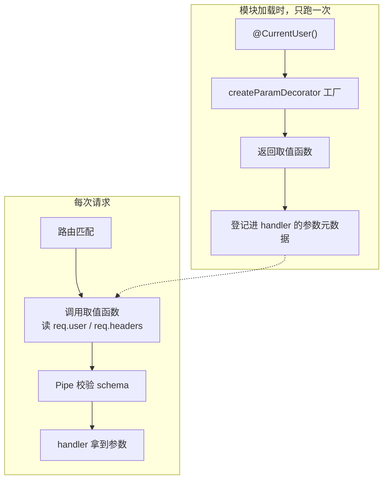

# 第 12 章 Nest 如何自定义装饰器

装饰器这个词听着玄，落到代码上只有一件事：给类、方法或参数贴一张便签，告诉框架"这段归谁管、有什么额外要求"。便签本身不干活，干活的是来读便签的人。

上一章末尾留了个尾巴：每个 handler 都要先 `switchToHttp().getRequest()`，再从 `req.user` 里掏字段。真写业务时，多半会写成下面这样，还带着一分侥幸——`req.user` 是 Passport（Node 的认证中间件，后面接入登录时会用到）塞进去的，TypeScript 看它是 `any`。

```ts
@Get('mine')
findMine(@Req() req: Request) {
  return this.bookingsService.findMine(req.user.id);
}
```

十几个接口都这么抄。后来用户模型把 `id` 改成 `userId`，编译器一声没吭，上线后这批接口统一返回空数组，日志里只有 `userId=undefined`。

这不是 TypeScript 的锅。`req.user` 的类型是 `any`，`any.id` 改不改名都合法，编译器没有任何理由报警。问题也不在改名，在于同一段取值逻辑被抄了十几份——没有一处能替你更新。

收进一个装饰器，handler 就只剩声明：

```ts
@Get('mine')
findMine(@CurrentUser() user: AuthUser) {
  return this.bookingsService.findMine(user.id);
}
```

Nest 内置的 `@Body()`、`@Query()`、`@Param()` 也是这个形状，只是框架替你写好了。

## 装饰器、元数据、反射，三件套

**装饰器（decorator）**是 TypeScript 的语法特性：一个函数，用 `@` 贴在类、方法、参数或属性前面，在类定义阶段就被调用。它本身不承载业务逻辑，通常只做三件事之一——往目标上写一段信息、挂上另一个装饰器、或者留下一个"这个参数从哪来"的取值函数。

这里有个容易混的地方：**装饰器和元数据不是一回事**。装饰器是动作，元数据是动作留下的字。`@SetMetadata('roles', ['ADMIN'])` 里，`@SetMetadata` 是写的那一半，`'roles'` 和数组是写下的字；读这些字的是 `Reflector`，第 13 章的主角。

打个比方：装饰器是往门上贴便签，元数据是便签上写的字，反射是有人来把便签读出来。三样缺一样都不行——只贴不读，便签就是装饰；读了但 key 对不上，等于读了一张空白便签。而且这两种情况都不会报错，只会安静地不生效。这也是为什么装饰器写错最难查：代码看着完全正常。

没有反射这一层会卡在哪？框架只能在启动时把所有路由硬编码进一张表，`@Roles()` 这种"运行时才知道要不要拦"的判断就无处安放。第 10 章已经按作用对象把装饰器分成六组，这里只复述一句：装饰器是声明，真正干活的是读它的人——路由装饰器由启动时的扫描器读，参数装饰器由请求进入 handler 前的参数解析器读，`@SetMetadata()` 写的东西由守卫或拦截器读。

**自定义装饰器**就是框架没提供、你自己写的那些。常见两类：

- **参数装饰器**换掉参数的来源。像点单时服务员不再问你要菜单，而是直接从柜台调出你的预订信息——调用方写法没变，值的来路变了。没有它，每个 handler 手写 `@Req()` 掏 `req.user`，就是开头那个事故。
- **方法/类装饰器**把多个声明打包。像把三张便签订成一张，贴一次等于贴三次。没有它，每个写接口头上都叠着 `@SetMetadata` 和 `@UseInterceptors`，改一个动作名要动三行。

两类都建立在同一套机制上：写便签、存字、有人读。区别只在读的人是谁——参数装饰器的读法是"请求进来时调取值函数"，方法装饰器的读法是"守卫或拦截器用 `Reflector` 查"。

## 先写一个能跑的 @CurrentUser()

**参数装饰器（param decorator）**挂在 handler 参数前面，不参与业务计算，只回答一个问题：这个参数的值从哪里来。`@Body()` 说从请求体来，`@Query('page')` 说从查询串来，`@CurrentUser()` 说从 `req.user` 来。

自己造一个，用 `createParamDecorator(factory)`：

```ts
// src/common/decorators/current-user.decorator.ts
import { createParamDecorator, type ExecutionContext } from '@nestjs/common';
import type { AuthUser } from '../types/auth-user.js';

interface RequestWithUser {
  user?: AuthUser;
  headers: Record<string, string | undefined>;
}

export const CurrentUser = createParamDecorator(
  (data: keyof AuthUser | undefined, ctx: ExecutionContext): AuthUser | string | undefined => {
    const request = ctx.switchToHttp().getRequest<RequestWithUser>();

    // 演示期用请求头冒充登录态；接入 JWT 后删掉这段，只读 request.user
    const user: AuthUser =
      request.user ??
      {
        id: request.headers['x-user-id'] ?? '',
        email: request.headers['x-user-email'] ?? '',
        name: request.headers['x-user-name'] ?? '',
        role: request.headers['x-user-role'] === 'ADMIN' ? 'ADMIN' : 'USER',
      };

    return data === undefined ? user : user[data];
  },
);
```

工厂的两个入参位置固定，名字随便起：第一个是你写在括号里的值，这里叫 `data`；第二个是上一章的 `ExecutionContext`（第 11 章）。`data` 为 `undefined` 时返回整个用户对象，传 `'email'` 时只返回邮箱。那个三元判断就是"取整个还是取一个字段"的开关，漏了它，`@CurrentUser('email')` 会给你整个用户对象。

注意 `request.headers['x-user-id']` 全是小写。Node 解析请求时已经把请求头名转成了小写，写成 `request.headers['X-User-Id']` 取到的是 `undefined`，而且不报错——自定义取头逻辑最常死在这儿。

把装饰器挂到控制器上：

```ts
// src/bookings/bookings.controller.ts（节选）
import { Controller, Get } from '@nestjs/common';
import type { AuthUser } from '../common/types/auth-user.js';
import { CurrentUser } from '../common/decorators/current-user.decorator.js';

@Controller({ path: 'bookings', version: '1' })
export class BookingsController {
  @Get('mine')
  findMine(@CurrentUser() user: AuthUser) {
    return { userId: user.id, email: user.email, role: user.role };
  }
}
```

跑起来：

```bash
pnpm start:dev

curl -s http://localhost:3000/api/v1/bookings/mine \
  -H 'x-user-id: 7c9e6679-7425-40de-944b-e07fc1f90ae7' \
  -H 'x-user-email: dev@example.com' \
  -H 'x-user-name: Dev' \
  -H 'x-user-role: USER'
# 示例输出：
# {"userId":"7c9e6679-7425-40de-944b-e07fc1f90ae7","email":"dev@example.com","role":"USER"}
```

把请求头全去掉，返回的是空字符串组成的对象，不是 401。这符合分工：**装饰器只负责取值，认证是 Guard 的事**。像前台的登记本只抄信息，不查身份证；查身份是门口保安的活。真实项目里 `req.user` 由 `JwtAuthGuard` 写入，装饰器里那段兜底代码删掉，`request.user` 为空时应该由守卫提前拒绝，而不是让 handler 拿到一个假用户。

`@Get('mine')` 要写在 `@Get(':id')` 前面。路由按声明顺序匹配，`mine` 先撞上 `:id`，会被 `ParseUUIDPipe` 判成非法 UUID 直接返 400，看起来像装饰器坏了，其实是路由顺序。这条与上一章同一个道理：匹配先到先得，不会因为路径更"像"就优先。

## 工厂只在类定义时跑一次

`createParamDecorator` 的工厂不是每个请求执行一次。模块加载时它执行一次，返回一个"取值函数"；之后每个请求进来，Nest 调用的是这个返回值。

像餐厅开业前把菜单印好，不是每位客人来都重印一遍。菜单印好之后，客人点菜时只用照着念——那个"念"的动作，才是每请求一次的取值函数。

```ts
// 只在启动时打印一次，不是每次请求
export const CurrentUser = createParamDecorator((data, ctx) => {
  console.log('factory');
  return ctx.switchToHttp().getRequest().user;
});
```

> **图 12-1** 装饰器在定义期登记，在请求期取值。



这条时间线解释了一个高频报错：在装饰器工厂里写 `this.configService.get(...)`，启动就报 `Cannot read properties of undefined`；或者用 `@Inject()` 注入了依赖，拿到的还是 `undefined`。工厂执行时容器还没建好，装饰器也没有实例，`this` 根本不指向任何东西。

**参数装饰器只取数据，不承载依赖。** 需要 `ConfigService`、`Logger`、数据库的逻辑，放进 Guard 或 Interceptor——它们由容器实例化，构造函数注入正常可用。这不是风格问题，是执行时机决定的：工厂跑的时候，容器还没开始装配。

顺带把 `data` 的类型收紧。`createParamDecorator<keyof AuthUser>` 能让 `@CurrentUser('emial')` 在编译期报错，而不是运行时拿到 `undefined`。但泛型只约束 `data`，返回值签名仍要自己写，别指望它自动收窄成 `string`。

## 取值顺手校验：Nest 12 的 schema 选项

参数装饰器只负责取，值合不合法是 Pipe 的事。Pipe 像安检机：你从哪来它不管，过机时不合规就拦下。它专门做转换和校验（第 19 章细讲，这里先知道这个分工）。

Nest 12 给参数装饰器加了 `schema` 选项，自定义装饰器也支持：传一个 Standard Schema（Zod、Valibot、ArkType 都实现了这套接口），由 `StandardSchemaValidationPipe` 消费。

```bash
pnpm add zod@^4.6.7
```

在 handler 上只取邮箱，并当场校验：

```ts
import { z } from 'zod';

@Get('mine')
findMine(
  @CurrentUser() user: AuthUser,
  @CurrentUser('email', { schema: z.email() }) email: string,
) {
  return { userId: user.id, email, role: user.role };
}
```

`@CurrentUser('email', { schema: z.email() })` 干了两件事：从用户对象里取 `email`，再把 `z.email()` 挂到这个参数的元数据上。注意 `schema` 不会传进工厂，工厂仍然只收到 `'email'`；Nest 把它单独记下来，留给 Pipe。

这也说明装饰器和 Pipe 是两个环节：装饰器负责把值捞出来，Pipe 负责判断捞出来的东西能不能用。两者靠元数据串起来，谁也不调谁。

Pipe 要注册，而且必须打开 `validateCustomDecorators`：

```ts
// src/app.config.ts（在 configureApp 里追加）
import { StandardSchemaValidationPipe, ValidationPipe } from '@nestjs/common';

app.useGlobalPipes(
  new ValidationPipe({ whitelist: true, transform: true }),
  new StandardSchemaValidationPipe({ validateCustomDecorators: true }),
);
```

`validateCustomDecorators` 默认是 `false`。这是刻意的：自定义装饰器取出来的可能是对象、数组，甚至不是请求里的东西，默认不校验避免误伤。不打开它，`z.email()` 就是个摆设，`abc` 会一路进到 handler。

重启后发一个非法邮箱：

```bash
curl -s -o /dev/null -w '%{http_code}\n' http://localhost:3000/api/v1/bookings/mine \
  -H 'x-user-id: 7c9e6679-7425-40de-944b-e07fc1f90ae7' \
  -H 'x-user-email: abc'

# 400，响应体（示例输出）：
# {"message":["Invalid email address"],"error":"Bad Request","statusCode":400}
```

这个 400 是 `StandardSchemaValidationPipe` 抛的，不是你手写的。要改错误结构，给它传 `exceptionFactory`；要换状态码，传 `errorHttpStatusCode`。

## 把"写元数据 + 挂拦截器"打包

还有一种重复不在参数上，在方法头上。审计要求每个写接口都记一条"谁在什么时候做了什么"，于是每个 handler 上面都叠着 `@SetMetadata('audit', '...')` 和 `@UseInterceptors(AuditInterceptor)`，改一个动作名要动三行。

`applyDecorators` 可以把多个装饰器合成一个：

```ts
// src/common/audit/audit.constants.ts
export const AUDIT_ACTION = 'audit:action';

// src/common/decorators/audited.decorator.ts
import { applyDecorators, SetMetadata, UseInterceptors } from '@nestjs/common';
import { AUDIT_ACTION } from '../audit/audit.constants.js';
import { AuditInterceptor } from '../interceptors/audit.interceptor.js';

export const Audited = (action: string) =>
  applyDecorators(
    SetMetadata(AUDIT_ACTION, action),
    UseInterceptors(AuditInterceptor),
  );
```

`applyDecorators` 没有隐藏语义，它只是把几个装饰器依次应用到同一个目标上。`@Audited('booking.list.mine')` 展开后就是两件事：给 handler 写一条元数据，给 handler 挂一个拦截器。

`SetMetadata` 只负责写，读取方得自己写。拦截器里注入 `Reflector`：

```ts
// src/common/interceptors/audit.interceptor.ts
import {
  type CallHandler,
  type ExecutionContext,
  Injectable,
  Logger,
  type NestInterceptor,
} from '@nestjs/common';
import { Reflector } from '@nestjs/core';
import type { Observable } from 'rxjs';
import { AUDIT_ACTION } from '../audit/audit.constants.js';

interface RequestWithUser {
  user?: { id: string };
  headers: Record<string, string | undefined>;
}

@Injectable()
export class AuditInterceptor implements NestInterceptor {
  private readonly logger = new Logger(AuditInterceptor.name);

  constructor(private readonly reflector: Reflector) {}

  intercept(context: ExecutionContext, next: CallHandler): Observable<unknown> {
    const action = this.reflector.get<string>(AUDIT_ACTION, context.getHandler());
    if (action === undefined) {
      return next.handle();
    }

    const request = context.switchToHttp().getRequest<RequestWithUser>();
    const userId = request.user?.id ?? request.headers['x-user-id'] ?? 'anonymous';
    this.logger.log(`action=${action} user=${userId}`);

    return next.handle();
  }
}
```

挂到路由上：

```ts
@Get('mine')
@Audited('booking.list.mine')
findMine(@CurrentUser() user: AuthUser) {
  return { userId: user.id };
}
```

拦截器必须能在容器里解析。`UseInterceptors(AuditInterceptor)` 传的是类，Nest 会向容器要实例，所以它要么在 `providers` 里，要么直接 `new` 一个不依赖注入的版本：

```ts
// src/bookings/bookings.module.ts
@Module({
  controllers: [BookingsController],
  providers: [BookingsService, AuditInterceptor],
})
export class BookingsModule {}
```

忘了注册，启动直接报 `Nest can't resolve dependencies of the AuditInterceptor`。这个错误比运行时静默失效好查得多——名字里就写了谁没注册。

请求一次，终端里会出现审计日志：

```bash
curl -s http://localhost:3000/api/v1/bookings/mine \
  -H 'x-user-id: 7c9e6679-7425-40de-944b-e07fc1f90ae7'

# 应用终端（示例输出）：
# [AuditInterceptor] action=booking.list.mine user=7c9e6679-7425-40de-944b-e07fc1f90ae7
```

没有 `@Audited` 的 handler 不会打日志，因为 `reflector.get` 返回 `undefined`，拦截器直接 `next.handle()` 放行。存储从日志换成数据库、再加字段、改成消息队列，都只改这一个拦截器。这就是"打包"真正的收益：改动点从 N 个 handler 收成一个文件。

## 几个容易踩反的地方

| 现象 | 原因 | 处理 |
| --- | --- | --- |
| 装饰器里注入的依赖是 `undefined` | 工厂在类定义期执行，容器还没建好 | 依赖逻辑移到 Guard / Interceptor |
| `@CurrentUser('email')` 拿到整个对象 | 工厂没判断 `data` | `data === undefined ? user : user[data]` |
| `{ schema }` 不生效 | 没注册 `StandardSchemaValidationPipe`，或没开 `validateCustomDecorators` | 两处同时配好 |
| `/bookings/mine` 返回 400 | 被 `@Get(':id')` 抢占 | 静态路由写在参数路由之前 |
| 取到的请求头是 `undefined` | Node 把请求头名转成了小写 | 统一用小写 key |
| 审计日志打两遍 | `@Audited` 和全局 `APP_INTERCEPTOR` 各注册了一次 | 只留一种 |

还有三件事值得记住：

- **装饰器只声明意图**。取值和副作用分开，`@Audited()` 才可能被替换、复用、独立演进。
- **身份来源要写清楚**。示例从 `x-user-*` 取身份，前提是这些头由网关注入、外部伪造不进来。服务直接对公网时，必须改成守卫验完 JWT 写 `req.user`，装饰器只读 `req.user`。
- **元数据 key 用常量**。`'audit'` 和 `'audit:action'` 混用，`Reflector` 只会安静地返回 `undefined`，不会报错。

装饰器写完，问题就变成"元数据写给谁看"。`SetMetadata` 存进去的东西、`Reflector` 怎么读、方法级和类级冲突时听谁的，这些是下一章的内容。


<!-- chapter-nav:start -->
---

← 上一篇：[011 ExecutionContext：切换不同上下文](011-ExecutionContext：切换不同上下文.md) · [本 Part 目录](_part.md) · 下一篇：[013 Metadata和Reflector](013-Metadata和Reflector.md) →
<!-- chapter-nav:end -->
