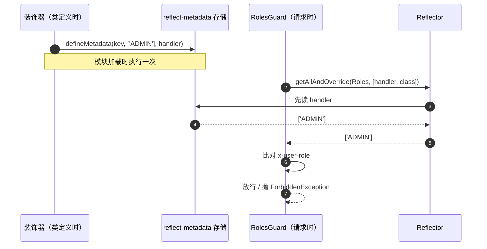
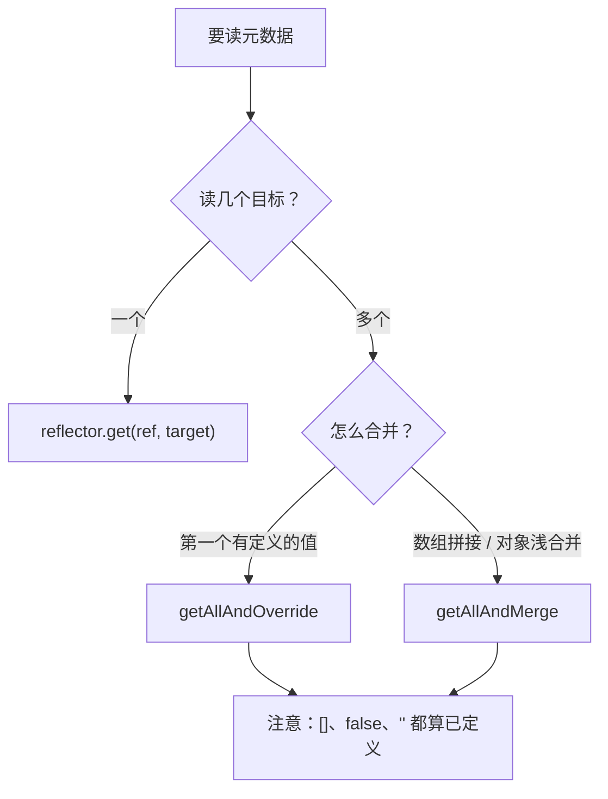

# 第 13 章 Metadata 和 Reflector

装饰器你已经在第 10 章和第 12 章见过了。它干的事，说穿了就是贴标签：类定义的时候，往类或方法上贴一张小纸条，上面写「这个接口要 ADMIN」「这个参数从 req.user 取」。贴完，装饰器就退场了。

纸条本身不会拦人，也不会取数据。请求进来之后，得有人把纸条撕下来看，权限才真正生效。这一章讲两件事：纸条上写的字——元数据，和来看纸条的人——Reflector。

先看一个真实事故。

一个普通用户调 `DELETE /api/v1/bookings/3f1c2b9e-7d4a-4c1e-9b2a-1a2b3c4d5e6f`，返回 204，别人的会议被删了。控制器上明明写着 `@Roles(['ADMIN'])`。

打开 `roles.guard.ts`，问题一眼就能看见：`this.reflector.get(Roles, context.getClass())`。只读类，不读方法。方法上那条 `@Roles(['ADMIN'])` 从写进去那天起，就没人读过。

装饰器写了，读取方读错了地方。这种 bug 不抛异常、不打日志，只是安静地把权限放宽。这一章就把这条链路拆开：元数据存在哪，`Reflector` 有几种读法，方法级和类级冲突时听谁的。

## 元数据就是贴在函数上的一张便签

**元数据（metadata）**这个词听着像玄学，其实就是「关于数据的数据」。落到代码里，它是一条挂在某个对象上的键值记录：键是名字，值是任意对象，对象可以是类、方法，也可以是普通函数。

打个比方，行李箱上的托运条。箱子还是那个箱子，条子上写着目的地、重量、易碎；条子不是行李，但没有它，分拣员不知道该把箱子扔到哪条传送带。

没有元数据会卡在哪？Nest 启动时只能把路由、权限、缓存策略全部写死在框架源码里。你每加一个接口，都得改框架。有了这条记录，框架才能等到运行时再问：「这个 handler 上写了什么？」

这里最容易混的是三样东西：

- **装饰器**是贴的动作，**元数据**是贴上去的字。`@SetMetadata('roles', ['ADMIN'])` 里，`@SetMetadata` 是动作，`'roles'` 和 `['ADMIN']` 是字。
- **元数据不是请求数据**。请求数据每次请求都不一样；元数据在类定义时写一次，所有请求共享同一份。
- **元数据也不是配置文件**。配置文件在磁盘上，元数据挂在内存里的类或函数对象上，进程重启就没了。

`reflect-metadata` 这个库给 JavaScript 的 `Reflect` 补上了读写元数据的方法。Nest 启动时会先加载它。先跑一个最小的例子：

```ts
// meta-demo.ts
import 'reflect-metadata';

const handler = (): void => {};

Reflect.defineMetadata('roles', ['ADMIN'], handler);
console.log(Reflect.getMetadata('roles', handler));
```

用 `tsx` 直接跑：

```bash
pnpm exec tsx meta-demo.ts
# [ 'ADMIN' ]
```

`Reflect.defineMetadata` 是写，`Reflect.getMetadata` 是读，目标可以是类、方法、普通函数。就这么两行，没有别的魔法。

Nest 的 `@SetMetadata(key, value)` 就是这两行的语法糖，简化后大致是这样：

```ts
export const SetMetadata = (key: string, value: unknown) =>
  (target: object, propertyKey?: string | symbol, descriptor?: PropertyDescriptor) => {
    Reflect.defineMetadata(key, value, descriptor?.value ?? target);
  };
```

看清楚 `descriptor?.value ?? target`：装饰方法时，元数据挂在方法函数上；装饰类时，挂在类上。挂上去的这一刻，请求还没来，Nest 也还没启动完。

这带来三个必须记住的后果：

- **一份，所有人共用**。一个类只写一次，所有请求读到的都是同一份。像小区公告栏，贴一张，全楼看的是同一张。
- **生命周期跟着类走**。类不被回收，元数据就在；进程重启，元数据重写一遍。
- **别放运行时值**。用户 ID、时间戳、请求体放进去，就是所有人看到最后一个人的值。

有人写过 `@SetMetadata('tenant', tenantId)`，想按请求区分租户。结果启动时 `tenantId` 是 `undefined`，所有租户拿到同一个值。要按请求变化的数据，放 `request` 对象、放 `AsyncLocalStorage`（Node 里按一次请求隔离存数据的机制），都行，就是别放元数据。

**守卫（Guard）**是最依赖元数据的组件。它像门口的保安：请求进来，先看证件，只回答「放不放行」，不碰业务代码。返回值只能是 `true`、`false`、`Promise` 或 `Observable`。

没有守卫会卡在哪？权限判断只能散在每个 handler 里，或者塞进中间件。中间件跑在路由匹配之前，拿不到最终命中哪个方法，也就读不到方法上的 `@Roles()`——这就是它和守卫最容易混的地方。中间件适合改请求、记日志（第 17 章），权限判断只能写在守卫里。

> **图 13-1** 元数据在类定义时写入，在请求到达时由 Reflector 读出。



## Reflector 是来读便签的人

**Reflector** 是 Nest 对 `Reflect` 的一层薄包装。它不存元数据，只负责按约定把元数据读出来、合并好。

像公司前台专职查档案的人：你说查谁的哪份，他去档案柜取；你不用记柜子编号，也不用自己判断两份档案哪份优先。

直接 `Reflect.getMetadata` 也能读，但有两个麻烦：key 是裸字符串，拼错了编译期发现不了；方法上和类上都有值时，优先级得自己写。Reflector 补的就是这两件事。

它由 Nest 注册在容器里，构造函数注入就能用：

```ts
import { Reflector } from '@nestjs/core';

@Injectable()
export class RolesGuard {
  constructor(private readonly reflector: Reflector) {}
}
```

四个方法，语义完全不同：

| 方法 | 返回值 | 什么时候用 |
| --- | --- | --- |
| `get(ref, target)` | 单个值或 `undefined` | 元数据只可能挂在一个地方 |
| `getAll(ref, targets)` | 数组，元素可能 `undefined` | 想自己写合并逻辑 |
| `getAllAndOverride(ref, [handler, class])` | 第一个有定义的值 | 方法覆盖类：角色、开关、超时 |
| `getAllAndMerge(ref, [handler, class])` | 数组拼接 / 对象浅合并 | 累加型：缓存标签、埋点标签 |

两个细节决定行为符不符合直觉。

**顺序由调用方决定。** 惯例写 `[getHandler(), getClass()]`，意思是先问方法，方法没写再问类。传反了就变成类优先，代码不报错，语义完全变了。就像请假先问直属领导、再问人事；顺序一换，批不批由谁说了算就变了。

**「有定义」包括空数组、`false`、空字符串。** `@Roles([])` 会盖掉类上的 `['ADMIN']`，不会回退。空数组也是一张写了字的纸条，只是写着「这里没有角色要求」，不是没写——在权限里，它的效果是把类上的默认限制悄悄放开，也可能是「显式关闭」的手段，取决于你有没有把它写进文档。

> **图 13-2** 四个读法的选型路径。



## 用 createDecorator 生成带类型的装饰器

Nest 12 里，`nest g decorator` 生成的默认写法变了：

```ts
export const Roles = Reflector.createDecorator<Role[]>();
```

`createDecorator<Role[]>()` 返回一个只接受 `Role[]` 的函数，key 被封在闭包里。像把钥匙焊在锁上：调用方不用记 key 是哪串字符串，也就拼不错；`reflector.get(Roles, target)` 读出来还有类型。

团队一大，字符串 key 的拼写错误就是最烦的那类问题——它只在运行时以「权限没生效」的形式出现，编译期一声不吭。

代价是它只处理「一个 key 一个值」。需要同时挂多条元数据时，还是 `applyDecorators` 组合，或者回到 `SetMetadata`。没有参数、只表达一个布尔开关的场景，`SetMetadata(KEY, true)` 反而更直接：写成 `@Public(true)` 是多余的。

这和 `SetMetadata` 不是替代关系，是两种工具：一个带类型、管一个 key；一个更灵活、能挂任意值。历史代码里两种都有，`Reflector` 都认，不用强行统一。

先把目标定清楚：列表接口公开，其余默认 `ADMIN` / `USER` 可访问，删除只给 `ADMIN`；再加一个缓存标签，看看「合并」是什么效果。

```ts
// src/common/auth/role.ts
export type Role = 'ADMIN' | 'USER';

// src/common/decorators/roles.decorator.ts
import { Reflector } from '@nestjs/core';
import type { Role } from '../auth/role.js';

export const Roles = Reflector.createDecorator<Role[]>();

// src/common/decorators/public.decorator.ts
import { SetMetadata } from '@nestjs/common';

export const IS_PUBLIC = 'auth:is-public';

export const Public = () => SetMetadata(IS_PUBLIC, true);

// src/common/decorators/cache-hints.decorator.ts
import { Reflector } from '@nestjs/core';

export const CacheHints = Reflector.createDecorator<string[]>();
```

`Roles` 和 `CacheHints` 需要参数和类型，用 `createDecorator`；`Public` 不需要参数，`SetMetadata` 更自然——写成 `@Public(true)` 是多余的。两种写法 `Reflector` 都认，不用强行统一历史代码。

## 守卫先读放行，再读角色

```ts
// src/common/guards/roles.guard.ts
import {
  type CanActivate,
  type ExecutionContext,
  ForbiddenException,
  Injectable,
} from '@nestjs/common';
import { Reflector } from '@nestjs/core';
import type { Role } from '../auth/role.js';
import { IS_PUBLIC } from '../decorators/public.decorator.js';
import { Roles } from '../decorators/roles.decorator.js';

interface RequestWithRole {
  headers: Record<string, string | undefined>;
}

@Injectable()
export class RolesGuard implements CanActivate {
  constructor(private readonly reflector: Reflector) {}

  canActivate(context: ExecutionContext): boolean {
    // 先看显式放行，命中就不再读角色
    const isPublic = this.reflector.getAllAndOverride<boolean>(IS_PUBLIC, [
      context.getHandler(),
      context.getClass(),
    ]);
    if (isPublic === true) {
      return true;
    }

    const roles = this.reflector.getAllAndOverride<Role[]>(Roles, [
      context.getHandler(),
      context.getClass(),
    ]);
    if (roles === undefined || roles.length === 0) {
      return true;
    }

    const { headers } = context.switchToHttp().getRequest<RequestWithRole>();
    const role = headers['x-user-role'];
    if (role === undefined || !roles.includes(role as Role)) {
      throw new ForbiddenException(`需要以下角色之一：${roles.join('、')}`);
    }

    return true;
  }
}
```

`@Public()` 的判断必须写在角色判断前面。读取顺序就是优先级——反过来的话，一个被 `@Public()` 标记的接口仍然会先撞上角色检查。

`roles` 为空时放行，这是「没配就不限制」。生产里更稳的默认是拒绝：没写角色就不许访问，要公开就显式 `@Public()`。选哪种是安全决策，不是代码细节，定下来写进团队文档。

控制器上，类级给默认值，方法级做覆盖：

```ts
// src/bookings/bookings.controller.ts
import {
  Body, Controller, Delete, Get, Header, HttpCode, HttpStatus,
  Param, ParseUUIDPipe, Post, Query, UseGuards, UseInterceptors, Version,
} from '@nestjs/common';
import type { AuthUser } from '../common/types/auth-user.js';
import { CacheHints } from '../common/decorators/cache-hints.decorator.js';
import { CurrentUser } from '../common/decorators/current-user.decorator.js';
import { Public } from '../common/decorators/public.decorator.js';
import { Roles } from '../common/decorators/roles.decorator.js';
import { RolesGuard } from '../common/guards/roles.guard.js';
import { CacheHintInterceptor } from '../common/interceptors/cache-hint.interceptor.js';
import { BookingsService, type Booking } from './bookings.service.js';
import type { CreateBookingDto } from './dto/create-booking.dto.js';

@Controller('bookings')
@Version('1')
@Roles(['ADMIN', 'USER'])
@CacheHints(['v1'])
@UseGuards(RolesGuard)
@UseInterceptors(CacheHintInterceptor)
export class BookingsController {
  constructor(private readonly bookingsService: BookingsService) {}

  @Get()
  @Public()
  @Header('Cache-Control', 'no-store')
  findAll(@Query('roomId') roomId?: string): Booking[] {
    return this.bookingsService.findAll({ roomId });
  }

  @Get('mine')
  @CacheHints(['bookings', 'mine'])
  findMine(@CurrentUser() user: AuthUser) {
    return { userId: user.id };
  }

  @Get(':id')
  findOne(@Param('id', ParseUUIDPipe) id: string): Booking {
    return this.bookingsService.findOne(id);
  }

  @Post()
  @Roles(['ADMIN'])
  @HttpCode(HttpStatus.CREATED)
  create(@Body() dto: CreateBookingDto): Booking {
    return this.bookingsService.create(dto);
  }

  @Delete(':id')
  @Roles(['ADMIN'])
  @HttpCode(HttpStatus.NO_CONTENT)
  remove(@Param('id', ParseUUIDPipe) id: string): void {
    this.bookingsService.remove(id);
  }
}
```

`@Get('mine')` 必须排在 `@Get(':id')` 前面，否则 `mine` 会被当成 UUID 参数，先撞上 `ParseUUIDPipe` 得到 400。这是路由匹配顺序，和元数据无关，但混在同一段代码里特别容易被归错原因。

守卫和拦截器要交给容器实例化：

```ts
// src/bookings/bookings.module.ts
@Module({
  controllers: [BookingsController],
  providers: [BookingsService, RolesGuard, CacheHintInterceptor],
})
export class BookingsModule {}
```

如果图省事写成 `new RolesGuard()`，构造函数里的 `Reflector` 没人传，运行时报 `Cannot read properties of undefined (reading 'getAllAndOverride')`。这和第 12 章里拦截器忘了注册是同一类问题。

## 跑一遍，看四种结果

```bash
pnpm start:dev

# 1) 列表被 @Public() 放行，匿名可访问
curl -s -o /dev/null -w '%{http_code}\n' http://localhost:3000/api/v1/bookings
# 200

# 2) 详情没带角色头，方法没有覆盖，落到类上的 ADMIN、USER
curl -s http://localhost:3000/api/v1/bookings/3f1c2b9e-7d4a-4c1e-9b2a-1a2b3c4d5e6f
# {"message":"需要以下角色之一：ADMIN、USER","error":"Forbidden","statusCode":403}

# 3) 方法级覆盖类级：USER 删不掉，ADMIN 删得掉
curl -s -o /dev/null -w '%{http_code}\n' -X DELETE \
  http://localhost:3000/api/v1/bookings/3f1c2b9e-7d4a-4c1e-9b2a-1a2b3c4d5e6f \
  -H 'x-user-role: USER'
# 403

curl -s -o /dev/null -w '%{http_code}\n' -X DELETE \
  http://localhost:3000/api/v1/bookings/3f1c2b9e-7d4a-4c1e-9b2a-1a2b3c4d5e6f \
  -H 'x-user-role: ADMIN'
# 204
```

第 3 条是整章的重点：同一个方法，凭 `x-user-role` 不同给出 403 和 204，说明方法上的 `@Roles(['ADMIN'])` 真的被读到了。两条都是 403，先查守卫有没有把 `getHandler()` 放进数组；两条都是 204，说明它还在读 `getClass()`。

上面的响应是示例输出，`remove` 在 demo 里不校验记录是否存在；接上数据库后，不存在的 ID 会先返 404。

## 合并语义：类上的标签不该被方法吞掉

缓存标签是累加语义。类上放 `['v1']`，方法上放 `['bookings', 'mine']`，期望三个都在：

```ts
// src/common/interceptors/cache-hint.interceptor.ts
import {
  type CallHandler,
  type ExecutionContext,
  Injectable,
  type NestInterceptor,
} from '@nestjs/common';
import { Reflector } from '@nestjs/core';
import type { Observable } from 'rxjs';
import { CacheHints } from '../decorators/cache-hints.decorator.js';

interface HeaderWritable {
  setHeader(name: string, value: string): void;
}

@Injectable()
export class CacheHintInterceptor implements NestInterceptor {
  constructor(private readonly reflector: Reflector) {}

  intercept(context: ExecutionContext, next: CallHandler): Observable<unknown> {
    const hints = this.reflector.getAllAndMerge<string[]>(CacheHints, [
      context.getHandler(),
      context.getClass(),
    ]);

    if (hints.length > 0) {
      context
        .switchToHttp()
        .getResponse<HeaderWritable>()
        .setHeader('X-Cache-Hints', hints.join(','));
    }

    return next.handle();
  }
}
```

```bash
curl -s -D - -o /dev/null http://localhost:3000/api/v1/bookings/mine \
  -H 'x-user-role: USER' \
  -H 'x-user-id: 7c9e6679-7425-40de-944b-e07fc1f90ae7' \
  | grep -i x-cache-hints
# X-Cache-Hints: bookings,mine,v1
```

换成 `getAllAndOverride` 就只剩方法那一份，类上的 `v1` 直接丢了。这就是「覆盖」和「合并」的差别，不是哪个更好，是语义不同：一个像新规定覆盖旧规定，一个像把两张清单拼成一张。

## 几个踩过的坑

| 现象 | 原因 | 处理 |
| --- | --- | --- |
| 方法上的 `@Roles` 不生效 | 守卫只读了 `getClass()` | `getAllAndOverride(Roles, [handler, class])` |
| 类上的默认角色被空数组覆盖 | `[]` 也算「已定义」 | 想表达「没配」就别写装饰器 |
| 子类控制器继承了基类权限 | `getMetadata` 沿原型链查找 | 用 `getOwnMetadata`，或不在基类挂权限 |
| 两个同类装饰器只有一个生效 | 从下往上执行，后应用的覆盖先应用的 | 合并成一个装饰器 |
| 守卫里 `reflector` 是 `undefined` | 守卫被 `new` 出来，没走容器 | 注册进 `providers`，用 `@UseGuards(RolesGuard)` |
| 类和方法都命中，标签重复 | `getAllAndMerge` 只拼接，不去重 | 在读取后 `new Set(hints)` |

还有一条不属于代码，但更常见：**把优先级规则留给读代码的人去猜**。同一个项目里，有的接口方法覆盖类，有的类方法合并，有的空数组表示关闭——半年后没人说得清哪个接口到底谁能调。规则本身不复杂，复杂的是没写下来。

到这儿，元数据这条链路闭合了：装饰器在类定义期写一条记录，`Reflector` 在请求期按「方法优先、类兜底、或合并」读出来，守卫和拦截器拿它做决策。你手上多了两个能力：给接口加声明式策略，以及在策略不生效时，按「谁写、写在哪、谁读、读哪个目标」四步定位。

下一章换个方向。前面所有例子都是单向依赖：Controller 依赖 Service，Guard 依赖 Reflector。真实项目里总会出现 A 依赖 B、B 又依赖 A 的情况，模块之间也一样。Nest 允许你写出来，但运行时会给你两个不同的报错——模块级的和 Provider 级的，处理方式完全不同。

这几页官方文档对应正文里的几个点，读完再看：[Decorators](https://www.typescriptlang.org/docs/handbook/decorators.html)（装饰器在类定义时执行，对应开头「装饰器只是贴标签」）、[emitDecoratorMetadata](https://www.typescriptlang.org/tsconfig/#emitDecoratorMetadata)（编译后额外发出哪些类型信息，对应 Nest 怎么知道该注入谁）、[reflect-metadata](https://github.com/rbuckton/reflect-metadata)（`defineMetadata` / `getMetadata` 的出处，对应可运行的元数据示例）、[Execution context](https://docs.nestjs.com/fundamentals/execution-context)（`getClass()`、`getHandler()` 的官方说明，对应守卫读元数据那段）、[Guards](https://docs.nestjs.com/guards)（守卫在请求链上的位置和返回值约定）、[Custom decorators](https://docs.nestjs.com/custom-decorators)（`Reflector.createDecorator` 的官方写法，对应本章后半段）。

<!-- chapter-nav:start -->
---

← 上一篇：[012 Nest如何自定义装饰器](012-Nest如何自定义装饰器.md) · [本 Part 目录](_part.md) · 下一篇：[014 Module和Provider的循环依赖怎么处理](014-Module和Provider的循环依赖怎么处理.md) →
<!-- chapter-nav:end -->
