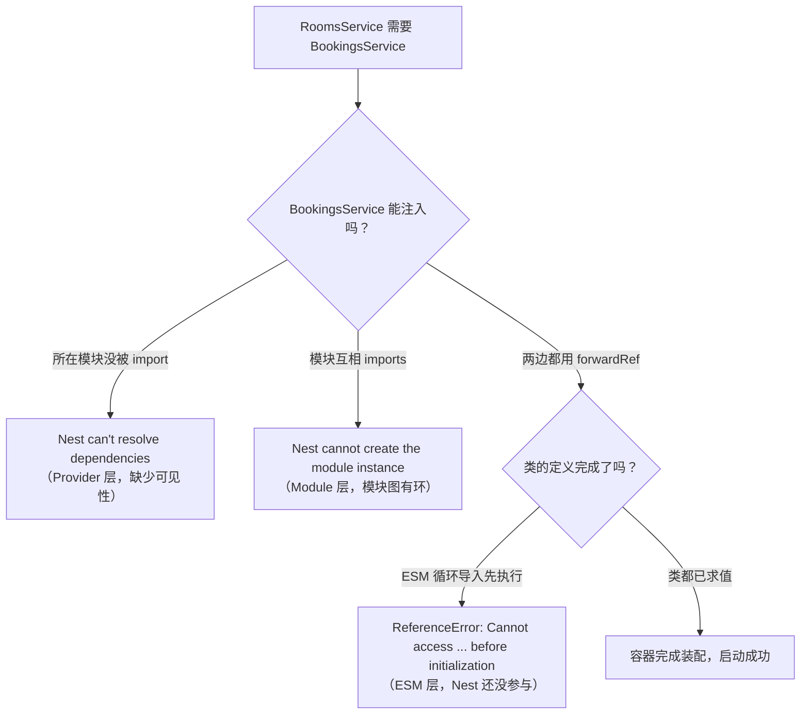
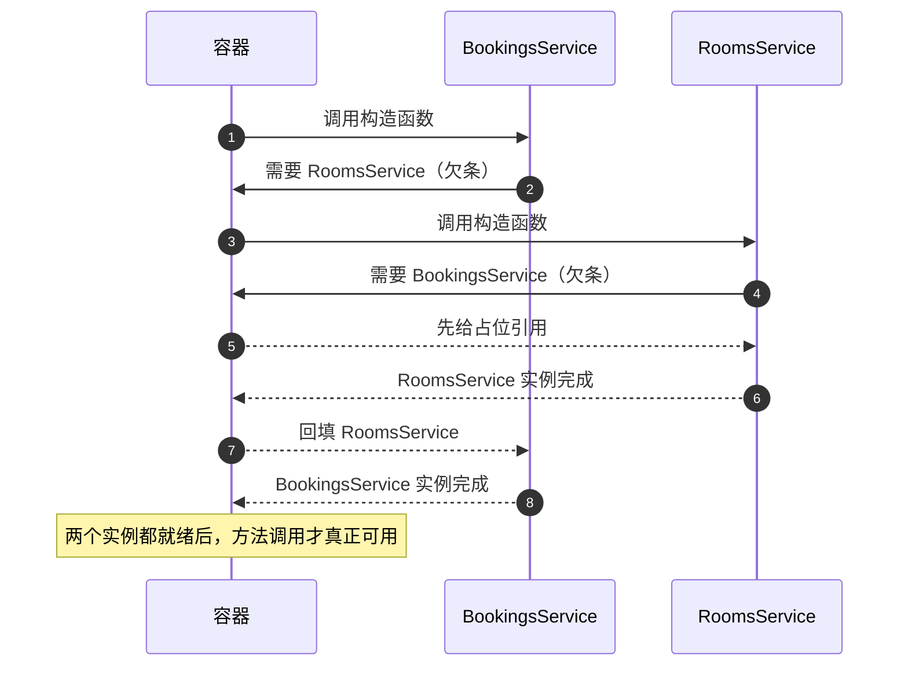

# 第 14 章 Module 和 Provider 的循环依赖怎么处理

## 先弄懂：循环依赖是什么

先把“依赖”这件事说清楚。Nest 启动时会把整个应用画成一张**依赖图**：节点是模块和 Provider（第 5、7、8 章讲过，模块是边界单位，Provider 是交给容器托管的实例），边是“谁需要谁”——`RoomsService` 的构造函数要 `BookingsService`，就有一条 `RoomsService → BookingsService` 的边；`RoomsModule` 的 `imports` 里有 `BookingsModule`，模块之间也有一条边。容器按这张图决定先造谁、后造谁。

这张图必须是**有向无环图**。一旦出现 `A → B → A`，就没有任何一个节点能第一个完成：造 A 要等 B，造 B 要等 A，容器只能抛错。这就是**循环依赖**。它不是某个要打开的开关，多数时候是模块边界划错了：两个服务互相读对方的数据，往往说明它们之间少了一层。只有真拆不掉的双向需求，才值得用 `forwardRef` 把“现在就要”改成“等会儿再要”。

还要记住，Nest 要解析的只是前两层：Provider 构造函数一层、Module `imports` 一层；再往下还有 ESM 的模块求值顺序（ESM 就是项目里 `import ... from ...` 这套模块系统，它在 Nest 启动之前就执行）。`forwardRef` 只能推迟容器解析，推迟不了 JavaScript 的 import 求值——这是这一章最容易翻车的地方。

官方文档（先看懂正文再点）：
- [Circular dependency](https://docs.nestjs.com/fundamentals/circular-dependency)：官方把模块级和 Provider 级两种环分开讲，对应“两个方向都跑一遍”。
- [Modules](https://www.typescriptlang.org/docs/handbook/2/modules.html)：TypeScript 的模块求值顺序和 `import type`，对应那次 `Cannot access ... before initialization` 报错。

现在看一个真实事故。

产品给房间列表加了个“当前占用”列，你要在 `RoomsService` 里查这个房间有几条有效预订。代码不复杂，从 `BookingsService` 拿个计数就行，加完依赖，`pnpm start:dev` 却没起来。

第一反应是“少 import 了模块”，补上 `BookingsModule` 后启动仍然失败，错误从“依赖解析不到”换成了“模块实例创建不了”；照提示给两边模块包上 `forwardRef`，第三次启动直接抛 `ReferenceError: Cannot access 'BookingsService' before initialization`——这次连 Nest 都还没进场。三个报错、三个层，修法各不相同。更麻烦的是第三层：`forwardRef` 只能推迟 Nest 的解析，推迟不了 ESM 的 import 求值。所以在这个 ESM 项目里，光给两边加 `forwardRef` 仍然起不来。这一章先把“环长在哪一层”看清楚，再给一份 ESM 下真能跑的写法。

## 先分清 Module 和 Provider

**Module（模块）**是 Nest 的边界单位。一个类加上 `@Module()`，就是在声明四件事：`imports`（我要用哪些模块导出的东西）、`controllers`（我对外暴露哪些路由）、`providers`（我内部有哪些可注入实例）、`exports`（我允许别人用哪些）。模块管的是“谁能看见谁”。

**Provider**是交给容器托管的任何实例，不限于 Service。Repository、Guard、拦截器、`{ provide: 'DB', useValue: db }` 这样的值，都算。模块是盒子，Provider 是盒子里的东西。

所以循环依赖有两层：两个 Service 的构造函数互相要对方（Provider 层），或者两个 Module 的 `imports` 互相指向对方（Module 层）。还有更早的第三层——ESM 的模块求值顺序，它发生在 Nest 启动之前。

> **图 14-1** 同一个环，在三个阶段会以三种完全不同的错误出现。



第一层是可见性问题。`BookingsService` 在 `BookingsModule` 里，`RoomsModule` 不 import 它，容器就不允许注入。这还不算环，补一行 `imports` 能解决。

补完之后，两个模块互相 import，才真的成环。容器在实例化模块时发现 A 等 B、B 等 A，谁也无法先完成，于是抛 `Nest cannot create the module instance`。

到了第三层，模块配置已经对了，但两个 `.ts` 文件互相 `import`。Node 执行 ESM 时按依赖顺序求值，`rooms.service.ts` 开始执行时，`bookings.service.ts` 里的 `BookingsService` 还处在暂时性死区（声明已提升、但尚未初始化的阶段），`emitDecoratorMetadata` 想读构造参数类型，读到的是未初始化绑定，直接 `ReferenceError`。

三层里只有第二层是“Nest 的循环依赖”，另外两层是模块可见性和 JavaScript 求值顺序。把它们混成一句“加 `forwardRef`”，就会出现改了这里、那里又炸的局面。

## forwardRef 只是把求值往后挪

`forwardRef` 接收一个返回类的函数：

```ts
forwardRef(() => RoomsService)
```

它不返回 `RoomsService`，返回的是一张“欠条”。容器先把这张欠条收下，等所有类都完成定义，再回调箭头函数，把真正的类取出来。环没有被删除，只是从“立刻要”变成“等会儿要”。

这解释了为什么必须两边都写。只包一侧，另一侧在解析构造参数时仍然立即求值，欠条还没到兑现的时候。也解释了为什么模块和 Provider 用的不是同一个位置：

- Provider 的构造参数：`@Inject(forwardRef(() => RoomsService))`
- Module 的 `imports`：`imports: [forwardRef(() => RoomsModule)]`

一个写在参数装饰器里，一个写在模块元数据里。只改一处，另一层照旧报错。

> **图 14-2** 两个实例都造出来之后，容器才回填引用。



时序图里有一处很容易忽略：`RoomsService` 的构造函数执行时，注入的 `BookingsService` 还没装配完。所以在构造函数里调用对方的方法，拿到的东西可能不完整。跨服务调用放业务方法里，最早放到 `onModuleInit` 之后。

官方文档还有一句提醒：**实例化顺序不确定**。不要写“A 一定先于 B”的代码，换个模块导入顺序就可能变。

但 `forwardRef` 的欠条只在 Nest 容器里有效。ESM 在 Nest 启动之前就要求值模块：`bookings.service.ts` 执行到类装饰器时，`rooms.service.ts` 里的 `RoomsService` 还在暂时性死区，`emitDecoratorMetadata` 生成的 `design:paramtypes` 会直接读它。`forwardRef` 还没被容器调用，帮不上忙。ESM 项目要同时做两件事：让 Nest 的依赖图可以延迟解析，让 ESM 的模块图不存在运行时环。前者靠 `forwardRef`，后者靠 `import type` 和注入令牌。

## 把环写出来，再修

沿用 `meeting-booking`。需求是双向的：创建预订要确认房间存在，房间占用率要统计预订。下面的写法能在 ESM 下跑：构造函数只 `import type` 对方的类，运行时依赖换成共享令牌；Nest 的环仍用 `forwardRef` 延迟。

先放一个两边都能 import 的令牌文件，它不依赖任何服务，所以不会参与环：

```ts
// src/contracts/tokens.ts
export const ROOMS_SERVICE = 'ROOMS_SERVICE';
export const BOOKINGS_SERVICE = 'BOOKINGS_SERVICE';
```

`ROOMS_SERVICE` 是一个字符串令牌，代表“房间服务”这个能力。`BookingsService` 只认令牌，不认 `RoomsService` 这个类，ESM 就不需要为了构造参数去求值对方的模块。令牌用字符串还是 `Symbol` 都行，字符串在日志和报错里更好认。

```ts
// src/bookings/bookings.service.ts
import { forwardRef, Inject, Injectable } from '@nestjs/common';
import { randomUUID } from 'node:crypto';
import type { RoomsService } from '../rooms/rooms.service.js';
import { ROOMS_SERVICE } from '../contracts/tokens.js';

export interface Booking {
  id: string;
  roomId: string;
  userId: string;
  startsAt: string;
  endsAt: string;
}

export interface CreateBookingInput {
  roomId: string;
  userId: string;
  startsAt: string;
  endsAt: string;
}

@Injectable()
export class BookingsService {
  private readonly bookings: Booking[] = [
    {
      id: 'bk_1',
      roomId: 'room_9',
      userId: 'usr_1',
      startsAt: '2026-11-10T09:00:00.000Z',
      endsAt: '2026-11-10T10:00:00.000Z',
    },
  ];

  constructor(
    @Inject(forwardRef(() => ROOMS_SERVICE))
    private readonly roomsService: RoomsService,
  ) {}

  findAll(roomId?: string): Booking[] {
    return roomId === undefined
      ? this.bookings
      : this.bookings.filter((booking) => booking.roomId === roomId);
  }

  create(input: CreateBookingInput): Booking {
    // 构造期间不碰对方，调用放在业务方法里
    this.roomsService.findOne(input.roomId);

    const booking: Booking = { id: randomUUID(), ...input };
    this.bookings.push(booking);
    return booking;
  }

  countActiveByRoom(roomId: string): number {
    return this.bookings.filter((booking) => booking.roomId === roomId).length;
  }
}
```

`RoomsService` 是镜面写法：

```ts
// src/rooms/rooms.service.ts
import { forwardRef, Inject, Injectable, NotFoundException } from '@nestjs/common';
import type { BookingsService } from '../bookings/bookings.service.js';
import { BOOKINGS_SERVICE } from '../contracts/tokens.js';

export interface Room {
  id: string;
  name: string;
  capacity: number;
}

export interface RoomOccupancy {
  roomId: string;
  activeBookings: number;
}

@Injectable()
export class RoomsService {
  private readonly rooms: Room[] = [
    { id: 'room_9', name: '9F-Aurora', capacity: 8 },
    { id: 'room_10', name: '9F-Borealis', capacity: 4 },
  ];

  constructor(
    @Inject(forwardRef(() => BOOKINGS_SERVICE))
    private readonly bookingsService: BookingsService,
  ) {}

  findOne(id: string): Room {
    const room = this.rooms.find((item) => item.id === id);
    if (room === undefined) {
      throw new NotFoundException(`Room ${id} not found`);
    }
    return room;
  }

  occupancy(roomId: string): RoomOccupancy {
    this.findOne(roomId);
    return {
      roomId,
      activeBookings: this.bookingsService.countActiveByRoom(roomId),
    };
  }
}
```

两个 `@Inject(forwardRef(() => 令牌))` 是对称的，少一个都不行。注意括号里已经是令牌，不再是类。接下来是模块层，要额外做一次“令牌 → 实例”的映射：

```ts
// src/bookings/bookings.module.ts
import { forwardRef, Module } from '@nestjs/common';
import { RoomsModule } from '../rooms/rooms.module.js';
import { BOOKINGS_SERVICE } from '../contracts/tokens.js';
import { BookingsController } from './bookings.controller.js';
import { BookingsService } from './bookings.service.js';

@Module({
  imports: [forwardRef(() => RoomsModule)],
  controllers: [BookingsController],
  providers: [
    BookingsService,
    { provide: BOOKINGS_SERVICE, useExisting: BookingsService },
  ],
  exports: [BookingsService, BOOKINGS_SERVICE],
})
export class BookingsModule {}

// src/rooms/rooms.module.ts
import { forwardRef, Module } from '@nestjs/common';
import { BookingsModule } from '../bookings/bookings.module.js';
import { ROOMS_SERVICE } from '../contracts/tokens.js';
import { RoomsController } from './rooms.controller.js';
import { RoomsService } from './rooms.service.js';

@Module({
  imports: [forwardRef(() => BookingsModule)],
  controllers: [RoomsController],
  providers: [
    RoomsService,
    { provide: ROOMS_SERVICE, useExisting: RoomsService },
  ],
  exports: [RoomsService, ROOMS_SERVICE],
})
export class RoomsModule {}
```

`useExisting` 不是再造一个实例，而是把令牌指向容器里已经存在的 `BookingsService`。所以 `BookingsService` 和拿到 `BOOKINGS_SERVICE` 的消费方共享同一份状态，不会出现“两个服务各记一份”。

`exports` 这行经常被漏，现在要 export 两样：类给类型和直接注入用，令牌给 `@Inject(TOKEN)` 用。`imports` 只决定“我能用什么”，`exports` 决定“别人能用我什么”。两个模块都 export，对方的构造参数才解析得到。`AppModule` 里正常写 `imports: [BookingsModule, RoomsModule]` 即可；模块是单例，重复导入不会造出第二份。

控制器把两条边都打出来：

```ts
// src/bookings/bookings.controller.ts（节选）
@Controller('bookings')
@Version('1')
export class BookingsController {
  constructor(private readonly bookingsService: BookingsService) {}

  @Get()
  findAll(@Query('roomId') roomId?: string): Booking[] {
    return this.bookingsService.findAll(roomId);
  }

  @Post()
  create(@Body() dto: CreateBookingDto): Booking {
    return this.bookingsService.create(dto);
  }
}

// src/rooms/rooms.controller.ts（节选）
@Controller('rooms')
@Version('1')
export class RoomsController {
  constructor(private readonly roomsService: RoomsService) {}

  @Get(':id/occupancy')
  occupancy(@Param('id') id: string): RoomOccupancy {
    return this.roomsService.occupancy(id);
  }
}
```

## 两个方向都跑一遍

```bash
pnpm start:dev

# 1) Bookings 调 Rooms：房间不存在，创建被拦下
curl -s -X POST http://localhost:3000/api/v1/bookings \
  -H 'content-type: application/json' \
  -d '{"roomId":"room_404","userId":"usr_1","startsAt":"2026-12-01T09:00:00.000Z","endsAt":"2026-12-01T10:00:00.000Z"}'
# {"message":"Room room_404 not found","error":"Not Found","statusCode":404}

# 2) 房间存在，创建成功
curl -s -o /dev/null -w '%{http_code}\n' -X POST http://localhost:3000/api/v1/bookings \
  -H 'content-type: application/json' \
  -d '{"roomId":"room_9","userId":"usr_1","startsAt":"2026-12-01T09:00:00.000Z","endsAt":"2026-12-01T10:00:00.000Z"}'
# 201

# 3) Rooms 调 Bookings：占用数从 1 变成 2
curl -s http://localhost:3000/api/v1/rooms/room_9/occupancy
# {"roomId":"room_9","activeBookings":2}
```

第一条的 404 不是手写的，是 `RoomsService.findOne` 抛出来的，说明 `BookingsService` 确实拿到了房间服务。第三条从初始的 1 变成 2，说明两边持有同一个 `BookingsService` 实例，不是各存了一份。

现在做反向实验：随便删掉一侧的 `forwardRef`，再启动。失败发生在启动阶段，不是第一次请求。这条经验很值钱——**循环依赖总在依赖图构建期暴露**。如果服务能正常启动、第一次调用才 500，那通常不是环，而是构造函数里用了还没装配完的对象，或者注入了 `undefined`。

上面的响应是示例输出，从空库启动时，`bk_1` 那条预置数据决定了占用数的初始值。

## 用 ModuleRef 拆掉一条边

如果 `RoomsService` 只有 `occupancy` 一个地方需要预订数据，这个环其实不必对称。可以让它到调用时再从容器里取：

```ts
// src/rooms/rooms.service.ts（只改依赖和 occupancy）
import { Injectable, NotFoundException } from '@nestjs/common';
import { ModuleRef } from '@nestjs/core';
import type { BookingsService } from '../bookings/bookings.service.js';
import { BOOKINGS_SERVICE } from '../contracts/tokens.js';

@Injectable()
export class RoomsService {
  constructor(private readonly moduleRef: ModuleRef) {}

  // rooms、findOne 不变

  occupancy(roomId: string): RoomOccupancy {
    this.findOne(roomId);
    const bookingsService = this.moduleRef.get<BookingsService>(
      BOOKINGS_SERVICE,
      { strict: false },
    );
    return {
      roomId,
      activeBookings: bookingsService.countActiveByRoom(roomId),
    };
  }
}
```

配套要改四处：`RoomsService` 的构造参数换成 `ModuleRef`；`RoomsModule` 删掉对 `BookingsModule` 的 `imports`；`BookingsModule` 的 `imports` 改回普通 `[RoomsModule]`，并去掉 `forwardRef`；`BookingsService` 的 `@Inject(forwardRef(() => ROOMS_SERVICE))` 改成普通的 `@Inject(ROOMS_SERVICE)`。这样依赖图只剩 `Bookings → Rooms` 一条边，Nest 不再需要延迟解析。

这里能继续用 `import type`，是因为 `RoomsService` 只在类型位置用到 `BookingsService`；运行时靠 `BOOKINGS_SERVICE` 这个令牌去全局容器里取。`BookingsModule` 里的 `useExisting` 别名仍然要保留，否则令牌没有指向。

`{ strict: false }` 不是可选项。`ModuleRef.get()` 默认只在当前模块的容器里查，`BOOKINGS_SERVICE` 由 `BookingsModule` 提供，不在 `RoomsModule` 的范围内，会抛 `UnknownElementException`。传了 `strict: false` 才去全局容器找。

代价是依赖从构造函数里消失了。只读 `RoomsService` 的构造函数，你看不出它依赖 `BookingsService`，编译期也检查不到。它适合“个别方法偶尔用一下”，不适合当常规解耦手段。

作用域也要注意：`get()` 取不到 request-scoped 或 transient 的 Provider。那种场景得用 `await this.moduleRef.resolve(BOOKINGS_SERVICE, contextId)`，而且同一个请求内要用 `ContextIdFactory` 拿到一致的 `contextId`，否则每次 resolve 都是新实例。

## 动手之前先判断：这个环非留不可吗

修法有四条，先选方向再写代码：

| 策略 | 做法 | 适合 | 代价 |
| --- | --- | --- | --- |
| 重构 | 抽出第三个服务、发领域事件、把读模型下沉 | 绝大多数业务环 | 要改设计，但依赖图恢复单向 |
| 令牌 + `forwardRef` | 共享令牌，类型用 `import type`，Provider 两端的 `@Inject` 包 `forwardRef` | ESM 下确实双向、短期拆不掉 | 多一层令牌和 `useExisting` 别名 |
| `ModuleRef` | 一端改成调用时用令牌从全局容器取 | 只有个别方法需要对方 | 依赖从构造函数里消失，编译期看不见 |
| `forwardRef` | 两端都包，Provider 和 Module 各一层 | 只维护 CJS 项目，或 ESM 里本来就没有运行时环 | ESM 下救不了 `ReferenceError` |

表里的 CJS 指 `require()` 那套旧的 CommonJS 模块系统，和前面说的 ESM 相对。

拿这次的需求举例：`RoomsService` 真的需要 `BookingsService` 的全部能力吗？它只要一个“这个房间有几条有效预订”的数字。把这部分抽成 `BookingStatsService`，只依赖预订数据，`BookingsService` 和 `RoomsService` 都依赖它，环就没了：

```ts
// src/bookings/booking-stats.service.ts
import { Injectable } from '@nestjs/common';

@Injectable()
export class BookingStatsService {
  private readonly counts = new Map<string, number>();

  increase(roomId: string): void {
    this.counts.set(roomId, (this.counts.get(roomId) ?? 0) + 1);
  }

  activeByRoom(roomId: string): number {
    return this.counts.get(roomId) ?? 0;
  }
}
```

两个原服务都改成注入 `BookingStatsService`，模块依赖变成 `Bookings → Stats ← Rooms`，没有环，也不需要 `forwardRef`。多出来的这个类不是“为了解耦而解耦”，它把“统计”这个变化原因单独关了起来——以后占用率的算法要改，只动它一个文件。

`forwardRef` 和 `ModuleRef` 是止血工具，不是设计目标。先问一句“这个环是不是设计问题”，能省掉后面很多解释成本。

## 几条踩出来的经验

| 现象 | 真正原因 | 处理 |
| --- | --- | --- |
| `Nest can't resolve dependencies ... available in the XModule context` | 模块没 import，或对方没 export | 补 `imports` 和 `exports`，先解决可见性 |
| `A circular dependency has been detected` | 至少一侧的 Provider 没包 `forwardRef` | 两个构造参数都加 `@Inject(forwardRef(() => X))` |
| `Nest cannot create the module instance` | 模块互相 `imports`，没有 `forwardRef` | 两侧 `imports` 都包 `forwardRef(() => XModule)` |
| 只改一侧，启动仍然失败 | 环的另一侧还在立即求值 | Provider、Module 两层分别检查 |
| `Cannot access 'X' before initialization` | ESM 循环导入，类尚未初始化 | 类型改 `import type`，运行时用共享令牌；只补 `forwardRef` 不够 |
| 启动正常，第一次请求 500 | 构造函数里调用了对方的方法 | 调用移到业务方法或 `onModuleInit` 之后 |
| `moduleRef.get()` 抛 `UnknownElementException` | 默认只查当前模块 | 传 `{ strict: false }`，或调整模块边界 |

最后一条经验跟语法无关：项目里只要有一个 `index.ts` 把模块和 Provider 全量 re-export，循环导入就会以最难查的方式出现。让模块直接引具体文件，比背 `forwardRef` 的用法更省时间。

循环依赖能修，但多数时候它在提醒你：这两个东西的边界划错了。创建预订需要房间信息，房间占用率需要预订统计——前者是“校验”，后者是“统计”，完全可以抽一个只读的查询服务，让两边都依赖它，环自然消失。`forwardRef` 和 `ModuleRef` 是止血工具，不是设计目标。

下一章换个角度。现在写的 `@Module({...})` 都是静态的：`imports`、`providers` 在编译期就定死。可真实项目里，同一份代码要跑在测试、预发、生产三套环境，数据库连接、限流阈值、缓存实现都不一样。这些参数能不能在注册模块时才传进去？能，这就是动态模块要解决的问题。

想更深入的话，官方文档里有这几页可以接着看：[Circular dependency](https://docs.nestjs.com/fundamentals/circular-dependency)（官方对两种环的判定和 `forwardRef` 写法，对照正文三种报错所处的不同层）、[Module reference](https://docs.nestjs.com/fundamentals/module-reference)（`ModuleRef` 的 `get`、`create`、`resolve` 用法，对应“用 ModuleRef 拆掉一条边”）、[Modules](https://docs.nestjs.com/modules)（模块的 `imports`/`exports` 到底管什么，对应开头那张依赖图）。

<!-- chapter-nav:start -->
---

← 上一篇：[013 Metadata和Reflector](013-Metadata和Reflector.md) · [本 Part 目录](_part.md) · 下一篇：[015 如何创建动态模块](015-如何创建动态模块.md) →
<!-- chapter-nav:end -->
