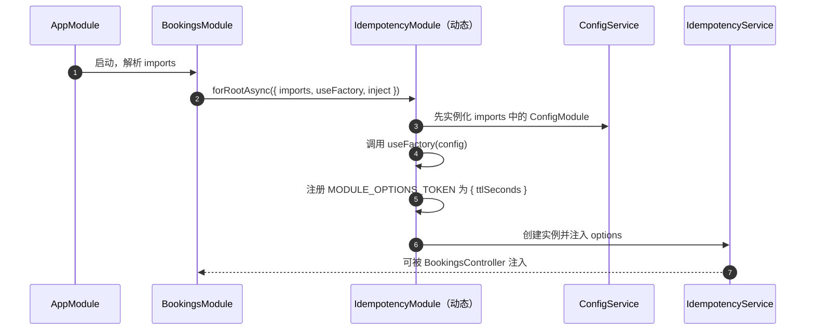

# 第 15 章 如何创建动态模块

## 先弄懂：模块为什么需要“动态”

模块（第 8 章讲过）是 Nest 的边界单位：一个类加上 `@Module()`，声明它内部有哪些 Provider、允许别人用什么。普通模块的这份声明在**类定义那一刻**就固定了，`imports: [SomeModule]` 的位置只放类名，没有地方写“这次用 60 秒还是 30 分钟”。

**动态模块**就是给这个位置开口子：模块类提供一个静态方法（比如 `register(options)`），调用它时把配置传进去，方法返回一份模块定义，Nest 按这份定义创建模块。注意“动态”不是运行中随时改配置，而是**注册时算出来**——每个消费方调用一次，就得到一份独立的模块节点和 Provider 实例。

事故里还会出现两个词：**幂等**指同一个请求重复到达，效果和执行一次相同；**TTL**（time to live）指这份去重记录保留多久。

没有它行不行？可以，把 TTL 写死，或者让 Service 自己读环境变量。但前者满足不了前台 60 秒、后台半小时；后者把“配置从哪来”焊进业务类。动态模块让同一份模块代码被不同配置各建一次，这是它不容易被替代的地方。

官方文档（先看懂正文再点）：
- [Dynamic modules](https://docs.nestjs.com/fundamentals/dynamic-modules)：官方 `register`/`forRoot` 的命名约定和异步版本，对应“异步配置：等工厂就绪再建模块”。
- [Modules](https://docs.nestjs.com/modules)：普通模块的 `imports` 与 `exports` 语义，对应“静态模块没有传参的位置”。

现在看一个真实事故。

上线第四天，运营在群里问：9F-Aurora 十点这场会，怎么同时出现了三条预订？查日志，客户端超时重试，同一个 `Idempotency-Key` 连发了三次，服务每次都老老实实插了一条。

你补幂等控制：请求进来先看这个 key 有没有处理过，处理过就返 409。key 不能无限存，得有过期时间。第一版写死 60 秒，前台预订够用。当天晚上批量导入就出事：一次全量导入跑二十多分钟，跑到一半 key 过期，重跑时前半段又写了一遍。

同一个幂等逻辑，前台要 60 秒，后台导入要半小时，本地调试恨不得 5 秒。把 TTL 写成常量满足不了，让 Service 自己读 `process.env` 又把配置来源焊死在业务类里。你需要的是：**模块类只写一份，每次被 import 时能带一份不同的配置**。这就是动态模块。

## 静态模块没有传参的位置

普通的模块长这样：

```ts
@Module({
  providers: [IdempotencyService],
  exports: [IdempotencyService],
})
export class IdempotencyModule {}
```

`@Module()` 的参数在类定义那一刻就固定了。消费方想用它，只能在 `imports` 里写类名：

```ts
@Module({ imports: [IdempotencyModule] })
export class BookingsModule {}
```

这个位置没有括号，没有参数。`IdempotencyService` 想拿 TTL，只剩两条路：写死常量，或者自己读环境变量。前者不可配置，后者让业务类知道了“配置从哪来”，以后换配置中心还得改它。

**动态模块**给 `imports` 开了个口子：模块类提供一个静态方法，调用它返回一份模块定义，参数就是这次的配置。

```ts
// src/idempotency/idempotency.module.ts（手工版）
import { type DynamicModule, Module } from '@nestjs/common';
import { IdempotencyService } from './idempotency.service.js';

export const IDEMPOTENCY_OPTIONS = 'IDEMPOTENCY_OPTIONS';

export interface IdempotencyModuleOptions {
  ttlSeconds: number;
}

@Module({})
export class IdempotencyModule {
  static register(options: IdempotencyModuleOptions): DynamicModule {
    return {
      module: IdempotencyModule,
      providers: [
        { provide: IDEMPOTENCY_OPTIONS, useValue: options },
        IdempotencyService,
      ],
      exports: [IdempotencyService],
    };
  }
}
```

调用方写成 `imports: [IdempotencyModule.register({ ttlSeconds: 60 })]`，`imports` 数组里放的不再是类，而是一个对象。

这个对象叫 `DynamicModule`，结构和 `@Module()` 的元数据一样，只多一个必填的 `module` 字段，指回模块类本身。它是容器做归属和去重的依据；少了它，Nest 不知道怎么把这份定义和哪个类关联起来。

`register` 不是关键字，叫 `configure`、`setup` 都能跑。但社区有三条命名约定，读懂别人的代码全靠它：

| 方法 | 语义 | 典型例子 |
| --- | --- | --- |
| `register(options)` | 每个消费方一份配置，互不影响 | `HttpModule.register({ baseURL })` |
| `forRoot(options)` | 全应用配置一次，多处复用 | `TypeOrmModule.forRoot()` |
| `forFeature(options)` | 在 `forRoot` 的基础上做局部声明 | `TypeOrmModule.forFeature([User])` |

异步版本对应 `registerAsync`、`forRootAsync`、`forFeatureAsync`，配置从容器里解析，而不是调用方硬编码。

这里有个被命名约定盖住的运行时事实：**每次调用 `forRoot()` 都会生成一个独立的动态模块节点**。三个模块各写一次 `forRoot()`，就有三份 `IdempotencyService` 实例、三份 `Map` 状态。幂等、限流、缓存这类有状态的模块，这么写等于每个入口各自记一份，全局根本不生效。“只配一次”是团队纪律，不是框架强制。要么在 `AppModule` 注册一次并设成全局，要么明确接受“每个消费方一份”。

## 异步配置：等工厂就绪再建模块

TTL 应该来自 `ConfigService`，不是调用方写死。`forRootAsync` 解决这个：

```ts
IdempotencyModule.forRootAsync({
  imports: [ConfigModule],
  useFactory: (config: ConfigService) => ({
    ttlSeconds: Number(config.get('IDEMPOTENCY_TTL_SECONDS') ?? 60),
  }),
  inject: [ConfigService],
});
```

它不是在模块建好之后再“补”配置，而是等工厂返回，才创建模块。顺序错了，注入就会失败。

> **图 15-1** `forRootAsync` 在启动阶段解析配置，再创建服务。



`forRootAsync` 里的 `imports` 不是“这个动态模块依赖谁”，而是“工厂函数要用到谁”。`inject` 里的令牌必须能在这些 `imports` 中找到。两者对不上，启动期就报错，不会拖到第一次请求。

工厂不一定是函数。配置逻辑一长，堆在 `useFactory` 里就没法单独测试，也不方便复用。这时换成 `useClass`：

```ts
// src/idempotency/idempotency.config.ts
import { Injectable } from '@nestjs/common';
import { ConfigService } from '@nestjs/config';
import type { ConfigurableModuleOptionsFactory } from '@nestjs/common';
import type { IdempotencyModuleOptions } from './idempotency.types.js';

@Injectable()
export class IdempotencyConfig
  implements ConfigurableModuleOptionsFactory<IdempotencyModuleOptions, 'create'>
{
  constructor(private readonly config: ConfigService) {}

  create(): IdempotencyModuleOptions {
    const ttlSeconds = Number(
      this.config.get<string>('IDEMPOTENCY_TTL_SECONDS') ?? '60',
    );
    if (!Number.isFinite(ttlSeconds) || ttlSeconds <= 0) {
      throw new Error('IDEMPOTENCY_TTL_SECONDS must be a positive number');
    }
    return { ttlSeconds };
  }
}
```

注册时写 `forRootAsync({ imports: [ConfigModule], useClass: IdempotencyConfig })`，容器会先造这个类，再调它的 `create()`。方法名不固定，`ConfigurableModuleOptionsFactory` 的第二个泛型参数就是方法名；默认是 `create`，用别的名字要同步改泛型。`useExisting` 则复用容器里已经存在的实例，三者只能选一个。

## 手写异步版太啰嗦，让生成器来

一个完整的动态模块要维护：options 接口、注入令牌、`register`、`registerAsync`、`useFactory`/`useClass`/`useExisting` 三条分支、`imports` 和 `inject` 的透传。写全了不难，写对不容易，漏一个分支就是运行时的注入错误。

`ConfigurableModuleBuilder` 把这些样板生成掉：

```ts
// src/idempotency/idempotency.module-definition.ts
import { ConfigurableModuleBuilder } from '@nestjs/common';
import type { IdempotencyModuleOptions } from './idempotency.types.js';

export const { ConfigurableModuleClass, MODULE_OPTIONS_TOKEN } =
  new ConfigurableModuleBuilder<IdempotencyModuleOptions>()
    .setClassMethodName('forRoot')
    .build();
```

三行拿到：一个 `forRoot`/`forRootAsync` 都有的基类、一个注入令牌，以及 `OPTIONS_TYPE`、`ASYNC_OPTIONS_TYPE` 两个类型。用了生成器，手工版里的 `IDEMPOTENCY_OPTIONS` 就不需要了，`MODULE_OPTIONS_TOKEN` 取代它——两者是同一个位置的东西，不能混用。模块类继承基类，`@Module()` 里的 `providers`/`exports` 会和生成的元数据合并：

```ts
// src/idempotency/idempotency.module.ts
import { Module } from '@nestjs/common';
import { ConfigurableModuleClass } from './idempotency.module-definition.js';
import { IdempotencyService } from './idempotency.service.js';

@Module({
  providers: [IdempotencyService],
  exports: [IdempotencyService],
})
export class IdempotencyModule extends ConfigurableModuleClass {}
```

`forRoot()` 的参数类型由泛型约束，`forRootAsync()` 的工厂返回值也会被检查。手写版里那种“令牌拼错、工厂返回错形状”的问题，编译期就能拦下大半。

如果模块还需要一个不影响业务配置的开关，比如 `isGlobal`，用 `setExtras`：

```ts
export const { ConfigurableModuleClass, MODULE_OPTIONS_TOKEN } =
  new ConfigurableModuleBuilder<IdempotencyModuleOptions>()
    .setClassMethodName('forRoot')
    .setExtras({ isGlobal: false }, (definition, extras) => ({
      ...definition,
      global: extras.isGlobal,
    }))
    .build();
```

`setExtras` 的第一个参数是默认值，第二个参数拿到生成好的模块定义和 extras，返回改过的定义。`isGlobal` 只影响模块节点的 `global` 字段，**不会**进入 `MODULE_OPTIONS_TOKEN`。Service 拿不到它，也不该拿到——它关心的是 TTL，不是自己是不是全局的。

用的时候在 `AppModule` 写一次 `IdempotencyModule.forRoot({ ttlSeconds: 60, isGlobal: true })`，之后 `BookingsModule` 不用再 import，`IdempotencyService` 直接可注入。代价是依赖从 `imports` 里消失了，读模块的人看不出这个服务从哪来。全局模块适合配置、日志、幂等这类基础设施，不适合业务模块。

## 把幂等模块搭起来

```ts
// src/idempotency/idempotency.types.ts
export interface IdempotencyModuleOptions {
  /** 幂等键保留时长，单位秒 */
  ttlSeconds: number;
}

// src/idempotency/idempotency.service.ts
import { ConflictException, Inject, Injectable } from '@nestjs/common';
import { MODULE_OPTIONS_TOKEN } from './idempotency.module-definition.js';
import type { IdempotencyModuleOptions } from './idempotency.types.js';

@Injectable()
export class IdempotencyService {
  private readonly seen = new Map<string, number>();

  constructor(
    @Inject(MODULE_OPTIONS_TOKEN)
    private readonly options: IdempotencyModuleOptions,
  ) {}

  assertFresh(key: string | undefined): void {
    if (key === undefined) {
      return;
    }

    const expiresAt = this.seen.get(key);
    if (expiresAt !== undefined && expiresAt > Date.now()) {
      throw new ConflictException(`Duplicate request: ${key}`);
    }
  }

  remember(key: string | undefined): void {
    if (key === undefined) {
      return;
    }
    this.seen.set(key, Date.now() + this.options.ttlSeconds * 1000);
  }
}
```

消费方这样注册：

```ts
// src/bookings/bookings.module.ts
import { Module } from '@nestjs/common';
import { ConfigModule, ConfigService } from '@nestjs/config';
import { IdempotencyModule } from '../idempotency/idempotency.module.js';
import { BookingsController } from './bookings.controller.js';
import { BookingsService } from './bookings.service.js';

@Module({
  imports: [
    IdempotencyModule.forRootAsync({
      imports: [ConfigModule],
      useFactory: (config: ConfigService) => {
        const ttlSeconds = Number(
          config.get<string>('IDEMPOTENCY_TTL_SECONDS') ?? '60',
        );
        if (!Number.isFinite(ttlSeconds) || ttlSeconds <= 0) {
          throw new Error('IDEMPOTENCY_TTL_SECONDS must be a positive number');
        }
        return { ttlSeconds };
      },
      inject: [ConfigService],
    }),
  ],
  controllers: [BookingsController],
  providers: [BookingsService],
  exports: [BookingsService],
})
export class BookingsModule {}
```

`Number('abc')` 是 `NaN`，`Date.now() + NaN * 1000` 还是 `NaN`，`expiresAt > Date.now()` 永远为 `false`——幂等会静默失效，一个错都不报。这种配置必须在工厂里挡住，让启动失败。线上的“偶尔不生效”比启动失败难查一百倍。

控制器里，先查后记：

```ts
// src/bookings/bookings.controller.ts（节选）
@Controller('bookings')
@Version('1')
export class BookingsController {
  constructor(
    private readonly bookingsService: BookingsService,
    private readonly idempotency: IdempotencyService,
  ) {}

  @Post()
  create(
    @Body() dto: CreateBookingDto,
    @Headers('idempotency-key') key: string | undefined,
  ): Booking {
    this.idempotency.assertFresh(key);

    const booking = this.bookingsService.create(dto);
    this.idempotency.remember(key);
    return booking;
  }
}
```

`assertFresh` 在创建前查，`remember` 在创建成功后才登记。顺序反过来，“房间不存在”导致的 404 也会占掉一个 key，调用方拿同一个 key 重试就永远是 409。

注意这是“先查后写”两步。单进程、单线程时没问题；换成 Redis 要用 `SET key 1 NX EX ttl` 这种原子占位，否则两个并发请求可以同时通过检查。`Map` 是教学版，多实例部署别带上去。

## 跑四条路径

```bash
IDEMPOTENCY_TTL_SECONDS=5 pnpm start:dev
```

```bash
# 1) 第一次提交
curl -s -o /dev/null -w '%{http_code}\n' -X POST http://localhost:3000/api/v1/bookings \
  -H 'content-type: application/json' -H 'idempotency-key: demo-key-1' \
  -d '{"roomId":"room_9","userId":"usr_1","startsAt":"2026-12-01T09:00:00.000Z","endsAt":"2026-12-01T10:00:00.000Z"}'
# 201

# 2) 同一个 key 立刻重发
curl -s -X POST http://localhost:3000/api/v1/bookings \
  -H 'content-type: application/json' -H 'idempotency-key: demo-key-1' \
  -d '{"roomId":"room_9","userId":"usr_1","startsAt":"2026-12-01T09:00:00.000Z","endsAt":"2026-12-01T10:00:00.000Z"}'
# {"message":"Duplicate request: demo-key-1","error":"Conflict","statusCode":409}

# 3) 换一个 key，重新放行
curl -s -o /dev/null -w '%{http_code}\n' -X POST http://localhost:3000/api/v1/bookings \
  -H 'content-type: application/json' -H 'idempotency-key: demo-key-2' \
  -d '{"roomId":"room_9","userId":"usr_1","startsAt":"2026-12-01T09:00:00.000Z","endsAt":"2026-12-01T10:00:00.000Z"}'
# 201

# 4) 等 TTL 过期，再用 demo-key-1
sleep 6
curl -s -o /dev/null -w '%{http_code}\n' -X POST http://localhost:3000/api/v1/bookings \
  -H 'content-type: application/json' -H 'idempotency-key: demo-key-1' \
  -d '{"roomId":"room_9","userId":"usr_1","startsAt":"2026-12-01T09:00:00.000Z","endsAt":"2026-12-01T10:00:00.000Z"}'
# 201
```

以上是示例输出（未实测）。第 4 步必须等够 5 秒；如果还是 409，先确认进程真的重启过——`forRootAsync` 的工厂只在启动时执行一次，改环境变量不重启不会生效。

再把 `IDEMPOTENCY_TTL_SECONDS` 改成 `abc` 启动，进程会直接退出并打印 `must be a positive number`。这条比任何 curl 都值钱：配置错误在启动时暴露，而不是变成线上“幂等偶尔失效”。

## 几个容易踩的点

| 现象 | 原因 | 处理 |
| --- | --- | --- |
| 启动报 `Cannot read properties of undefined (reading 'module')` | 返回对象少了 `module` | 补 `module: XxxModule` |
| `Nest can't resolve dependencies of IdempotencyService (?)` | options Provider 没注册，或令牌不一致 | 检查 `useValue` 和 `@Inject` 是否同一个令牌 |
| `forRootAsync` 注入 `ConfigService` 失败 | `imports` 漏了 `ConfigModule` | 补 `imports: [ConfigModule]`，并让 `inject` 对得上 |
| TTL 是 `NaN` | 环境变量没转数字 | 工厂内校验 `Number.isFinite`，非法就启动失败 |
| 多个模块各调一次 `forRoot`，状态互不影响 | 每次调用生成独立模块节点 | 在 `AppModule` 注册一次并设 `isGlobal: true` |
| `useClass` 报缺少 `create` 方法 | 工厂类没实现约定接口 | 实现 `ConfigurableModuleOptionsFactory<Options, 'create'>` |
| `isGlobal` 在 Service 里取不到 | extras 不进 options token | 设计如此，全局开关只影响模块元数据 |
| 改了 TTL 行为没变 | 动态模块只在启动时求值 | 重启进程，并把配置写进部署环境变量 |

还有一条习惯值得养：**options 接口就是你的公开 API**。给它加字段时先想默认值，别让所有调用方跟着改类型——这和发布一个 npm 包是一回事。

现在你手上有了一套完整的动态模块：`forRoot`/`forRootAsync` 按调用方传配置，`MODULE_OPTIONS_TOKEN` 把配置送进 Service，`ConfigurableModuleClass` 省掉样板，`setExtras` 处理模块级开关。判断标准也不复杂：配置随调用方不同，用 `register`；全应用一份，用 `forRoot` + `isGlobal`；只是局部声明，用 `forFeature`。同一套写法也适用于封装第三方 SDK：把令牌、超时、重试收进模块，业务侧只看见一个 `register({...})`。

下一章往下沉一层。模块、Provider、装饰器都见过了，但一个 HTTP 请求最后是谁在 `listen`、谁在解析 body、谁把返回值写成响应？Nest 自己不做这些，它交给 HTTP 适配器。默认是 Express，也可以换成 Fastify。

想更深入的话，官方文档里有这几页可以接着看：[Dynamic modules](https://docs.nestjs.com/fundamentals/dynamic-modules)（官方动态模块的完整写法，含 `forRootAsync` 的三种工厂分支）、[Modules](https://docs.nestjs.com/modules)（模块边界和导出规则，对照“同一份代码按配置各建一次”）、[Configuration](https://docs.nestjs.com/techniques/configuration)（官方配置模块本身就是动态模块，对应“手写异步版太啰嗦”那节的生成器）。

<!-- chapter-nav:start -->
---

← 上一篇：[014 Module和Provider的循环依赖怎么处理](014-Module和Provider的循环依赖怎么处理.md) · [本 Part 目录](_part.md) · 下一篇：[016 Nest和Express的关系，如何切到fastify](016-Nest和Express的关系，如何切到fastify.md) →
<!-- chapter-nav:end -->
