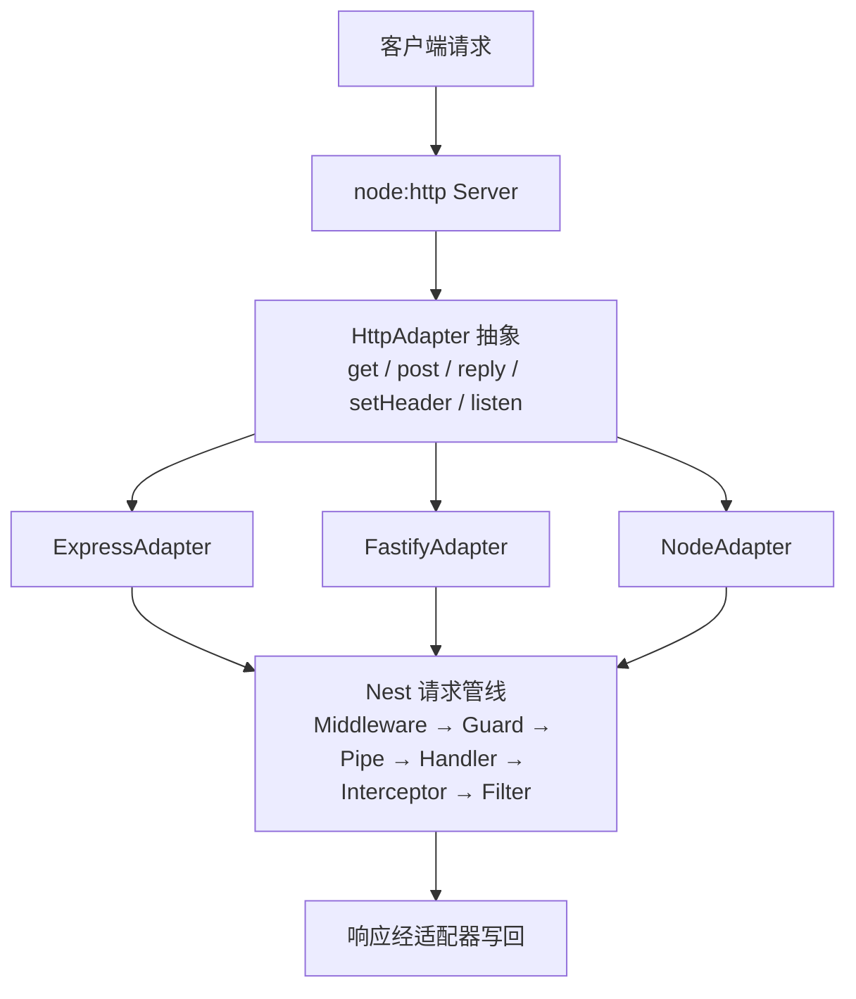
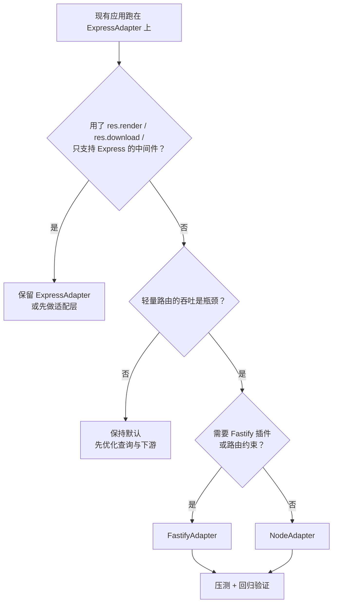

# 第 16 章 Nest 和 Express 的关系，如何切到 Fastify

## 出国要带转换插头

去英国旅行，你的手机充电器是国标两脚，墙上却是三方孔。充电器没坏，墙也没坏，中间少一个转换头。Nest 和 Express 的关系就是这样：Nest 是那台充电器，Express 是墙上的插座，中间那层转换头叫**适配器（adapter）**。

具体说，Nest 的核心不解析 HTTP。监听端口、拆请求报文、写响应头和状态码，这些活它交给一个 **HTTP 框架**：Express、Fastify，或者 Node 自带的 `node:http`。Express 成熟、生态大，中间件和 `req`/`res` 的写法影响最广；Fastify 新一些，主打插件、schema 校验（按声明的数据结构校验请求和响应）和更高的吞吐，响应对象叫 `reply`。

Nest 不直接调某一个框架，而是在中间放一层适配器：它把框架包成统一接口，Nest 只调“注册路由、发响应、设响应头、取客户端地址”这几个固定方法。默认适配器是 `@nestjs/platform-express`；不传适配器时 Nest 会去找它，找不到就启动失败。没有这层行不行？Nest 核心自己不会收包，没有适配器连服务都起不来。

代价是“抽象漏底”：只要业务代码直接摸框架的 `req`/`res`/`reply`，就绑死在这个框架上，换适配器时这些地方会最先坏。这一章的两个事故都属于这一类。

下面的事故发生在 Kubernetes 上：灰度指先放一小部分流量到新版本；Pod 是运行容器的单元，Readiness 探针通过只说明进程愿意接流量，不代表集群外一定能访问。

官方文档（先看懂正文再点）：
- [HTTP adapter FAQ](https://docs.nestjs.com/faq/http-adapter)：官方讲怎么换适配器、怎么写自定义适配器，对应“NodeAdapter：v12.3 之后的新选项”。
- [Express](https://expressjs.com/)：Express 自己的文档，`req`/`res` 和中间件的原始写法都在这里，对应“抽象漏底”那段。
- [Fastify](https://fastify.dev/docs/latest/)：Fastify 自己的文档，`reply`、插件和 schema 校验都在这里，对照 `reply.redirect` 那个事故。

现在看一个真实事故。

灰度切 Fastify 那天，Pod 全是 Running，Readiness 也过，外部访问却清一色 502。你进容器执行 `curl localhost:3000/api/v1/bookings`，返回正常，日志里一条错误都没有。

查了半小时，问题只有一行：Fastify 默认只绑 `localhost`。`app.listen(3000)` 真的只监听 `127.0.0.1`，容器外当然进不来。改成 `app.listen(3000, '0.0.0.0')`，流量立刻回来。

第二天又出事。一个历史遗留的重定向接口 500，日志里写着 `reply.redirect is not a function`。业务代码一行没改，坏的是它直接拿了 Fastify 的 `reply` 对象。

两次故障都不在业务逻辑里。要理解为什么，得先看清 Nest 和 Express 到底是什么关系。

## Nest 不管收包，Express 只管收包

监听端口、拆报文、写响应头这些事，Nest 核心一件都不做。它把它们交给适配器，自己只调用适配器暴露的一组固定方法：注册路由、发响应、设响应头、取客户端地址。

所以 Express 不是 Nest 的一部分，而是默认适配器底下的那层运行时。`@nestjs/platform-express` 这个包把 Express 包成适配器；`@Controller()`、`@Get()`、`@Body()` 这些写法属于 Nest 的抽象层，不知道底下是谁在收包。像装修：Nest 是设计加管理流程的那一方，Express 是实际开槽走线的施工队，换施工队不影响你的户型图。

| 适配器 | 包 | 底层 |
| --- | --- | --- |
| `ExpressAdapter` | `@nestjs/platform-express` | Express 5，默认 |
| `FastifyAdapter` | `@nestjs/platform-fastify` | Fastify 5 |
| `NodeAdapter` | `@nestjs/platform-node` | `node:http`，v12.3 起推荐 |

不传适配器时，`NestFactory.create(AppModule)` 会去找 `@nestjs/platform-express`；找不到就启动失败。这就是“卸了 Express 却忘了传 `new FastifyAdapter()`”那条报错的来源——转换头拿掉了，插头自然插不进去。

> **图 16-1** 业务代码只依赖 Nest 抽象，适配器负责落到具体框架。



这层分离带来两个后果。好处是能换：Express、Fastify、裸 `node:http` 都能接。成本也真实：任何绕过抽象、直接摸底层 `req`/`res` 的代码，换适配器时都会露出来。

## 换 Fastify，换掉的是什么

| 维度 | ExpressAdapter | FastifyAdapter |
| --- | --- | --- |
| 请求/响应对象 | `Request` / `Response` | `FastifyRequest` / `FastifyReply` |
| 中间件拿到的对象 | Express 包装后的 req/res | 原始 Node `req`/`res`（经 `@fastify/middie`） |
| 重定向 | `res.redirect('/login')` | `reply.status(302).redirect('/login')` |
| 扩展方式 | 中间件生态 | 插件，`app.register()` |
| 路由匹配 | 按声明顺序，先到先得 | 按具体度 |
| 文件上传 | Multer 拦截器（Express 的文件上传中间件） | `@nestjs/platform-fastify/multipart` |
| 监听地址 | 默认所有网卡 | 默认只监听 `localhost` |

不变的部分比变的多：模块、依赖注入、`@Controller`、`@Get`、`@Body`、`ValidationPipe`、`@UseGuards`、`@UseInterceptors`、`@Catch`、`@Version`、Swagger 装饰器，全都照常工作。

**只有直接碰底层 req/res 的代码要改。** 这也是估工作量的方法：把项目里所有 `@Req()`、`@Res()`、`req.`、`res.` 出现的位置列出来，那些才是迁移成本；一处都没有，说明业务层是干净的。

## NodeAdapter：v12.3 之后的新选项

Nest 12.3 起，官方在“选哪个适配器”上多给了一个答案：`NodeAdapter` 直接跑在 `node:http` 上，但给请求和响应补了 Express 风格的助手：`req.get()`、`req.ip`、`res.status()`、`res.json()`、`res.redirect()`、`res.sendFile()`。

官方基准是 Node 24、100 连接、纯路由：`NodeAdapter` 比 `ExpressAdapter` 多约 50% RPS（每秒请求数），比 `FastifyAdapter` 多约 5%。v13 会把它设为默认。

但 benchmark 不是“必须换”的理由。适配器只占一次请求耗时的一小部分，路由里只要在等数据库，三者差距立刻被抹平。选型看生态和兼容性，不看排名。

它的边界也明确：`res.render()`、`res.download()`、`res.format()`、`req.accepts()` 不可用；路由按具体度匹配、大小写敏感；handler 返回字符串时按 `text/plain` 发，不是 `text/html`。从 Express 迁过去，这些地方会安静地变行为，不会报错。

## 该不该切

- 需要 Fastify 插件生态：`@fastify/helmet`、`@fastify/compress`、`@fastify/cookie`、`@fastify/rate-limit`。
- 需要路由约束、schema 级序列化、流式上传。
- 团队已经在别的服务里用 Fastify，排障经验能复用。
- 只是想让接口快一点：先查数据库和下游调用，适配器通常不是瓶颈。

> **图 16-2** 先排除兼容性，再谈性能。



还有一种偷懒做法：用环境变量在两套入口之间切换，线上出问题就切回 Express。听着稳，实际是把两套运行时的差异长期留在生产里，下一次发版跑的是哪套没人说得清。真要灰度，在网关层按流量比例切，别在进程里留分叉。

想先试 `NodeAdapter` 的话，入口只换两行：

```ts
import { NestFactory } from '@nestjs/core';
import { NestNodeApplication, NodeAdapter } from '@nestjs/platform-node';

const app = await NestFactory.create<NestNodeApplication>(
  AppModule,
  new NodeAdapter({ trustProxy: 'loopback' }),
);
await app.listen(Number(process.env.PORT ?? 3000), '0.0.0.0');
```

包名从 `platform-fastify` 换成 `platform-node`，泛型从 `NestFastifyApplication` 换成 `NestNodeApplication`。它的中间件仍是 Express 风格，常见的 helmet、compression、cookie-parser 可以直接用；但 `res.render()`、`res.download()` 这些没有对应实现，迁移前要逐个确认。

## 动手换

沿用 `meeting-booking`。先装新适配器，确认能启动后再卸 Express：

```bash
pnpm add @nestjs/platform-fastify@^12.3.3 fastify@^5
pnpm add @fastify/helmet
# 等启动、路由、异常过滤器都验证过，再执行下一行
pnpm remove @nestjs/platform-express
```

版本要对齐：`@nestjs/platform-fastify` 12.x 配 Fastify 5.x，不要拿 Fastify 4 来凑。

顺序也别反：先装 `platform-fastify` 和 `fastify`，入口传 `FastifyAdapter`，启动确认路由、全局前缀、异常过滤器都正常，最后再卸 `platform-express`。反过来做，编译阶段就找不到模块，你连第一行启动日志都看不到。

Fastify 的插件不能走 `app.use()`，要走 `register()`：

```ts
// src/fastify.config.ts
import helmet from '@fastify/helmet';
import type { NestFastifyApplication } from '@nestjs/platform-fastify';

export const configureFastify = async (
  app: NestFastifyApplication,
): Promise<void> => {
  await app.register(helmet);
};
```

Fastify 的插件模型和 Express 中间件不是一回事：插件在 `ready` 阶段被封装进独立上下文，`fastify-plugin` 决定要不要打破这层封装；`app.use()` 是 Express 的方法，Fastify 实例上根本没有。所以 Nest 用 `register()` 挂插件，而且必须赶在 `listen()` 之前。

入口改成显式传适配器：

```ts
// src/main.ts
import { NestFactory } from '@nestjs/core';
import {
  FastifyAdapter,
  type NestFastifyApplication,
} from '@nestjs/platform-fastify';
import { AppModule } from './app.module.js';
import { configureFastify } from './fastify.config.js';

const bootstrap = async (): Promise<void> => {
  const app = await NestFactory.create<NestFastifyApplication>(
    AppModule,
    new FastifyAdapter({
      // 只有确实在可信代理后面才开；'loopback' 表示只信任本机代理
      trustProxy: 'loopback',
    }),
  );

  app.setGlobalPrefix('api');
  app.enableShutdownHooks();
  await configureFastify(app);

  // Fastify 默认只监听 localhost，容器里必须显式给 0.0.0.0
  await app.listen(Number(process.env.PORT ?? 3000), '0.0.0.0');
};

await bootstrap();
```

几个关键点：

- **`NestFastifyApplication` 不能省**。只有它暴露 `register()`，写成 `INestApplication` 会编译失败。
- **`listen` 的第二个参数**。Fastify 默认绑 `localhost`，Docker/K8s 里表现为“容器活着，外面进不来”。
- **`configureApp` 那几行不用改**。`setGlobalPrefix`、`enableVersioning`、`useGlobalPipes`、`enableShutdownHooks` 都是适配器无关的。
- **`trustProxy` 不是可有可无**。在反向代理后面，`req.ip` 默认是代理地址，限流会把所有客户端算成一个。Fastify 5.12.1 起传数字（比如 `1`）表示不信任任何代理，要传 `'loopback'` 或具体网段。

`configureFastify` 必须在 `listen()` 之前调用。Fastify 的插件要在实例 `ready` 之前注册，`listen()` 内部会触发 `ready`。

重定向别再用 `@Res()`：

```ts
// src/legacy/legacy.controller.ts
import { Controller, Get, Redirect } from '@nestjs/common';

@Controller('legacy')
export class LegacyController {
  @Get('bookings')
  @Redirect('/api/v1/bookings', 302)
  redirectToBookings(): void {
    // 返回值会被 @Redirect 忽略
  }
}
```

把 `LegacyController` 加进 `BookingsModule` 的 `controllers`。`@Redirect` 在两个适配器上都生成标准的 `302 + Location`，控制器里没有一行框架类型。反过来，一旦写成 `@Res() res: Response`，这个控制器就永远绑在 Express 上了。

中间件只依赖结构，不依赖框架类型：

```ts
// src/common/request-id.middleware.ts
import { randomUUID } from 'node:crypto';

type RequestLike = {
  headers: Record<string, string | string[] | undefined>;
};

type ResponseLike = {
  setHeader(name: string, value: string): void;
};

export const requestIdMiddleware = (
  req: RequestLike,
  res: ResponseLike,
  next: () => void,
): void => {
  const incoming = req.headers['x-request-id'];
  const requestId =
    typeof incoming === 'string' && incoming.length > 0
      ? incoming
      : randomUUID();

  req.headers['x-request-id'] = requestId;
  res.setHeader('x-request-id', requestId);
  next();
};
```

在 `AppModule` 的 `configure(consumer)` 里 `consumer.apply(requestIdMiddleware).forRoutes('*')`。这段代码两个适配器下都能跑，因为它只要求“有 headers、能 setHeader”。写成 `req.get('x-request-id')` 或 `res.send()`，就绑死 Express 了。

注意 Fastify 的中间件由 `@fastify/middie` 执行，Nest 传进来的是**原始 Node `req`/`res`**，不是 `FastifyRequest`/`FastifyReply`。所以“Express 中间件原样搬过来”通常不行：要么改 Fastify hook，要么把依赖面缩到 Node 原生对象也有的结构。

如果原来的中间件用了 Express 专属 API，又不想为迁移重写，可以直接用 Fastify 的 hook。请求 ID 这个例子在 hook 里长这样：

```ts
import { randomUUID } from 'node:crypto';

const fastify = app.getHttpAdapter().getInstance();
fastify.addHook('onRequest', async (request, reply) => {
  const incoming = request.headers['x-request-id'];
  const requestId =
    typeof incoming === 'string' && incoming.length > 0
      ? incoming
      : randomUUID();
  request.headers['x-request-id'] = requestId;
  reply.header('x-request-id', requestId);
});
```

`onRequest` 比中间件更早，拿到的就是 `FastifyRequest`，可以放心用 Fastify 的类型和插件。代价是这段代码只属于 Fastify，换回 Express 时要另写一份。选择哪条路，取决于你想让这段逻辑跟框架绑多深。

## 三条响应验明身份

```bash
pnpm start:dev

# 1) 业务接口：200 + helmet 头（示例输出，未实测）
curl -s -D - -o /dev/null http://localhost:3000/api/v1/bookings \
  | grep -iE 'HTTP/|x-content-type-options'
# HTTP/1.1 200 OK
# x-content-type-options: nosniff

# 2) 重定向：302 + Location
curl -s -D - -o /dev/null http://localhost:3000/api/v1/legacy/bookings \
  | grep -iE 'HTTP/|location'
# HTTP/1.1 302 Found
# location: /api/v1/bookings

# 3) 确认不是 Express：Fastify 不发 X-Powered-By
curl -s -D - -o /dev/null http://localhost:3000/api/v1/bookings \
  | grep -i 'x-powered-by' || echo 'no x-powered-by'
# no x-powered-by
```

第 3 条是最省事的验伪手段。如果打出 `x-powered-by: Express`，说明适配器根本没生效——要么 `NestFactory.create` 还在走默认，要么进程没重启。

## 这些坑，基本都踩过

| 现象 | 原因 | 怎么处理 |
| --- | --- | --- |
| 容器外 502，容器内 `curl localhost` 正常 | Fastify 默认只监听 `localhost` | `app.listen(port, '0.0.0.0')` |
| `Cannot find module '@nestjs/platform-express'` | 卸了 Express 却没传适配器 | `new FastifyAdapter()` 传进 `create()` |
| `app.register is not a function` | 应用类型写成了 `INestApplication` | 用 `NestFastifyApplication` 泛型 |
| `reply.redirect is not a function` | Fastify 的 redirect 要先设状态码 | 用 `@Redirect()`，或 `reply.status(302).redirect(url)` |
| 中间件里 `req.get` 未定义 | middie 给的是原始 `IncomingMessage` | 直接读 `req.headers`，或改用 Fastify hook |
| 跨域 `PUT`/`DELETE` 预检被拒 | `@fastify/cors` 默认只放行 `GET/HEAD/POST` | `enableCors({ methods: [...] })`，并装 `@fastify/cors` |
| 上传大文件报 413 | `@fastify/multipart` 默认 `fileSize` 就是 `bodyLimit`（1 MiB） | 在 `FastifyAdapter` 的 `multipart.limits.fileSize` 里放宽 |
| 切到 NodeAdapter 后路由命中和以前不一样 | Express 按注册顺序，NodeAdapter 按具体度 | Express 侧可用 `routeResolutionStrategy: 'specificity'`；新代码别依赖注册顺序 |

再补一条部署侧的：**入口和脚本要共用同一个创建函数**。把“创建 app + 注册插件 + configureApp”抽成一个函数，`main.ts`、压测脚本、巡检脚本都调它。否则迟早出现“本地 Express、线上 Fastify”这种谁都没意识到的偏差。

到这儿，Nest 与 HTTP 框架的关系就清楚了：Nest 提供编程模型，适配器负责落到底层运行时。迁移的固定动作是换依赖、换入口泛型、显式 `listen` 地址、插件走 `register`、把 `@Res()` 换成 `@Redirect()` 这类与适配器无关的写法。剩下的业务代码，一行都不用动。判断迁移成本也不用通读文档，先全局搜一遍 `@Req`、`@Res` 就够了，不用猜。真正要改的，往往只有入口和那几个碰过底层对象的 handler。

下一章顺着请求往回走一步。请求进入 Nest 管线之前，最先碰到的是中间件。它拿得到最原始的 `req`/`res`，却不知道最终哪个 handler 会被调用；类中间件能注入 Provider，但拿不到路由元数据。这一层的位置很特殊，坑也集中。


<!-- chapter-nav:start -->
---

← 上一篇：[015 如何创建动态模块](015-如何创建动态模块.md) · [本 Part 目录](_part.md) · 下一篇：[017 Nest的Middleware](017-Nest的Middleware.md) →
<!-- chapter-nav:end -->
