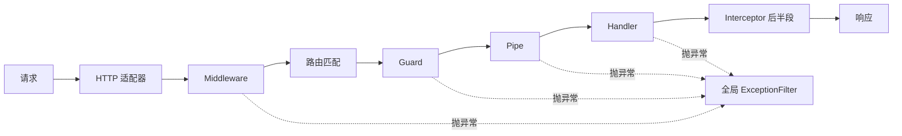

# 第 17 章 Nest 的 Middleware

## 小区门口那间岗亭

你住的小区，外卖、快递、访客都得先经过门口那间岗亭。门卫能看证件、登记来访、发一张访客条，觉得不对的人当场劝返。但他不知道你住几号楼几单元——那要进了小区、到了楼下前台才知道。

Nest 里也有这么一间岗亭，叫**中间件（middleware）**。请求进来之后，还没匹配到具体是哪个接口，它先跑一遍。它拿到的是原始的 `req`、`res` 和一个 `next`，能改请求头、写响应头、提前把响应结束掉；如果什么也不做，就必须调用一次 `next()` 放行。

没有它行不行？能跑，但“每个请求都要做”的那几件事——打请求 ID、记访问日志、开 CORS（跨域资源共享，让别的域名也能调你的接口）——就只能抄进每个接口。漏一个入口，就少一笔记录。你也可以在 `main.ts` 里用 `app.use()` 挂一个函数，省掉一部分重复；可它拿不到依赖注入，也没法按路由把健康检查排除掉。这一章要补的就是这两个缺口。

它跟守卫、拦截器、管道、异常过滤器最容易混。先记住一句：**中间件在“找到是哪个接口”之前跑；守卫、管道、拦截器在“找到之后”跑。** 门卫不知道你找谁，所以读不到 `@Roles()` 这种挂在方法上的标记，也拿不到解析好的 DTO（请求体的形状类，第 20 章）。楼下前台是守卫，知道你要去哪个部门、有没有预约；安检机是管道，检查你带的东西（第 19 章）；进门前记一笔、出门后帮你整理材料的是拦截器（第 18 章）；出事之后统一处理的是异常过滤器（第 21 章）。这五类组件各自卡在请求链的哪一段，第 9 章画过一张位置图。

官方文档（先看懂正文再点）：
- [Middleware](https://docs.nestjs.com/middleware)：官方中间件的函数与类两种写法、`forRoutes` 和 `exclude`，对应全章。
- [Using middleware](https://expressjs.com/en/guide/using-middleware.html)：Express 自己的中间件模型，对应“中间件站在路由之前”那段。

## 三条一模一样的日志

凌晨两点，值班群弹出一条消息：“会议室 A 被重复预订了三次，用户说只点了一次。”你打开日志，看到三条一模一样的 `POST /api/bookings`，时间戳只差几十毫秒。三条都是匿名行：没有请求 ID，没有耗时，也没有响应状态。你分不清哪些日志属于同一次点击，更分不清是前端重试、网关重放，还是用户真的点了三次。

错误响应里其实有 `requestId`，那是异常过滤器加上去的；访问日志里却没有。两个地方各写各的，串不起来。要解决这个问题，得在请求进入路由之前先给它贴一个编号，并在响应结束时把结果记下来——这正是门卫的位置。

## 它站在路由之前，所以看不见 handler

中间件是一个函数，在路由处理器之前执行，签名是 `(req, res, next)`。它拿到原始的请求和响应对象，可以改请求、可以提前结束响应；如果既没有结束响应也没有抛错，就必须调用 `next()`，把控制权交给下一环。像接力赛：它把棒交出去，但不知道最后一棒是谁。

这个“下一环”不是某个具体 handler（真正处理这个接口的方法），而是这条处理链上的下一站。中间件执行时，Nest 还没有算出这个请求会命中哪个 Controller、哪个方法。它不知道 `@Roles()` 写了什么，也拿不到 `@Body()` 解析后的 DTO。这是它和守卫、拦截器最本质的区别：

| 位置 | 什么时候执行 | 能拿到什么 | 典型用途 |
| --- | --- | --- | --- |
| Middleware | 路由匹配之前 | 原始 `req`/`res`、注入的 Provider | 请求 ID、访问日志、CORS、body 大小限制 |
| Guard | 路由匹配之后、管道之前 | `ExecutionContext`、路由元数据 | 登录校验、角色判断 |
| Pipe | 参数进入 handler 之前 | 参数值、参数元数据 | 类型转换、DTO 校验 |
| Interceptor | handler 前后 | `ExecutionContext`、返回值流 | 统一响应、超时、缓存 |
| ExceptionFilter | 有异常抛出时 | 异常对象、`ExecutionContext` | 统一错误结构 |

> **图 17-1** 中间件在请求管线里的位置：它之前只有 HTTP 适配器，之后才有路由、守卫和管道。



`next()` 看着像个可选的回调，实际上是整条链的放行按钮。不按，请求会一直堵在门口，直到客户端超时；按两次，后面的中间件和 handler 会跑两遍，日志里就会出现两条一模一样的记录。中间件里所有分支最终都要落到“调用一次 `next()`”或“直接结束响应”这两个出口上。

## 项目里已经有一个函数版

打开 `meeting-booking`，`src/common/middleware/request-id.middleware.ts` 里已经有一个函数版：

```ts
import { randomUUID } from 'node:crypto';
import type { NextFunction, Request, Response } from 'express';
import type { RequestWithId } from '../types/request-with-id.js';

export const requestIdMiddleware = (
  req: Request,
  res: Response,
  next: NextFunction,
): void => {
  const incoming = req.header('x-request-id');
  const requestId =
    incoming !== undefined && incoming.length <= 128 ? incoming : randomUUID();

  (req as RequestWithId).id = requestId;
  res.setHeader('x-request-id', requestId);
  next();
};
```

它在 `main.ts` 里通过 `app.use(requestIdMiddleware)` 挂到所有请求上。这段逻辑做对了两件事：上游已经带了 `x-request-id` 就复用，这样网关、前端、下游能串成一条链路；处理不了就生成一个随机 UUID（一串不会重复的编号），保证每个请求都有编号。

但它只解决了“编号”，没解决“记录”。响应头里有了 ID，访问日志里仍然什么都没有。而且 `app.use()` 是平台级注册：它进不了 Nest 的依赖注入容器，也没法按 Controller 或路由排除健康检查。要补上这些，得换成类中间件。

## 换成类，才能注入依赖、划范围

函数版够用，但它拿不到容器里的东西。要让中间件能读配置、能按路由排除，就得把它写成类：带 `@Injectable()`、实现 `NestMiddleware` 接口。Nest 会用模块的注入器创建它，所以构造器里可以正常注入 Provider。函数版像临时工，只会做固定动作；类版是正式员工，能从公司系统里查配置，还能被安排只守某几栋楼。

```ts
// src/common/middleware/request-log.middleware.ts
import { Injectable, Logger, NestMiddleware } from '@nestjs/common';
import { ConfigService } from '@nestjs/config';
import { randomUUID } from 'node:crypto';
import type { IncomingMessage, ServerResponse } from 'node:http';

export interface RequestWithId extends IncomingMessage {
  id: string;
}

const REQUEST_ID_PATTERN = /^[A-Za-z0-9._-]{8,64}$/;

@Injectable()
export class RequestLogMiddleware implements NestMiddleware {
  private readonly logger = new Logger(RequestLogMiddleware.name);

  constructor(private readonly config: ConfigService) {}

  use(req: RequestWithId, res: ServerResponse, next: () => void): void {
    const incoming = req.headers['x-request-id'];
    const candidate = Array.isArray(incoming) ? incoming[0] : incoming;

    req.id =
      candidate !== undefined && REQUEST_ID_PATTERN.test(candidate)
        ? candidate
        : randomUUID();
    res.setHeader('x-request-id', req.id);

    const startedAt = process.hrtime.bigint();
    res.on('finish', () => {
      const durationMs = Number(process.hrtime.bigint() - startedAt) / 1e6;
      this.logger.log(
        JSON.stringify({
          requestId: req.id,
          environment: this.config.get<string>('environment'),
          method: req.method,
          path: req.url,
          statusCode: res.statusCode,
          durationMs: Number(durationMs.toFixed(1)),
        }),
      );
    });

    next();
  }
}
```

几个设计点值得停一下：

- **参数类型用 `IncomingMessage` / `ServerResponse`，不用 Express 的 `Request` / `Response`**。Nest 中间件拿到的是适配器传进来的原始 Node 对象，Express 和 Fastify 都是。这样写，上一章切到 Fastify 后这段代码照样能跑；代价是用不了 `req.header()` 这种 Express 助手，只能读 `req.headers`。
- **入站的 ID 不能无条件信任**。它来自客户端，可以带换行、可以超长，直接写进日志就是日志注入。正则同时限制字符集和长度，不合法就丢弃。
- **耗时必须等 `finish` 事件**。`next()` 是同步返回的，它返回时 handler 可能还没开始跑，此时算出来的耗时不具参考价值。
- **`res.setHeader` 放在 `next()` 之前**。响应头一旦发给客户端就改不了了。
- **注入 `ConfigService` 是为了让日志带上环境**。如果不需要这个字段，这个类写成函数就够了；需要 DI 的时候，类中间件才是正确选择。

中间件写完不会自动生效，要在模块的 `configure()` 里声明挂载范围。让 `AppModule` 实现 `NestModule`：

```ts
// src/app.module.ts
import {
  MiddlewareConsumer,
  Module,
  NestModule,
  RequestMethod,
} from '@nestjs/common';
import { ConfigModule } from '@nestjs/config';
import { RequestLogMiddleware } from './common/middleware/request-log.middleware.js';
import { configuration } from './config/configuration.js';

@Module({
  // 其余 imports/providers 省略
  imports: [ConfigModule.forRoot({ isGlobal: true, load: [configuration] })],
})
export class AppModule implements NestModule {
  configure(consumer: MiddlewareConsumer): void {
    consumer
      .apply(RequestLogMiddleware)
      .exclude('health', 'health/*splat')
      .forRoutes({ path: '*splat', method: RequestMethod.ALL });
  }
}
```

`configure()` 里的链式调用读起来像一句话：把 `RequestLogMiddleware` 应用到所有路由，但 `health` 开头的除外。

`forRoutes()` 的写法决定作用范围：

- 传 Controller 类，例如 `forRoutes(BookingsController)`，等于这个控制器下的所有路由；
- 传字符串，例如 `forRoutes('bookings')`，按路径前缀匹配；
- 传对象，例如 `forRoutes({ path: 'bookings', method: RequestMethod.POST })`，只对指定方法生效；
- 传 `'*splat'`，匹配所有带至少一段路径的路由。

`exclude()` 里的路径**不包含全局前缀**。项目里 `app.setGlobalPrefix('api')`，健康检查实际是 `/api/health`，但这里写的是 `'health'`，不是 `'api/health'`。写成后者会匹配不到。

还要把 `main.ts` 里原来的 `app.use(requestIdMiddleware)` 删掉，否则同一个请求会被两版中间件各处理一次，响应头被覆盖，日志也会重复。

## 跑起来看结果

`pnpm start:dev` 启动，另开一个终端。下面的响应和日志都是示例输出，未在本地起服务实测；UUID、时间戳和耗时以你机器上的为准。先看被排除的健康检查：

```bash
curl -i http://localhost:3000/api/health
```

```text
HTTP/1.1 200 OK
Content-Type: application/json; charset=utf-8
...

{"status":"ok","timestamp":"2026-11-06T18:20:31.442Z","uptime":12}
```

响应里没有 `x-request-id`，说明 `exclude()` 生效了。再看一个需要登录的接口：

```bash
curl -i http://localhost:3000/api/bookings
```

```text
HTTP/1.1 401 Unauthorized
x-request-id: 4b7e2f1a-9c3d-4e8a-b6f0-2d5c7a1e9b33
Content-Type: application/json; charset=utf-8

{"statusCode":401,"message":"Unauthorized","error":"Unauthorized","requestId":"4b7e2f1a-9c3d-4e8a-b6f0-2d5c7a1e9b33"}
```

注意响应头和错误体里的 `requestId` 是同一个值。前者由中间件写，后者由全局异常过滤器从 `request.id` 取，两个位置共用一份数据。

再试上游传 ID 和非法 ID 两种情况：

```bash
curl -i -H 'x-request-id: trace-demo-0001' http://localhost:3000/api/bookings
# x-request-id: trace-demo-0001

curl -i -H 'x-request-id: bad id with spaces' http://localhost:3000/api/bookings
# x-request-id: 9f1c8d42-6a7b-4c2e-8d10-3e5f7a9b1c44
```

第一种原样透传，第二种因为包含空格、不满足正则，被替换成新的 UUID。

服务端日志是一行一条，不是两条：

```text
[Nest] 51233  - 2026/11/06 18:20:35     LOG [RequestLogMiddleware] {"requestId":"4b7e2f1a-9c3d-4e8a-b6f0-2d5c7a1e9b33","environment":"development","method":"GET","path":"/api/bookings","statusCode":401,"durationMs":2.4}
```

401 也有日志，这一点很重要：中间件在路由和守卫之前执行，请求失败同样会被记录。线上排查时，真正有用的大多是这些“没成功”的日志。

## 该用函数还是类

判断标准只有一条：**这段逻辑需不需要容器里的东西**。需要读配置、写审计表、调限流服务，就用类；只是给所有响应加一个固定头，函数就够：

```ts
// src/common/middleware/no-store.middleware.ts
import type { NextFunction, IncomingMessage, ServerResponse } from 'node:http';

export const noStore = (
  _req: IncomingMessage,
  res: ServerResponse,
  next: NextFunction,
): void => {
  res.setHeader('Cache-Control', 'no-store');
  next();
};
```

在 `main.ts` 里 `app.use(noStore)` 即可。它没有依赖，也不需要按路由排除，用 `app.use()` 最省事。

多个中间件按 `apply()` 里的顺序执行：

```ts
consumer.apply(RequestLogMiddleware, noStore).forRoutes('bookings');
```

先记日志再设缓存头，和反过来写，结果可能不同。顺序由你声明，不由 Nest 猜。

## 生产里真正会踩的坑

| 现象 | 原因 | 怎么处理 |
| --- | --- | --- |
| 请求一直挂着，客户端超时 | 某个分支没有调用 `next()`，或者调了两次 | 保证每条路径只调用一次；提前 `res.end()` 的分支不要再调 `next()` |
| 注入的服务是 `undefined` | 用了 `app.use(new XxxMiddleware())`，实例不在模块上下文里 | 改成 `consumer.apply(XxxMiddleware).forRoutes(...)`，让 Nest 创建实例 |
| `exclude('api/health')` 不生效 | `exclude()` 的路径不含全局前缀 | 写 `exclude('health')`，同时注意大小写 |
| 启动报 `Missing parameter name` | path-to-regexp v8 不接受裸 `*` | 改成 `*splat`；要匹配空前缀时用 `{*splat}` |
| 明明写了 `health/*splat`，`/health` 还是被记录 | 命名通配符至少要吃一段路径 | 把 `health` 和 `health/*splat` 都写进 `exclude()` |
| Fastify 下报 `req.header is not a function` | 中间件拿到的是原始 Node 请求，不是 Fastify 的包装对象 | 用 `req.headers[...]`，或按适配器写 `FastifyRequest['raw']` |
| 支付回调验签失败 | Express 适配器默认先注册了 `express.json()`，原始 body 已经被消费 | `NestFactory.create(AppModule, { bodyParser: false })`，在 JSON 解析之前挂 raw body 解析 |
| 中间件抛 `UnauthorizedException`，返回结构却不是自定义的 | 控制器级、方法级过滤器接不到中间件的异常 | 用 `APP_FILTER` 注册全局过滤器；中间件里直接 `throw`，不要 `next(error)` |

再补两条不显眼但绕不开的：

- **异步中间件要 `await`**。`use()` 声明成 `async` 后，里面的 Promise 必须被 await 或 return，否则 reject 不会被 Nest 捕获，客户端只能看到连接被重置。
- **中间件保持薄**。查数据库、拉用户权限这类事会让静态资源请求也付出一次 IO，而且拿不到 `@Roles()` 元数据。那是守卫的活。

到这里，每个请求都有了贯穿响应头、错误体和访问日志的 ID，健康检查也不会被日志刷屏。但客户端拿到的成功响应还是各写各的：列表返回数组，详情返回对象，分页又套一层。下一章用拦截器把响应结构统一起来，顺便处理超时和缓存头。


<!-- chapter-nav:start -->
---

← 上一篇：[016 Nest和Express的关系，如何切到fastify](016-Nest和Express的关系，如何切到fastify.md) · [本 Part 目录](_part.md) · 下一篇：[018 RxJS和Interceptor](018-RxJS和Interceptor.md) →
<!-- chapter-nav:end -->
