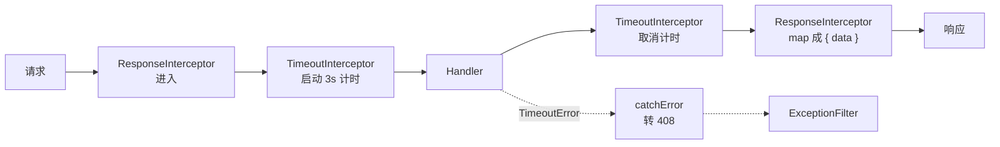

# 第 18 章 RxJS 与 Interceptor

## 有些值，下单的时候还没到

平时写函数，调用完就有结果：`const sum = add(1, 2)`，马上拿到 3。像自动售货机，按一下，饮料立刻掉出来。

可有些值不是立刻到的。你点一份外卖，付完钱那一刻饭还没做；接下来可能二十分钟后送到一份（一个值），也可能分三趟送（多个值），还可能半路被取消（错误）。下单时你拿到的是一个“之后会发生的安排”，不是饭本身。

RxJS 处理的就是这种“一串还没发生的值”。它把这种安排叫 **Observable**——别被这个词吓到，你就把它读成“一串还没发生的值”：可能只有一个，可能有很多个，也可能一个都没有。RxJS 是围着这串值干活的一整套工具。

Nest 为什么用它？因为 handler 的返回值不一定是单个值。普通接口返回一个对象；SSE（服务器推送）会持续往外推消息；WebSocket 也可能一次返回多条。把这些都看成“值的序列”，拦截器就能用同一套写法做包装、超时、重试和错误转换，不用为每种返回类型写一套分支。代价是方法签名里多一层 `Observable`，不熟的人第一次看会绕。

**拦截器（interceptor）**是包在 handler（真正处理这个接口的方法）外面的一层壳。请求要进 handler 之前，它先看一眼；handler 办完出来，它还能把结果改一改再交给客户端。`next.handle()` 就是“放他进去办”的开关，它返回的正是上面那串“还没发生的值”。没有它行不行？能跑，但统一响应、超时、缓存这些横跨所有接口的规则，只能复制到每个 Controller 里。

它和中间件不是一回事。中间件在门口，只知道有请求进来，不知道会落到哪个方法（第 17 章）；拦截器在 handler 前后，知道这次命中了哪个方法，还能改写返回给客户端的数据。守卫管“能不能进”，管道管“参数对不对”（第 19 章），异常过滤器管“出错之后怎么回”（第 21 章）。这五类组件各自的位置，第 9 章画过一张图。

官方文档（先看懂正文再点）：
- [Observable](https://rxjs.dev/guide/observable)：流是什么、为什么订阅后才开始跑，对应开头“外卖”那个比喻。
- [Operators](https://rxjs.dev/guide/operators)：`map`、`tap`、`catchError` 怎么串起来，对应后面两段改造。
- [Interceptors](https://docs.nestjs.com/interceptors)：官方的 `CallHandler` 与 `next.handle()`，对应“拦截器接的是 handler 的返回值”。

## 一个列表页，三种返回形状

同一个列表页，调 `/api/rooms` 拿到的是裸数组，调 `/api/bookings` 拿到的是 `{ items, meta }`，到了统计接口又变成 `{ data: ... }`。前端只好写一个 `const list = res.data ?? res.items ?? res` 的兼容函数，每接一个接口就补一层。

另一件事更急。数据库连接池打满的那几分钟，`GET /api/bookings` 一直挂着，浏览器转圈到 30 秒，网关先返回了 504。用户以为按钮没点，又点了一次，等连接池恢复，重复预订就来了。

这两个问题都不该由每个 Controller 自己解决。响应长什么样、一次请求最多等多久，是横跨所有 handler 的规则。复制到几十个方法里，改一次就要动几十处。拦截器就是 Nest 留给这层规则的位置：它包在 handler 外面，拿得到“这次命中了哪个方法”（`ExecutionContext`，第 11 章专门讲过），也拿得到 handler 的返回值。

## 把这串值想清楚

先用数组对比一下。数组 `[1, 2, 3]` 是**已经到齐**的值，你随时可以 `map`、`filter`、取长度。Observable 是**以后才会到**的一串值，现在可能还是空的，你没法立刻取长度，只能先安排好“到了以后怎么处理”。

处理这串值有三方角色，像一台净水器：

- **水源**：谁产生值。可能是一个 HTTP 请求的返回值，也可能是一个定时器、一条 WebSocket 消息。
- **滤芯**：中间怎么加工。`map` 换值、`filter` 挑值、`catchError` 接错误，这些加工步骤叫**操作符**。
- **水龙头**：谁来消费。拧开龙头（订阅，`subscribe`），水才开始流；不拧，前面的管子装得再好也不出水。

所以你会看到两种写法。装滤芯是 `.pipe(...)`，它只负责把加工步骤串起来，不会启动任何东西；真正开闸的是 `subscribe()`。Nest 在拿到 `intercept()` 的返回值之后，会替你拧这个龙头。你要做的是“把管子接好”，不是“自己开水”。

这也是最容易踩的坑：在拦截器里手动 `subscribe()`，等于你自己开了一次龙头，Nest 又开一次，handler 就会执行两遍，日志里出现两行。**只组装，不订阅**，记住这一句就够了。

这串值还有两个脾气：

- **它是冷的**。同一份“安排”，每订阅一次就从头跑一遍。像净水器，每开一次龙头，水都从水源重新流过来，不会接着上次的位置。
- **它会有始有终**。值可以一个接一个地来，也可以中途报错，或者正常结束。报错时，后面的加工步骤不再执行，错误会顺着管道往回找 `catchError`；正常结束时，流发一个“完了”的信号就关门。

这一章只需要五个操作符：

| 操作符 | 作用 | 打个比方 | 什么时候用 |
| --- | --- | --- | --- |
| `map` | 把流里的值换成另一个值 | 给传送带上的每个箱子换一张标签 | 包装响应、裁剪字段 |
| `tap` | 看一眼值，不改变它 | 门卫登记，不拆包裹 | 记日志、打点 |
| `catchError` | 捕获错误，换一条流继续 | 保险丝烧了，换一根接着供电 | 把底层错误翻译成 HTTP 异常 |
| `timeout` | 超过时限没发出值就报错 | 给后厨设一个出餐倒计时 | 给 handler 设上限 |
| `finalize` | 成功、失败、取消都执行 | 不管这单成不成，最后都关灯锁门 | 清理计时器、关闭连接 |

`tap` 的 `next` 回调只在成功时触发，handler 抛错时不会进去。要在错误路径也执行，用 `finalize`，或者给 `tap` 传一个带 `error` 回调的观察者对象。

这里的 `.pipe()` 只是把操作符串起来，和 Nest 的 Pipe 组件同名不同物，后者第 19 章讲。

## 拦截器接的是 handler 的返回值

要写一个拦截器，就是写一个类：带 `@Injectable()`、实现 `NestInterceptor` 接口，并实现 `intercept()` 方法：

```ts
intercept(context: ExecutionContext, next: CallHandler): Observable<unknown>
```

`next.handle()` 是“继续往下走，执行 handler”的开关。它返回一个 `Observable`，handler 的返回值会从这个流里出来；你在流上挂操作符，等于在 handler 返回之后、响应发出之前插一段逻辑。如果 `intercept()` 里根本没调用 `next.handle()`，handler 一次都不会执行——这是实现缓存拦截器时常用的技巧，也是忘记调用时接口“莫名其妙返回空”的原因。

多个拦截器叠在一起时是洋葱模型：先注册的在外层，它的前置代码最先执行，它的 `map` 最后执行。像给同一个包裹套两层包装纸：最外层先包、最后拆。图 18-1 里 `ResponseInterceptor` 在外、`TimeoutInterceptor` 在内，所以超时只包住 handler，不会把外层包装响应的耗时也算进去。

> **图 18-1** 两个拦截器套在 handler 外面的执行顺序。



## 第一步：把成功响应收成一种形状

打开 `meeting-booking` 的 `src/common/interceptors/response.interceptor.ts`，参考实现里已经有这一版：

```ts
import {
  type CallHandler,
  type ExecutionContext,
  Injectable,
  type NestInterceptor,
} from '@nestjs/common';
import { map, type Observable } from 'rxjs';
import type { PageMeta } from '../dto/paginated.dto.js';

export interface ApiResponse<T> {
  data: T;
  meta?: PageMeta;
}

interface PaginatedPayload {
  items: unknown[];
  meta: PageMeta;
}

const isPaginatedPayload = (value: unknown): value is PaginatedPayload => {
  if (typeof value !== 'object' || value === null) {
    return false;
  }

  const candidate = value as Partial<PaginatedPayload>;
  return (
    Array.isArray(candidate.items) &&
    typeof candidate.meta === 'object' &&
    candidate.meta !== null
  );
};

@Injectable()
export class ResponseInterceptor
  implements NestInterceptor<unknown, ApiResponse<unknown>>
{
  intercept(
    _context: ExecutionContext,
    next: CallHandler,
  ): Observable<ApiResponse<unknown>> {
    return next.handle().pipe(
      map((payload: unknown) => {
        if (isPaginatedPayload(payload)) {
          return { data: payload.items, meta: payload.meta };
        }

        return { data: payload };
      }),
    );
  }
}
```

`map` 的回调接收 handler 的返回值。普通接口直接包成 `{ data }`；分页接口的 service 返回 `{ items, meta }`，这里把它拆成 `{ data: items, meta }`。类型守卫 `isPaginatedPayload` 不是装饰，它让“分页”和“普通对象”在运行时也能区分——只靠 `typeof payload === 'object'` 会把任何对象都当成可分页数据。

拦截器写完后，用 `APP_INTERCEPTOR` 注册成全局拦截器：

```ts
// src/app.module.ts
import { APP_INTERCEPTOR } from '@nestjs/core';
import { ResponseInterceptor } from './common/interceptors/response.interceptor.js';

@Module({
  // 其余 imports/providers 省略
  providers: [
    { provide: APP_INTERCEPTOR, useClass: ResponseInterceptor },
  ],
})
export class AppModule {}
```

`useClass` 让 Nest 通过容器创建实例，拦截器就能注入 `ConfigService`、`Logger` 这类 Provider。对比 `app.useGlobalInterceptors(new ResponseInterceptor())`：后者也能生效，但实例是你在模块外 `new` 的，注入不进去，测试时也不好替换。

跑起来看两个接口。下面的响应是示例输出，未在本地起服务实测：

```bash
curl -s http://localhost:3000/api/health | jq
```

```json
{
  "data": {
    "status": "ok",
    "timestamp": "2026-11-06T18:42:07.318Z",
    "uptime": 37
  }
}
```

再看不带 token 的预订列表：

```bash
curl -s http://localhost:3000/api/bookings | jq
```

```json
{
  "statusCode": 401,
  "message": "Unauthorized",
  "error": "Unauthorized",
  "requestId": "d3a91f0c-7b52-4e18-9a64-1f0c8b2d7e51"
}
```

成功响应被包成了 `{ data }`，401 没有。这不是漏了：错误走的是异常过滤器那条路，`map` 只处理成功值，抛出的异常不会经过它。错误结构该由异常过滤器统一，硬把 401 也包成 `{ data }`，前端反而要多判断一层。异常过滤器在第 21 章细讲。

还有一种情况会让包装失效：handler 用了 `@Res()` 自己 `res.json()`。此时 Nest 把响应控制权交给了你，拦截器改不了已经写出去的响应。要么改用 `@Res({ passthrough: true })`，让 Nest 继续处理返回值；要么别用 `@Res()`。

## 第二步：给 handler 加一条时间上限

超时不能靠 `setTimeout` 加一个 `res.end()`。那样只是让客户端早点断开，handler 还在跑，数据库连接也不会释放。RxJS 的 `timeout` 至少会取消订阅，让上游知道没人要结果了——像后厨的倒计时到点，前台不再等这单，但后厨的锅不一定已经关火，这个边界后面还会说。

```ts
// src/common/interceptors/timeout.interceptor.ts
import {
  type CallHandler,
  type ExecutionContext,
  Injectable,
  type NestInterceptor,
  RequestTimeoutException,
} from '@nestjs/common';
import {
  TimeoutError,
  catchError,
  throwError,
  timeout,
  type Observable,
} from 'rxjs';

const HANDLER_TIMEOUT_MS = 3000;

@Injectable()
export class TimeoutInterceptor implements NestInterceptor {
  intercept(
    _context: ExecutionContext,
    next: CallHandler,
  ): Observable<unknown> {
    return next.handle().pipe(
      timeout({ each: HANDLER_TIMEOUT_MS }),
      catchError((error: unknown) => {
        if (error instanceof TimeoutError) {
          return throwError(
            () => new RequestTimeoutException('处理超时，请稍后重试'),
          );
        }
        return throwError(() => error);
      }),
    );
  }
}
```

`timeout({ each: 3000 })` 的语义是“距离上一次发出值超过 3 秒就报错”。普通 JSON 接口只发一次值，所以它等于给 handler 设了 3 秒上限；如果拿它包 SSE，`each` 限制的是两条消息之间的最大间隔，不是总时长。要分别限制首字节和后续间隔，写 `timeout({ first: 1000, each: 3000 })`。

`catchError` 里最后那行 `return throwError(() => error)` 是整段代码最贵的一行。少了它，404、400、数据库错误会全部变成 408，前端会以为所有失败都是超时。只有 `error instanceof TimeoutError` 时才翻译，其余原样抛回给异常过滤器。

把它注册在 `ResponseInterceptor` 后面：

```ts
providers: [
  { provide: APP_INTERCEPTOR, useClass: ResponseInterceptor },
  { provide: APP_INTERCEPTOR, useClass: TimeoutInterceptor },
],
```

先注册的在外层。响应包装在外，超时在内，超时预算只覆盖 handler，不覆盖后面的序列化。

## 跑起来，看 408 和 404 的分界

在 `AppController` 里临时加两个公开路由，一个慢、一个抛 404：

```ts
import { NotFoundException } from '@nestjs/common';
import { setTimeout as delay } from 'node:timers/promises';

@Public()
@Get('slow')
async slow(): Promise<{ finishedAt: string }> {
  await delay(5000);
  return { finishedAt: new Date().toISOString() };
}

@Public()
@Get('missing')
async missing(): Promise<never> {
  await delay(50);
  throw new NotFoundException('这条记录不存在');
}
```

先请求慢接口。下面的返回是示例输出，未在本地起服务实测：

```bash
curl -s -o /tmp/slow-18.json -w '%{http_code} %{time_total}\n' \
  http://localhost:3000/api/slow
```

```text
408 3.004
```

```bash
python3 -m json.tool /tmp/slow-18.json
```

```json
{
  "statusCode": 408,
  "message": "处理超时，请稍后重试",
  "error": "Request Timeout",
  "requestId": "6c1d0a3e-5b74-4f92-8e10-7a3c9d5b2f68"
}
```

按上面的配置，3 秒左右会返回，不是 5 秒；多出来的几毫秒是连接和序列化。再请求会抛 404 的接口：

```bash
curl -s -o /dev/null -w '%{http_code}\n' http://localhost:3000/api/missing
```

```text
404
```

404 没有被改写成 408，说明 `catchError` 的分支判断生效了。如果这里也返回 408，先检查 `TimeoutError` 是不是从 `rxjs` 导入的——从别的路径导入会导致 `instanceof` 判断失败，然后检查 `catchError` 里是不是漏了原样抛回。

超时响应同样不会被包成 `{ data }`。它走的是异常过滤器，结构是 `{ statusCode, message, error, requestId }`，和 401 一致。成功和失败各用一种结构，前端只需要判断 HTTP 状态码，不需要在成功结构里再找 `error` 字段。

验证完把 `slow` 和 `missing` 两个路由删掉。它们只是用来确认边界的，留在生产代码里没有意义。

## 拦截器的三种挂法

- **方法级**：`@UseInterceptors(LoggingInterceptor)` 写在 handler 上，只影响这一个方法。
- **控制器级**：写在 Controller 类上，影响这个控制器下的所有 handler。
- **全局**：`APP_INTERCEPTOR` 或 `app.useGlobalInterceptors()`。前者能注入依赖，后者不能，项目里优先用前者。

方法级适合一次性逻辑，比如某个导出接口要禁用缓存；全局适合响应包装、超时这种所有接口都要的规则。不要把业务判断塞进全局拦截器，再靠 URL 前缀区分——那会把全局拦截器变成第二个路由表。

## 生产里真正会踩的坑

| 现象 | 原因 | 怎么处理 |
| --- | --- | --- |
| 接口一直不返回，也没有日志 | `intercept` 忘了 `return next.handle()`，或返回了裸值 | 必须返回 Observable；先确认 `next.handle()` 被调用 |
| handler 执行两次，日志重复 | 拦截器里手动 `subscribe()`，Nest 又订阅了一次 | 只组装管道，订阅交给框架 |
| 所有 404 都变成 408 | `catchError` 没有区分错误类型 | 用 `instanceof TimeoutError` 判断，其余原样抛 |
| 返回值没被包装 | handler 用了 `@Res()` 自己发送响应 | 改用 `@Res({ passthrough: true })`，或去掉手动发送 |
| 超时后数据库还在执行 | `timeout` 只取消订阅，不会自动回滚下游 | 把 `AbortSignal` 传进 `fetch`/驱动，在事务层处理取消 |
| SSE 连接几秒就断 | 把 `each` 当成总时长用 | 流式接口用 `each` 限制消息间隔，用 `first` 单独限制首字节 |
| 拦截器顺序和预期相反 | 先注册的在外层，`map` 最后执行 | 用洋葱模型推一遍；全局拦截器别堆太多层 |
| 所有 Controller 都变成请求作用域 | 全局拦截器注入了 `REQUEST` 作用域的 Provider | 能从 `ExecutionContext` 拿的请求数据就别注入 |

还有两个边界，排障时很容易忽略：

- **408 的语义并不完美**。HTTP 里的 408 原本表示“服务端等客户端发送请求超时”，不是“handler 执行超时”。应用内部用 408 很常见，但前面有网关时，网关更常用 504 表示上游超时。选一个，在错误码文档里写清楚，别让前端同时猜 408 和 504。
- **`timeout` 不会自动把取消信号传下去**。它只是不再等结果；handler 里的 Promise、数据库查询、下游 HTTP 请求仍在跑。生产里要把 `AbortSignal` 从请求一路传到这些调用，否则超时只是把问题从客户端挪到了服务端。

响应结构收口之后，入口还有一个更隐蔽的问题：`@Param('id') id: number` 这句类型标注在运行时完全不存在，`id` 仍然是字符串。下一章从这个问题开始，把内置 `Parse*` 管道和自定义管道拆开讲清楚。


<!-- chapter-nav:start -->
---

← 上一篇：[017 Nest的Middleware](017-Nest的Middleware.md) · [本 Part 目录](_part.md) · 下一篇：[019 内置Pipe和自定义Pipe](019-内置Pipe和自定义Pipe.md) →
<!-- chapter-nav:end -->
