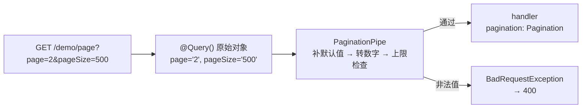

# 第 19 章 内置 Pipe 和自定义 Pipe

## 快递单上写“易碎”，箱子不会变结实

寄快递时，你在单子上写“易碎”。箱子本身不会因为这三个字变结实，搬运工也不会因此就轻拿轻放——单子只是给眼睛看的。

TypeScript 的类型标注就是这张单子。`id: number` 是写给编译器和编辑器看的，编译成 JavaScript 之后，类型标注被整段擦掉，运行时根本没有“number 类型”这回事。TypeScript 官方管这个叫“类型擦除”。

后果很具体：从 URL、查询串进来的值永远是字符串；请求体是 `JSON.parse` 出来的普通对象，字段类型全凭客户端。所以 `@Param('id') id: number` 不会让 Nest 自动把 `'2'` 变成 `2`。

**管道（Pipe）**是 Nest 在“外面的值进入 handler（真正处理这个接口的方法）”这个位置留的一道安检：一个实现 `PipeTransform` 的类，`transform(value, metadata)` 拿到原始值和参数信息，返回处理后的值，或者抛异常把人拦下。它一次只检查一个参数，站在守卫之后、handler 之前。守卫回答“你能不能进这个接口”，管道回答“你带来的东西对不对”；拦截器包的是 handler 和返回值，不改 handler 的参数（第 18 章）。这五类组件的位置，第 9 章画过一张图。

没有管道行不行？能跑，但每个 handler 都得自己 `Number(id)`、自己检查 `pageSize` 上限，漏一个入口就出一个洞。更麻烦的是类型标注会让人误以为已经安全了——编译期通过，运行时照样拿到字符串。

官方文档（先看懂正文再点）：
- [TypeScript 类型擦除](https://www.typescriptlang.org/docs/handbook/2/basic-types.html)：类型只在编译期存在、编译后整段消失，对应开头“类型在运行时不存在”。
- [Pipes](https://docs.nestjs.com/pipes)：官方管道的定义、内置清单和三种挂法，对应 `PipeTransform` 签名。

## 第 2 条记录，跳到了第 21 条

线上有个预约详情页，链接是 `/bookings/2`。详情接口把 `id` 原样返回，前端拿它算“下一条”：`id + 1`。本地测试一直正常，直到有人点了第 2 条，页面跳到了 `/bookings/21`。

后端查了一下，`@Param('id') id: number` 打印出来是 `'2'`，`'2' + 1` 当然是 `'21'`。把类型改成 `number` 再重启，结果不变——TypeScript 的类型在编译后已经被擦掉，Nest 从 URL 里拿到的永远是字符串。

同一个接口还有另一个入口：`GET /bookings?pageSize=100000` 会把整张表拖回来。没有上限，也没有类型检查。两件事指向同一个位置：外部数据进入 handler 之前，需要有人做转换和拦截。Nest 把这个位置单独抽出来，叫管道。

## 类型是写给编译器看的

管道是一个实现 `PipeTransform` 的类，只有一个必须实现的方法：

```ts
transform(value: unknown, metadata: ArgumentMetadata): unknown
```

它一次处理一个参数。`@Param('id')`、`@Query('page')`、`@Body()` 各是一个参数，各自可以挂管道，管道按声明顺序从左到右执行。返回值会替换掉原来的参数值；抛异常则请求到此为止，handler 一行都不会执行，异常交给异常过滤器，按异常自带的状态码返回（管道里最常见的是 400）。

`@Param('id') id: number` 里的 `number` 只是给编译器看的。Nest 确实能从参数上读到 `metatype = Number`，但没有任何内置逻辑会因为 `metatype === Number` 就自动把字符串转成数字——真正做转换的是你显式挂上去的 `ParseIntPipe`。

管道拿到的 `ArgumentMetadata` 有四个字段：

| 字段 | 含义 | 容易踩的地方 |
| --- | --- | --- |
| `type` | `'body'`、`'query'`、`'param'`、`'custom'` | 自定义装饰器的参数是 `'custom'`，默认不参与校验 |
| `metatype` | 参数类型的构造函数 | 参数是 interface、泛型、或没写类型时是 `Object` 或 `undefined` |
| `data` | 装饰器里的键名，如 `@Query('page')` 的 `'page'` | `@Body()` 不传键名时是 `undefined` |
| `schema` | 参数装饰器上挂的通用校验描述 | Nest 12 新增，由 `StandardSchemaValidationPipe` 读取 |

两个后果值得记牢：

- **DTO 必须是 class**（DTO 是请求体的形状类，第 20 章展开）。如果 `@Body() dto: CreateBookingDto` 里的 `CreateBookingDto` 是 interface，转译后类型信息消失，`metatype` 变成 `Object`，依赖它的校验逻辑会直接跳过。
- **不要用 `import type` 引入 DTO**。`import type` 只保留类型、不生成运行时导入，构造函数同样拿不到。写成普通 `import`，让类真实存在于运行时。

管道里只应该抛 `HttpException` 及其子类。抛一个普通 `Error`，Nest 会把它当成未处理的服务端错误，客户端收到 500，日志里多一条本可以避免的堆栈。

## 单个值，先让内置管道干

Nest 自带一组 `Parse*` 管道，常用的有：

| 管道 | 输入 | 输出/行为 | 备注 |
| --- | --- | --- | --- |
| `ParseIntPipe` | `'42'` | `42` | 拒绝 `'1.5'`、`'42abc'` |
| `ParseFloatPipe` | `'3.14'` | `3.14` | 接受小数和科学计数法 |
| `ParseBoolPipe` | `'true'` | `true` | 只认 `'true'` 和 `'false'` |
| `ParseEnumPipe` | `'PENDING'` | 枚举成员 | 必须传枚举对象；数字枚举也认字符串形式 |
| `ParseArrayPipe` | `'a,b'` | `['a','b']` | `separator` 默认 `,`，`items` 可选 |
| `ParseUUIDPipe` | UUID 字符串 | 原字符串 | 默认接受 1–8、Nil、Max |
| `ParseDatePipe` | `'2026-11-06'` | `Date` | 无时区后缀的日期按 UTC 解析 |
| `DefaultValuePipe` | `undefined` | 默认值 | 只补值，不校验；数组/对象每次调用会复制 |
| `ParseFilePipe` | 上传文件 | 校验后的文件 | 文件上传单独讲 |

`Parse*` 默认遇到 `undefined` 会抛错。可选参数有两种写法，语义不同：

```ts
@Query('status', new ParseEnumPipe(BookingStatus, { optional: true }))
status?: BookingStatus
```

`optional: true` 表示“没有值就放行，把 `undefined` 交给 handler”。另一种是前置 `DefaultValuePipe`：

```ts
@Query('page', new DefaultValuePipe(1), ParseIntPipe) page: number
```

它先把 `undefined` 补成 `1`，再交给 `ParseIntPipe`。顺序不能反——反过来 `ParseIntPipe` 先看到 `undefined`，直接 400，默认值根本没机会生效。像进门前先填一张默认登记表，再去安检；安检在前，人已经被拦下了，表还没填。

这两种写法都只处理 `undefined` 和 `null`。`?page=` 传的是空字符串，既不是 `undefined` 也不是 `null`，`DefaultValuePipe` 不会补值，`ParseIntPipe` 会报 400。空字符串要不要当“没传”，得在业务上明确。

## 挂到一个控制器上跑一遍

在 `meeting-booking` 里建一个临时实验模块。先定义状态枚举和控制器：

```ts
// src/modules/demo/booking-status.enum.ts
export enum BookingStatus {
  PENDING = 'PENDING',
  CONFIRMED = 'CONFIRMED',
  CANCELLED = 'CANCELLED',
}
```

```ts
// src/modules/demo/demo.controller.ts
import {
  Controller,
  DefaultValuePipe,
  Get,
  Param,
  ParseArrayPipe,
  ParseBoolPipe,
  ParseDatePipe,
  ParseEnumPipe,
  ParseIntPipe,
  ParseUUIDPipe,
  Query,
} from '@nestjs/common';
import { Public } from '../../common/decorators/public.decorator.js';
import { BookingStatus } from './booking-status.enum.js';

interface DemoItem {
  id: string;
  status: BookingStatus;
}

@Public()
@Controller('demo')
export class DemoController {
  private readonly items: DemoItem[] = [
    {
      id: '3f2504e0-4f89-41d3-9a0c-0305e82c3301',
      status: BookingStatus.CONFIRMED,
    },
    {
      id: '9c858901-8a57-4791-81fe-4c455b099bc9',
      status: BookingStatus.PENDING,
    },
  ];

  @Get('builtins')
  builtins(
    @Query('page', new DefaultValuePipe(1), ParseIntPipe) page: number,
    @Query('pageSize', new DefaultValuePipe(20), ParseIntPipe) pageSize: number,
    @Query('active', new DefaultValuePipe(true), ParseBoolPipe) active: boolean,
    @Query('status', new ParseEnumPipe(BookingStatus, { optional: true }))
    status?: BookingStatus,
    @Query('tags', new ParseArrayPipe({ optional: true })) tags: string[] = [],
  ): {
    page: number;
    pageSize: number;
    active: boolean;
    status: BookingStatus | null;
    tags: string[];
    total: number;
  } {
    return {
      page,
      pageSize,
      active,
      status: status ?? null,
      tags,
      total: this.items.length,
    };
  }

  @Get('date/:date')
  byDate(@Param('date', new ParseDatePipe()) date: Date): { date: string } {
    return { date: date.toISOString() };
  }

  @Get('items/:id')
  findOne(
    @Param('id', new ParseUUIDPipe({ version: '4' })) id: string,
  ): DemoItem {
    const item = this.items.find((entry) => entry.id === id);
    return item ?? { id, status: BookingStatus.PENDING };
  }
}
```

再建模块并注册：

```ts
// src/modules/demo/demo.module.ts
import { Module } from '@nestjs/common';
import { DemoController } from './demo.controller.js';

@Module({
  controllers: [DemoController],
})
export class DemoModule {}
```

```ts
// src/app.module.ts
import { DemoModule } from './modules/demo/demo.module.js';

@Module({
  imports: [
    // 其余模块省略
    DemoModule,
  ],
})
export class AppModule {}
```

控制器上加 `@Public()`，是因为项目里有全局 JWT 守卫（检查登录令牌的守卫）。实验接口没必要每次先登录拿 token；验证完把 `DemoModule` 从 `AppModule` 删掉。

启动。下面的启动日志和各条响应都是示例输出，未在本地起服务实测：

```bash
pnpm start:dev
```

```text
[Nest] 48211  - 11/06/2026, 6:51:03 PM     LOG [NestApplication] Nest application successfully started +8ms
```

请求第一组参数：

```bash
curl -s 'http://localhost:3000/api/demo/builtins?page=2&pageSize=2&status=PENDING&tags=nest,rxjs' | jq
```

```json
{
  "data": {
    "page": 2,
    "pageSize": 2,
    "active": true,
    "status": "PENDING",
    "tags": ["nest", "rxjs"],
    "total": 2
  }
}
```

`page`、`pageSize` 是数字，`active` 是布尔值，`tags` 被拆成了数组。注意最外层的 `data`——第 18 章装的 `ResponseInterceptor` 还在生效，所有成功响应都会被包一层。

再试几个边界：

```bash
curl -s 'http://localhost:3000/api/demo/builtins?page=abc' | jq
```

```json
{
  "statusCode": 400,
  "message": "Validation failed (numeric string is expected)",
  "error": "Bad Request",
  "requestId": "c81f4e2a-93b7-4d05-8f6e-2a7b1c9d4e30"
}
```

```bash
curl -s 'http://localhost:3000/api/demo/builtins?status=DRAFT' | jq
```

```json
{
  "statusCode": 400,
  "message": "Validation failed (enum string is expected)",
  "error": "Bad Request",
  "requestId": "0b7d3c9e-4a12-4e8f-b5d6-9c2a1f7e8d43"
}
```

日期和 UUID：

```bash
curl -s 'http://localhost:3000/api/demo/date/2026-11-06' | jq
# { "data": { "date": "2026-11-06T00:00:00.000Z" } }

curl -s 'http://localhost:3000/api/demo/items/3f2504e0-4f89-41d3-9a0c-0305e82c3301' | jq
# { "data": { "id": "3f2504e0-4f89-41d3-9a0c-0305e82c3301", "status": "CONFIRMED" } }

curl -s 'http://localhost:3000/api/demo/items/not-a-uuid' | jq
# { "statusCode": 400, "message": "Validation failed (uuid is expected)", ... }
```

几个容易误判的细节：

- `ParseArrayPipe` 的 `items` 不是必填。不传时，`?tags=nest,rxjs` 拆出来的元素保持字符串；要数字数组才写 `items: Number`。真正会报 `Validation failed (parsable array expected)` 的是 `null`/`undefined` 且没开 `optional`，不是“没写 `items`”。
- `?tags=` 会得到 `['']`，不是 `[]`。空字符串照样是一个元素，`optional` 也不会拦它。业务上要过滤，就在管道里处理，别指望默认值。
- `ParseUUIDPipe({ version: '4' })` 会拒绝 UUID v7。Nest 12 默认接受 1–8、Nil、Max；v12.1.2 起版本号也可以写数字 `7`。数据库主键用什么版本，管道就写什么版本，或者干脆不传 `version`。
- `ParseDatePipe` 不是“什么日期格式都收”。`2026-11-06` 按 UTC 零点解析；`2026/11/06` 在不同运行环境下可能得到不同结果。空字符串报 `Validation failed (no Date provided)`，无法解析的字符串报 `Validation failed (invalid date format)`。
- `DefaultValuePipe` 对数组和普通对象做的是逐次复制，不是共享同一个引用。handler 修改了默认对象，不会污染下一次请求。

## 一组参数：自己写一个分页管道

单个值用内置管道就够了，分页却是一组参数的联合规则：`page` 默认 1、`pageSize` 默认 20、都必须是正整数、`pageSize` 有上限、`offset` 由前两者算出来。拆成三个 `@Query`，controller 里会出现三行默认值和三处校验，规则还容易改漏。

把整个 query 对象交给一个自定义管道：

```ts
// src/modules/demo/pipes/pagination.pipe.ts
import {
  BadRequestException,
  Injectable,
  type PipeTransform,
} from '@nestjs/common';
import type { ArgumentMetadata } from '@nestjs/common';

export interface Pagination {
  page: number;
  pageSize: number;
  offset: number;
}

export type PaginationQuery = Record<
  string,
  string | string[] | undefined
>;

const DEFAULT_PAGE = 1;
const DEFAULT_PAGE_SIZE = 20;
const MAX_PAGE_SIZE = 100;

@Injectable()
export class PaginationPipe
  implements PipeTransform<PaginationQuery, Pagination>
{
  transform(
    query: PaginationQuery,
    _metadata: ArgumentMetadata,
  ): Pagination {
    const page = this.toPositiveInt(query.page, 'page', DEFAULT_PAGE);
    const pageSize = this.toPositiveInt(
      query.pageSize,
      'pageSize',
      DEFAULT_PAGE_SIZE,
    );

    if (pageSize > MAX_PAGE_SIZE) {
      throw new BadRequestException(`pageSize 不能超过 ${MAX_PAGE_SIZE}`);
    }

    return { page, pageSize, offset: (page - 1) * pageSize };
  }

  private toPositiveInt(
    raw: string | string[] | undefined,
    field: string,
    fallback: number,
  ): number {
    if (raw === undefined) {
      return fallback;
    }
    if (typeof raw !== 'string' || !/^\d+$/.test(raw)) {
      throw new BadRequestException(`${field} 必须是正整数`);
    }

    const value = Number(raw);
    if (value < 1) {
      throw new BadRequestException(`${field} 必须大于 0`);
    }
    return value;
  }
}
```

把它挂到整个 query 上：

```ts
// DemoController 里加
import { PaginationPipe, type Pagination } from './pipes/pagination.pipe.js';

@Get('page')
paginate(@Query(PaginationPipe) pagination: Pagination): Pagination {
  return pagination;
}
```

`@Query(PaginationPipe)` 不传字段名，Nest 把整个 query 对象交给管道，管道返回的 `Pagination` 直接成为 handler 参数。controller 里不再出现 `Number(query.page)`，分页规则只有一份。

> **图 19-1** 查询参数从 HTTP 字符串变成 handler 参数的过程。



```bash
curl -s 'http://localhost:3000/api/demo/page?page=2&pageSize=2' | jq
# { "data": { "page": 2, "pageSize": 2, "offset": 2 } }

curl -s 'http://localhost:3000/api/demo/page?pageSize=500' | jq
# { "statusCode": 400, "message": "pageSize 不能超过 100", "error": "Bad Request", ... }
```

检查点：`page=2&pageSize=2` 返回的必须是数字、`offset` 必须是 2；`page=abc`、`pageSize=0`、`pageSize=500` 都必须是 400，不能是 500。如果 `pageSize=500` 被放行，检查上限判断是不是写在了 `return` 之后。

`transform` 可以返回 `Promise`，Nest 会 `await` 它。但别在热路径的管道里查数据库做存在性校验——每个参数一次查询，延迟会叠加到整个请求上，而且管道抛出的 404 会掩盖真正的业务语义。

## 管道的三种挂法

- **参数级**：`@Query('page', ParseIntPipe)`，只影响这一个参数。
- **方法/控制器级**：`@UsePipes(new PaginationPipe())` 写在 handler 或 Controller 上，影响这一组参数。
- **全局**：`{ provide: APP_PIPE, useClass: ValidationPipe }`，或者 `app.useGlobalPipes()`。前者能注入依赖，后者是手动 `new` 的实例。

全局管道适合所有接口都要的规则，比如 DTO 校验；参数级适合一次性的转换。别把分页这种只属于列表接口的规则塞进全局管道，否则详情接口也要跟着解析一遍 `page`。

## 生产里真正会踩的坑

| 现象 | 原因 | 处理 |
| --- | --- | --- |
| `id` 是 `'2'` 不是 `2` | 没挂管道，TS 类型不参与运行时 | 加 `ParseIntPipe`，或用 DTO + `ValidationPipe` |
| 可选参数不传就 400 | `Parse*` 默认拒绝 `undefined` | 加 `{ optional: true }`，或前置 `DefaultValuePipe` |
| 默认值不生效 | `DefaultValuePipe` 放在了 `Parse*` 后面 | 顺序改成 default → parse |
| `?page=` 没走默认值 | 空字符串不是 `undefined` | 在管道里显式处理空串 |
| 数组元素没被校验 | `items` 传了 interface，或被 `import type` 引入 | 改成 class、普通 import，并补 `@Type` |
| UUID v7 被拒 | 写死了 `version: '4'` | 去掉 `version`，或按实际版本传 |
| 自定义管道抛错返回 500 | 抛了普通 `Error` | 改抛 `BadRequestException` 等 `HttpException` |
| 全局管道注入不到 `ConfigService` | 用了 `app.useGlobalPipes(new X())` | 改成 `APP_PIPE` + `useClass` |

还有三条边界，等出问题再补成本会更高：

- **`pageSize` 上限是安全边界**。没有上限的 `pageSize` 会让一次查询拖回几十万行，既是性能问题，也是 DoS 入口。默认值、上限、最大页码在管道里一次做完。
- **排序字段必须白名单**。`?sort=createdAt` 如果直接拼进 `ORDER BY` 就是注入点。用 `ParseEnumPipe` 限定可选字段，再映射到真实列名。
- **跨字段规则不该塞进参数管道**。开始时间早于结束时间、优惠券和订单金额匹配这类规则，放在 DTO 类级校验或领域服务里；管道只做单参数、单对象的格式和范围校验。

单个参数和分页对象都收口了，但 POST body 是一整个嵌套对象：字段之间有依赖，数组元素还要逐个校验。下一章把 `ValidationPipe` 和 DTO 类接上，处理 `whitelist`、嵌套对象和错误消息路径。


<!-- chapter-nav:start -->
---

← 上一篇：[018 RxJS和Interceptor](018-RxJS和Interceptor.md) · [本 Part 目录](_part.md) · 下一篇：[020 如何使用ValidationPipe验证post请求参数](020-如何使用ValidationPipe验证post请求参数.md) →
<!-- chapter-nav:end -->
