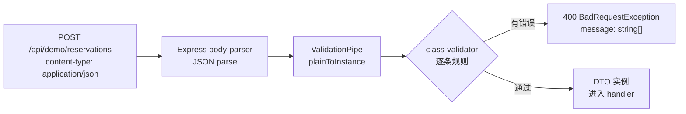

# 第 20 章 用 ValidationPipe 验证 POST 请求参数

## 先弄懂：DTO 和运行时校验

**DTO（Data Transfer Object，数据传输对象）**用来描述“请求或响应长什么样”：有哪些字段、什么类型、是否必填。它只负责形状，不放业务逻辑；这一章用它描述 POST body。在 Nest 的校验里，DTO 要写成 class，而不是 interface——因为 interface 编译后会被擦掉，装饰器没地方挂，运行时也拿不到这个类型。

**校验**要在运行时做。TypeScript 只能保证编译期，HTTP 进来的 JSON 是任意对象，`@Body() dto: CreateReservationDto` 不会自动检查。Nest 的 `ValidationPipe` 就是干这个的内置管道（第 19 章讲过管道的位置）：它先用 `class-transformer` 把普通对象转成 DTO 实例，再用 `class-validator` 读属性上的 `@IsUUID()`、`@MaxLength()` 等装饰器逐条跑规则，有错就抛 400，全过才把实例交给 handler。

没有它行不行？能跑，但 `isAdmin` 这种多余字段会一路穿到业务层，甚至被写进数据库，5000 字的标题和字符串类型的 `attendees` 也会等到写库或渲染时才炸；你只能在每个 handler 里手写一堆 `if`，还很难保证规则一致。class-validator 负责“规则怎么写”，class-transformer 负责“实例怎么来”，ValidationPipe 负责“什么时候执行、错了怎么返回”。

官方文档（先看懂正文再点）：
- [Validation](https://docs.nestjs.com/techniques/validation)：官方校验章节，`ValidationPipe` 的选项讲得最全，对应“三个开关决定行为”。
- [class-validator](https://github.com/typestack/class-validator)：全部规则装饰器清单，对应 DTO 里的 `@IsUUID()`、`@MaxLength()`。
- [class-transformer](https://github.com/typestack/class-transformer)：普通对象怎么变成 DTO 实例，对应“先看清楚，400 是谁返回的”。

现在看一个真实事故。

周五下午，前端给 `POST /api/demo/reservations` 多传了一个 `isAdmin: true`，接口照样返回 201，响应里还把它原样回显了。三天后，有人把 `title` 改成 5000 字，把 `attendees` 传成字符串，列表页直接 500。

这两件事看起来是“前端乱传”，根子上是同一个问题：JSON body 进来时只是一个普通对象，TypeScript 的 `interface` 编译完就没了，运行时没有任何人检查它。`@Body() dto: CreateReservationDto` 只是给编辑器看的，不会拦住 `isAdmin`，也不会拦住空标题。

这一章把 body 当成一份运行时契约：用 DTO 类写规则，用 `ValidationPipe` 在进入 handler 之前执行，让非法请求停在 400，而不是流进数据库。

## 先看清楚，400 是谁返回的

`ValidationPipe` 是 Nest 内置的管道，挂在路由匹配之后、handler 之前。它背后是两个库：`class-transformer` 负责把 JSON.parse 出来的普通对象变成 DTO 实例，`class-validator` 负责按属性上的装饰器逐条跑规则。规则不过，它抛 `BadRequestException`，响应就是 400。

管道做三件事，顺序不能反：

1. 把 plain object 转成 DTO 实例（`plainToInstance`）。
2. 在实例上执行 class-validator 的元数据规则。
3. 有错就抛 400；没错就把实例交给 handler。



图 20-1 一个 JSON body 在进入 handler 之前经历的转换与校验。

为什么不能直接写 `interface`？看这段：

```ts
interface CreateReservationDto {
  roomId: string;
  title: string;
}

@Post('reservations')
create(@Body() dto: CreateReservationDto) {
  return dto;
}
```

`interface` 只活在编译期。Nest 在运行时通过 `design:paramtypes` 拿到的类型是 `Object`，`ValidationPipe` 看到 `Object` 就直接放行。把 `interface` 换成 `class`，再打开 `tsconfig.json` 里的 `experimentalDecorators` 和 `emitDecoratorMetadata`，元数据才有地方挂。

还有一个更隐蔽的写法：`import type { CreateReservationDto } from './dto/...'`。`import type` 在编译时被整个擦掉，装饰器元数据里只剩 `Object`，校验同样静默失效。DTO 必须用普通 `import` 引入。

## 把 body 写成一份 DTO

新建 `src/modules/demo/dto/create-reservation.dto.ts`。字段按“会议室预订”的真实需求来：房间、标题、起止时间、参会人、设备、备注。

```ts
import { Transform, Type } from 'class-transformer';
import {
  ArrayMaxSize,
  ArrayMinSize,
  IsEmail,
  IsEnum,
  IsISO8601,
  IsOptional,
  IsString,
  IsUUID,
  MaxLength,
  MinLength,
  ValidateNested,
} from 'class-validator';

export enum Equipment {
  PROJECTOR = 'PROJECTOR',
  WHITEBOARD = 'WHITEBOARD',
  VIDEO = 'VIDEO',
}

export class AttendeeDto {
  @IsString()
  @MinLength(2)
  name!: string;

  @IsEmail()
  email!: string;
}

export class CreateReservationDto {
  @IsUUID()
  roomId!: string;

  @IsString()
  @MinLength(2)
  @MaxLength(100)
  title!: string;

  @IsISO8601({ strict: true })
  startTime!: string;

  @IsISO8601({ strict: true })
  endTime!: string;

  @ArrayMinSize(1)
  @ArrayMaxSize(20)
  @ValidateNested({ each: true })
  @Type(() => AttendeeDto)
  attendees!: AttendeeDto[];

  @IsOptional()
  @IsEnum(Equipment, { each: true })
  equipment?: Equipment[];

  @IsOptional()
  @IsString()
  @MaxLength(500)
  @Transform(({ value }) => (typeof value === 'string' ? value.trim() : value))
  remark?: string;
}
```

几个地方值得停一下：

- `!` 是 TypeScript 的 definite assignment 断言。`strictPropertyInitialization` 打开时，类字段必须有初始值，但 DTO 的字段是框架在运行时赋的，所以用 `!` 告诉编译器“我心里有数”。
- `@IsUUID()` 不限制版本，v1 到 v8 都收。要只收 v4，写 `@IsUUID('4')`。
- `@IsISO8601({ strict: true })` 的 `strict` 会检查日期部分。`2026-02-30T09:00:00+08:00` 在宽松模式下可能被当成合法字符串，严格模式下会直接拒掉。
- `@ValidateNested({ each: true })` 和 `@Type(() => AttendeeDto)` 必须成对出现。前者说“数组里每个元素都要递归校验”，后者告诉 class-transformer“元素要转成哪个类”。少了 `@Type`，class-validator 不知道子对象的规则挂在哪，嵌套校验会静默跳过。
- `@IsOptional()` 只认 `null` 和 `undefined`。传 `""` 不算“没传”，后面的 `@IsString()`、`@MaxLength()` 照样执行。想让空字符串也跳过，得再加 `@IsEmpty()` 或自定义逻辑，别指望 `@IsOptional()`。
- `@Transform()` 在 `plainToInstance` 阶段执行。`remark` 传 `"  周会  "`，handler 拿到的是 `"周会"`，但前提是 `transform: true`，下一节会讲。

## 注册管道：三个开关决定行为

DTO 只是规则，得有人执行。打开 `src/main.ts`，在 `app.setGlobalPrefix('api')` 之前加：

```ts
import { ValidationPipe } from '@nestjs/common';

app.useGlobalPipes(
  new ValidationPipe({
    whitelist: true,
    forbidNonWhitelisted: true,
    transform: true,
    transformOptions: { enableImplicitConversion: false },
    errorFormat: 'list',
  }),
);
```

逐项说：

- `whitelist: true`：只保留 DTO 上声明过的属性，多余字段直接删掉。
- `forbidNonWhitelisted: true`：多余字段不删，直接 400。它和 `whitelist` 一起开才有意义。只开 `whitelist` 时，`isAdmin` 会被静默丢掉，客户端以为存进去了，其实没有。
- `transform: true`：handler 拿到的是 DTO 实例，不是 plain object；`@Type` 和 `@Transform` 的结果也才会出现在 handler 里。关掉它，校验阶段仍然会实例化，但最后返回的是原始对象。
- `transformOptions.enableImplicitConversion: false`：禁止“字符串自动变数字”这种隐式转换。需要转的地方显式写 `@Type(() => Number)`，出问题时能一眼看到。
- `errorFormat: 'list'`：错误消息是字符串数组，也是 Nest 12 之前的默认形状。Nest 12 还支持 `'grouped'`，把消息按字段路径分组，形状变成 `Record<string, string[]>`；如果切过去，全局异常过滤器和前端解析都要跟着改。

如果管道需要注入依赖，用 `APP_PIPE` 注册；这里没有依赖，`useGlobalPipes` 就够了。别在同一路由上再挂一个更松的 `ValidationPipe` 想“放宽”——全局管道已经先跑过，400 已经抛了，后面的管道没机会。

## 跑一遍

在 `DemoController` 里加一个写接口。为了不碰真实数据库，直接把 DTO 原样返回，再补一个 id：

```ts
import { randomUUID } from 'node:crypto';
import { Body, Controller, Post } from '@nestjs/common';
import { Public } from '../../common/decorators/public.decorator.js';
import { CreateReservationDto } from './dto/create-reservation.dto.js';

@Public()
@Controller('demo')
export class DemoController {
  @Post('reservations')
  create(@Body() dto: CreateReservationDto): CreateReservationDto & { id: string } {
    return { id: randomUUID(), ...dto };
  }
}
```

`pnpm start:dev` 起来后，先发一个合法请求：

```bash
curl -s -X POST http://localhost:3000/api/demo/reservations \
  -H 'content-type: application/json' \
  -d '{
    "roomId": "3f1c2a9e-7b4d-4c8e-9f10-2a6b7c8d9e0f",
    "title": "周会",
    "startTime": "2026-11-20T09:00:00+08:00",
    "endTime": "2026-11-20T10:00:00+08:00",
    "attendees": [{"name": "张三", "email": "zhang@example.com"}],
    "equipment": ["PROJECTOR"],
    "remark": "  周会  "
  }'
```

```json
{"data":{"id":"a1b2c3d4-5e6f-4a7b-8c9d-0e1f2a3b4c5d","roomId":"3f1c2a9e-7b4d-4c8e-9f10-2a6b7c8d9e0f","title":"周会","startTime":"2026-11-20T09:00:00+08:00","endTime":"2026-11-20T10:00:00+08:00","attendees":[{"name":"张三","email":"zhang@example.com"}],"equipment":["PROJECTOR"],"remark":"周会"}}
```

> 示例输出（未实测）。`remark` 两边的空格没了，这是 `transform: true` 让 `@Transform` 的结果真正落到了 handler。

再发一个带 `isAdmin` 的：

```bash
curl -s -X POST http://localhost:3000/api/demo/reservations \
  -H 'content-type: application/json' \
  -d '{"roomId":"3f1c2a9e-7b4d-4c8e-9f10-2a6b7c8d9e0f","title":"周会","startTime":"2026-11-20T09:00:00+08:00","endTime":"2026-11-20T10:00:00+08:00","attendees":[{"name":"张三","email":"zhang@example.com"}],"isAdmin":true}'
```

```json
{"statusCode":400,"message":["property isAdmin should not exist"],"error":"Bad Request","requestId":"c2f4a6b8-1d3e-4f5a-9b7c-8d0e2f4a6b8c"}
```

> 示例输出（未实测）。如果只开 `whitelist`、不开 `forbidNonWhitelisted`，这个请求会返回 201，但响应里没有 `isAdmin`——`ValidationPipe` 把它删了。两种行为都不算错，区别是“告诉客户端传错了”还是“默默忽略”。

最后把多个字段一起弄坏：

```bash
curl -s -X POST http://localhost:3000/api/demo/reservations \
  -H 'content-type: application/json' \
  -d '{
    "roomId": "3f1c2a9e-7b4d-4c8e-9f10-2a6b7c8d9e0f",
    "title": "x",
    "startTime": "2026-02-30T09:00:00+08:00",
    "endTime": "2026-11-20T10:00:00+08:00",
    "attendees": [{"name": "", "email": "not-an-email"}],
    "equipment": ["TV"]
  }'
```

```json
{"statusCode":400,"message":["title must be longer than or equal to 2 characters","startTime must be a valid ISO 8601 date string","attendees.0.name should not be empty","attendees.0.email must be an email","equipment.0 must be one of the following values: PROJECTOR, WHITEBOARD, VIDEO"],"error":"Bad Request","requestId":"d3e5b7c9-2f4a-4b6c-8d1e-9f0a3b5c7d9e"}
```

> 示例输出（未实测）。`attendees.0.email` 这种路径是 class-validator 自动拼的；前端可以按 `.` 拆开，定位到具体行。

现在把 `@Type(() => AttendeeDto)` 注释掉，重启，再发一次上面那个坏 `email` 的请求：

```json
{"data":{"id":"b2c3d4e5-6f7a-4b8c-9d0e-1f2a3b4c5d6e","roomId":"3f1c2a9e-7b4d-4c8e-9f10-2a6b7c8d9e0f","title":"周会","startTime":"2026-11-20T09:00:00+08:00","endTime":"2026-11-20T10:00:00+08:00","attendees":[{"name":"","email":"not-an-email"}]}}
```

> 示例输出（未实测）。201，嵌套规则一条都没跑。不是 `@ValidateNested` 没生效，而是它不知道数组元素该按哪个类校验。把 `@Type` 加回去，400 立刻回来。

## 跨字段的规则，别硬塞进装饰器

`endTime` 必须晚于 `startTime`，这条规则现在没人管。class-validator 的装饰器都是“单字段”视角，`@ValidateIf` 只能决定“这个字段要不要校验”，做不了两个字段比大小。硬要写，就得自定义 `ValidatorConstraint`、注入 `ValidationArguments`，为了一个比较搭进去一个类，不划算。

这种跨字段、带业务语义的规则，放在 handler 开头更清楚：

```ts
import { BadRequestException } from '@nestjs/common';

if (Date.parse(dto.endTime) <= Date.parse(dto.startTime)) {
  throw new BadRequestException('endTime 必须晚于 startTime');
}
```

好处是错误消息可以说人话，也能带上业务背景；代价是它不在 `ValidationPipe` 的错误数组里，`message` 是一个字符串而不是数组。全局过滤器要同时接住这两种形状，下一章会处理。

边界可以这样分：字段类型、长度、格式、枚举、嵌套结构，交给 DTO；需要查库、比大小、判断状态机的，交给 service 或 handler。把后者塞进装饰器，规则会越来越难读，测试也不好写。

## Nest 12 的另一条路：StandardSchemaValidationPipe

`ValidationPipe` 不是唯一解。Nest 12 新增了 `StandardSchemaValidationPipe`，直接吃 Standard Schema 对象，Zod、Valibot、ArkType 都实现了这个协议。规则不再挂在类上，而是一份 schema；类型用 `z.infer` 反推，不需要 `emitDecoratorMetadata`。

新建 `src/modules/demo/dto/reservation.schema.ts`：

```ts
import { z } from 'zod';

export const reservationSchema = z.object({
  roomId: z.uuid(),
  title: z.string().min(2).max(100),
  startTime: z.iso.datetime({ offset: true }),
  endTime: z.iso.datetime({ offset: true }),
  attendees: z
    .array(
      z.object({
        name: z.string().min(2),
        email: z.email(),
      }),
    )
    .min(1)
    .max(20),
  equipment: z
    .array(z.enum(['PROJECTOR', 'WHITEBOARD', 'VIDEO']))
    .optional(),
  remark: z.string().trim().max(500).optional(),
});

export type ReservationInput = z.infer<typeof reservationSchema>;
```

注意 Zod 4 的写法：`z.email()`、`z.uuid()`、`z.iso.datetime()` 都是顶层函数，不是 `z.string().email()`。`z.iso.datetime({ offset: true })` 接受带时区偏移的 ISO 时间，也会检查 `2026-02-30` 这种不存在的日期。

注册时在同一个 `useGlobalPipes` 里再加一个：

```ts
import { StandardSchemaValidationPipe } from '@nestjs/common';

app.useGlobalPipes(
  new ValidationPipe({ /* 上面的配置 */ }),
  new StandardSchemaValidationPipe(),
);
```

两个管道可以共存：`ValidationPipe` 只处理“参数类型是 class”的情况，`StandardSchemaValidationPipe` 只处理“参数上声明了 schema”的情况，各管各的，不会互相抢。

控制器换成 schema：

```ts
import { Body, Controller, Post } from '@nestjs/common';
import { Public } from '../../common/decorators/public.decorator.js';
import { reservationSchema, type ReservationInput } from './dto/reservation.schema.js';

@Public()
@Controller('demo')
export class DemoController {
  @Post('reservations-schema')
  createFromSchema(
    @Body({ schema: reservationSchema }) dto: ReservationInput,
  ): ReservationInput & { id: string } {
    return { id: randomUUID(), ...dto };
  }
}
```

再发一次坏数据：

```bash
curl -s -X POST http://localhost:3000/api/demo/reservations-schema \
  -H 'content-type: application/json' \
  -d '{"roomId":"3f1c2a9e-7b4d-4c8e-9f10-2a6b7c8d9e0f","title":"x","startTime":"2026-02-30T09:00:00+08:00","endTime":"2026-11-20T10:00:00+08:00","attendees":[{"name":"张三","email":"not-an-email"}]}'
```

```json
{"statusCode":400,"message":["title: Too small: expected string to have >=2 characters","startTime: Invalid ISO datetime","attendees.0.email: Invalid email address"],"error":"Bad Request","requestId":"e4f6a8c0-3b5d-4e7f-9a1c-2b4d6f8a0c2e"}
```

> 示例输出（未实测）。Zod 的错误消息自带路径前缀，和 class-validator 的 `attendees.0.email must be an email` 是两种风格，但都能定位到字段。

几个 schema 侧的细节：

- `z.object()` 默认会剥掉未声明的键，效果类似 `whitelist`。要像 `forbidNonWhitelisted` 那样拒绝，用 `z.strictObject()`，错误消息是 `Unrecognized key: "isAdmin"`；想原样保留，用 `z.looseObject()`。
- path 参数用 coerce：`@Param('id', { schema: z.coerce.number().int().positive() })`。HTTP 里的 id 是字符串，`z.coerce` 先转再校验。
- 默认把 schema 解析后的输出交给 handler；传 `transform: false` 会改交原始输入。
- 如果自定义参数装饰器也要走 schema 校验，注册时加 `{ validateCustomDecorators: true }`——这个开关默认是 `false`，和 `ValidationPipe` 一样。

怎么选？手里已经有一堆 class DTO、Swagger 文档、`class-validator` 规则，继续用 `ValidationPipe`，改动最小；新接口、前后端共享 schema、团队已经在用 Zod，直接上 `StandardSchemaValidationPipe`，不用为了校验再维护一套类。两个都注册也不冲突。

## 几个容易踩的点

| 现象 | 原因 | 处理 |
| --- | --- | --- |
| 怎么传都不报错 | DTO 写成了 `interface`，或用了 `import type` | 改成 `class`，普通 `import` |
| 嵌套字段永远通过 | 只写了 `@ValidateNested`，漏了 `@Type` | 两个一起写，数组加 `each: true` |
| 多余字段被静默删掉 | 只开 `whitelist` | 再加 `forbidNonWhitelisted: true` |
| handler 里还是字符串 | `transform: false` | 打开 `transform: true` |
| `page=abc` 变成 `NaN` | 开了 `enableImplicitConversion` | 关掉隐式转换，显式 `@Type(() => Number)` |
| `""` 没被 `@IsOptional` 跳过 | `@IsOptional` 只认 `null`/`undefined` | 加 `@IsNotEmpty()` 或自定义规则 |
| `2026-02-30` 通过了 | `@IsDateString` 比较宽松 | 用 `@IsISO8601({ strict: true })` |
| 全局过滤器拿不到 `message` 数组 | 切了 `errorFormat: 'grouped'` | 过滤器同时支持 `string \| string[] \| Record<string, string[]>` |
| 大 body 直接 413 | Express `json()` 默认 100kb 上限 | 调 `app.use(json({ limit: '1mb' }))`，别靠 DTO 兜底 |

## 这一章带走了什么

你现在能判断一个 POST 接口该不该有运行时校验，也能把“字段类型 + 约束 + 嵌套规则”写成一份 DTO，让 `ValidationPipe` 在 handler 之前拦住脏数据。记住三个开关：`whitelist` 决定删不删，`forbidNonWhitelisted` 决定删还是报错，`transform` 决定 handler 拿到的是实例还是原始对象。

如果团队用 Zod，`StandardSchemaValidationPipe` 是 Nest 12 给出的另一条路，规则和类型来自同一份 schema，不用再写 `interface` 和类。两条路都行，别在同一个接口上混着写两套规则。

参数错了现在会返回 400，但 401、403、404、500 还是 Nest 的默认形状，错误体里也没有 `requestId`。下一章把这些出口收成一个异常过滤器，让所有失败长一个样。

想更深入的话，官方文档里有这几页可以接着看：[Validation](https://docs.nestjs.com/techniques/validation)（官方校验全流程，含 `whitelist`、`forbidNonWhitelisted` 的取舍）、[Using the built-in ValidationPipe](https://docs.nestjs.com/techniques/validation#using-the-built-in-validationpipe)（每个选项的默认值和作用，对应“三个开关决定行为”）、[class-validator](https://github.com/typestack/class-validator)（规则装饰器清单和各字段的约束写法，对应 DTO 那节）。

<!-- chapter-nav:start -->
---

← 上一篇：[019 内置Pipe和自定义Pipe](019-内置Pipe和自定义Pipe.md) · [本 Part 目录](_part.md) · 下一篇：[021 如何自定义ExceptionFilter](021-如何自定义ExceptionFilter.md) →
<!-- chapter-nav:end -->
