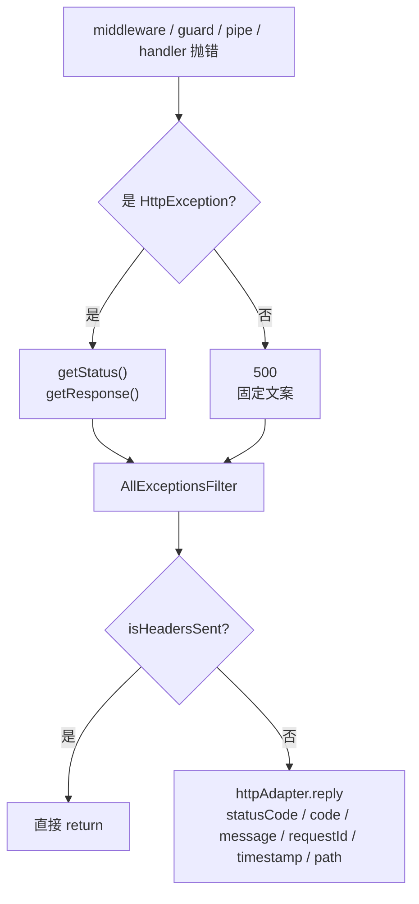

# 第 21 章 如何自定义 ExceptionFilter

## 一栋楼漏水，得有一个共用的排水口

一条请求要经过好几道手：中间件、守卫、管道、拦截器，最后才到 handler。这五道手里的任何一道都可能出错——token 过期、参数不合法、数据库连不上、代码里一个 `undefined` 被当成函数调了。Nest 不会让这些错误直接冒到进程外，而是把它们统统送进一个地方，由那里决定回什么状态码、什么响应体、记不记日志。

这个地方叫**异常层**，替它做决定的类就是**异常过滤器（ExceptionFilter）**。

拿楼里的排水打比方：哪一层漏水，水最后都从同一个排水口出去。排水口接不接、怎么接、接完倒哪儿，决定了楼下会不会被淹。一个项目里，这个排水口就是所有错误的唯一出口。

具体怎么写？实现 `ExceptionFilter` 接口，用 `@Catch()` 声明接哪类异常，在 `catch(exception, host)` 里改写响应、补日志、加业务错误码。`host` 是 `ArgumentsHost`，不是 `ExecutionContext`——异常可能发生在路由选中之前，过滤器不能假设 handler 一定存在（第 11 章讲过两者的区别）。

没有它会卡在哪？能跑，但每个接口的错误形状各写各的：404 的 `message` 是字符串，400 是数组，500 只有一句 `Internal server error`。客户端要写多套解析分支，排障时也没有 requestId 把日志和请求串起来。把 `try/catch` 写进每个 Controller 更糟，业务代码会被错误处理淹没。

它和另外四类组件差在哪，一句话就能分开：

- **中间件**在楼门口（第 17 章），只管请求进来，拿不到 handler，也管不了错误怎么回去。
- **守卫**是前台查预约（第 9 章的表），回答「你能不能进」，进不去时抛的异常也要落到过滤器。
- **管道**是安检机（第 19 章），只检查参数，一次一个。
- **拦截器**是包在 handler 外面的一层夹层（第 18 章），`catchError` 能看到 handler 抛的错，但路由都没匹配上的 404、中间件里抛的错，它看不到。
- **过滤器**是出口。异常从哪一层来都归它，只要它是全局注册的。

官方文档（先看懂正文再点）：
- [Exception filters](https://docs.nestjs.com/exception-filters)：官方 `@Catch()` 与 `catch(exception, host)` 的签名，对应正文过滤器写法。
- [Execution context](https://docs.nestjs.com/fundamentals/execution-context)：`ArgumentsHost` 和 `ExecutionContext` 的区别，对应「过滤器拿到的是 ArgumentsHost」。

## 一句 500，什么都没留下

`POST /api/bookings` 返回 500，页面上只有一句 `Internal server error`。打开日志，同一秒有几十条请求，没有 requestId，只能按时间一条条猜是哪一单。

前端那边也在抱怨：404 的 `message` 是字符串，400 的 `message` 是数组，409 又变成对象；三个接口写了三套解析分支，最近还多了一个 422。错误形状不统一，客户端就没法把「失败」当成一种正常返回值处理。

Nest 的默认异常层只做了最低限度的事：`HttpException` 原样返回，其他错误压成 500 和固定文案。它替你挡住了堆栈，但没有建立稳定的响应结构，也没有把请求上下文带进日志。这一章把这两件事补上。

## 默认出口只做两件事

请求链路上任何一环抛出的异常——中间件、守卫、管道、拦截器、handler——最后都会进入异常层。默认行为只有两条：

- 异常是 `HttpException` 的实例：取 `getStatus()` 和 `getResponse()`，原样返回。
- 其他任何 `Error`：返回 500，body 固定为 `Internal server error`，堆栈只留在服务端。

所以 `NotFoundException` 返回 `{ statusCode: 404, message: '...', error: 'Not Found' }`，`ValidationPipe` 返回 `{ statusCode: 400, message: ['...'], error: 'Bad Request' }`，未捕获的 `TypeError` 只有一句话。字段名看起来一样，`message` 的类型却不一样，前端没法用一个分支处理。

还有三个缺口：

- **没有请求关联 ID**。线上收到一张 500 截图，不知道对应哪条日志。
- **没有业务错误码**。客户端只能靠 `message` 文案分支，文案一改就崩。
- **`HttpException` 默认不打日志**。它继承自 `IntrinsicException`（框架内部用来标记「不需要默认日志」的基类），内置过滤器不会为它记录；未知错误虽然由框架打印，但缺请求上下文。

这里有个必须说清楚的细节：**默认异常不会自动生成业务 `errorCode`**。`new NotFoundException('预约不存在')` 的 `exception.errorCode` 是 `undefined`，响应体里也没有这个字段。只有你在构造函数的 options 里显式传了，它才会被设置：

```ts
throw new ConflictException('时间冲突', { errorCode: 'BOOKING_CONFLICT' });
```

`HttpException` 的 `errorCode` 字段、`createBody` 里的 `errorCode`，都来自这个 options。不传就没有，别指望框架按状态码自动编一个。

## 过滤器拿到的是 ArgumentsHost，不是 ExecutionContext

写过滤器第一个要改的习惯是参数类型。`catch(exception, host)` 里的 `host` 是 `ArgumentsHost`，它没有 `getHandler()`、`getClass()`——异常可能发生在还没有选中 handler 的时候，比如中间件里。`ExecutionContext` 是它的子接口，只在守卫、拦截器、管道这些已经绑定到路由的场景里才有。

打个比方：`ExecutionContext` 是「已经排到号的窗口」，能查你办的是哪项业务；`ArgumentsHost` 是「大厅」——先知道你是从哪个门进来的，业务窗口还没影呢。

`host.switchToHttp()` 返回 HTTP 上下文，`getRequest<T>()`、`getResponse<T>()` 取出平台对象。发送响应不要直接调 `response.status().json()`：换成 Fastify 后这套 API 就不存在了。注入 `HttpAdapterHost`，用 `httpAdapter.reply(response, body, status)`，让适配器决定怎么发。

```ts
const { httpAdapter } = this.httpAdapterHost;
const ctx = host.switchToHttp();
httpAdapter.reply(ctx.getResponse(), body, status);
```

`HttpAdapterHost` 由 `@nestjs/core` 提供，`APP_FILTER` 注册时能正常注入；用 `new AllExceptionsFilter()` 手动注册就拿不到它，运行期直接炸。

## 谁先接住：作用域和匹配顺序

| 绑定方式 | 作用范围 | 能否依赖注入 |
| --- | --- | --- |
| `@UseFilters(FilterClass)` | 方法或控制器 | 能，由容器实例化 |
| `@UseFilters(new Filter())` | 方法或控制器 | 不能，实例已经创建 |
| `app.useGlobalFilters(new Filter())` | 全局 | 不能 |
| `{ provide: APP_FILTER, useClass: Filter }` | 全局 | 能 |

多个过滤器同时存在时，Nest 只调用**第一个匹配**的。匹配前会把当前路由收集到的过滤器数组反序，所以方法级会排在控制器级、全局之前，方法级总能覆盖全局。

同一组 `@UseFilters(A, B)` 里的顺序也有讲究。数组反序后取第一个匹配，意味着 catch-all 过滤器要写在具体类型过滤器的**前面**。写成 `@UseFilters(CatchAll, HttpFilter)`，反序后 `HttpFilter` 先匹配 `HttpException`，其余的才落到 `CatchAll`；反过来写，`CatchAll` 会截走所有异常，`HttpFilter` 永远不执行。这个顺序和直觉相反，配置时最好在代码里写一行注释。

还有一个容易忽略的边界：中间件里抛出的异常，方法级和控制器级的 `@UseFilters()` 都不会执行，只有全局过滤器能接住。因为那时还没选中路由，方法级绑定根本不存在。



图 21-1 异常从抛出到响应的路径，以及过滤器在发送前必须检查的出口。

## 写一个能收住所有异常的过滤器

```ts
// src/common/filters/all-exceptions.filter.ts
import {
  ArgumentsHost,
  Catch,
  ExceptionFilter,
  HttpException,
  HttpStatus,
  Logger,
} from '@nestjs/common';
import { HttpAdapterHost } from '@nestjs/core';

interface ErrorResponseBody {
  statusCode: number;
  code: string;
  message: string | string[];
  requestId: string;
  timestamp: string;
  path: string;
}

interface HttpRequestLike {
  method: string;
  url: string;
  originalUrl?: string;
  headers: Record<string, string | string[] | undefined>;
}

const isRecord = (value: unknown): value is Record<string, unknown> =>
  typeof value === 'object' && value !== null;

@Catch()
export class AllExceptionsFilter implements ExceptionFilter {
  private readonly logger = new Logger(AllExceptionsFilter.name);

  constructor(private readonly httpAdapterHost: HttpAdapterHost) {}

  catch(exception: unknown, host: ArgumentsHost): void {
    const { httpAdapter } = this.httpAdapterHost;
    const ctx = host.switchToHttp();
    const request = ctx.getRequest<HttpRequestLike>();
    const response = ctx.getResponse();

    const status =
      exception instanceof HttpException
        ? exception.getStatus()
        : HttpStatus.INTERNAL_SERVER_ERROR;
    const payload = exception instanceof HttpException ? exception.getResponse() : undefined;
    const record = isRecord(payload) ? payload : undefined;

    const rawMessage =
      record?.message ?? (typeof payload === 'string' ? payload : '请求处理失败');
    const message = Array.isArray(rawMessage)
      ? rawMessage.map((item) => String(item))
      : typeof rawMessage === 'string'
        ? rawMessage
        : '请求处理失败';

    const errorCode =
      exception instanceof HttpException && typeof exception.errorCode === 'string'
        ? exception.errorCode
        : undefined;
    const code =
      errorCode ?? (typeof record?.errorCode === 'string' ? record.errorCode : `HTTP_${status}`);

    const headerValue = request.headers['x-request-id'];
    const requestId = Array.isArray(headerValue)
      ? (headerValue[0] ?? 'unknown')
      : (headerValue ?? 'unknown');
    const path = request.originalUrl ?? request.url;

    const body: ErrorResponseBody = {
      statusCode: status,
      code,
      message: status >= 500 ? '服务器内部错误' : message,
      requestId,
      timestamp: new Date().toISOString(),
      path,
    };

    if (status >= 500) {
      this.logger.error(
        JSON.stringify({ requestId, method: request.method, path, status, code }),
        exception instanceof Error ? exception.stack : undefined,
      );
    } else {
      this.logger.warn(JSON.stringify({ requestId, method: request.method, path, status, code }));
    }

    if (httpAdapter.isHeadersSent(response)) {
      return;
    }
    httpAdapter.reply(response, body, status);
  }
}
```

几个设计点：

- **`message` 统一成 `string | string[]`**。`ValidationPipe` 给数组，`NotFoundException` 给字符串，直接透传会让响应类型漂移。这里只做归一，不把数组拍平成字符串——前端需要知道哪条对应哪个字段。
- **5xx 覆盖为固定文案**。数据库连接串、SQL、内部路径只写日志，绝不返回给客户端。这是过滤器存在的第一理由。
- **`code` 优先读 `exception.errorCode`**，再回退响应体里的 `errorCode`，最后才是 `HTTP_<status>`。业务异常有稳定标识，普通 HTTP 异常也有兜底，客户端永远有分支依据。
- **4xx 用 `warn`，5xx 用 `error` 并带堆栈**。404 是正常流量，打成 error 会让告警系统麻木；500 必须带堆栈，否则排障时只能看天。
- **`requestId` 从 `x-request-id` 头取**，没有就回退 `unknown`。过滤器不依赖中间件一定存在，但生产环境应该由第 17 章的中间件补齐。
- **请求类型只声明用得到的字段**。不要 `import type { Request } from 'express'`——过滤器可能跑在 Fastify 下，`originalUrl` 不存在时用 `url` 兜底，`headers` 两边都有。发送仍然走 `httpAdapter.reply`。
- **发送前检查 `isHeadersSent`**。handler 用 `@Res()` 自己发送响应、之后又冒出异常时，再 `reply` 会触发 `ERR_HTTP_HEADERS_SENT`；错误处理里再抛错，客户端只会看到连接被重置。`httpAdapter.isHeadersSent()` 比直接读 `response.headersSent` 更稳，Express 和 Fastify 都适用。

## 业务错误码不会自己长出来

```ts
// src/bookings/booking-conflict.exception.ts
import { ConflictException } from '@nestjs/common';

export class BookingConflictException extends ConflictException {
  constructor(bookingId: string) {
    super(`预约 ${bookingId} 与已有订单时间冲突`, {
      errorCode: 'BOOKING_CONFLICT',
      cause: new Error(`booking ${bookingId} overlaps with an existing reservation`),
    });
  }
}
```

`ConflictException` 的第二个参数才是 `HttpExceptionOptions`，`errorCode` 要放在这里。`super(message, { errorCode, cause })` 会通过 `HttpException` 的 `initErrorCode()` 把字段设到实例上，过滤器里的 `exception.errorCode` 才读得到。

两个反例：

- **把整个对象当第一参**：`new ConflictException({ message: '时间冲突', errorCode: 'BOOKING_CONFLICT' })`。Nest 会把对象当成完整响应体，`statusCode`、`error` 这些默认字段反而消失，过滤器还得自己补。要么传字符串 + options，要么自己保证对象结构完整。
- **以为 `errorCode` 会自动生成**：不传 options 就没有，前面已经说过。默认的 `NotFoundException` 不会因为状态码是 404 就送你一个 `NOT_FOUND`。

`cause` 只用于服务端日志和错误链，不会被序列化进响应。它和 `errorCode` 是两件事：一个给排障，一个给客户端契约。

路由顺序也顺手确认一下：`@Get('boom')` 必须写在 `@Get(':id')` 之前。反过来，`/bookings/boom` 会先命中 `:id`，被 `ParseIntPipe` 拦成 400，根本走不到抛 500 的分支。Nest 不会按具体程度替你排序。

## 接到模块里

```ts
// src/app.module.ts
import { Module } from '@nestjs/common';
import { APP_FILTER } from '@nestjs/core';
import { AllExceptionsFilter } from './common/filters/all-exceptions.filter.js';

@Module({
  providers: [{ provide: APP_FILTER, useClass: AllExceptionsFilter }],
})
export class AppModule {}
```

`APP_FILTER` 注册的过滤器是全局的，而且能注入 `HttpAdapterHost`。`app.useGlobalFilters(new AllExceptionsFilter())` 看起来更短，但构造函数参数只能手动塞，漏了就等到运行期才炸。另外，`useGlobalFilters()` 不覆盖 WebSocket 网关和混合应用；纯 HTTP 项目里两者等价，有网关时优先 `APP_FILTER`。

## 跑起来，四种错误各打一遍

```bash
pnpm start:dev
```

先打 404：

```bash
curl -s -H 'x-request-id: demo-404' http://localhost:3000/api/bookings/999 | jq .
```

```json
{
  "statusCode": 404,
  "code": "HTTP_404",
  "message": "预约 999 不存在",
  "requestId": "demo-404",
  "timestamp": "2026-11-06T09:12:31.004Z",
  "path": "/api/bookings/999"
}
```

再打业务冲突 409：

```bash
curl -s -X POST -H 'x-request-id: demo-409' http://localhost:3000/api/bookings | jq .
```

```json
{
  "statusCode": 409,
  "code": "BOOKING_CONFLICT",
  "message": "预约 BK-2026-0001 与已有订单时间冲突",
  "requestId": "demo-409",
  "timestamp": "2026-11-06T09:12:35.118Z",
  "path": "/api/bookings"
}
```

然后打一个未捕获的 500：

```bash
curl -s -H 'x-request-id: demo-500' http://localhost:3000/api/bookings/boom | jq .
```

```json
{
  "statusCode": 500,
  "code": "HTTP_500",
  "message": "服务器内部错误",
  "requestId": "demo-500",
  "timestamp": "2026-11-06T09:12:38.220Z",
  "path": "/api/bookings/boom"
}
```

最后打一个参数错误 400：

```bash
curl -s -H 'x-request-id: demo-400' http://localhost:3000/api/bookings/abc | jq .
```

```json
{
  "statusCode": 400,
  "code": "HTTP_400",
  "message": "Validation failed (numeric string is expected)",
  "requestId": "demo-400",
  "timestamp": "2026-11-06T09:12:41.673Z",
  "path": "/api/bookings/abc"
}
```

> 示例输出（未实测）。四个响应的字段完全一致；`/boom` 那次终端里是 `ERROR`，带完整堆栈，404 和 400 是 `WARN`，一行 JSON，能直接按 `requestId` 搜到对应请求。响应体里搜不到 `postgres://`——连接串只进了日志。

检查点：四个状态码依次是 404、409、500、400；四个响应都有 `statusCode`、`code`、`message`、`requestId`、`timestamp`、`path`；`/boom` 的 `message` 必须是「服务器内部错误」，并且响应里没有连接串；`requestId` 要等于你传的 header，而不是写死的 `unknown`。

如果 404 还是框架默认结构，先确认 `APP_FILTER` 是否真的注册在根模块；如果 `/boom` 返回 400，检查路由顺序；如果 500 响应里出现了原始错误消息，检查 5xx 分支是不是在组装 body 之后才覆盖 `message`。

## 生产里真正会踩的坑

| 现象 | 原因 | 处理 |
| --- | --- | --- |
| 自定义过滤器完全没生效 | 用 `new Filter()` 注册，依赖是 `undefined`；或只绑到了某个控制器 | 用 `APP_FILTER` / `@UseFilters(FilterClass)`，确认作用域 |
| `TypeError` 仍返回框架默认 500 | 过滤器写的是 `@Catch(HttpException)` | 改成 `@Catch()`，或再加一个 catch-all |
| 具体类型过滤器不执行 | catch-all 和它同组，且 catch-all 写在后面，反序后排到最前 | catch-all 写在具体过滤器前面 |
| 中间件抛错没被自定义过滤器接住 | 方法级/控制器级过滤器不覆盖中间件 | 用全局过滤器（`APP_FILTER`） |
| `ERR_HTTP_HEADERS_SENT` | handler 用 `@Res()` 已经发送响应，过滤器又 reply | reply 前检查 `isHeadersSent`，已发送直接 return |
| 4xx 也打 error，告警泛滥 | 没按状态码分级 | 4xx 用 `warn`，5xx 用 `error`；401/403 单独统计 |
| 加了 `errorCode` 却丢了 `statusCode`/`error` | 整个对象被当成第一参，响应体被整体覆盖 | 用第二参 `{ errorCode: '...' }` |
| Fastify 下过滤器报错 | 直接调了 Express 的 `res.status()`；或用了 `reply.headersSent` | 发送走 `httpAdapter.reply`；判断用 `httpAdapter.isHeadersSent(response)` |
| 过滤器里读不到 `requestId` | 中间件未注册，或未命中该路由 | 检查 `forRoutes()`；回退值要能接受 |

几条边界，越早定越好：

- **错误码是 API 契约，不是日志字段**。用 `DOMAIN_REASON` 命名（`BOOKING_CONFLICT`、`PAYMENT_DECLINED`），在 OpenAPI 里枚举出来。不要用 `HTTP_409` 这种把传输层状态当业务语义的写法，也不要把数据库错误码直接透出。
- **5xx 只返回关联 ID**。客户端提示「请稍后重试，错误编号 xxx」，客服拿编号能在日志系统里定位；堆栈、SQL、上游响应只进服务端日志，并做敏感字段脱敏。
- **过滤器只负责翻译，不负责恢复**。重试、降级、事务回滚应该在 service 或拦截器里完成；在过滤器里再调远程服务，一旦失败就是异常套异常。
- **优先继承 `BaseExceptionFilter`**。只想加日志、保留默认行为时，继承它并调用 `super.catch(exception, host)`，比完全手写更不容易漏掉边界；要统一响应结构时再完全接管。它内部也用 `applicationRef.isHeadersSent` 处理了响应已发送的情况，自己写 catch-all 就要补上这一步。
- **跨协议时按 `host.getType()` 分支**。同一个过滤器可以服务 HTTP、WebSocket、RPC，但发送方式不同；不要假设一定是 HTTP。

到这里，所有失败都长同一个样了：4xx 保留可读消息，5xx 只给固定文案和 requestId，业务失败带稳定的 `errorCode`。但还有一个问题没回答：中间件、守卫、拦截器、管道、过滤器，这五类组件在一条请求里到底谁先谁后，谁短路了谁后面的代码就不跑。下一章用一条带编号的 trace 把它们串起来，逐个验证。


<!-- chapter-nav:start -->
---

← 上一篇：[020 如何使用ValidationPipe验证post请求参数](020-如何使用ValidationPipe验证post请求参数.md) · [本 Part 目录](_part.md) · 下一篇：[022 图解串一串Nest核心概念](022-图解串一串Nest核心概念.md) →
<!-- chapter-nav:end -->
