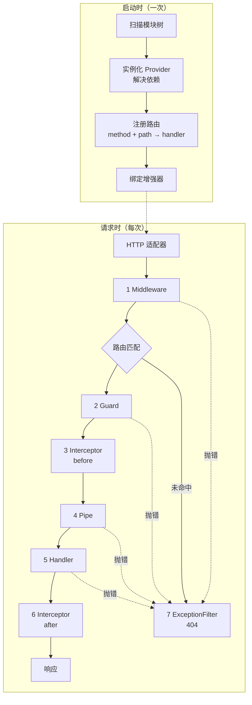
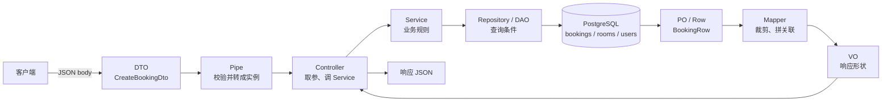

# 第 22 章 图解串一串 Nest 核心概念

新同事在 `TraceGuard` 里查了一次用户，又在 `TraceInterceptor` 里查了一次。你问他为什么不复用，他说“反正都会执行”。

你把一条 403 的日志翻出来给他看：只有 `1 middleware` 和 `7 filter`，`3 interceptor before` 根本没出现。他愣了几秒：“那我在拦截器里查用户，403 的时候不就白查了？”

Middleware、Guard、Interceptor、Pipe、ExceptionFilter 单独看都不难，难的是它们在一条请求里谁先谁后、谁短路谁、异常又从哪条路返回。这一章不背定义，直接跑一条带编号的 trace，让日志把顺序打出来；跑完再回头看分层，哪些词该放在哪一层就清楚了。

## 先分清两条时间线

Nest 的很多困惑，来自把“启动时”和“请求时”混在一起。它们是两条独立的时间线：

- **启动时只发生一次**：扫描模块树，实例化 Provider，解决依赖，注册 `method + path → handler`，绑定中间件、守卫、拦截器、管道、过滤器。
- **请求时每个请求重复**：适配器收包，中间件，路由匹配，守卫，拦截器前半段，管道，handler，拦截器后半段，响应；任意一步抛错，进入异常过滤器。

依赖注入发生在启动时，所以构造函数里拿不到当前请求。需要请求数据时，从 `ExecutionContext` 或 `ArgumentsHost` 里取——这也是守卫、拦截器、过滤器能读到 header、用户、路由 metadata 的原因。



图 22-1 启动时装配与请求时执行，以及五类组件在请求链上的位置。

两个顺序最容易记反：

**守卫在管道之前**。未登录、无权限的请求不该先做一轮参数校验，否则既浪费 CPU，也可能借校验错误把字段规则泄露给不该看到的人。所以 403 的日志里没有 `4 pipe`。

**拦截器的“前半段”在管道之前，“后半段”在 handler 之后**。拦截器能统计到包含参数校验在内的总耗时；`map`/`tap` 改的是 handler 返回之后的值。管道失败时，`catchError` 能观察到错误，但 handler 不会执行。

## 五个组件，各自能拿到什么

| 组件 | 拿到的上下文 | 能做什么 | 不能做什么 |
| --- | --- | --- | --- |
| Middleware | 原始 `req`、`res`、`next` | 改请求头、日志、CORS、body 解析 | 不知道 handler、拿不到路由 metadata |
| Guard | `ExecutionContext`、`Reflector` | 读 metadata、查用户、短路请求 | 改响应体、包装 handler |
| Interceptor | `ExecutionContext`、`CallHandler` | 包裹 handler、改返回值、超时、缓存 | 不知道参数的校验结果 |
| Pipe | `value`、`ArgumentMetadata` | 转换、校验单个参数 | 访问 handler 的业务结果 |
| ExceptionFilter | `exception`、`ArgumentsHost` | 改写错误响应、记录日志 | 恢复业务、重试 |

一句话：**上下文决定能力边界**。想在中间件里读 `@Roles()`，或者在管道里查数据库判断权限，不是写不出来，是选错了层。

同类增强器有多个时，顺序按“范围从大到小”：守卫和拦截器是全局 → 控制器 → 方法；管道是全局 → 控制器 → 方法 → 参数；过滤器只执行第一个匹配的。拦截器的“大”体现在外层：先注册的包住后注册的，`next.handle()` 之前的代码先执行，之后的代码逆序执行。

## 分层：请求经过哪些形状



图 22-2 一次创建预订的调用穿过各层时，数据形状怎么变。

几个词最容易混，放在一起对照：

| 词 | 一句话 | 在 example 里 |
| --- | --- | --- |
| Controller | HTTP 入口，取参、调 Service、交响应 | `src/modules/*/*.controller.ts` |
| Service | 业务规则与流程编排，不认识 HTTP | `src/modules/*/*.service.ts` |
| Provider | 交给 IoC 容器管理的类或值的统称 | 任何 `@Injectable()`；`PRISMA` token |
| DTO | 跨层传数据的载体，不带业务逻辑 | `src/modules/*/dto/*.dto.ts` |
| Entity / PO | 领域对象 / 与表一一对应的行对象 | `Booking` 概念；`BookingRow` |
| VO | 值对象，或给某端消费的裁剪结果 | `PaginatedResult<T>`、`AuthUser` |
| Repository / DAO | 面向聚合根 / 面向表的持久化抽象 | 暂未单独抽，直接用 Prisma 客户端 |
| Mapper | 在以上形状之间搬字段的代码 | `paginate()`、`ResponseInterceptor` |

表里有两个词需要补一句：**聚合根**是领域驱动设计里“作为一致性边界的根对象”，Repository 通常围绕它建模；**Prisma** 是第 44 章要讲的 ORM（对象关系映射）工具，这里先把它当成直接操作数据库的客户端。

判断 Controller 和 Service 的标准很硬：**这段代码需不需要 HTTP 才能成立**。要 `@Body()`、`@Param()`、`@Res()`，要拼状态码，它在 Controller；只吃普通参数、只吐普通对象，它在 Service。Service 里出现 `Request`、`Response` 或任何 HTTP 装饰器，就是越界了。同一条“创建预订”的规则，将来要被定时任务、CLI、消息消费者复用，那些入口都没有 HTTP 请求对象。

DTO 和 Entity/PO 的区别在方向。DTO 面向接口契约，字段可以裁剪、组合、改名；PO 面向表，字段跟列一一对应。拿 PO 直接当响应，表加一列接口就多一个字段，`users` 表这么干就是密码哈希泄露；拿请求 DTO 当响应，客户端传的 `isAdmin` 会原样回来。DTO 必须是 `class` 而不是 `interface`，因为 `ValidationPipe` 要靠运行时还存在的类名找规则，`interface` 会被擦成 `Object`。

Service 和 Provider 也不是一回事：Service 是**角色**，Provider 是**容器概念**。`@Injectable()` 标记的类进 IoC 容器，容器里托管的一切都叫 Provider——Service、Guard、Repository、工厂都是。`{ provide: PRISMA, useValue: db }` 也是 Provider，但它不是 Service，连类都不是。

VO 在中文技术圈有两个来源：领域驱动里的 Value Object 没有唯一标识、以值相等判断；分层里的 View Object 是为某一端裁剪的返回结构。example 里后者更多：`ResponseInterceptor` 包 `{ data, meta }`，`AuthUser` 是认证后的视图。判断方法：**这个类型有没有业务不变量**。有，它是值对象或实体；没有，只是为了“让某一端好消费”，它是视图对象。

## 把五层写进一个 trace.ts

```bash
pnpm dlx @nestjs/cli@12 new trace-lab --package-manager pnpm --strict --skip-git
```

CLI 问模块系统时选 **ESM**，相对导入带 `.js`。这一章不装新依赖，用 Nest 自带的 `Logger`。

```ts
// src/trace/trace.ts
import {
  ArgumentsHost,
  BadRequestException,
  CallHandler,
  CanActivate,
  Catch,
  Controller,
  DefaultValuePipe,
  ExceptionFilter,
  ExecutionContext,
  ForbiddenException,
  Get,
  HttpException,
  Injectable,
  Logger,
  NestMiddleware,
  NestInterceptor,
  PipeTransform,
  Query,
} from '@nestjs/common';
import { HttpAdapterHost } from '@nestjs/core';
import type { NextFunction, Request, Response } from 'express';
import { Observable, catchError, tap, throwError } from 'rxjs';

const logger = new Logger('Trace');

@Injectable()
export class TraceMiddleware implements NestMiddleware {
  use(req: Request, _res: Response, next: NextFunction): void {
    logger.log(`1 middleware ${req.method} ${req.originalUrl}`);
    next();
  }
}

@Injectable()
export class TraceGuard implements CanActivate {
  canActivate(context: ExecutionContext): boolean {
    const request = context.switchToHttp().getRequest<Request>();
    logger.log(`2 guard ${request.method} ${request.originalUrl}`);
    if (request.header('x-trace-block') === '1') {
      throw new ForbiddenException('trace blocked');
    }
    return true;
  }
}

@Injectable()
export class TraceInterceptor implements NestInterceptor {
  intercept(context: ExecutionContext, next: CallHandler): Observable<unknown> {
    const request = context.switchToHttp().getRequest<Request>();
    logger.log(`3 interceptor before ${request.originalUrl}`);
    return next.handle().pipe(
      tap(() => logger.log(`6 interceptor after ${request.originalUrl}`)),
      catchError((error: unknown) => {
        logger.warn(`6 interceptor error ${request.originalUrl}`);
        return throwError(() => error);
      }),
    );
  }
}

@Injectable()
export class TracePipe implements PipeTransform<string, string> {
  transform(value: string): string {
    logger.log(`4 pipe ${value}`);
    if (value === 'blocked') {
      throw new BadRequestException('name is blocked');
    }
    return value.trim();
  }
}

@Catch()
export class TraceFilter implements ExceptionFilter {
  constructor(private readonly adapterHost: HttpAdapterHost) {}

  catch(exception: unknown, host: ArgumentsHost): void {
    const ctx = host.switchToHttp();
    const status = exception instanceof HttpException ? exception.getStatus() : 500;
    const message = exception instanceof HttpException ? exception.message : 'Internal server error';
    logger.warn(`7 filter ${status}`);
    this.adapterHost.httpAdapter.reply(ctx.getResponse(), { statusCode: status, message }, status);
  }
}

@Controller('trace')
export class TraceController {
  @Get('ok')
  ok(@Query('name', new DefaultValuePipe('guest'), TracePipe) name: string): { name: string } {
    logger.log('5 handler ok');
    return { name };
  }

  @Get('fail')
  fail(): never {
    logger.log('5 handler fail');
    throw new Error('demo failure');
  }
}
```

几个刻意的写法：

- **中间件用 `req.originalUrl`**，不是 `req.url`。后者在挂载点下可能被裁剪，带不上全局前缀 `/api`。
- **守卫抛 `ForbiddenException`**，不是直接 `return false`。两者都短路，但抛异常能带业务消息，也会进入统一过滤器。
- **拦截器用 `tap` 记成功、`catchError` 记失败**。`tap` 只在 `next` 正常时执行；错误路径由 `catchError` 接管，所以 `6` 有两种形态。
- **管道只挂在 `@Query('name')` 上**。全局管道会作用到每个参数，反而看不清编号。

## 注册：全局增强器，加两个具体路由

```ts
// src/app.module.ts
import { MiddlewareConsumer, Module, NestModule, RequestMethod } from '@nestjs/common';
import { APP_FILTER, APP_GUARD, APP_INTERCEPTOR } from '@nestjs/core';
import {
  TraceController,
  TraceFilter,
  TraceGuard,
  TraceInterceptor,
  TraceMiddleware,
} from './trace/trace.js';

@Module({
  controllers: [TraceController],
  providers: [
    { provide: APP_GUARD, useClass: TraceGuard },
    { provide: APP_INTERCEPTOR, useClass: TraceInterceptor },
    { provide: APP_FILTER, useClass: TraceFilter },
  ],
})
export class AppModule implements NestModule {
  configure(consumer: MiddlewareConsumer): void {
    consumer.apply(TraceMiddleware).forRoutes(
      { path: 'trace/ok', method: RequestMethod.GET },
      { path: 'trace/fail', method: RequestMethod.GET },
    );
  }
}
```

`APP_GUARD`、`APP_INTERCEPTOR`、`APP_FILTER` 都是全局增强器，`TracePipe` 只挂在参数上。中间件这里绑的是两个具体路由。`main.ts` 照旧 `app.setGlobalPrefix('api')`、监听 3000。`forRoutes(TraceController)` 也不是前缀通配：Nest 会扫描该控制器的每个 handler，逐条展开成 `trace/ok`、`trace/fail`，所以 `/api/trace/nope` 同样不会执行 `1`。只有 `forRoutes('*splat')` 这类通配符才会让 404 先经过中间件。

## 跑五条路径，让日志对号

```bash
pnpm start:dev

curl -s 'http://localhost:3000/api/trace/ok?name=alice'
# 200 {"name":"alice"}

curl -s 'http://localhost:3000/api/trace/ok?name=blocked'
# 400 {"statusCode":400,"message":"name is blocked"}

curl -s 'http://localhost:3000/api/trace/fail'
# 500 {"statusCode":500,"message":"Internal server error"}

curl -s -H 'x-trace-block: 1' 'http://localhost:3000/api/trace/ok?name=alice'
# 403 {"statusCode":403,"message":"trace blocked"}

curl -s 'http://localhost:3000/api/trace/nope'
# 404 {"statusCode":404,"message":"Cannot GET /api/trace/nope"}
```

终端日志是五种序列（省略 Nest 的日志前缀）：

```text
# 成功
1 middleware GET /api/trace/ok?name=alice
2 guard GET /api/trace/ok?name=alice
3 interceptor before /api/trace/ok?name=alice
4 pipe alice
5 handler ok
6 interceptor after /api/trace/ok?name=alice

# 管道失败
1 middleware ...
2 guard ...
3 interceptor before ...
4 pipe blocked
6 interceptor error ...
7 filter 400

# handler 抛错
1 middleware ...
2 guard ...
3 interceptor before ...
4 pipe alice
5 handler fail
6 interceptor error ...
7 filter 500

# 守卫拒绝
1 middleware ...
2 guard ...
7 filter 403

# 路由不存在
7 filter 404
```

> 示例输出（未实测）。trace-lab 的过滤器只保留 `statusCode` 和 `message`，重点在顺序；真实项目用第 21 章那份完整契约。

注意管道失败和 handler 抛错都有 `6 interceptor error`，但前者没有 `5`，后者有；守卫拒绝连 `3` 都没有。**不是每个请求都会经过每一层**，这就是短路。

| 路径 | 已执行 | 未执行 | 响应 |
| --- | --- | --- | --- |
| 正常 | 1 → 2 → 3 → 4 → 5 → 6 | — | 200 |
| 守卫拒绝 | 1 → 2 → 7 | 3、4、5、6 | 403 |
| 管道失败 | 1 → 2 → 3 → 4 → 6(error) → 7 | 5 | 400 |
| handler 抛错 | 1 → 2 → 3 → 4 → 5 → 6(error) → 7 | — | 500 |
| 路由不存在 | 7（当前绑定下 1–6 全未执行） | 1–6 | 404 |

`6(error)` 是拦截器的 `catchError` 分支，不是 `tap` 的成功分支。它执行完会把错误继续抛出去，所以后面还有 `7`。

把中间件改成 `forRoutes('*splat')`，404 会多一行 `1 middleware`，但 `2–6` 仍然不会执行。**中间件的绑定范围只决定 `1` 出不出现，不决定守卫、拦截器、管道是否执行**；后者由路由是否命中决定。

## 生产里真正会踩的坑

| 现象 | 原因 | 处理 |
| --- | --- | --- |
| 守卫里拿不到 `request.user` | 认证中间件还没执行，或守卫顺序不对 | 认证放中间件/守卫链前；守卫只读已挂载的用户 |
| 鉴权没执行，管道却已校验参数 | 守卫没有全局注册，或被路由排除 | 检查 `APP_GUARD` / `@UseGuards()` 的绑定范围 |
| 拦截器里 `next.handle()` 没执行 | 提前 `return of(cached)` 或忘记返回 | 明确缓存命中与正常路径的分支 |
| 404 返回框架默认结构 | 全局过滤器没注册，或只挂在控制器/方法上 | 用 `APP_FILTER` 兜底 |
| 过滤器拿到的 `response` 已发送 | 用了 `@Res()` 并手动 `json()` | 检查 `isHeadersSent`，或统一用 `passthrough` |
| 全局管道把 `@Req()` 也校验了 | 全局管道作用于所有参数 | 用参数级管道，或自定义装饰器 + `validateCustomDecorators` |
| 拦截器顺序与预期相反 | 先注册的在外层，后半段逆序执行 | 按洋葱模型推一遍，只保留必要的全局拦截器 |
| 以为 404 不会跑中间件 | 当前只绑了具体路由；`forRoutes(TraceController)` 同样展开为精确路由 | 要覆盖 404，用 `forRoutes('*splat')` |
| 中间件抛错没被方法级过滤器接住 | 方法级/控制器级过滤器不覆盖中间件 | 用全局 `APP_FILTER` |
| Service 里出现 `@Req()`、`Request` 类型 | HTTP 上下文漏进了业务层 | Controller 取参后传普通值，Service 只认 DTO 和领域类型 |

几条边界，越早定越好：

- **全局增强器要有清单**。`APP_GUARD`、`APP_INTERCEPTOR`、`APP_PIPE`、`APP_FILTER` 分散在各模块时，新人很难还原执行顺序。集中注册，或维护一张表。
- **性能开销在全局层被放大**。全局守卫每请求一次鉴权查询、全局管道每参数一次校验、全局拦截器每响应一次序列化，都会随 QPS（每秒查询数）放大。热点路径用缓存、采样和逃生口。
- **可观测性只做一次**。请求 ID 在中间件生成，异常过滤器带出，日志里贯穿；不要在五层各生成一个 ID，否则链路对不上。
- **选层看上下文，不看习惯**。需要原始 socket/headers 用中间件；需要用户身份与路由 metadata 用守卫；需要包裹返回值或统计 handler 耗时用拦截器；需要参数格式用管道；需要统一错误用过滤器。

跑通这条 trace 之后，再遇到“这个逻辑放哪”的问题，先问它需要什么上下文，而不是先找拦截器。分层解决“写在哪”，图 22-1 这条链路解决“什么时候执行”，两个维度合起来，一个需求落到代码里就有位置了。

下一部分进入数据持久化与鉴权：守卫做 JWT（JSON Web Token，登录令牌）校验，拦截器做响应脱敏，过滤器兜住数据库异常——三件事都能在图 22-1 上找到自己的位置。

想更深入的话，官方文档里有这几页可以接着看：[Middleware](https://docs.nestjs.com/middleware)（请求进路由前的第一环，对应图里第 1 步）、[Guards](https://docs.nestjs.com/guards)（路由匹配后决定放不放行，对应图里第 2 步）、[Interceptors](https://docs.nestjs.com/interceptors)（handler 前后各包一段，对应图里 3 和 6）、[Pipes](https://docs.nestjs.com/pipes)（参数进 handler 前做转换和校验，对应图里第 4 步）、[Exception filters](https://docs.nestjs.com/exception-filters)（任何一环抛错都从这里出去，对应图里第 7 步）、[Execution context](https://docs.nestjs.com/fundamentals/execution-context)（守卫、拦截器、管道拿请求和 handler 信息的统一入口，对应“五个组件，各自能拿到什么”）。

<!-- chapter-nav:start -->
---

← 上一篇：[021 如何自定义ExceptionFilter](021-如何自定义ExceptionFilter.md) · [本 Part 目录](_part.md) · 下一篇：[023 Express如何使用multer实现文件上传](023-Express如何使用multer实现文件上传.md) →
<!-- chapter-nav:end -->
