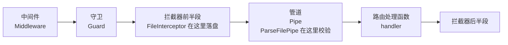

# 第 24 章 Nest 如何使用 multer 实现文件上传

上一章把 multer 手工接在 Express 路由上：`upload.single('file')` 当中间件，处理函数里拿 `req.file`。Nest 把同一套东西收进了一行装饰器。代码短了，但多了一个必须搞清楚的问题：文件是什么时候被收下的，校验又是什么时候跑的。

先认识三个东西，这一章的坑全绕着它们转。

**拦截器（interceptor）**是包在 handler（真正处理这个接口的方法）外面的一层壳。第 18 章讲过：它像门童，进门之前看一眼，出门之后还能把结果改一改。`FileInterceptor` 只用进门那半段——在 handler 之前把文件收下来。

**管道（Pipe）**是 handler 门口的一台安检机。第 19 章讲过：它只检查要送进 handler 的参数，格式不对就拦下。`ParseFilePipe` 就是专门检查上传文件的管道。

**装饰器**是贴在方法或参数上的标签，比如 `@UseInterceptors(...)`、`@UploadedFile()`。Nest 启动时读这些标签，知道该给哪个方法挂拦截器、该把哪个参数送进安检机（第 10 章把常用装饰器过了一遍）。

Nest 处理一个请求的顺序是固定的：



顺序里藏着一个很反直觉的结果：**文件已经收完、流已经关掉，Pipe 才开始校验**。因为 `FileInterceptor` 是拦截器，跑在前半段；`ParseFilePipe` 是管道，排在它后面。这一章的报错基本都从这个先后关系长出来。

## 两行装饰器能用，换成磁盘就报错

合同上传接口上线的第二天，客服转来一条反馈：PDF 传不上去，弹窗里是一段英文，`Validation failed (file buffer is not available; file type validation could not be performed; ...)`。

可这个接口本来是能用的。开发时它长这样，两行装饰器就通了：

```ts
@Post()
@UseInterceptors(FileInterceptor('file'))
upload(@UploadedFile() file: Express.Multer.File) {
  return { name: file.originalname, size: file.size };
}
```

后来为了让内存别被大文件撑爆，有人把存储换成了 `diskStorage`——文件边收边写临时盘。上传就此失败，而且报错说的不是“类型不对”，是“buffer 不可用”。

文件落在哪、Pipe 能拿到什么、Service 该在哪一步接手，这三个问题由同一个顺序决定。顺序理清了，报错就不用猜。

## 两行装饰器背后是一个拦截器

这层壳由 `@nestjs/platform-express` 提供。它本身不解析 multipart（第 23 章讲的那种分箱打包），只**把 multer 中间件包进 Interceptor**：壳里调 `multer.single(fieldName)`，解析完把结果挂到请求上，再让 `@UploadedFile()` 取出来。

所以第 23 章讲的 boundary、limits、storage 全部作数，Nest 只是换了挂载位置。位置很关键——`FileInterceptor` 在管道之前就把活干完了，`@UploadedFile()` 上的 `ParseFilePipe` 要到管道阶段才开始工作。也就是说：**multer 早就把文件写完、关掉流了，Pipe 才开始检查大小和类型**。

顺便把四个装饰器认全，它们分别对应 multer 的四个方法：

- `FileInterceptor(fieldName, options?)` → `.single()`，单文件。
- `FilesInterceptor(fieldName, maxCount?, options?)` → `.array()`，同字段多文件。
- `FileFieldsInterceptor([{ name, maxCount }], options?)` → `.fields()`，不同字段各收各的。
- `AnyFilesInterceptor(options?)` → `.any()`，不限字段名。

它们都来自 `@nestjs/platform-express`；而 `@UploadedFile()`、`@UploadedFiles()`、`ParseFilePipe` 来自 `@nestjs/common`。如果你用 Fastify 适配器，这一组要换成 `@nestjs/platform-fastify` 的版本（底层是 `@fastify/multipart`），连 `Express.Multer.File` 这个类型都不存在。

## 内存还是磁盘，决定了 Pipe 能看见什么

两种存储引擎的差别不只是“存哪儿”，还决定了 `file` 对象上有没有 `buffer`。用搬家打比方：内存模式是把货先摊在前台桌上，谁都能翻开看；磁盘模式是直接卸进临时月台，手里只剩一张取货单。

| | memoryStorage（默认） | diskStorage |
| --- | --- | --- |
| 字节在哪 | `file.buffer`（Buffer） | `file.path`（临时文件） |
| 默认文件名 | 无 | 32 位随机串，无扩展名 |
| 内存占用 | 约等于文件大小 × 并发数 | 一个流的小缓冲 |
| 适合 | 小图、要先读内容再决定 | 大文件、视频、压缩包 |

Nest 默认用 `memoryStorage`。所以上面那个“两行装饰器”的例子，文件其实一直在内存里，只是你没看见。

`memoryStorage` 在这里有个隐藏好处：`FileTypeValidator` 能工作。它判断类型的方式不是看 `mimetype` 字段，而是**读 `file.buffer` 的头几个字节比对魔数**（第 23 章讲过，魔数就是文件的防伪钢印）。内存模式下 buffer 存在，验货员手里有货，可以开箱；一旦换成 `diskStorage`，`file.buffer` 是 `undefined`，验货员只有取货单，拿不到内容，只能抛错。开头那条报错就是这么来的。

把 storage 换成 `diskStorage`、其他不动，请求返回：

```json
{
  "message": "Validation failed (file buffer is not available; file type validation could not be performed; expected type is /^image\\/(png|jpeg|webp)$/)",
  "error": "Unprocessable Entity",
  "statusCode": 422
}
```

而同样用 `memoryStorage`，传一个内容是 `hello`、声明成 `image/png` 的文件，报的是另一句：

```json
{
  "message": "Validation failed (file type could not be detected from its content; expected type is /^image\\/(png|jpeg|webp)$/)",
  "error": "Unprocessable Entity",
  "statusCode": 422
}
```

两句错误值得对照着读：前一句是“我没法检查”，后一句是“我检查了，不对”。前者是配置问题，后者才是业务拒绝。生产环境把这两种混成一句，排查会很痛苦。

怎么选？三条路，按场景挑：

1. **只收小图（≤2 MB）：`memoryStorage` + `FileTypeValidator`**。代码最少、校验最严，代价是并发上传时内存会涨。
2. **收大文件：`diskStorage`，类型校验自己写**。落盘之后读文件头，放进 Service——就是第 23 章的 `detectImageMime`。
3. **既要大文件又要统一校验：自定义 `FileValidator`**。继承抽象类 `FileValidator`，在 `isValid(file)` 里按 `file.path` 读文件头，绕开对 `buffer` 的依赖。

第 2 条最常用，因为它顺手把“读魔数、算哈希、换正式路径”串成了一条线，代码只写一处。

## 配置该收到模块里

两行装饰器适合演示，不适合项目。真实项目里 storage、limits、fileFilter 会被多个 Controller 共用，应该收进模块——像公司把收货规则写成一份制度，而不是每个窗口各贴一张纸条：

```ts
// src/upload/upload.module.ts
import { Module, UnsupportedMediaTypeException } from '@nestjs/common';
import { ConfigModule, ConfigService } from '@nestjs/config';
import { MulterModule } from '@nestjs/platform-express';
import { diskStorage } from 'multer';
import { randomUUID } from 'node:crypto';
import { join } from 'node:path';

const ALLOWED = /^image\/(png|jpeg|webp)$/;

@Module({
  imports: [
    MulterModule.registerAsync({
      imports: [ConfigModule],
      inject: [ConfigService],
      useFactory: (config: ConfigService) => ({
        storage: diskStorage({
          destination: join(process.cwd(), 'storage', 'tmp'),
          filename: (_req, _file, cb) => cb(null, `${randomUUID()}.part`),
        }),
        limits: {
          fileSize: Number(config.get<string>('UPLOAD_MAX_BYTES')),
          files: 1,
          fields: 10,
          parts: 20,
        },
        fileFilter: (_req, file, cb) => {
          if (!ALLOWED.test(file.mimetype)) {
            cb(new UnsupportedMediaTypeException(`unsupported type: ${file.mimetype}`));
            return;
          }
          cb(null, true);
        },
      }),
    }),
  ],
})
export class UploadModule {}
```

`registerAsync` 的理由和 `TypeOrmModule.forRootAsync` 一样：配置来自 `ConfigService`，而它得等 `ConfigModule` 初始化完才可注入。写成同步的 `register({...})`，就只能在模块加载时读 `process.env`，测试也没法替换。

`ConfigService.get` 有个必须记住的细节：**它不做类型转换**。`.env` 里写 `UPLOAD_MAX_BYTES=5242880`，读出来是字符串——配置中心递给你一张写着数字的纸条，纸条还是纸条，不会自动变成数字。我实际跑了一遍，日志里是：

```text
[config] raw = "5242880" typeof = string
ERROR [ExceptionHandler] TypeError: Expected limits.fileSize to be a non-negative integer or Infinity
```

multer 拿到字符串做断言失败，进程直接起不来。报错看着像 multer 的锅，实际是自己少了一个 `Number()`。同类问题在 `PORT`、`REDIS_TTL`、`MAX_CONNECTIONS` 上都会复现——数字型配置读出来必须转，或者在 `registerAs` 工厂里统一转。

另一个细节是**合并规则**。从 12.0.4 起，路由级 `FileInterceptor('file', { limits })` 与模块级默认值按 key 合并，而不是整体替换。所以 Controller 里写 `limits: { fileSize: 1024 }`，模块里的 `files: 1` 依然生效。“路由级配置覆盖模块级”这种直觉是错的，是合并。

## 落盘只是开始

`diskStorage` 写出来的文件有两个特点：名字是 UUID + `.part`，位置在 `storage/tmp`。它只是一个**内容还没被确认的临时文件**，像写了一半的草稿。完整的收尾要四步：

```ts
// src/upload/upload.service.ts
const EXT: Record<string, string> = {
  'image/png': 'png',
  'image/jpeg': 'jpg',
  'image/webp': 'webp',
};

@Injectable()
export class UploadService {
  private readonly filesDir = join(process.cwd(), 'storage', 'files');

  async finalize(file: Express.Multer.File): Promise<{ key: string; sha256: string; type: string }> {
    const type = await this.detect(file.path);            // 1. 读文件头定性
    const ext = type === undefined ? undefined : EXT[type];
    if (type === undefined || ext === undefined) {
      await rm(file.path, { force: true });               // 2. 不合格就地删掉
      throw new UnsupportedMediaTypeException('content does not look like an allowed image');
    }
    const sha256 = await this.hash(file.path);             // 3. 算内容指纹
    const day = new Date().toISOString().slice(0, 10);
    const key = `${day}/${sha256}.${ext}`;
    await mkdir(join(this.filesDir, day), { recursive: true });
    await rename(file.path, join(this.filesDir, key));     // 4. 原子改名到正式目录
    return { key, sha256, type };
  }
}
```

第 2 步很容易漏。`ParseFilePipe` 校验失败时，Nest 12.2 起会自动清理已落盘的文件；但**你自己在 Service 里抛的错，它管不着**。我第一版没加 `rm`，跑完发现 `storage/tmp` 里躺着一个 `.part`：字节落盘了、请求返回 415、文件永远留在那儿。上传目录的垃圾就是这么攒出来的，还得靠定时任务扫 mtime 清。

第 4 步的 `rename` 有一个物理限制：**只能在同一块卷内原子完成**。`storage/tmp` 和 `storage/files` 如果在容器里挂了两个 volume，`rename` 会抛 `EXDEV: cross-device link not permitted`。要么把两者放在同一个挂载点下，要么退化成“复制 + 删除”——但那样不再原子，中途崩溃会留半个文件。选前者，路径规划时就把 `storage/` 当成整体挂。

用内容哈希做文件名还有个副作用：**天然去重**。两个用户传同一张图，落到同一个 key，数据库两条记录指向同一个对象，存储只花一份钱。代价是删除要引用计数，或者干脆不删——图片资源通常按生命周期整体清理，不做单条删除。

## 真跑一遍

以下输出来自本机实际运行（Nest 12.4.0、multer 2.5.0），不是示意。

```bash
pnpm start:dev
# [Nest] LOG [NestApplication] Nest application successfully started +0ms

# 1. 正常上传，同时带一个文本字段
curl -s -w " [%{http_code}]\\n" \
  -F "file=@fixtures/pixel.png;type=image/png" \
  -F "caption=活动海报" \
  http://localhost:3000/api/uploads
# {"key":"2026-11-06/c414cd0e...ce77.png","sha256":"c414cd0e...ce77",
#  "type":"image/png","name":"pixel.png","size":70,"caption":"活动海报"} [201]
```

```bash
# 2. 内容与声明不符
curl -s -w " [%{http_code}]\\n" -F "file=@fixtures/fake.png;type=image/png" http://localhost:3000/api/uploads
# {"message":"content does not look like an allowed image: image/png",
#  "error":"Unsupported Media Type","statusCode":415} [415]

# 3. 没带文件
curl -s -w " [%{http_code}]\\n" -X POST http://localhost:3000/api/uploads
# {"message":"File is required","error":"Unprocessable Entity","statusCode":422} [422]

# 4. 类型不在白名单，在 fileFilter 阶段就被拒
curl -s -w " [%{http_code}]\\n" -F "file=@fixtures/fake.png;type=text/plain" http://localhost:3000/api/uploads
# {"message":"unsupported type: text/plain","error":"Unsupported Media Type","statusCode":415} [415]

# 5. 超过 5 MB
head -c 6291456 /dev/zero > /tmp/big.png
curl -s -w " [%{http_code}]\\n" -F "file=@/tmp/big.png;type=image/png" http://localhost:3000/api/uploads
# {"message":"File too large","error":"Payload Too Large","statusCode":413} [413]
```

四个状态码对应四种失败原因，前端可以精确分支。注意第 3 条——**字段缺失返回的是 422 而不是 400**，因为 `errorHttpStatusCode` 设成了 422，`ParseFilePipe` 对“文件不存在”和“文件不合格”一视同仁。想区分，就在 Pipe 里用 `exceptionFactory`，或者在 handler 开头手写 `if (!file) throw new BadRequestException()`。

落盘结果也确认一下：

```bash
find storage/files -type f
# storage/files/2026-11-06/c414cd0e...ce77.png
ls storage/tmp
# （空）
```

## 三个会浪费半天的坑

**第一个：`tsx` 下构造器注入拿到 `undefined`。**

这个问题和 multer 无关，但第一次用 `tsx` 跑 Nest 就会撞上。tsx 底层是 esbuild，它**不实现 `emitDecoratorMetadata`**，Nest 靠反射拿到的构造参数类型是空的，DI 不知道要注入谁。像一个翻译官只翻正文、不翻贴在旁边的便签，读便签的人自然不知道你要什么。表现是：

```text
TypeError: Cannot read properties of undefined (reading 'finalize')
```

两种解法：显式注入 `constructor(@Inject(UploadService) private readonly uploads: UploadService) {}`，参数装饰器不依赖元数据；或者改用 `nest start` / `tsc` 编译，或换 SWC（支持产出元数据）。生产环境本来就走 `nest build`，所以这只在本地热跑时出现。知道原因，看到 `undefined` 就不会去怀疑模块没导入。

**第二个：`fileType` 传字符串和传正则是两种语义。**

`fileType: 'image/png'` 是精确匹配 MIME，`fileType: /^image\//` 是前缀匹配。像找地址：一个是精确门牌号，一个是整条街都算。两者都不看扩展名。想更严就用 `{ fileType: /^image\/(png|jpeg|webp)$/ }`，别把 `skipMagicNumbersValidation` 设成 `true` 去“绕过 buffer 错误”——那等于关掉内容检查，只信客户端声明。

Nest 12.3 给 `FileTypeValidator` 加了两个选项：`fallbackToMimetype`（魔数识别失败时退回声明的 MIME）和 `overrideMimeType`（用识别结果覆盖 `file.mimetype`）。前者让校验变松，后者让后续代码拿到真实类型；两者都只在能读到内容时才有效。

**第三个：字段名必须和前端一字不差。**

`FileInterceptor('file')` 只接 `name="file"` 的那一段。前端写成 `avatar`，`@UploadedFile()` 就是 `undefined`，然后 Pipe 报 422“File is required”——看着像前端没传，实际是名字不匹配。调试时先用 `curl -F "file=@..."` 确认服务端，再去查前端。

## 照这张表挑写法

| 需求 | 写法 |
| --- | --- |
| 单文件 | `@UseInterceptors(FileInterceptor('file'))` + `@UploadedFile()` |
| 多文件同字段 | `FilesInterceptor('files', 9)` + `@UploadedFiles()` |
| 多文件不同字段 | `FileFieldsInterceptor([{ name: 'cover', maxCount: 1 }])` |
| 校验大小/类型 | `ParseFilePipeBuilder().addMaxSizeValidator().addFileTypeValidator().build()` |
| 全局默认配置 | `MulterModule.registerAsync({ useFactory })` |
| 静态访问 | `app.useStaticAssets(dir, { prefix: '/files/' })` |

`useStaticAssets` 要留意两点：目录传绝对路径（`join(process.cwd(), 'storage', 'files')`），否则工作目录一变就 404；再用 `setHeaders` 给响应补 `X-Content-Type-Options: nosniff`，防止浏览器把图片当 HTML 执行。更稳的做法是走对象存储的预签名 URL，静态目录只留给本地开发。

下一章处理另一种上传：文件大到一次传不完，或者网络一断就得从头再来。分片上传把“一次请求”拆成“一组请求”，幂等、断点续传、合并时机这些新问题会一起冒出来。


<!-- chapter-nav:start -->
---

← 上一篇：[023 Express如何使用multer实现文件上传](023-Express如何使用multer实现文件上传.md) · [本 Part 目录](_part.md) · 下一篇：[025 大文件分片上传](025-大文件分片上传.md) →
<!-- chapter-nav:end -->
