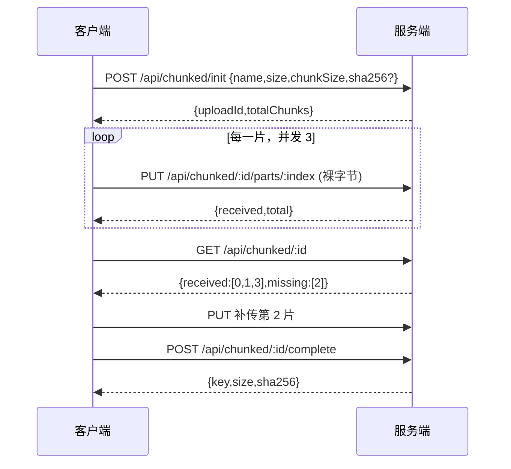

# 第 25 章 大文件分片上传

## 分片、会话、断点续传，各管什么

把 3 GB 塞进一个请求，失败成本就是全部：连接断在 97%，服务端已经收到的字节全部作废，客户端只能从 0 开始。中间还有网关的请求体上限和代理超时，请求越大，撞上的概率越高。

HTTP 协议只为**下载**定义了 `Range` 头（[MDN Range requests](https://developer.mozilla.org/en-US/docs/Web/HTTP/Guides/Range_requests)），分片**上传**没有标准，边界、顺序、合并方式都得自己定；Nest 这一侧仍然从[文件上传](https://docs.nestjs.com/techniques/file-upload)的拦截器起步。

分片上传把文件按固定大小切块，每块一个短请求。某一块失败只重传这一块，已经成功的块留在服务端，这就是**断点续传**。代价是服务端不能再把「一个请求等于一个文件」当默认——它得知道第 3 块和第 4 块属于同一个文件。

这份「知道」就是**上传会话**：`init` 时建一个 `uploadId`，记下文件名、总大小、分片大小、已收到哪些块；`complete` 时按顺序合并。重传同一块还必须安全，否则一次网络抖动就会把写好的块覆盖坏，所以每个分片操作都要**幂等**（执行一次和执行多次，结果相同）。三个词落到接口上，就是下面这套协议。

现在看一个真实事故。

设计团队要传一个 3.2 GB 的素材包。传到 97%，笔记本合盖休眠，连接断了。重新打开页面，进度条回到 0——因为整个文件只发了一个请求，断了就是全丢。

就算网络不断，这个请求在服务端也活不下来：Nginx 默认 1 MB 的请求体上限、Node 进程里那几 GB 的内存、代理层的 60 秒超时，随便哪一个都会先动手。

所以问题不是「怎么把超时调大」，而是**怎么让一次失败只损失一片**：把一次长连接、大体积、不可重试的操作，换成多次短请求加一份可查询的会话状态。下面把它落成接口和状态。

## 先想清楚要传什么

这些词落到代码里都要变成参数。写之前，有四件事必须先定下来，否则越写越乱。

**分片**（chunk）是把文件按固定字节区间切开，每片单独发一个请求。切的时候要定一个 `chunkSize`，它是服务端和客户端必须达成一致的参数——客户端按它切，服务端按它算边界。常用 5–10 MB：太小，请求数暴涨；太大，重传成本变高，而且容易撞上网关的单请求上限。

**上传会话**（upload session）是把「这一次上传」的状态从请求里挪到服务端：文件名、总大小、分片长度、收到哪几片，全都挂在一个 `uploadId` 下面。没有它，第 3 片和第 4 片之间没有任何关系，服务端不知道它们属于同一个文件。

**幂等**指同一个分片重传一次，结果和只传一次相同。这是所有重试逻辑的前提——网络抖动导致客户端不知道上一片到底成没成功，它只能重传，而重传必须是安全的。

**秒传**是在 `init` 时带上文件内容的 `sha256`，服务端发现同哈希的文件已存在，直接返回它，一个字节都不用传。它是去重的副产品，但要注意：哈希可枚举，秒传接口等于告诉别人「这个文件在不在你的库里」，涉密业务要关掉或者加权限。

还有一个常见误解值得先纠正：HTTP 只有**下载**支持 `Range` 请求头（`Range: bytes=0-1048575`）。上传没有标准化的断点续传语义，浏览器也不会替你切片。所以「从断点继续」这件事，协议层帮不了你，只能在应用层自己切、自己记。

## 四个接口就是一份协议

分片上传看起来复杂，落到接口只有四个。它们的分工是：创建会话、传一片、查缺哪片、合并收尾。



四个接口里，真正容易被设计错的是 `PUT` 那一个：**分片索引本身就是幂等键**。客户端重传第 2 片，服务端就覆盖第 2 片，`received` 不会变成 2。不要给每片再发一个随机 id，那样重传会写出两份，合并时还得去重。

分片数量由 `totalChunks = Math.ceil(size / chunkSize)` 算出来。看起来 trivial，但边界条件就藏在这里：**最后一片通常比 `chunkSize` 短**。比如 20 MB 的文件按 6 MB 切，是 6 + 6 + 6 + 2，四片。服务端如果对每片都要求「必须等于 chunkSize」，最后一片永远传不上来。

最后一片的期望长度是：

```ts
const expected =
  index === totalChunks - 1
    ? size - chunkSize * (totalChunks - 1)
    : chunkSize;
```

这个公式我在实现时写错过一次，表现是「前三片都成功，第 4 片 400」。用 `size % chunkSize` 也能算，但当 `size` 正好是 `chunkSize` 的整数倍时，余数是 0，就会把最后一片算成 0 字节——所以用减法，别用取余。

## 把裸字节读进来

分片请求体不是 JSON，是**裸二进制**。Nest 默认挂的 `bodyParser` 只认 `application/json` 和 `application/x-www-form-urlencoded`，`application/octet-stream` 会被跳过，`req.body` 是 `{}`。

有两种接法。第一种是全局关掉 body parser，自己挂：

```ts
// src/main.ts
import express from 'express';
import { NestFactory } from '@nestjs/core';
import { AppModule } from './app.module.js';

const bootstrap = async (): Promise<void> => {
  const app = await NestFactory.create(AppModule);
  app.use('/api/chunked', express.raw({ type: 'application/octet-stream', limit: '9mb' }));
  await app.listen(3000);
};
await bootstrap();
```

这里 `limit` 必须**略大于** `chunkSize`。设成 `8mb`、分片正好 8 MB 时，请求会因为多几个字节的边界开销被 413 拒掉——而这个 413 来自 body parser，不是你的业务代码，日志里看不到任何业务痕迹，很容易误判成网关问题。

第二种是只在 `PUT` 路由上用 `@Req()` 配一个自定义参数装饰器读流。控制更细，但要自己处理 `data`/`end`/`error` 和背压，通常没必要。除非你要边收边算哈希、根本不落内存，才值得写。

注意 `express.raw` 只对匹配 `Content-Type: application/octet-stream` 的请求生效。客户端如果发成 `application/x-www-form-urlencoded`，body parser 会把它当表单解析，`req.body` 又变回 `{}`。这类型问题在联调时最耗时间：请求体明明有 6 MB，服务端说收到 0 字节。

## 服务端要管的三份状态

会话状态放在文件系统里就够，不需要上数据库：

```text
storage/uploads/<uploadId>/
  meta.json          # name, size, chunkSize, totalChunks, createdAt
  parts/
    000000.part
    000001.part
```

`meta.json` 在 `init` 时写一次，之后只读。分片按 6 位零填充命名，这样 `readdir` 拿到的顺序就是索引顺序，合并时不用额外排序——虽然排序只要一行代码，但省掉一个可能的 bug 总是好的。

写分片有一个不能省的步骤：**先写临时名，再 rename**。

```ts
async putPart(id: string, index: number, buf: Buffer): Promise<{ received: number; total: number }> {
  const meta = await this.meta(id);
  if (!Number.isInteger(index) || index < 0 || index >= meta.totalChunks) {
    throw new BadRequestException(`part index out of range: ${index}`);
  }
  const expected = index === meta.totalChunks - 1
    ? meta.size - meta.chunkSize * (meta.totalChunks - 1)
    : meta.chunkSize;
  if (buf.length !== expected) {
    throw new BadRequestException(`part ${index} expected ${expected} bytes, got ${buf.length}`);
  }

  const name = `${String(index).padStart(6, '0')}.part`;
  const tmp = join(this.dir(id), 'parts', `${name}.${randomUUID()}.tmp`);
  await writeFile(tmp, buf);
  await rename(tmp, join(this.dir(id), 'parts', name));

  const received = (await readdir(join(this.dir(id), 'parts')))
    .filter((f) => f.endsWith('.part')).length;
  return { received, total: meta.totalChunks };
}
```

为什么要多这一步 `rename`？因为进程可能在写第 3 片的中途被 kill 或 OOM，留下一个 4 MB 的半截文件。如果直接用最终名写，`status` 会把它算成「已收到」，`complete` 合并出来的文件就是坏的，而且哈希对不上、还不知道是哪一片的问题。临时名 + 原子 rename 保证「要么完整存在，要么不存在」，这是分片上传能可靠续传的底层前提。

`buf.length !== expected` 这个校验也值得说一句。它在服务端复查客户端切分是否守规矩。不检查会怎样？客户端少传 1 个字节，合并出来的文件整体错位，哈希校验失败，但错误发生在最后一步，前面几十片全部白传。

## 合并与收尾

`complete` 做的事：确认没有缺片 → 顺序拼接 → 算哈希 → 改名到正式目录 → 删会话。

```ts
async complete(id: string): Promise<{ key: string; size: number; sha256: string }> {
  const meta = await this.meta(id);
  const { missing } = await this.status(id);
  if (missing.length > 0) {
    throw new BadRequestException(`missing parts: ${missing.join(',')}`);
  }
  const merged = join(this.dir(id), `merged.${randomUUID()}.tmp`);
  const handle = await open(merged, 'w');
  try {
    for (let i = 0; i < meta.totalChunks; i += 1) {
      await handle.write(await readFile(join(this.dir(id), 'parts', `${String(i).padStart(6, '0')}.part`)));
    }
  } finally {
    await handle.close();
  }
  const sha256 = await this.hash(merged);
  const key = `${new Date().toISOString().slice(0, 10)}/${sha256}`;
  await mkdir(join(this.filesDir, key.slice(0, 10)), { recursive: true });
  await rename(merged, join(this.filesDir, key));
  await rm(this.dir(id), { recursive: true, force: true });
  return { key, size: meta.size, sha256 };
}
```

注意几个细节。合并写的是 `merged.<uuid>.tmp`，不是最终名——同样是为了防中断。哈希在合并之后算，因为流式合并时同时更新哈希虽然更快，但一旦代码有 bug，你拿到的是一个「哈希正确但内容错位」的文件，更难查。

合并完立刻 `rm` 掉整个会话目录。不删的话，一份 3 GB 的上传会在磁盘上留 3 GB 的分片加 3 GB 的成品，占用直接翻倍。

**并发 `complete`** 是必须挡住的。用户手抖点两下，两个请求同时进入合并，会写出两个 `merged.tmp`、算两次哈希、`rename` 两次。第二次的 `rm` 可能把第一次的会话目录删掉，而第一次还在读它。

单进程用内存锁就够：

```ts
private readonly merging = new Set<string>();

async complete(id: string) {
  if (this.merging.has(id)) throw new ConflictException(`upload ${id} is completing`);
  this.merging.add(id);
  try {
    // ... 合并逻辑
  } finally {
    this.merging.delete(id);
  }
}
```

但 `Set` 只在当前进程有效。多实例部署时，两个 Pod 各持有一份 `Set`，锁形同虚设。要跨进程，用 PG 的咨询锁：

```sql
SELECT pg_advisory_xact_lock(hashtext($1));
```

`hashtext` 把 `uploadId` 映射成 64 位整数，事务结束自动释放。它不需要额外建表，也不怕进程崩溃——连接断开时锁自动放掉。这是我在「不想引入 Redis」时最常拿来兜底的方案。

## 真跑一遍

以下输出来自本机实际运行（Nest 12.4.0），不是示意。用一个 20 MB 的随机文件按 6 MB 切四片：

```bash
head -c 20971520 /dev/urandom > /tmp/demo/big.bin
split -b 6291456 -d -a 2 /tmp/demo/big.bin /tmp/demo/part-
ls -l /tmp/demo/
# part-00  6291456
# part-01  6291456
# part-02  6291456
# part-03  2097152   ← 最后一片只有 2 MB
```

```bash
curl -s -X POST http://localhost:3000/api/chunked/init \
  -H 'Content-Type: application/json' \
  -d '{"name":"big.bin","size":20971520,"chunkSize":6291456}'
# {"uploadId":"373291d7-59f0-4dbb-83a5-76fa4b8c7484","name":"big.bin",
#  "size":20971520,"chunkSize":6291456,"totalChunks":4,"createdAt":"2026-11-06T15:46:06.839Z"}
```

```bash
for f in /tmp/demo/part-*; do
  i=$((10#$(basename "$f" | sed 's/part-//')))
  curl -s -X PUT -H 'Content-Type: application/octet-stream' \
    --data-binary @"$f" http://localhost:3000/api/chunked/$ID/parts/$i
  echo
done
# {"received":1,"total":4}
# {"received":2,"total":4}
# {"received":3,"total":4}
# {"received":4,"total":4}

curl -s http://localhost:3000/api/chunked/$ID
# {"received":[0,1,2,3],"missing":[],"total":4}

curl -s -X POST http://localhost:3000/api/chunked/$ID/complete
# {"key":"2026-11-06/4270cf09...40b6","size":20971520,
#  "sha256":"4270cf09...40b6"}

shasum -a 256 /tmp/demo/big.bin
# 4270cf09...40b6  /tmp/demo/big.bin
```

最后两行哈希一致，说明切分、传输、拼接、落盘全程没有丢字节。这一步必须做——没有哈希对比的「上传成功」只是「没有报错」。

失败路径同样跑了一遍：

```bash
# 跳过第 0 片，直接传第 1 片：可以，顺序无所谓
{"received":1,"total":4}

# 重复传第 1 片：received 不变，幂等
{"received":1,"total":4}

# 缺片时合并
{"message":"missing parts: 0,2,3","error":"Bad Request","statusCode":400}

# 最后一片长度不对
{"message":"part 3 expected 2097152 bytes, got 6291456","error":"Bad Request","statusCode":400}

# 索引越界
{"message":"part index out of range: 9","error":"Bad Request","statusCode":400}

# 未知会话
{"message":"unknown upload 00000000-0000-4000-8000-000000000000","error":"Not Found","statusCode":404}

# 单片超过 raw limit
{"statusCode":413,"message":"request entity too large"}
```

最后一条的 413 措辞和业务错误不一样——它来自 `express.raw`，不是 `BadRequestException`。同一个状态码两种来源，是排查时最容易走错路的地方。

## 前端要做的三件事

服务端协议定好之后，客户端只需要三件事，但每一件都有人写错。

**并发数要限。** 20 个请求同时发，浏览器同域并发上限（HTTP/1.1 是 6）会把它们排队，再加上服务端每个请求都在写盘，实际吞吐反而比串行还差。开 3 个 worker 就够了：

```ts
const limit = 3;
const queue = parts.slice();
await Promise.all(
  Array.from({ length: limit }, async () => {
    for (let part = queue.shift(); part !== undefined; part = queue.shift()) {
      await putPartWithRetry(part);
    }
  }),
);
```

**失败要退避重试。** 第 3 片失败就立刻重发，多半还是失败。等 `200ms × 2^attempt`，重试三次，仍失败就整体停下，把 `uploadId` 存进 `localStorage`，下次进页面先 `GET` 一次查 `missing`。

**续传要恢复上下文。** 刷新后拿到 `uploadId`，先查状态，只补 `missing` 里的索引。存 `uploadId` 时顺手记文件大小和最后修改时间，否则用户换了文件、`uploadId` 还是旧的，服务端会按旧的大小校验分片长度，报一堆看不懂的 400。

## 上线前要补的几件事

| 现象 | 原因 | 处理 |
| --- | --- | --- |
| 413，但业务日志没有记录 | 网关 / `express.raw` 的 `limit` 先拒 | 两层都调，`limit` 比 `chunkSize` 大 1 MB |
| `req.body` 是 `{}` | `Content-Type` 不是 `application/octet-stream`，或没挂 raw parser | 检查请求头与 `app.use` 路径 |
| 最后一片永远 400 | 用 `chunkSize` 校验了最后一片 | 用减法算期望长度 |
| 合并后哈希不对 | 分片长度没校验，或半截文件被当成完整片 | 临时名 + rename，服务端复查长度 |
| 会话目录越堆越多 | 没有清理任务 | 定时扫 `meta.json` 的 mtime，删 24 小时未完成的会话 |
| 磁盘被写满 | 没做配额 | 单用户并发上传数、总占用都要限；`ENOSPC` 要捕获成 503 |

清理任务的实现，`@nestjs/schedule` 就够：

```ts
@Cron(CronExpression.EVERY_HOUR)
async sweep(): Promise<void> {
  const cutoff = Date.now() - 24 * 60 * 60 * 1000;
  for (const id of await readdir(this.root)) {
    const info = await stat(join(this.root, id, 'meta.json')).catch(() => undefined);
    if (info !== undefined && info.mtimeMs < cutoff) {
      await rm(join(this.root, id), { recursive: true, force: true });
    }
  }
}
```

以 `meta.json` 的 mtime 为准，而不是目录的——目录 mtime 在每次写入分片时都会变，用它判断会把正在传的会话删掉。

还有一条容易忽略的：**合并是 CPU 和 IO 的双重负担**。一次 `complete` 要读 3 GB、写 3 GB、算一遍哈希。同一时刻来十个，机器就跪了。给 `complete` 加个并发上限（比如 2），超出的排队或者直接 429，比让它慢慢拖垮整个服务好。

分片上传把「一次失败」变成了「一片失败」，代价是引入了一整套会话状态：创建、查询、幂等写、合并、清理。这五件事任何一件缺失，系统都能跑，但会在某个流量高峰或某次部署重启时集中爆发。

下一章换个话题：这些上传、合并、失败，你怎么知道它们发生了什么？日志。

想更深入的话，官方文档里有这几页可以接着看：[文件上传](https://docs.nestjs.com/http/file-upload)（Nest 自带上传能力的边界，分片这套要自己补的东西可以拿它对照）、[任务调度](https://docs.nestjs.com/techniques/task-scheduling)（定时任务的装饰器和模块怎么注册，对应本章清理过期会话那段）、[PostgreSQL 咨询锁](https://www.postgresql.org/docs/17/explicit-locking.html#ADVISORY-LOCKS)（数据库层的锁怎么加、什么时候释放，对应多实例下用数据库锁代替进程内标记那段）。

<!-- chapter-nav:start -->
---

← 上一篇：[024 Nest如何使用multer实现文件上传](024-Nest如何使用multer实现文件上传.md) · [本 Part 目录](_part.md) · 下一篇：[026 Nest里如何打印日志](026-Nest里如何打印日志.md) →
<!-- chapter-nav:end -->
