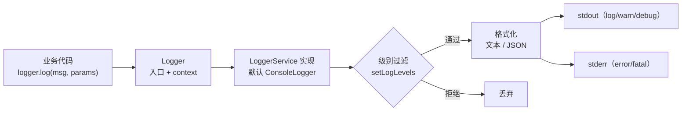

# 第 26 章 Nest 里如何打印日志

线上出问题的时候，你不在现场。用户只会说一句「刚才下单失败了」，你能拿到的，只有程序自己留下的那几行字。

打印日志干的就是这件事：**趁事情发生的那一刻，把现场记下来**。谁在什么时候、对哪个订单、做了什么、结果如何，按时间顺序写到一个地方。几个小时后你赶到，靠这些记录把当时的情形拼回去。

它像行车记录仪。没装的时候，事故怎么发生的只能靠双方各说各话；装了，至少能看到撞上前的十秒。日志也一样——它不是写给现在的你看的，是写给**出事后赶来的你**看的，可能是凌晨三点，也可能是不认识这套代码的同事。

有个词容易跟它混：`console.log`。那东西是给正在写代码的你现看的，屏幕上刷过去，看完就没了。日志是给事后的人查的，要能留下来、能按条件搜出来、能在出事时报警。两者可以长得很像，用途完全不同——这一章讲的是后者。

## 日志在干什么

日志不是「一行字」。一行能用的日志，拆开至少有五块：时间、级别、来源（哪个类或模块）、消息、结构化字段。缺哪块会出什么事，后面挨个看。

先说最要紧的一样：**结构化字段**。它是 `requestId`、`orderId` 这种独立的键值对，日志平台能按它筛选、分组、报警。把它拼进字符串，机器就只能拿正则去碰运气——这就是很多「日志不少，就是查不出来」的根子。

日志最后要落到一条流里：`stdout`（正常输出）或 `stderr`（错误输出）。容器里通常由采集程序从这两条流把日志收走，再送到 Loki、Elasticsearch 这类平台。Nest 的 `Logger` 就包在这一层上面：它替你补时间、级别和 context，也能把参数整理成 JSON。

两个官方入口先放这儿：[Nest Logger](https://docs.nestjs.com/techniques/logger) 是这一章要用的 API；[Node 的 process I/O 说明](https://nodejs.org/api/process.html#a-note-on-process-io) 解释 `stdout`/`stderr` 在终端和管道下行为为什么不同。

## 一个真实的事故

订单接口的 5xx 从 0.1% 涨到 4%。打开日志平台，搜到 37 条 `[ExceptionsHandler] Cannot read properties of undefined`，没有一条带 URL、用户或请求 ID。三个实例的日志按时间交错，你只能靠「大概在这一分钟」去猜是哪次请求。

四十分钟后才查出来：上游把字段从 `orderId` 改成了 `order_id`。

问题不在「日志不够多」，而在**日志里没有能拿去搜的字段**。一行只由字符串拼起来的日志，人读着还行，机器读起来等于一段散文。想按 `userId` 把所有相关记录捞出来？只能全文搜，搜出来还未必是同一个人。

Nest 自带一套日志设施，默认就能解决大半问题。这章把它拆开看：一条日志由什么组成、级别怎么过滤、怎么打结构化字段、生产环境怎么输出 JSON。至于什么时候该换 Winston，下一章再说。

## 一条日志该带什么

这几块在 Nest 里都有对应的 API。先把词统一，后面会反复用。

- **级别**（severity）：这条信息有多急。Nest 的顺序是 `fatal > error > warn > log > debug > verbose`。它不只是个标签，还是运行时的过滤器——设成 `warn`，就只有 `warn`、`error`、`fatal` 能出来。像小区门口的保安：`error` 是有人砸门，`log` 是正常进出，`debug` 是连谁多看了摄像头一眼都记，后者当然关掉，不然一天下来全是无用记录，真出事那条反而找不着。
- **上下文**（context）：谁打的，一般写类名。它的作用是在一行日志里回答「哪个模块」，像快递面单上的寄件人那一栏——没有它，一堆日志全糊在一起，你得靠猜是订单模块还是支付模块在说话。
- **结构化字段**（structured params）：`requestId`、`userId`、`orderId` 这类可以按值查询的键值对。它们是日志平台能分组、能筛、能报警的前提；和「一句话里塞进去的键值」只差一个位置——放在对象里是字段，拼进字符串就只是字。
- **输出流**：`stdout` 还是 `stderr`。采集端通常把两条流分开收，错误走 `stderr` 才能被单独告警。像公司门口的两个信箱，普通件和加急件分开放，处理的人不用一封封拆开看。

拿这几项去量 `console.log`，它一项都及不了格：没有级别、没有上下文、只能拼字符串、永远写 `stdout`。它唯一的优点是零成本——调本地脚本时依然好用，进了业务代码就是负债。

`console.log` 还有两个不太显眼的坑。一是**参数会被 `util.inspect` 处理**，打印一个类实例时把内部字段连同嵌套引用一起倒出来，读的人分不清哪几个是你要看的；二是**写流的代价**，在 Linux 上 `stdout` 接管道时是异步的、接终端时是同步的——同一行代码，本地和线上行为不同，压测时会看到莫名其妙的阻塞。

## Nest 的 Logger 替你做了什么

`Logger` 来自 `@nestjs/common`，用法只有两种形态：

```ts
import { Logger } from '@nestjs/common';

// 形态一：静态方法，快速打一行
Logger.log('bootstrap done');

// 形态二：实例，带上下文，推荐
const logger = new Logger(UploadService.name);
logger.log('merged upload', { uploadId: 'u_1', parts: 4 });
```

实例形态的第一个参数是上下文，日志里会显示成 `[UploadService]`。它比静态方法好在两点：上下文只写一次，后面每行自动带上；这个实例还能被注入、被替换（依赖注入是什么，第 5 章讲过，这里只要知道「能被换掉」就够了）。

`Logger` 本身**不负责写**，它只是入口。真正干活的是 `LoggerService` 接口的实现，默认那个叫 `ConsoleLogger`。这层分离很像餐厅前台和后厨：你在前台点菜（`logger.log()`），前台把单子递给当班的后厨（当前挂着的 logger 实现），换掉后厨不用重新教顾客点菜。所以以后换成 Winston、换成 pino，业务代码一行都不用动。



注意最后两个分支：**错误不是「级别更高的普通日志」，它写的是另一条流**。这不是 Nest 的怪癖，是 Unix 的惯例——采集端可以只订阅 `stderr` 做告警，不用去解析 `stdout` 里那几十万行正常日志。

## 级别：什么时候用哪个

六个级别，对应六种场景，别用混：

| 级别 | 用在 | 生产默认 |
| --- | --- | --- |
| `fatal` | 进程无法继续，即将退出 | 开 |
| `error` | 请求失败、外部依赖挂了，但进程还活着 | 开 |
| `warn` | 可恢复的异常、降级、慢查询 | 开 |
| `log` | 关键业务事件：启动、任务开始/结束 | 开 |
| `debug` | 排查用的中间状态：缓存命中、SQL 参数 | 关 |
| `verbose` | 极细的追踪，通常只临时打开 | 关 |

「生产默认」这一列不是建议，是成本核算。`debug` 级别的日志量通常是 `log` 的十倍以上，QPS 800 的接口一天写 60 GB 不是夸张——把所有响应体打进 `debug`，磁盘压力能直接把 Pod 驱逐。

级别过滤的写法有三种，都在应用创建时或运行中指定：

```ts
// 1. 创建时给数组
const app = await NestFactory.create(AppModule, { logger: ['error', 'warn', 'log'] });

// 2. 按级别字符串算，>=warn 就是 warn/error/fatal
const app = await NestFactory.create(AppModule, {
  logger: filterLogLevels('>=warn'),
});

// 3. 运行中改（比如配置加载完之后）
app.useLogger(['error', 'warn']);
```

数组的语义要留意：**它按「最严重级别」级联**。传 `['log']`，`warn`、`error`、`fatal` 也会一起打开，因为它们的严重程度都在 `log` 之上。想让 `error` 出来但 `log` 不出来，得传 `['error']`，而不是传 `['log']` 再想办法排除。这就像调水闸只调最低那根线：水位高过它，上游全放行。

`filterLogLevels` 是 Nest 12 提供的工具，接受 `'>=warn'`、`'>warn'`、`'warn'` 和逗号列表 `'error,warn'`。它比手写数组不容易错——手写很容易把顺序搞反，或者漏掉 `fatal`。

运行中改级别最实用的场景是「临时开 debug」：线上出问题，把某个请求的 `debug` 打开，复现完再关掉。前提是你的日志实现支持 `setLogLevels()`，它在 `LoggerService` 接口里是可选方法。

## 从字符串到结构化

这是 Nest 12 变化最大的一块，也是旧教程最容易带偏的地方。

以前要打结构化字段，只能拼字符串或者自己 `JSON.stringify`：

```ts
logger.log(`merged upload uploadId=${uploadId} parts=${parts}`); // 老写法
```

问题在哪？这行字对人很友好，对机器等于一句没有标点的句子。`uploadId` 的值里要是夹了个空格或换行，字段边界就没了；用户输入里塞一行伪造的内容，还能凭空造出一条假日志。

v12 起，`Logger` 的方法接受「消息 + 一个纯对象」，对象会被当成 structured params，合并进同一条日志：

```ts
logger.log('merged upload', { uploadId: 'u_1', parts: 4 });
```

开启 JSON 输出后，实际是这样：

```json
{"level":"log","pid":61205,"timestamp":1793980007729,"message":"server started","params":{"port":3000,"env":"production"}}
```

字段是固定的：`level`、`pid`、`timestamp`、`message`、`params`，有堆栈时多一个 `stack`。日志平台可以直接按 `params.userId` 建索引，不用写正则。这就像快递面单从上世纪的「手写地址」变成了标准化的几个方框：内容一样，分拣效率完全不同。

两个细节值得记住。第一，**只有纯对象会被当成 params**。传 `Map`、类实例、数组，行为不一样——数组会被当成格式化参数，类实例会被序列化成对象但可能丢方法。第二，`flattenParams: true` 会把 params 摊平到根，变成 `{"level":"log","userId":1,...}`，适合对接那些不支持嵌套字段的采集端。

还有一个隐藏福利：**惰性求值**。`logger.debug(() => heavyDump())` 只在 `debug` 级别开启时才执行函数。生产环境关掉 `debug` 时，这段开销是零。别小看它，有些团队为了打一行调试日志把整个对象深度遍历了一遍，QPS 一上来就是热点。

## 让输出适配环境

`ConsoleLogger` 有一组选项，改的是「长什么样」，不是「记什么」：

```ts
// 本地：带颜色、带时间、方便肉眼看
const dev = new ConsoleLogger({ prefix: 'api', timestamp: true, colors: true });

// 生产：一行一个 JSON，交给采集端
const prod = new ConsoleLogger({ json: true });
```

常用的几个：

- `json`：单行 JSON，生产必开。
- `prefix`：默认 `Nest`，多进程时改成服务名，方便区分。
- `timestamp`：文本模式加时间戳。JSON 模式的 `timestamp` 是 epoch 毫秒，要 ISO 字符串就继承 `ConsoleLogger` 覆盖 `getTimestamp()`。
- `logLevels`：构造时直接定级别，等价于 `filterLogLevels` 的结果。
- `compact` / `depth` / `maxArrayLength`：控制文本模式下对象的打印深度，防止一行日志打出几百 KB。

一个常被忽略的事实：**JSON 模式下 `colors` 无效**。有人两个都开，然后在日志平台里看到一堆 `\u001b[32m` 转义符，还以为是采集端的问题。给机器读的东西，本来就不该带给人看的装饰。

自定义 logger 也很直接，实现 `LoggerService` 接口即可：

```ts
import { Injectable, LoggerService } from '@nestjs/common';

@Injectable()
export class AppLogger implements LoggerService {
  log(message: unknown, ...optional: unknown[]): void { /* ... */ }
  error(message: unknown, ...optional: unknown[]): void { /* ... */ }
  warn(message: unknown, ...optional: unknown[]): void { /* ... */ }
  debug?(message: unknown, ...optional: unknown[]): void { /* ... */ }
  verbose?(message: unknown, ...optional: unknown[]): void { /* ... */ }
  setLogLevels?(levels: LogLevel[]): void { /* ... */ }
}
```

挂上去有两种方式：`app.useLogger(app.get(AppLogger))` 走依赖注入（推荐，logger 自己能注入 `ConfigService`）；或者 `app.useLogger(new AppLogger())` 直接给实例（简单，但不能注入）。

用 DI 版本时，启动阶段有个坑：`NestFactory.create()` 返回之前，Nest 自己的启动日志已经用默认 logger 打出去了。要保证从第一行开始就用你的 logger，加 `bufferLogs`：

```ts
const app = await NestFactory.create(AppModule, { bufferLogs: true });
app.useLogger(app.get(AppLogger));
await app.listen(3000);
```

`bufferLogs: true` 让启动日志先攒着，等你挂上自定义 logger 再一起 flush。默认 `autoFlushLogs` 会在 `listen()` 时自动冲，不用手动管。如果初始化就失败了，Nest 会退回默认 logger 把缓冲打出来——所以不会丢启动错误。可以理解成机场的摆渡车：人先上车等着，等登机口定了再一起送过去，中间不会有人被落下。

## 真跑一遍

以下输出来自本机实际运行（Nest 12.4.0），不是示意。

```ts
import { ConsoleLogger, Logger, filterLogLevels } from '@nestjs/common';

const json = new ConsoleLogger({ json: true });
json.log('server started', { port: 3000, env: 'production' });
json.warn('slow query', { ms: 1200, sql: 'select 1' });
json.error('payment failed', 'trace..', 'PaymentsService');

const human = new ConsoleLogger({ prefix: 'api', timestamp: true, logLevels: filterLogLevels('>=warn') });
human.log('this line is filtered out');
human.warn('deprecated endpoint', { path: '/v1/pay' });

const logger = new Logger('UploadService');
logger.log('merged upload', { uploadId: 'u_1', parts: 4 });
```

```text
{"level":"log","pid":61205,"timestamp":1793980007729,"message":"server started","params":{"port":3000,"env":"production"}}
{"level":"warn","pid":61205,"timestamp":1793980007729,"message":"slow query","params":{"ms":1200,"sql":"select 1"}}
{"level":"error","pid":61205,"timestamp":1793980007729,"message":"payment failed","stack":"trace.."}
[api] 61205  - 11/06/2026, 11:46:47 PM    WARN deprecated endpoint { path: '/v1/pay' }
[Nest] 61205  - 11/06/2026, 11:46:47 PM     LOG [UploadService] merged upload { uploadId: 'u_1', parts: 4 }
```

三件事可以对着输出确认。

第一，`human.log(...)` 那行**没有出现**——`filterLogLevels('>=warn')` 生效了，`log` 被过滤掉，`warn` 通过。

第二，`json.error` 的第三个参数 `'PaymentsService'` 没有变成 context。`error()` 的签名是 `error(message, stack?, context?)`，第三个位置是 context，但 JSON 模式里它并没有被渲染成 `context` 字段。想稳定带上下文，用 `new Logger('PaymentsService')` 的实例方法，别用静态方法传参。

第三，错误那行走的是 `stderr`。在终端里看不出区别，但 `node app.js 2>error.log` 之后，它只会出现在 `error.log` 里。这一条直接决定了告警能不能只订阅错误流。

## 几条踩过的坑

**日志里不要有敏感信息。** 手机号、身份证、token、完整请求体——这些一旦进了日志平台，就等于永久留存，还要走数据合规流程。要么在业务层脱敏，要么在 logger 层统一过滤字段名（`password`、`token`、`authorization`）。

**别用字符串拼接。** `` logger.log(`user ${id} paid ${amount}`) `` 看起来方便，但字段无法索引、无法聚合，还容易因为用户输入里的换行伪造一条假日志（日志注入）。用结构化参数。

**`error` 要传 Error 对象，不是 `error.message`。** 堆栈是排查的主要线索，只写 message 等于把最值钱的部分扔了：

```ts
try {
  await this.pay(order);
} catch (error) {
  this.logger.error('payment failed', error instanceof Error ? error.stack : String(error), { orderId: order.id });
}
```

**每个请求打一行「入口 + 出口」就够。** 中间过程用 `debug`。否则一次请求打十几行，日志量翻十倍，真正有用的那行会被淹掉。

**生产开 JSON，别开颜色。** 颜色转义符会污染字段，`level` 前面多几个字节，正则匹配全挂。

## 内置 logger 的边界

到这里，Nest 内置 logger 已经能覆盖大多数场景：分级、结构化、JSON、DI、运行中调级别、错误分流。官方文档的说法也很明确——内置 logger + JSON + 结构化参数 + 一个 traceId 就够用了。

真正需要第三方库的是这几种情况：

- **要把日志写到文件或传输到远端**（内置只写 stdout/stderr，靠采集端收）；
- **需要字段级脱敏、采样、redaction**（内置没有这层）；
- **极致吞吐**，日志量大到 `ConsoleLogger` 的字符串处理成瓶颈；
- **多进程/多服务统一格式**，需要一套跨语言的 schema。

换句话说，内置 logger 的职责到「把日志交出去」为止；日志出了进程之后的事——存多久、放哪、崩了怎么办——它不管。这正好是下一章要讲的：为什么这时候会想到 Winston。


<!-- chapter-nav:start -->
---

← 上一篇：[025 大文件分片上传](025-大文件分片上传.md) · [本 Part 目录](_part.md) · 下一篇：[027 为什么Node里要用Winston打印日志](027-为什么Node里要用Winston打印日志.md) →
<!-- chapter-nav:end -->
