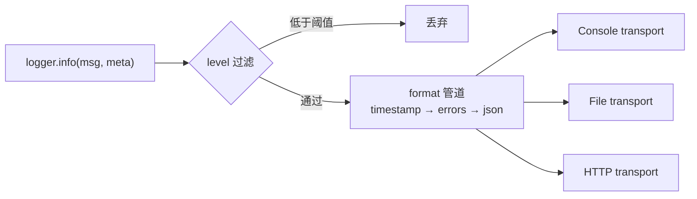

# 第 27 章 为什么 Node 里要用 Winston 打印日志

## 日志写出来，不等于存下来

`console.log` 默认写到进程的 `stdout`，Nest 的 `Logger` 默认把普通日志送 `stdout`、错误送 `stderr`。这两条流都由父进程（终端、systemd、容器运行时）接管。日志平台要拿到它们，中间得有一个采集 agent 把流读走、送到远端存储；存多久由平台的**保留期**决定，不由你的代码决定。容器删了，可写层没了，如果没人把 `stdout` 搬走，日志就真的没了。

要把同一条日志同时送进控制台、本地文件和远端 Loki，还要在写出之前脱敏，就需要一个能把「产生 → 过滤 → 格式化 → 输出」拆成多步的库。Winston 把这条管道做成可配置的：用 level 管过滤、用 format 管形状、用 transport 管目的地，一条日志可以同时进多个 transport。[Winston 的文档](https://github.com/winstonjs/winston) 把这三块分开讲得很清楚，[Node 的 process I/O 说明](https://nodejs.org/api/process.html#a-note-on-process-io) 则能补上 `stdout` 在终端和管道下行为不同的细节。

现在看一个真实事故。

合规同事周五下午来找你，要 6 月到 8 月所有退款操作的记录。你打开日志平台，保留期 7 天。容器只往 `stdout` 写，节点一换，旧日志跟着没了。你只能回答：「系统里查不到。」

第二种场景更日常：日志要同时进控制台、进本地文件、进远端的 Loki，还要在写出去之前把手机号脱敏。用内置 `Logger` 也不是不行——每个出口写一个自定义 `LoggerService`，里面调三种客户端。但很快你会发现，自己在重新实现一个日志库，而且实现得没别人好。

所以它不是「更好的 console.log」，它是**日志的路由器**：把一条日志从产生到落地拆成一条可编排的管道。

## 日志不是打印，是事件流

把日志当成一次 `print`，你的选择只有「打不打」。把它当成一条事件流，就会自然分出四段：

1. **产生**：业务代码给出 `message` + 结构化字段 + 级别。
2. **过滤**：低于当前级别的直接丢，连格式化都不做。
3. **格式化**：时间戳、错误堆栈、脱敏、序列化成 JSON。
4. **投递**：写到控制台、文件、HTTP 端点、Kafka、Sentry。

内置 logger 只做了 1 和 4 的一部分（只到 `stdout`/`stderr`）。Winston 把四段都做成可替换的零件：

- `level` 控制过滤；
- `format` 是一条 `combine` 出来的管道，顺序有讲究；
- `transport` 是一个目的地，配几个就写几处；
- `child()` 派生带默认字段的子 logger，用来绑 `requestId`。



控制台和文件里的日志格式可以不一样：`format` 既能挂在 logger 上，也能挂在单个 transport 上，后者覆盖前者。生产里常用这个特性——控制台给人看（彩色、单行），文件给机器看（JSON）。

## 最小可用的三件套

```ts
import winston from 'winston';

const logger = winston.createLogger({
  level: 'info',
  format: winston.format.combine(
    winston.format.timestamp({ format: 'YYYY-MM-DD HH:mm:ss.SSS' }),
    winston.format.errors({ stack: true }),
    winston.format.json(),
  ),
  transports: [
    new winston.transports.Console({
      format: winston.format.combine(winston.format.colorize(), winston.format.simple()),
    }),
    new winston.transports.File({ filename: 'logs/app.log' }),
  ],
});

logger.info('server started', { port: 3000, env: 'production' });
```

跑出来是这样（本机实际输出，控制台带颜色，文件是纯 JSON）：

```text
info: server started {"env":"production","port":3000,"timestamp":"2026-11-06 23:47:27.519"}
warn: slow query {"ms":1200,"timestamp":"2026-11-06 23:47:27.520"}
error: payment failed upstream timeout {"requestId":"req_8f2c","stack":"Error: upstream timeout\n    at ..."}
```

```json
{"env":"production","level":"info","message":"server started","port":3000,"timestamp":"2026-11-06 23:47:27.519"}
{"level":"error","message":"payment failed upstream timeout","requestId":"req_8f2c","stack":"Error: upstream timeout\n    at ...","timestamp":"2026-11-06 23:47:27.519"}
```

三个细节值得停下来看。

**第一，`format.errors({ stack: true })` 必须放在 `json()` 前面。** 它负责把 `Error` 对象的 `stack` 摊到顶层。顺序反了，`json()` 会先把 Error 序列化成 `{}`，堆栈直接消失——这是 Winston 最常见的一个坑，且不报错，只是日志里少东西。

**第二，`meta` 会被摊平到根。** 你传 `{ port: 3000 }`，输出是顶层 `"port":3000`，不是 `"meta":{"port":3000}`。这和 Nest 内置 logger 的 `params` 嵌套不同，对接日志平台时字段路径要跟着改。

**第三，`level` 是过滤阈值，不是标签。** 设成 `info`，`logger.debug()` 连 format 都不会进。这意味着你可以放心在热路径写 `debug`，只要级别是 `info`，开销就是一次函数调用加一次比较。

## child：把 requestId 绑到每条日志

一次请求会打十几条日志，逐条传 `requestId` 既啰嗦又容易漏。`child()` 派生一个带默认字段的 logger：

```ts
const child = logger.child({ requestId: 'req_8f2c' });
child.info('order created', { orderId: 'o_1001', amount: 9900 });
child.error('payment failed', error);
```

输出里两条都带上了 `"requestId":"req_8f2c"`：

```json
{"amount":9900,"level":"info","message":"order created","orderId":"o_1001","requestId":"req_8f2c","timestamp":"..."}
{"level":"error","message":"payment failed upstream timeout","requestId":"req_8f2c","stack":"Error: upstream timeout\n    at ...","timestamp":"..."}
```

配合 `AsyncLocalStorage`，可以在请求入口把 `requestId` 存进去，在 logger 的 `format` 里读出来拼上——业务代码一行都不用改。Express/Nest 的中间件里 `als.run({ requestId }, next)`，日志格式化时 `als.getStore()?.requestId`。这是比「每个 service 手动传」干净得多的做法。

`child()` 的默认字段是**浅合并**的：子 logger 的字段会覆盖父 logger 的同名字段，但嵌套对象不会深合并。想加一个 `{ user: { id } }`，父级已有 `{ user: { name } }`，结果是只剩 `id`。

## 崩溃时的最后一条日志

这是内置 logger 和 Winston 差距最大的地方，也是很多团队换库的真正原因。

进程抛未捕获异常时，默认行为是打印到 `stderr` 然后退出。问题是：**退出前那次写可能还没落盘**。文件流的缓冲、OS 的 page cache，都可能让最后一两条日志消失——而它们往往是最有价值的。

Winston 提供两个兜底 transport：

```ts
const logger = winston.createLogger({
  level: 'info',
  format: winston.format.combine(winston.format.timestamp(), winston.format.json()),
  transports: [new winston.transports.File({ filename: 'logs/crash.log' })],
  exceptionHandlers: [new winston.transports.File({ filename: 'logs/crash.log' })],
  rejectionHandlers: [new winston.transports.File({ filename: 'logs/crash.log' })],
});
```

我实际跑了一次：先 `logger.info('before crash')`，再 `Promise.reject(new Error('db connection lost'))`，50 ms 后定时器里再 `throw`。

```bash
node --import tsx wdemo2.ts
# exit=1
wc -l logs/crash.log
# 2
```

文件里只有两行：崩溃前那条 `info`，和一条 `unhandledRejection` 记录。**定时器里那个 `throw` 没有写进去**——进程在 flush 之前就退了。这说明了兜底 handler 的价值和边界：它能接住异常并尽力写一条，但不保证 100% 落盘。

同一个 `crash.log` 里还能看到，Winston 处理异常时会自动附加 `os`、`process`、`trace` 一大坨元数据：

```json
{"level":"error","message":"unhandledRejection: db connection lost\nError: ...","rejection":true,
 "os":{"loadavg":[3.3,...],"uptime":468599},
 "process":{"argv":[...],"memoryUsage":{...},"pid":61536,...},"trace":[...]}
```

信息很全，但单条日志能到几 KB。采集端按行切、按大小限流时，这些字段经常是第一个被丢的。可以关掉：

```ts
new winston.transports.File({ filename: 'logs/crash.log', handleExceptions: false })
```

或者在 format 里删字段。**生产建议保留 `process.pid` 和 `trace`，删掉 `os`/`argv`**——前者用来定位是哪个实例，后者只在本地调试有用。

还有一条容易忘的：`exceptionHandlers` 接管之后，Winston 默认 `exitOnError: true`，处理完会调用 `process.exit(1)`。如果你有自己的优雅退出逻辑（关数据库连接、flush 指标），要把它设成 `false` 并自己控制退出时机，否则连接会被硬切。

## 和 pino 比，选哪个

Node 生态里另一个主流选择是 pino。两者定位不同：

| | Winston | pino |
| --- | --- | --- |
| 设计重心 | 灵活、可编排 | 吞吐、低开销 |
| 传输 | transport 直接写在配置里 | 主进程只写 stdout，用 `pino/transport` 起 worker |
| 格式化 | `format.combine` 任意组合 | 固定 JSON，序列化器可换 |
| 生态 | 传输目标最多（文件、HTTP、Kafka、Sentry） | 插件多，但文件落盘要额外配 |
| 上手成本 | 中等 | 低 |

一个粗略的经验：**日志要写文件、要多个目的地、要复杂脱敏，选 Winston；只写 stdout、追求极致吞吐、日志由采集端统一处理，选 pino**。后者的 `sonic-boom` 用 worker 线程写盘，压测时对主线程的影响明显更小。

还有一个现实因素：如果你用 Nest，`nestjs-pino` 的集成比 Winston 更顺（官方推荐、自带请求日志），而 `nest-winston` 需要自己写 `LoggerService` 适配。这不是技术优劣，是生态现状。

## 什么时候根本不用换

说回 026：如果你们的需求是「日志进 stdout，平台负责采集和保留」，那内置 `Logger` + JSON 输出就够了。上 Winston 只会多一层配置、多一个依赖、多一处可能配错的地方。

判断标准可以很具体——出现下面任意一条，才值得引入：

- 日志要**落本地文件**，并且要轮转、压缩、按天删；
- 日志要**同时进多个目的地**，且格式不同；
- 要在写出去之前做**字段级脱敏或采样**；
- 需要**异常兜底**，把崩溃现场写进文件；
- 需要**跨服务统一的日志 schema**。

否则，先用内置的。工具是来解决具体问题的，不是来占位的。

## 几个必踩的坑

| 现象 | 原因 | 处理 |
| --- | --- | --- |
| 日志里没有堆栈 | `json()` 排在 `errors({stack:true})` 前面 | errors 必须在前 |
| 文件里一条都没有 | transport 是异步写，进程提前退出 | 优雅退出时 `logger.end()` / 等 flush |
| 控制台彩色，文件也带转义符 | 共享了同一个 colorize format | 给 Console transport 单独挂 format |
| 多进程写同一个文件，内容错乱 | 每个进程各自开 `File` transport | 按 pid 分文件，或改走 stdout |
| `child()` 的字段丢了一半 | 浅合并，嵌套对象被整体覆盖 | 摊平成 `user.id` 这种键 |
| 日志把磁盘写满 | 没有轮转/上限 | 用 `DailyRotateFile` + `maxFiles` |

还有 `DailyRotateFile` 的两个参数，配错了会悄悄丢日志：`maxsize` 和 `maxFiles` 必须同时给，只给 `maxsize` 会无限切文件不删；`zippedArchive: true` 只在文件切走时才压缩，当前文件永远不压。

## 一条判断线

内置 logger 的职责到 `stdout` 为止，Winston 补的是「出了进程之后」那一段：落盘、轮转、多目的地、兜底。要判断自己需不需要它，看你的日志有没有「出了进程还要负责」的部分——有就上，没有就别上。

下一篇把它接进 Nest。麻烦的地方不在 Winston 本身，而在两套日志体系的接缝：Nest 的启动日志、依赖注入、模块生命周期、请求上下文，都要在适配层里对齐。

想更深入的话，官方文档里有这几页可以接着看：[Winston](https://github.com/winstonjs/winston)（建 logger、配格式、挂多个输出目的地，本章最小三件套就是照它拼的）、[Nest 日志](https://docs.nestjs.com/techniques/logger)（Nest 自带 logger 能做什么、不能做什么，用来对照“什么时候根本不用换”）、[pino](https://getpino.io/)（另一个日志库的定位和吞吐取向，对应正文 Winston 与 pino 怎么选那段）。

<!-- chapter-nav:start -->
---

← 上一篇：[026 Nest里如何打印日志](026-Nest里如何打印日志.md) · [本 Part 目录](_part.md) · 下一篇：[028 Nest集成日志框架Winston](028-Nest集成日志框架Winston.md) →
<!-- chapter-nav:end -->
