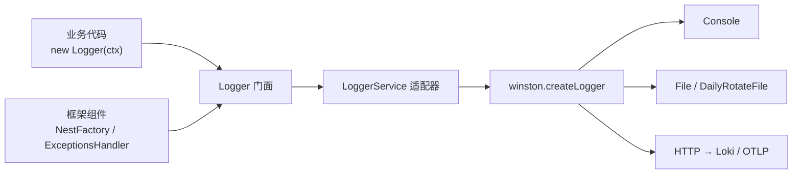

# 第 28 章 Nest 集成日志框架 Winston

## 两套 API 长得像，参数却不是一回事

先把这件事说清楚：把 Winston 接进 Nest，真正要接的不是「日志」，而是**两边对不上的那句话**。同一行 `logger.log('user created', { userId: 1 })`，Nest 认为那个对象是「要一起记下来的字段」，适配层却可能把它当成「谁打的」这个标签。就像给外国电器配转换插头：电是一样的，插脚形状不一样，硬插要么不通，要么烧掉。

Nest 的 `Logger` 只是门面：`new Logger('DemoService')` 里的字符串是 context，`log(message, ...optionalParams)` 后面可以跟任意个参数。真正决定日志写到哪的是 `LoggerService` 接口的实现；默认实现是 `ConsoleLogger`（第 26 章拆过这层），`WinstonModule.forRoot()` 提供 Winston 实例，启动时还要 `app.useLogger(...)` 才真正换掉默认实现。

Winston 的 API 是 `logger.info(message, meta)`，第二个参数是一个对象。两套签名都叫「日志」，形状却不同：Nest 的 context 是构造时传的字符串，适配层通常把 `{ context: 'DemoService' }` 塞进 meta。如果图省事，把 Nest 的 `optionalParams` 整个当 meta，就会出现下面这种「context 变成对象、DemoService 不见了」的输出。

可以对照 [Nest Logger 文档](https://docs.nestjs.com/techniques/logger) 和 [nest-winston](https://github.com/gremo/nest-winston) 看这层适配。

## 先看接错的样子

Winston 配好了，`WinstonModule.forRoot(...)` 也写进 `AppModule` 了，服务能启动。你随手在 Service 里打一条：

```ts
const logger = new Logger('DemoService');
logger.log('user created', { userId: 1, plan: 'pro' });
```

日志文件里出现的是这个：

```json
{"context":{"plan":"pro","userId":1},"level":"info","message":"user created","timestamp":"2026-11-06T15:48:44.549Z"}
```

`DemoService` 不见了，`context` 变成了一个对象。你以为是字段配错，把 `context` 改成 `service`，结果整个对象还是塞在 `context` 里。再试框架自己打的异常日志：

```json
{"context":"ExceptionsHandler","error":{},"level":"error","message":"adapter blew up","stack":["Error: adapter blew up\n    at ..."]}
```

`error` 是空的，`stack` 是数组不是字符串。日志平台按 `stack` 建索引，直接失效。

这两个都不是 Winston 的问题，而是**适配层的参数协议对不上**。这一章就是把这条接缝焊好。

## 接缝到底在哪

这三层各有各的职责，拆开看：

- **门面**：`@nestjs/common` 的 `Logger` 类。业务代码 `new Logger(OrdersService.name)` 拿到的就是它，`log/warn/error/debug/verbose/fatal` 六个方法。
- **接口**：`LoggerService`，第 26 章讲过，它就是「门面背后真正干活的那个实现」要满足的合同。谁实现它，谁就接管门面背后所有的输出。
- **装配点**：`app.useLogger(instance)`。启动时调用一次，把门面背后的实现换成你的。

关键在第三层：`useLogger` 换的不只是业务代码的 `Logger`，还包括框架内部那些不走依赖注入的组件——`NestFactory` 的启动日志、`RoutesResolver` 的路由映射、`ExceptionsHandler` 的异常捕获（异常过滤器是第 21 章的内容），全都通过同一个静态门面输出。所以只要适配器写对，框架日志和业务日志会落到同一个文件、同一套字段。



图上那条从框架组件指向门面的线，是很多人漏掉的：他们只把自己的 Service 改成注入 Winston，结果框架日志还是走默认 `ConsoleLogger`，一个请求的日志散在两个地方。像公司换了对讲机，只给销售部发了新的，保安和前台还用旧的，出事时两边对不上话。

`LoggerService` 接口一共七个方法：`log`、`error`、`warn`、`debug`、`verbose`、`fatal` 六个输出方法，加一个可选的 `setLogLevels`。只有 `log/error/warn` 是必选的，其余带 `?`。`setLogLevels` 会被 `app.useLogger(['error', 'warn'])` 这种调用触发——也就是说，你传数组时，Nest 调的是当前实现的 `setLogLevels`，而不是换一个实现。想让运行中改级别生效，适配器里得实现它，否则这个调用会被静默忽略。

还有一点容易误解：`new Logger('X')` 每次 new 出来的都是新对象，但它们共享同一个静态 `staticInstanceRef`。`app.useLogger()` 改的是这个静态引用，所以你在任意模块、任意层级 new 出来的 `Logger`，输出都会跟着变。这也解释了为什么适配器必须是个单例——如果每个模块各 new 一个自己的 Winston logger，框架那部分日志仍然走静态引用，两边就分叉了。

## 方案一：nest-winston 的三行接法

社区包 `nest-winston` 提供了现成的 `WinstonModule` 和适配器。装好之后，`AppModule` 里这样配。`forRoot()` 收的就是一份 Winston 配置：`level` 管过滤、`format` 管形状、`transports` 管去处（第 27 章拆过这三件套），原样搬过来即可。

```ts
import { Module } from '@nestjs/common';
import { WinstonModule } from 'nest-winston';
import winston from 'winston';

@Module({
  imports: [
    WinstonModule.forRoot({
      level: 'info',
      format: winston.format.combine(
        winston.format.timestamp(),
        winston.format.errors({ stack: true }),
        winston.format.json(),
      ),
      transports: [
        new winston.transports.Console({
          format: winston.format.combine(winston.format.colorize(), winston.format.simple()),
        }),
        new winston.transports.File({ filename: 'logs/nest.log' }),
      ],
    }),
  ],
})
export class AppModule {}
```

`main.ts` 里两件事不能少：

```ts
const app = await NestFactory.create(AppModule, { bufferLogs: true });
app.useLogger(app.get(WINSTON_MODULE_NEST_PROVIDER));
```

`bufferLogs: true` 让 Nest 在 `useLogger` 生效之前先把启动日志缓冲住，等适配器装好再一次性 flush——就是第 26 章那个摆渡车的办法：人先上车等着，登机口定了再一起走。没有它，`NestFactory` 最早那几行日志会走默认实现，直接打到终端，不进文件。缓冲有上限，默认在 `NestApplication` 初始化时自动 flush；如果你在 `create` 之后、`useLogger` 之前又打了大量日志，可以手动 `app.flushLogs()` 提前排空，免得缓冲区被截断。

跑起来，`logs/nest.log` 里是这样：

```json
{"context":"NestFactory","level":"info","message":"Starting Nest application...","timestamp":"2026-11-06T15:48:07.012Z"}
{"context":"InstanceLoader","level":"info","message":"AppModule dependencies initialized","timestamp":"2026-11-06T15:48:07.012Z"}
{"context":"RoutesResolver","level":"info","message":"ChunkedController {/api/chunked}:","timestamp":"2026-11-06T15:48:07.013Z"}
{"context":"NestApplication","level":"info","message":"Nest application successfully started","timestamp":"2026-11-06T15:48:07.013Z"}
```

```bash
# 终端上是另一套格式，因为 Console transport 单独挂了 format
info: Nest application successfully started {"context":"NestApplication","timestamp":"2026-11-06T15:48:07.013Z"}
```

到这里看着都对。问题出在业务代码开始打结构化参数的那一刻。

## 坑一：结构化参数被当成 context

nest-winston 2.0 的适配器方法签名是：

```ts
log(message: any, context?: string) {
  context = context || this.context;
  ...
  return this.logger.info(message, { context });
}
```

它只认两个位置：`message` 和 `context`。这是 Nest 11 及以前的协议——第三个及以后的参数才是可选的上下文/堆栈。而 Nest 12 的门面签名变成了：

```ts
log(message: any, ...optionalParams: [...any, string?]): void;
```

**末尾那个字符串才是 context，它前面的对象全是结构化参数。** 适配器没做这个区分，于是 `logger.log('user created', { userId: 1, plan: 'pro' })` 里的对象被当成 `context`，执行 `Object.assign({ context }, meta)` 之后，`context` 字段就成了那个对象，真正的 `DemoService` 被覆盖。

这就是开头那条日志的来历。修法有两个：业务代码退回旧写法 `logger.log('user created', 'DemoService')`（丢掉结构化参数，不推荐），或者不用这个适配器。

## 坑二：Error 被 JSON 序列化成空对象

第二个坑更隐蔽。nest-winston 的 `error` 分支：

```ts
if (message instanceof Error) {
  const { message: msg, name, stack } = message;
  return this.logger.error(msg, { context, stack: [trace || stack], error: message });
}
```

两个问题：

1. `error: message` 直接放了 `Error` 实例。`JSON.stringify(new Error('x'))` 的结果是 `{}`——`message`、`stack` 都是不可枚举属性。所以日志里 `"error":{}`。
2. `stack: [trace || stack]` 包了一层数组。Winston 的 `format.errors({ stack: true })` 只处理顶层 `stack` 是字符串的情况，数组原样透传。

日志平台里 `error.message` 查不到、`stack` 不是字符串，告警规则全部要重写。这就像把一封信装进信封又套了个箱子：地址写在信封上，你却只把箱子递给邮局，邮局只能看到箱子。

## 方案二：写一个 40 行的适配器

既然协议对不上，就自己实现 `LoggerService`。核心只有一件事：**把 `optionalParams` 拆成「末尾的 context」和「前面的对象」**。

```ts
import type { LoggerService } from '@nestjs/common';
import winston from 'winston';

type Meta = Record<string, unknown>;

const merge = (items: unknown[]): Meta =>
  items.reduce<Meta>(
    (acc, item) => (item && typeof item === 'object' ? { ...acc, ...(item as Meta) } : acc),
    {},
  );

const text = (message: unknown): string =>
  message instanceof Error
    ? message.message
    : typeof message === 'string'
      ? message
      : JSON.stringify(message);

export class WinstonLogger implements LoggerService {
  constructor(private readonly logger: winston.Logger) {}

  private write(level: 'info' | 'warn' | 'error' | 'debug', message: unknown, params: unknown[]): void {
    const rest = [...params];
    const context = typeof rest.at(-1) === 'string' ? (rest.pop() as string) : undefined;
    const stack = typeof rest.at(-1) === 'string' ? (rest.pop() as string) : undefined;

    this.logger.log(level, text(message), {
      ...merge(rest),
      ...(context ? { context } : {}),
      ...(stack ?? (message instanceof Error ? message.stack : undefined)
        ? { stack: stack ?? (message as Error).stack }
        : {}),
      ...(message instanceof Error ? { error: { name: message.name, message: message.message } } : {}),
    });
  }

  log(message: unknown, ...params: unknown[]): void { this.write('info', message, params); }
  warn(message: unknown, ...params: unknown[]): void { this.write('warn', message, params); }
  error(message: unknown, ...params: unknown[]): void { this.write('error', message, params); }
  debug(message: unknown, ...params: unknown[]): void { this.write('debug', message, params); }
  verbose(message: unknown, ...params: unknown[]): void { this.write('debug', message, params); }
  fatal(message: unknown, ...params: unknown[]): void { this.write('error', message, params); }
}
```

`main.ts` 里直接 new：

```ts
const logger = winston.createLogger({
  level: 'info',
  format: winston.format.combine(
    winston.format.timestamp(),
    winston.format.errors({ stack: true }),
    winston.format.json(),
  ),
  transports: [new winston.transports.File({ filename: 'logs/custom.log' })],
});

const app = await NestFactory.create(AppModule, { bufferLogs: true });
app.useLogger(new WinstonLogger(logger));
```

注意 logger 是在 `NestFactory.create` **之前**创建的，不是模块里通过依赖注入拿的。原因是 `NestFactory` 自己就要打日志，那时候容器还没起来，拿不到 provider。如果你确实想把它放进模块（比如要用 `ConfigService` 读级别和目录），可以保留 `bufferLogs` 并在 `create` 之后用 `app.get` 取出来；但别在 `create` 之前去 `app.get`，那时 `app` 还不存在。

同样的业务代码，现在输出是：

```json
{"context":"DemoService","level":"info","message":"user created","plan":"pro","timestamp":"2026-11-06T15:49:25.392Z","userId":1}
{"context":"DemoService","level":"warn","limit":100,"message":"quota nearly full","timestamp":"2026-11-06T15:49:25.393Z","used":95}
{"context":"ExceptionsHandler","error":{"message":"adapter blew up","name":"Error"},"level":"error","message":"adapter blew up","stack":"Error: adapter blew up\n    at ChunkedController.boom (.../chunked.controller.ts:14:11)\n    at ...","timestamp":"2026-11-06T15:49:25.392Z"}
```

`context` 回到了 `DemoService`，`userId`/`plan` 摊在顶层，`stack` 是字符串，`error` 是 `{name, message}` 而不是 `{}`。

顺手验一下异常路径。控制器里故意抛一个错：

```bash
curl -s http://localhost:3000/api/chunked/boom
# {"statusCode":500,"message":"Internal server error"}
```

客户端只看到一句笼统的 500——这是对的，堆栈不能返回给调用方。同时日志文件里是完整的：

```json
{"context":"ExceptionsHandler","error":{"message":"adapter blew up","name":"Error"},
 "level":"error","message":"adapter blew up",
 "stack":"Error: adapter blew up\n    at ChunkedController.boom (.../chunked.controller.ts:14:11)\n    at ...",
 "timestamp":"2026-11-06T15:49:25.392Z"}
```

响应和日志的这一分工，是异常处理的基本盘：**给用户看的和给排查用的，从来不是同一份内容**。适配器如果直接把 `message` 塞进响应，等于把内部实现暴露出去；反过来，日志里只有 `Internal server error` 而没有堆栈，排查时等于什么都没记。

有一个取舍要说明：`verbose` 我映射到了 `debug`，`fatal` 映射到 `error`。Winston 的级别是 `error/warn/info/http/verbose/debug/silly`，Nest 是 `fatal/error/warn/log/debug/verbose`。两边名字不完全对得上，映射方案没有标准答案，关键是在告警规则里统一——比如把 `fatal` 映射成 `error` 同时加 `"fatal": true` 字段，别让级别名在两边漂移。

## 让 requestId 自动出现

适配器只管格式，不负责请求上下文。要在每条日志上带 `requestId`，用 `AsyncLocalStorage` 最省事。它像是给每个进门的人发一个手环，之后不管走到哪个柜台，工作人员抬手就能看到编号（第 27 章讲 `child()` 时提过同样的思路，这里是它在 Nest 里的落地）。

```ts
import { AsyncLocalStorage } from 'node:async_hooks';

export const traceStore = new AsyncLocalStorage<{ requestId: string }>();

// 中间件里
app.use((req, res, next) => {
  traceStore.run({ requestId: req.headers['x-request-id'] as string ?? crypto.randomUUID() }, next);
});
```

然后在 Winston 的 format 里读出来：

```ts
const withTrace = winston.format((info) => {
  const requestId = traceStore.getStore()?.requestId;
  return requestId ? { ...info, requestId } : info;
});

format: winston.format.combine(withTrace(), winston.format.timestamp(), winston.format.json())
```

`withTrace()` 必须放在 `json()` 之前。format 是管道，后面的函数拿到的是前面函数的返回值，顺序错了字段就进不去。

验证方式很直接：同一个请求里打三条日志，`grep requestId logs/custom.log` 应该三条都命中；不同请求的 `requestId` 不同。异步并发的场景（`Promise.all` 里各打一条）也要验一次，`AsyncLocalStorage` 在 `await` 之后仍然能拿到正确的 store——这是它相对「全局变量存 requestId」的唯一优势，也是必须用它的理由。

## 日志轮转：别让文件无限长

`File` transport 只会追加，不会删。上线一周，`logs/` 能到几十 GB。换成 `DailyRotateFile`：

```ts
import 'winston-daily-rotate-file';

new winston.transports.DailyRotateFile({
  dirname: 'logs',
  filename: 'app-%DATE%.log',
  datePattern: 'YYYY-MM-DD',
  maxSize: '100m',
  maxFiles: '14d',
  zippedArchive: true,
});
```

```text
logs/
├── app-2026-11-06.log
├── app-2026-11-05.log.gz
└── app-2026-11-04.log.gz
```

（以上目录结构为示例输出，本机没有持续运行到跨天，未实测轮转效果。）

三个参数容易配错：

- `maxSize` 单独用不会删旧文件，必须配 `maxFiles`；
- `maxFiles: '14d'` 是按文件 mtime 算的，不是按文件名里的日期；
- `zippedArchive: true` 只压缩已经被切走的文件，当前正在写的那个永远是明文。

另外，容器里写本地文件要挂 volume，否则容器一重建日志就没了——这一点在 031 写 Dockerfile 时会再碰到。

## 几个真会踩的点

| 现象 | 原因 | 处理 |
| --- | --- | --- |
| 启动日志没进文件 | 没开 `bufferLogs` | `NestFactory.create(AppModule, { bufferLogs: true })` |
| `context` 变成对象 | 适配器把结构化参数当 context | 自己拆 `optionalParams` |
| `error` 是 `{}` | `Error` 的字段不可枚举 | 手动展开 `{name, message}` |
| `stack` 是数组 | 适配器包了一层 | 传字符串 |
| 日志重复两遍 | `useLogger` 调了两次，或同时用了两个 transport | 只装一次，检查 `WinstonModule` 是否被重复 import |
| 测试环境刷屏 | 级别写死 `info` | 从 `ConfigService` 读 `LOG_LEVEL` |
| 时间戳是本地时间 | `timestamp()` 默认本地格式 | 用 `timestamp({ format: () => new Date().toISOString() })` |

最后一条值得展开：跨时区部署时，本地时间会让日志排序错乱。统一 ISO 8601 带 `Z`，采集端再按用户时区展示，是唯一不会出错的做法。

## 这条管道值不值

接完这一套，你得到的是：框架日志和业务日志同一个文件、同一套字段、同一个 `requestId`；`Error` 能被检索；文件会轮转；级别能按环境调。

代价是四十行适配器加一个社区包。如果只用内置 `ConsoleLogger`，这些都要自己再实现一遍，而且大概率实现得更差。

下一篇换场景：代码要打包上服务器了。Docker 是什么、为什么前端也要懂它，从一个能双击安装的桌面应用讲起。


<!-- chapter-nav:start -->
---

← 上一篇：[027 为什么Node里要用Winston打印日志](027-为什么Node里要用Winston打印日志.md) · [本 Part 目录](_part.md) · 下一篇：[029 通过Desktop学Docker也太简单了](../part-02/029-通过Desktop学Docker也太简单了.md) →
<!-- chapter-nav:end -->
