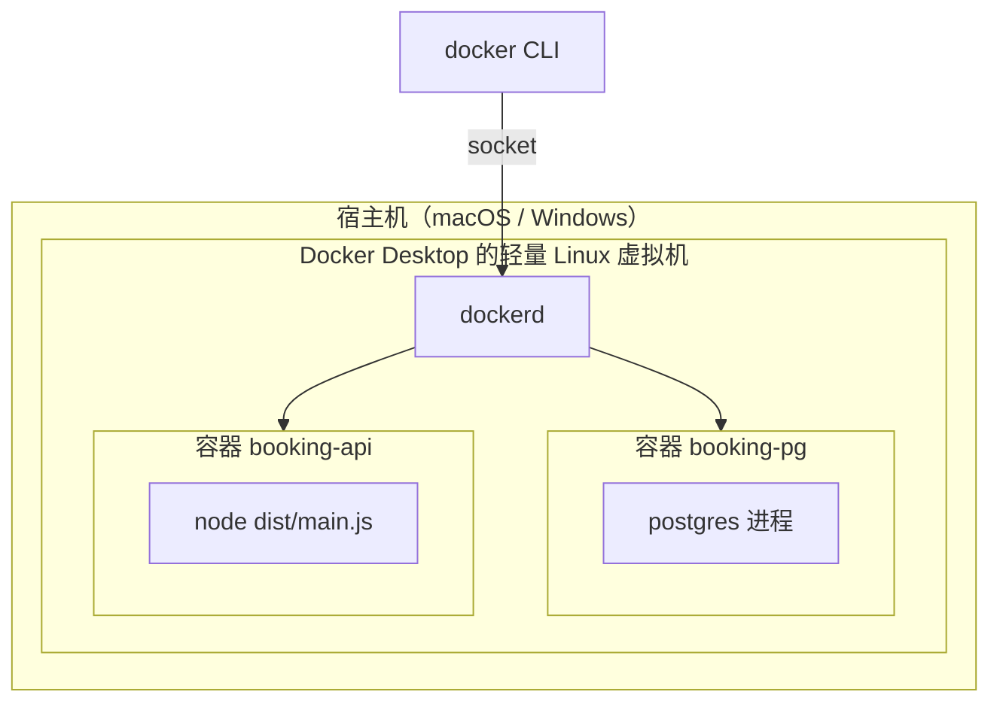

# 第 29 章 通过 Desktop 学 Docker 也太简单了

新同事周一入职，clone 完仓库，`pnpm install` 跑了四分钟，`pnpm start:dev` 报 `Error: connect ECONNREFUSED 127.0.0.1:5432`。你让他装 PostgreSQL 17，他装完发现端口被本机另一个数据库占了；改完端口，Prisma 迁移又因为版本差了一个小号失败。一个上午没了。

这类问题的根源不是谁技术差，而是**「运行环境」这件事从来没被当成代码来管理**。Node 版本、系统库、数据库、环境变量，散落在每个人的机器上，靠口头约定同步。Docker 做的事很朴素：把应用和它需要的那一层环境一起打包，变成可以复制、可以版本化的东西。

这一章不碰内核（033 再拆），先把「镜像、容器、卷、网络」四个对象的关系摆正，再真跑一个 Postgres。本机没装 Docker，所以下面的命令输出都标注为示例输出，结构和字段与真实 `docker` 一致，但没在你这台机器上跑过。

## 先拆掉一个误解：容器不是小虚拟机

这是学 Docker 第一个要纠正的直觉。虚拟机虚拟出整套硬件，每台跑自己的内核；容器不虚拟硬件，它只是宿主机上**被隔离的进程**——用 **namespace** 隔开进程能看到的东西（网络、文件系统挂载、PID），用 **cgroup** 限制它能用的资源（CPU、内存）。用白话讲：namespace 决定「你看得见什么」，cgroup 决定「你最多能用多少」；两者都是 Linux 内核能力，033 会拆到系统调用层。[Docker overview](https://docs.docker.com/get-started/docker-overview/) 和 [namespaces(7)](https://man7.org/linux/man-pages/man7/namespaces.7.html) 可以先扫一眼。

两个直接后果：容器启动是毫秒到秒级，不是虚拟机的几十秒；容器里不能换内核、也不能跑一个架构不同的镜像。



Mac 上 `docker info` 看到的 `OSType` 是 `linux`，不是 `darwin`，因为 `dockerd` 跑在 Desktop 拉起的那台 Linux 虚拟机里。你在终端敲的 `docker` 只是客户端，通过 socket（默认是 `/var/run/docker.sock` 这个 Unix 套接字）把请求送进去。Windows 用 WSL2 做同一件事。

## 四个对象，一次说清

后面所有命令，本质上都在操作这四个东西：

- **镜像**（image）：只读模板，按层叠好的文件系统快照加一份启动配置。`postgres:17-alpine` 就是一份镜像，`docker pull` 只把它拉到本地，它不会运行。
- **容器**（container）：镜像的一次运行实例。Docker 在只读层之上加一个可写层，再启动镜像里声明的进程。进程退出，容器就变成 `Exited`——`docker ps` 里显示 `Up`，靠的是那个前台进程还活着。
- **卷**（volume）：由 Docker 管理的持久化存储，生命周期和容器解耦。容器换多少个，卷里的数据都在。
- **网络**（network）：决定容器能看见谁。同一个自定义网络里，容器名可以直接当主机名用。

理解「可写层」是理解后面所有坑的钥匙：容器里写的文件，写在可写层；`docker rm` 删容器，可写层一起消失。数据库把数据目录放在可写层里，等于拿容器的命当磁盘用。

镜像这边还有一个「分层」的性质，直接决定了 030 怎么写 Dockerfile：镜像由一层层只读文件系统叠起来，每条构建指令加一层。相同的基础层在不同镜像之间共享，磁盘上只存一份，`docker pull` 也只拉本地缺的层。所以「换一个更小的基础镜像」能省下的空间，往往比删几个文件多得多——后者只是在最上层记了一笔「已删除」，底下的层还在。真要减体积，得让被删的东西从一开始就不进入那一层。

## 从 hello-world 到真的 Postgres

装好 Desktop 后先确认客户端和守护进程能通：

```bash
docker version
```

```text
Client:
 Version:           28.5.1
 OS/Arch:           darwin/arm64
Server: Docker Desktop 4.49.0 (208003)
 Engine:
  Version:          28.5.1
  OS/Arch:          linux/arm64
```

（示例输出，未实测。）`Client` 是 Mac 上的命令行，`Server` 是虚拟机里的引擎，两个 `OS/Arch` 不一样是正常的。

`docker run hello-world` 能跑通，只证明安装成功，证明不了卷和网络。直接上项目要用的 PostgreSQL 17：

```bash
docker pull postgres:17-alpine

docker run -d --name booking-pg \
  -e POSTGRES_USER=meeting \
  -e POSTGRES_PASSWORD=meeting \
  -e POSTGRES_DB=meeting_booking \
  -p 127.0.0.1:5432:5432 \
  -v booking-pg-data:/var/lib/postgresql/data \
  postgres:17-alpine
```

逐段拆：

- `17-alpine` 是标签。`17` 是主版本，`alpine` 是体积更小的发行版变体。**别写 `latest`**——今天拉到的和下周拉到的可能不是一个东西，而数据库镜像的大版本升级往往伴随数据目录不兼容。
- `--name booking-pg`：容器名。后面的日志、`exec`、网络 DNS 解析都靠它。
- `-e` 三个环境变量只在**数据目录为空、镜像执行初始化**时生效。卷里已经有数据了，再改密码不会生效。
- `-p 127.0.0.1:5432:5432` 的格式是「宿主机地址:宿主机端口:容器端口」。带上 `127.0.0.1` 表示只允许本机访问；写成 `5432:5432` 会监听所有网卡。
- `-v booking-pg-data:/var/lib/postgresql/data` 把命名卷挂到数据目录。卷不存在时 Docker 自动创建。
- `-d` 后台运行。

起来之后先看状态：

```bash
docker ps --filter name=booking-pg
```

```text
CONTAINER ID   IMAGE                COMMAND                  CREATED         STATUS         PORTS                      NAMES
c1f0a9d2e7b4   postgres:17-alpine   "docker-entrypoint.s…"   9 seconds ago   Up 8 seconds   127.0.0.1:5432->5432/tcp   booking-pg
```

`STATUS` 是 `Up` 说明进程活着。如果是 `Exited (1)`，先 `docker logs booking-pg`，九成是端口被占或卷权限不对。再看日志：

```bash
docker logs --tail 5 booking-pg
```

```text
2026-11-06 07:12:41.882 UTC [1] LOG:  database system is ready to accept connections
```

最后进容器确认能连：

```bash
docker exec -it booking-pg psql -U meeting -d meeting_booking
```

```text
psql (17.6)
Type "help" for help.

meeting_booking=#
```

`docker exec` 进的是容器里的命名空间，你看到的 `psql`、`/var/lib/postgresql/data` 都是容器视角，不是 macOS 的路径。建张表、插一条：

```sql
create table smoke_test (id bigserial primary key, note text not null);
insert into smoke_test (note) values ('data lives in the volume');
select * from smoke_test;
```

```text
 id |          note
----+-------------------------
  1 | data lives in the volume
(1 row)
```

## 删掉容器，数据还在吗

这是整章最值得亲手做的一步。

```bash
docker volume ls --filter name=booking-pg-data
```

```text
DRIVER    VOLUME NAME
local     booking-pg-data
```

```bash
docker rm -f booking-pg
```

然后用**一模一样**的 `docker run` 命令再起一个。镜像不用重拉，卷还在。进去查：

```bash
docker exec -i booking-pg psql -U meeting -d meeting_booking \
  -c 'select * from smoke_test;'
```

```text
 id |          note
----+-------------------------
  1 | data lives in the volume
(1 row)
```

数据还在，因为它从来不在容器里。这里有三条边界要记住：

- `docker rm` 删容器和可写层，**不删命名卷**；要删卷得显式 `docker volume rm booking-pg-data`。
- `docker rm -v` 的 `-v` 只处理**匿名卷**，不会动你命名的卷。
- `docker compose down -v` 会删 compose 文件里声明的命名卷——执行前看清楚，这条命令在生产环境等同于删库。

那能不能把宿主机目录直接挂进去？可以，开发时挂源码很方便：

```bash
-v "$PWD/pgdata:/var/lib/postgresql/data"
```

但数据库不建议。Desktop 的绑定挂载要经过文件共享层，IO 比卷慢；Postgres 初始化时还会改目录权限，macOS 下经常报 `could not change permissions of directory`。**数据库用命名卷，源码/配置/日志才考虑绑定挂载。**

## 容器之间不叫 localhost

现在把网络补上。默认 `bridge` 网络里，容器之间只能用 IP 互访，容器名不解析。自建一个网络：

```bash
docker network create booking-net
docker network connect booking-net booking-pg
```

起一个一次性客户端，和数据库同网络：

```bash
docker run --rm --network booking-net \
  -e PGPASSWORD=meeting \
  postgres:17-alpine \
  psql -h booking-pg -U meeting -d meeting_booking \
  -c 'select count(*) from smoke_test;'
```

```text
 count
-------
     1
(1 row)
```

`-h booking-pg` 能通，是 Docker 内置 DNS 把容器名解析成了地址。换成 `localhost` 就失败：

```text
psql: error: connection to server at "localhost" (::1), port 5432 failed: Connection refused
```

每个容器有自己的网络命名空间，`localhost` 指向它自己，而那个一次性客户端里没有 Postgres。`-p` 发布的是「宿主机 → 容器」的入口，不是「容器 → 容器」的入口。容器要访问宿主机上的服务，Desktop 用 `host.docker.internal`；Linux 上得加 `--add-host=host.docker.internal:host-gateway`。

这也是 031 写连接串时最容易错的地方：`DATABASE_URL` 里的 host，取决于**这段配置在容器里跑还是在宿主机跑**，同一个值换个执行位置就不成立。

## 每天都会用的几条

| 目的 | 命令 | 关键点 |
| --- | --- | --- |
| 看运行中的容器 | `docker ps` | 加 `-a` 连已退出的也看，排障第一步 |
| 跟日志 | `docker logs -f --tail 100 booking-pg` | `-f` 一直挂着，Ctrl-C 只退日志不停容器 |
| 进容器 | `docker exec -it booking-pg sh` | 镜像里没 bash 时用 `sh`，`-it` 才有交互终端 |
| 看配置 | `docker inspect booking-pg` | JSON 太长，用 `--format '{{.State.Status}}'` 取字段 |
| 看端口 | `docker port booking-pg` | 确认发布关系，不是看应用有没有监听 |
| 看资源 | `docker stats --no-stream` | 容器视角的 CPU/内存，和宿主机 `top` 对不上是正常的 |
| 清垃圾 | `docker system df` | 先看占用再决定删什么，别直接 `prune -a` |

## 几个会咬人的边界

**端口冲突。** 本机已有 Postgres 占着 5432 时，`docker run` 报 `Bind for 0.0.0.0:5432 failed: port is already allocated`。要么停本机的，要么换 `-p 127.0.0.1:5433:5432`，连接串端口跟着改 5433。容器里的 5432 不用动。

**环境变量只在初始化时生效。** 卷里已有 `PGDATA`，改 `POSTGRES_PASSWORD` 不会改密码。要么进库 `ALTER USER`，要么重建卷。生产别把密码写进 `docker run` 历史，用 secret 或 `--env-file`。

**卷不是备份。** 卷只保证容器删除后数据还在；误删表、`docker volume rm`、磁盘坏了都救不回来。备份得靠 `pg_dump` 或快照。

**Apple Silicon 的架构。** 拉镜像时 Docker 会选和虚拟机匹配的架构；只有 `amd64` 的镜像会走 QEMU 模拟，能跑但慢。先 `docker image inspect <image> --format '{{.Architecture}}'` 看清楚，再决定要不要 `--platform linux/amd64`。

**Desktop 的资源是虚拟机资源。** CPU、内存、磁盘上限在 Settings → Resources 里。容器里 `free` 看到的是那台虚拟机，不是你的 Mac。

四个对象摆正之后，`docker run` 那串参数就不再是死记硬背：`-p` 是网络、`-v` 是卷、`-e` 是启动配置、镜像名决定里面有什么。下一章反过来——不用别人的镜像，自己写一个 Dockerfile，把 Node 服务打成镜像。

想更深入的话，官方文档里有这几页可以接着看：[Docker overview](https://docs.docker.com/get-started/docker-overview/)（镜像、容器、卷、网络这几个对象的关系，对应“四个对象，一次说清”）、[Volumes](https://docs.docker.com/engine/storage/volumes/)（卷存在哪、怎么挂、容器删了为什么还在，对应“删掉容器，数据还在吗”）、[Bridge network driver](https://docs.docker.com/engine/network/drivers/bridge/)（默认网络怎么给容器分 IP、容器名怎么互相访问，对应“容器之间不叫 localhost”）、[docker run](https://docs.docker.com/reference/cli/docker/container/run/)（`-p`、`-v`、`-e` 这些参数各自管什么，对应文末“四个对象摆正之后”）。

<!-- chapter-nav:start -->
---

← 上一篇：[028 Nest集成日志框架Winston](../part-01/028-Nest集成日志框架Winston.md) · [本 Part 目录](_part.md) · 下一篇：[030 你的第一个Dockerfile](030-你的第一个Dockerfile.md) →
<!-- chapter-nav:end -->
