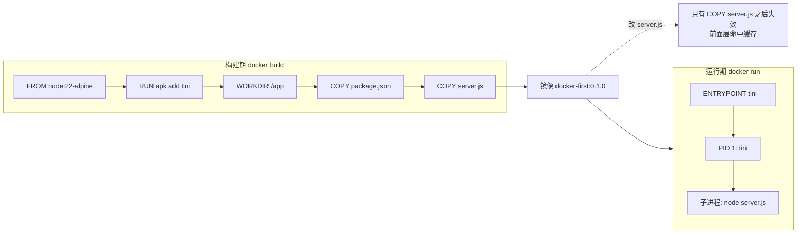

# 第 30 章 你的第一个 Dockerfile

一个 `tar.gz` 交付过去，里面是 `server.js` 和 `package.json`，对方一跑就报 `SyntaxError: Unexpected token 'with'`：本地是 Node 22，服务器上是 20，代码里用了 ESM 的 JSON 导入属性。

问题不在代码，在「交付物」：你交的是**源码**，运行它的环境还留在你机器上。Dockerfile 要交的是**源码 + 运行环境 + 启动方式**，三样写进一份可以重复执行的文本（[Dockerfile reference](https://docs.docker.com/reference/dockerfile/) 是完整指令表）。`docker build` 出来的镜像在谁的机器上都一样——镜像和容器的关系，第 29 章第一次讲过：镜像是模具，容器是照着模具做出来的那一份。

这一章从一个不依赖任何第三方库的小服务开始，写完第一份 Dockerfile。本机没有 Docker，所以 `docker build`/`docker run` 的输出都标了「示例输出，未实测」；前半段在宿主机上跑服务的输出是真跑过的。

## 先写服务，先在宿主机跑通

把依赖拿掉，只留 Node 标准库，这样出问题时范围最小。目录长这样：

```text
docker-first/
├── .dockerignore
├── Dockerfile
├── package.json
└── server.js
```

`package.json` 里最关键的是 `"type": "module"`，Node 靠它把 `.js` 当 ESM 解析；`engines` 只是给人看的约束，Docker 构建时不会检查。

```json
{
  "name": "docker-first",
  "private": true,
  "type": "module",
  "scripts": { "start": "node server.js" },
  "engines": { "node": ">=22.12.0" }
}
```

`server.js` 提供一个 `/health`，其余路径 404，并且显式监听 `0.0.0.0`：

```js
import { createServer } from 'node:http';

const port = Number(process.env.PORT ?? 3000);
const startedAt = Date.now();

const server = createServer((req, res) => {
  if (req.url === '/health') {
    res.writeHead(200, { 'content-type': 'application/json' });
    res.end(JSON.stringify({ status: 'ok', uptime: Math.round((Date.now() - startedAt) / 1000) }));
    return;
  }
  res.writeHead(404, { 'content-type': 'application/json' });
  res.end(JSON.stringify({ error: 'not found' }));
});

server.listen(port, '0.0.0.0', () => console.log(`listening on 0.0.0.0:${port}`));

const shutdown = (signal) => {
  console.log(`${signal} received, closing`);
  server.close((error) => {
    if (error) {
      console.error(error);
      process.exit(1);
    }
    process.exit(0);
  });
};

process.on('SIGTERM', () => shutdown('SIGTERM'));
process.on('SIGINT', () => shutdown('SIGINT'));
```

`0.0.0.0` 这行在容器里是关键。你可以把它想成「门牌挂在哪一面墙上」：只听 `127.0.0.1`，相当于门只朝屋里开，端口映射从外面进来也敲不到门；监听 `0.0.0.0` 才是朝所有网卡开门。先在宿主机验证：

```bash
PORT=3100 node server.js
```

```text
listening on 0.0.0.0:3100
```

```bash
curl -s http://localhost:3100/health
# {"status":"ok","uptime":1}
curl -s -o /dev/null -w "%{http_code}\n" http://localhost:3100/nope
# 404
kill -TERM $(lsof -ti:3100)
# 进程输出 SIGTERM received, closing
```

跳过这一步，容器起不来时你分不清是代码问题、镜像问题还是端口问题。

## 第一份 Dockerfile

先分清三个词，它们后面会一直出现。

**基础镜像**（`FROM`）是起点，像买现成的毛坯房：里面已经有一套能跑 Node 的完整用户空间，你只是在它上面添家具。没有它，你得从空内核开始装系统，那就不是写 Dockerfile 了。

**层**（layer）是每条指令的产出，像千层饼，一层压一层。Docker 会缓存没变化的层，所以指令顺序直接决定一次构建是几秒还是几分钟。它和「镜像」的区别是：镜像是整块饼，层是做饼时留下的每一层。

**构建上下文**（`docker build` 最后那个 `.`）是你送进车间的材料目录，`COPY` 只能从里面取文件。它决定要传多少数据，也决定会不会把 `.env`、`.git` 打进镜像。

还有两个阶段别混：`docker build` 只产出镜像，`docker run` 才把镜像跑成容器。Dockerfile 不管镜像推到哪、也不管多机编排，那是第 31、34 章的事。

在项目根目录建 `Dockerfile`：

```dockerfile
FROM node:22-alpine

RUN apk add --no-cache tini

WORKDIR /app

COPY --chown=node:node package.json ./
COPY --chown=node:node server.js ./

ENV NODE_ENV=production
ENV PORT=3000

EXPOSE 3000

USER node

ENTRYPOINT ["/sbin/tini", "--"]
CMD ["node", "server.js"]
```

逐条看：

- `FROM node:22-alpine`：基础镜像决定起点，它已经包含 Node 22、npm 和一套 Alpine 用户空间。选 alpine 是因为体积小；代价是 musl libc，装原生模块时可能和 glibc 不兼容。
- `RUN apk add --no-cache tini`：**构建时**执行，结果写进镜像层。`tini` 是几十 KB 的 init 进程，用来当 PID 1，后面单独讲。
- `WORKDIR /app`：创建并切换目录，之后的 `COPY`、`RUN`、`CMD` 都相对它。注意 `RUN cd /app` 只影响当前指令，不会留给下一层，所以必须用 `WORKDIR`。
- `COPY --chown=node:node`：从构建上下文复制文件，同时改好属主。不写 `--chown`，后面要用 `chown -R` 再压一层。
- `ENV NODE_ENV=production`：运行期环境变量。很多库靠它切换行为（比如是否输出调试信息、是否启用缓存），生产镜像别漏。
- `EXPOSE 3000`：只是元数据和文档，告诉读的人「默认听 3000」，**不发布端口**。真正的发布在 `docker run -p`。
- `USER node`：切到基础镜像自带的非 root 用户（UID 1000）。容器被攻破时，攻击者拿到的不是 root。
- `ENTRYPOINT` 固定入口，`CMD` 默认参数。都用 exec 数组形式，进程才能直接收到信号。

构建、运行：

```bash
docker build -t docker-first:0.1.0 .
```

```text
[+] Building 12.4s (9/9) FINISHED
 => [1/5] FROM docker.io/library/node:22-alpine
 => [2/5] RUN apk add --no-cache tini
 => [3/5] WORKDIR /app
 => [4/5] COPY --chown=node:node package.json ./
 => [5/5] COPY --chown=node:node server.js ./
 => exporting to image
 => => naming to docker.io/library/docker-first:0.1.0
```

（示例输出，未实测。）

```bash
docker run -d --name docker-first -p 3000:3000 docker-first:0.1.0
curl -s http://localhost:3000/health
```

```text
{"status":"ok","uptime":2}
```

（示例输出，未实测。）

`-d` 后台运行，`--name` 给容器起名方便后面 `exec`/`logs`，`-p 3000:3000` 把宿主机 3000 映射到容器 3000。调试时常用 `--rm` 让容器退出后自动删除，免得堆一堆 `Exited` 的记录。

构建完可以看看镜像里每一层占多少：

```bash
docker image ls docker-first
docker history docker-first:0.1.0
```

`docker history` 里真正占空间的是 `FROM` 带进来的基础镜像和 `RUN apk add`；`ENV`、`CMD`、`EXPOSE` 这类只改元数据的指令几乎不增加体积。这也回答了一个常见疑问：为什么加一行 `ENV` 镜像没变大——它改的是配置，不是文件系统。

再确认两件事：1 号进程是谁、当前用户是谁。

```bash
docker exec docker-first cat /proc/1/comm
docker exec docker-first id -un
```

```text
tini
node
```

（示例输出，未实测。）

## 为什么要有 tini 这一层

`/proc/1` 是容器里的 1 号进程。这里它是 `tini`，Node 是它的子进程。

先搞清 1 号进程是什么。在 Linux 里，1 号进程是「所有进程的祖宗」，它要负责两件杂事：把别人发给它的信号转给该收的人，以及给死掉的进程收尸（回收孤儿进程）。容器里没有完整的 init 系统，你 `CMD` 里写的那条命令就直接当了祖宗。

把 `tini` 去掉，直接 `CMD ["node", "server.js"]` 也能跑——Node 自己注册了 SIGTERM 处理函数，`docker stop` 同样能优雅退出。

但只要你写成 shell 形式：

```dockerfile
CMD npm start
```

PID 1 就变成了 `/bin/sh -c "npm start"`。`docker stop` 发的 SIGTERM 打到 shell 上，shell 不会转发给 node，等满 10 秒后 Docker 发 SIGKILL，退出码 137。日志里看不到你写的 `SIGTERM received, closing`，数据库连接、在途请求全部硬断。

`tini` 就是这个「专职传话、顺手收尸」的角色。它解决两件事：转发信号给子进程、回收孤儿进程，代价是一个很小的二进制。判断标准很简单——**只要启动命令不是 exec 数组形式，或者进程本身不处理信号，就该加**。



## 改一行代码，看哪几层还在缓存

层缓存是 Dockerfile 里最影响日常体验的部分。规则只有一句：Docker 按指令顺序逐层构建，某条指令的输入变了，它和它之后的所有层都要重算；前面的层没变就复用。像叠积木，抽掉中间一块，上面的全得重摆。

改一下 `server.js` 里的日志文案，带 `--progress=plain` 重新构建：

```bash
docker build --progress=plain -t docker-first:0.1.0 .
```

```text
#8 [2/5] RUN apk add --no-cache tini
#8 CACHED
#10 [4/5] COPY --chown=node:node package.json ./
#10 CACHED
#11 [5/5] COPY --chown=node:node server.js ./
#11 DONE 0.0s
```

（示例输出，未实测。）`RUN apk add` 和 `COPY package.json` 都是 `CACHED`，只有 `server.js` 那一层重跑。原因很直接：后面的层依赖前面的结果，`server.js` 变了，它之后不可信；`package.json` 没变，前面就不用重来。

这也解释了为什么「装依赖」必须单独占一层，并且放在复制源码之前。写成这样：

```dockerfile
COPY . .
RUN pnpm install --frozen-lockfile
```

你改任何一个 `.ts` 文件，`COPY . .` 的缓存就失效，`pnpm install` 跟着重跑。依赖没变却每次等几分钟，这是最典型的 Dockerfile 写坏的方式。

缓存也不是永久有效：换基础镜像、改构建参数、加 `--no-cache` 都会让它失效；CI 里想跨机器复用，还得配 cache backend，第 31 章会讲。想只让某一层重跑，Docker 28 还支持 `--no-cache-filter=<stage>`，调试构建阶段时比整个 `--no-cache` 省时间。

## 构建上下文和 .dockerignore

`docker build -t docker-first:0.1.0 .` 最后那个 `.` 是构建上下文。Docker 会把这个目录（减去 `.dockerignore` 排除的）打包送给构建器，`COPY` 只能看见上下文里的文件，看不见外面的路径。

所以上下文里如果有 `node_modules`、`.git`、`.env`，每次构建都要传一遍；`COPY . .` 还会把密钥和历史一起打进镜像。写一个 `.dockerignore`：

```text
node_modules
dist
coverage
.git
.gitignore
.env
.env.*
*.log
.DS_Store
```

改完再构建，开头 `transferring context` 的大小会明显下降。`.dockerignore` 语法和 `.gitignore` 类似，但服务对象不同——一个给构建器，一个给 Git，两个都要维护。

还有一个常见误会：`COPY . .` 之后补一句 `RUN chown -R node:node /app`。这一条会把所有文件复制进新层，镜像直接翻倍；能在 `COPY` 上写 `--chown` 就别事后改属主。

还有个反直觉的点：Dockerfile 本身在上下文里，但 `COPY` 不会自动把它弄进镜像。有人为了「镜像里留一份 Dockerfile」写 `COPY . .`，结果把 `.git`、测试数据、`.env` 全带进去，本末倒置。

顺带分清 `ARG` 和 `ENV`：`ARG` 只在构建期存在，`docker build --build-arg` 传入，适合指定版本号、镜像源；`ENV` 会保留到运行期，容器里 `printenv` 能看到。两者都不安全——都会留在镜像元数据里，密码放哪一份都会被 `docker history` 翻出来。

## 几个会咬人的边界

| 现象 | 原因 | 处理 |
| --- | --- | --- |
| 宿主机访问 `localhost:3000` 不通 | 只写了 `EXPOSE`，没发布端口 | `docker run -p 3000:3000` |
| 容器里连 `localhost:5432` 失败 | 容器内的 `localhost` 是它自己 | 用服务名或 `host.docker.internal` |
| 改了代码镜像里还是旧的 | 缓存复用了旧层 | 检查 `COPY` 顺序，必要时 `--no-cache` |
| 启动报 `permission denied` | 非 root 用户，但目录属主是 root | `COPY --chown` 或提前 `chown` |
| `docker stop` 等 10 秒后退出 137 | 信号没到 Node，超时被 SIGKILL | exec 形式，别用 `npm start` 包一层 |

再补几条：

- **`EXPOSE` 只是元数据**，不发布端口、也不改运行时行为；端口靠 `-p` 映射。同理 `STOPSIGNAL` 只换信号，进程不处理 `SIGTERM` 的话，`docker stop` 照样等满 10 秒再 137。
- **别在 `RUN`/`ENV`/`ARG` 里写密钥**。镜像层会保留历史，`docker history` 能看到；`ARG` 也会进镜像元数据。运行时用 `-e`、secret mount 或编排平台的 Secret。
- **alpine 不是所有依赖都能装**。带原生扩展的包要针对 musl 编译，`sharp`、`bcrypt` 这类先确认有没有预编译版本，再决定换不换 `slim`。第 31 章会具体算这笔账。
- **tag 别只用 `latest`**。`docker-first:0.1.0` 至少能让你知道线上跑的是哪次构建，回滚有坐标。

一个小服务能跑起来之后，Nest 项目会多出四件事：TypeScript 要先编译、pnpm 依赖要分层、Prisma 8 的契约产物要带上、非 root 用户要能写日志目录。下一章把这些一次理顺。


<!-- chapter-nav:start -->
---

← 上一篇：[029 通过Desktop学Docker也太简单了](029-通过Desktop学Docker也太简单了.md) · [本 Part 目录](_part.md) · 下一篇：[031 Nest项目如何编写Dockerfile](031-Nest项目如何编写Dockerfile.md) →
<!-- chapter-nav:end -->
