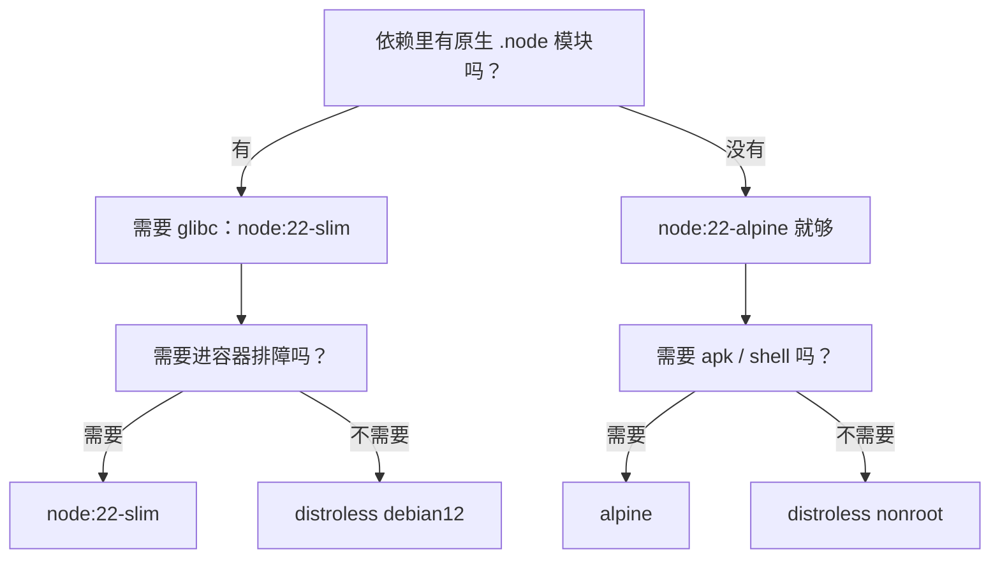

# 第 32 章 提升 Dockerfile 的 5 个技巧

上一章的镜像已经能跑，但 CI 账单不这么看：构建一次九分钟，本地那个 `meeting-booking:1.0.0` 是 1.9GB，安全扫描列了四十多个 HIGH（漏洞严重级别），一半来自构建阶段的工具链。

功能一行没改，成本全在 Dockerfile 的写法上。这三项成本可以拆开看：

- **体积**：决定拉取、存储、扫描各要多久。1.9GB 的镜像，每个节点拉一次就是几分钟。
- **构建时间**：取决于层缓存命中率。九分钟里可能只有一分钟在编译，剩下八分钟在重复装依赖。
- **攻击面**：镜像里每一个包都算，编译器、shell、包管理器全在内。少装一个工具链，扫描结果就少一批漏洞。

下面是五个改动，按「收益/成本」从高到低排。每个都有改前和改后，可以全做，也可以只挑当前最疼的那一项。

## 先量，别猜

改之前先知道大钱花在哪。体积按层拆：

```bash
docker image ls meeting-booking
docker history --format '{{.Size}}\t{{.CreatedBy}}' meeting-booking:1.0.0 | head -20
```

```text
1.9GB  meeting-booking:1.0.0
612MB  RUN /bin/sh -c corepack enable && pnpm install --frozen-lockfile
204MB  RUN /bin/sh -c pnpm build
...
```

（示例输出，本机无 Docker，未实测。）`pnpm install` 那层 612MB，是因为它把 devDependencies、pnpm store 的硬链接、Prisma CLI 全留在了层里；`pnpm build` 那层 204MB 里是 `dist` 加上编译过程的中间产物。看到这两行，顺序就清楚了：先拆阶段，再谈缓存。

构建时间同样能量：`--progress=plain` 每一步都有 `DONE 3.8s` 的耗时，把最慢的几步对回 Dockerfile 行号，就知道该动哪一条。

## 一、多阶段：让 runner 不继承构建环境

单阶段写法通常长这样：

```dockerfile
FROM node:22-alpine
WORKDIR /app
COPY . .
RUN corepack enable && pnpm install --frozen-lockfile && pnpm build
CMD ["node", "dist/main.js"]
```

能跑，但 `COPY . .` 把源码、`.git`、测试数据全带了进去；`pnpm install` 装了 `@nestjs/cli`、TypeScript、Prisma CLI；容器默认 root 启动。最终镜像里同时有编译器和运行时，体积和攻击面都下不来。

改成多阶段，构建阶段随便重，运行阶段只拿产物：

```dockerfile
FROM deps AS build
COPY src ./src
RUN pnpm build

FROM node:22-alpine AS runner
COPY --from=prod-deps --chown=node:node /app/node_modules ./node_modules
COPY --from=build --chown=node:node /app/dist ./dist
COPY --chown=node:node package.json ./
USER node
CMD ["node", "dist/main.js"]
```

判断有没有真分离，别数 Dockerfile 行数，看运行镜像里有什么：

```bash
docker run --rm --entrypoint sh meeting-booking:1.0.0 -c 'ls -1 /app'
```

```text
dist
node_modules
package.json
```

（示例输出，本机无 Docker，未实测。）

看到 `src`、`tsconfig.json`、`prisma/` 就说明复制多了。体积只告诉你结果，`ls /app` 能告诉你原因。

改完再量一次，`docker image ls` 从 1.9GB 掉到 210MB 左右，`docker history` 里最大的层变成生产依赖那 180MB，编译器层整个消失。调试构建阶段也不用改 Dockerfile：`docker build --target build -t meeting-booking:debug .` 停在 build 阶段，进去看 `dist` 有没有生成、Prisma 产物在不在。

## 二、把变化慢的层放前面，再挂 cache mount

层缓存的规则一句话：一条指令的输入变了，它和它后面的层都失效。所以依赖单独一层，源码放后面。

```dockerfile
COPY package.json pnpm-lock.yaml pnpm-workspace.yaml ./
RUN pnpm install --frozen-lockfile

COPY . .
RUN pnpm build
```

改一个 `.ts`，`COPY . .` 失效，`pnpm build` 重跑，但 `pnpm install` 仍命中缓存。反过来写，每次改代码都要重装依赖。

那两个文件也别漏：`pnpm-lock.yaml` 决定装哪些版本，`pnpm-workspace.yaml` 里的 `minimumReleaseAge` 决定 pnpm 怎么解析——少 COPY 一个，依赖层虽然命中了缓存，装出来的树却可能和本地不同，属于「缓存命中但结果不对」的隐蔽 bug。

pnpm 还有一层可省：包已经下载过，但每次构建的容器是新的，全局 store 没了。BuildKit 的 cache mount 能把 store 挂进来：

```dockerfile
RUN --mount=type=cache,id=pnpm-store,target=/pnpm/store \
    pnpm install --frozen-lockfile --store-dir=/pnpm/store
```

`--mount=type=cache` 的目录不写进镜像层，只在构建期可见，所以既加速又不增大镜像。Docker 28 默认 BuildKit，这条能直接跑；老版本要先升级或显式 `DOCKER_BUILDKIT=1`。

验证缓存是否命中，用 `--progress=plain` 看 `CACHED`：

```bash
docker build --progress=plain -t meeting-booking:1.0.0 .
```

```text
#9  [deps 3/3] RUN --mount=type=cache,id=pnpm-store,target=/pnpm/store pnpm install ...
#9  CACHED
#13 [build 5/5] RUN pnpm build
#13 DONE 3.8s
```

（示例输出，未实测。）第二次构建 `pnpm install` 直接 `CACHED`，说明 store 命中；仍然完整跑一遍，先确认两次构建用的是同一个 builder，`id=pnpm-store` 没被改过。

cache mount 只在本机有效。CI 的 runner 每次都是新机器，要配远程缓存：

```bash
docker buildx build \
  --cache-from type=registry,ref=registry.example.com/meeting-booking:buildcache \
  --cache-to type=registry,ref=registry.example.com/meeting-booking:buildcache,mode=max \
  -t meeting-booking:1.0.0 .
```

没有这一步，本地三十秒、CI 九分钟，两头体验对不上。缓存也是供应链的一部分：registry cache 要设读写权限，别让不受信任的构建往里写；构建参数里带 token 时，即使 cache mount 不落盘，也可能留在构建记录里。

## 三、选基础镜像：先看 libc，再看排障

「越小越好」是错的。四种常见选择的差别不在几十 MB，而在**能不能跑你的依赖**：

| 镜像 | 体积（约） | libc | 有 shell | 适合 |
| --- | --- | --- | --- | --- |
| `node:22` | 1.1GB | glibc | 有 | 本地排障、需要编译工具 |
| `node:22-slim` | 200MB | glibc | 有 | 有原生模块的生产镜像 |
| `node:22-alpine` | 130MB | musl | 有 | 纯 JS 依赖，最常见 |
| `distroless/nodejs22` | 80MB | glibc | 无 | 安全要求高、排障靠日志 |



判断有没有原生模块，不用猜：

```bash
find node_modules -name '*.node' -print | head
```

有输出就说明有原生扩展，先在 musl 镜像里跑一次 `node -e "require('那个包')"`；报 `Error relocating` 或 `invalid ELF header`，就换回 glibc 的 `slim`。`bcryptjs` 是纯 JS 不受影响，`sharp`、带 C++ 扩展的驱动就要实测。Prisma 8 的 contract 运行时以 JS 为主，但 CLI 和迁移工具仍可能带原生依赖——这也是迁移不该塞进运行镜像的原因之一。

distroless 的代价要提前算：没有 `wget`，`HEALTHCHECK` 得用 Node 的 `fetch` 写，或者交给 Kubernetes 探针；没有 shell，出问题只能看日志和指标。省下的几十 MB 值不值，取决于你的排障流程，不是镜像排行榜。

## 四、锁 digest，别只锁 tag

`node:22-alpine` 比 `node:22` 稳，但 tag 仍然可以被重新推送：同一个 tag，今天和下周可能指向不同 manifest，构建结果就不可复现。digest 是内容哈希，标签会动，digest 不会。

先拿 digest：

```bash
docker image inspect node:22-alpine --format '{{index .RepoDigests 0}}'
```

```text
node@sha256:9f2a6c1e...（64 位十六进制，示例）
```

把它接在 tag 后面：

```dockerfile
FROM node:22-alpine@sha256:<64位摘要>
```

tag 留给人看，digest 负责锁内容。不要手抄半截，也别写省略号——少一位就报 `invalid reference format`。多架构镜像的 digest 是 manifest list 的哈希，`FROM` 会按当前平台选具体镜像，所以同一个 Dockerfile 在 arm64 和 amd64 上都能构建。

锁完 digest，升级变成一个**有意识的动作**：Renovate 或 Dependabot 提 PR，CI 重新构建、跑扫描、合并。tag 自动漂移的问题没了，代价是每周处理一次升级 PR。生产镜像这个交换通常值得。

但要清楚它锁住了什么：只锁住了基础镜像的字节。`apk add` 装的系统包、`pnpm install` 按 lockfile 拉的包、构建阶段 `apt-get update` 的结果，都不在 digest 里。真正的可复现是三件事一起做——锁 digest、提交 lockfile、把 `apt-get update && apt-get install` 写在同一层并固定版本。

## 五、最小权限、只读根文件系统、持续扫描

默认 `docker run` 给容器 root 用户、一组 capability、可写的根文件系统。应用只需要监听 3000 和读文件，这些权限全是多余的。

Dockerfile 里先切用户（上一章已经做了），运行参数再收一轮：

```bash
docker run -d --name meeting-booking \
  --read-only --tmpfs /tmp \
  --cap-drop=ALL \
  --security-opt no-new-privileges \
  --init \
  -p 3000:3000 \
  meeting-booking:1.0.0
```

- `--read-only` 把根文件系统挂成只读，应用只能写显式挂载的 `/tmp`。Nest 只往 stdout 打日志，所以能跑；代码往 `./logs` 写文件时立刻报 `EROFS`——这是好事，逼你把日志交给采集器。
- `--cap-drop=ALL` 去掉所有 Linux capability。监听 1024 以上端口不需要 `NET_BIND_SERVICE`；真要监听 80，在前面放反向代理，而不是把 capability 加回来。
- `--security-opt no-new-privileges` 阻止 setuid 程序提权，配合非 root 一起用。
- `--init` 注入一个极小的 init 当 PID 1，回收孤儿进程；应用自己处理 SIGTERM 时它不会抢信号。

顺手补两个稳定性参数：`--memory=512m` 让超限的容器被内核 OOM killer 干掉，而不是把宿主拖进 swap；`--pids-limit=256` 挡住 fork 炸弹。Node 22 会读 cgroup 的内存上限来定堆大小，但一个镜像里跑多个进程时，显式 `--max-old-space-size` 仍然更可控。

验证参数真的生效：

```bash
docker inspect --format '{{.HostConfig.ReadonlyRootfs}} {{.HostConfig.CapDrop}}' meeting-booking
docker exec meeting-booking id -u
```

```text
true [ALL]
1000
```

（示例输出，未实测。）

最后把扫描放进 CI，而不是上线前才看一眼：

```bash
trivy image --severity HIGH,CRITICAL --exit-code 1 meeting-booking:1.0.0
```

`--exit-code 1` 让有高危漏洞的构建直接失败。没有 Trivy 就用 Desktop 自带的 `docker scout cves meeting-booking:1.0.0`。关键不是工具，是规则：哪些级别必须修、哪些可以接受、谁来决定。没有这条规则，扫描报告只会变成没人看的附件。

## 五个改动的取舍

收益不一样：多阶段和层缓存立刻改善构建体验，几乎不用权衡；基础镜像要在体积、兼容性、排障能力之间选；digest 用维护成本换可复现；只读根文件和 capability 裁剪可能暴露应用里原本被掩盖的写文件行为，得先改代码再上线。判断从哪下手不用拍脑袋：翻一次 `--progress=plain` 的构建日志、看一次扫描报告，最慢的两层和 CVE 最多的两个包就是答案。

顺序上，先把多阶段和缓存做掉，再看体积和扫描结果，最后加权限限制。反过来先上 `--read-only`，大概率被临时文件写到满屏报错，然后整个安全方案被回滚。

到这里，镜像是怎么被一层层叠出来、又是怎么被内核隔离的，还都是「用」的层面。下一章往下挖：namespace、cgroup、联合文件系统到底怎么落到 Linux 上。

想更深入的话，官方文档里有这几页可以接着看：[Building best practices](https://docs.docker.com/build/building/best-practices/)（多阶段、层顺序、基础镜像选择的官方建议，本章五个技巧的原始出处）、[Build cache](https://docs.docker.com/build/cache/)（缓存挂载和层缓存的工作方式，对应“把变化慢的层放前面，再挂 cache mount”）、[Distroless Node.js](https://github.com/GoogleContainerTools/distroless/blob/main/nodejs/README.md)（这种镜像里有什么、没什么，对应基础镜像选型那张表）、[docker image inspect](https://docs.docker.com/reference/cli/docker/image/inspect/)（这个命令能查哪些字段、格式化输出怎么写，对应锁 digest 和验证只读根文件系统两段）、[Trivy](https://trivy.dev/)（镜像漏洞扫描怎么跑、严重级别和退出码怎么配，对应最后把扫描放进 CI）。

<!-- chapter-nav:start -->
---

← 上一篇：[031 Nest项目如何编写Dockerfile](031-Nest项目如何编写Dockerfile.md) · [本 Part 目录](_part.md) · 下一篇：[033 Docker是怎么实现的](033-Docker是怎么实现的.md) →
<!-- chapter-nav:end -->
