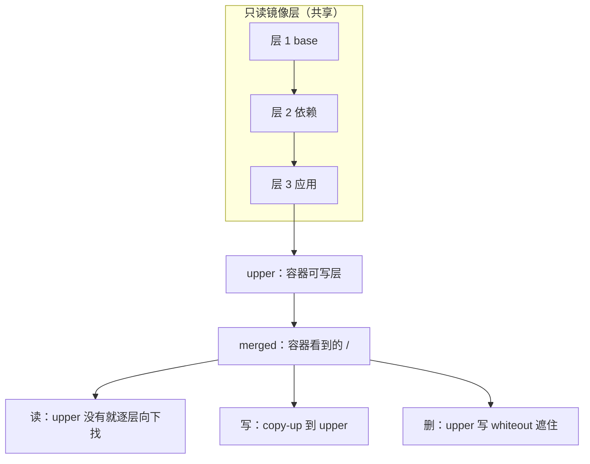
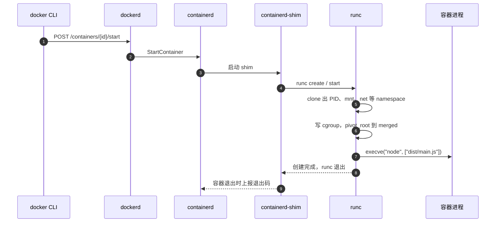

# 第 33 章 Docker 是怎么实现的

## 容器到底是啥：四个内核机制

容器里 `ps` 只看到两个进程，不是因为容器里真的只有两个进程，而是因为 **namespace** 把「进程表」换了一份：容器内的 1 号进程在宿主机上是另一个 PID，`ps` 读的是容器自己那份名字表。namespace 管的是「你能看见什么」——PID、网络接口、挂载点、主机名、IPC、用户 ID 都可以各有一份。

容器突然消失、退出码 137，则通常是 **cgroup** 干的：它给一组进程记账，`memory.max` 一到就触发 OOM killer，发 SIGKILL，退出码就是 128+9=137。cgroup 管的是「你最多能用多少」——CPU、内存、进程数、I/O。

容器的根目录来自 **overlayfs**：只读的镜像层在下面，薄薄的可写层在上面，合并成容器看到的 `/`；写文件时触发 copy-up，删文件时留一个 whiteout。把进程真正造出来的是 **runc**：它按 OCI 规范调用 clone/unshare 建 namespace、写 cgroup、切根目录，然后 exec 你的命令。

这四个词都有官方说明：[Docker overview](https://docs.docker.com/get-started/docker-overview/) 给整体图景，[namespaces(7)](https://man7.org/linux/man-pages/man7/namespaces.7.html)、[cgroup v2](https://docs.kernel.org/admin-guide/cgroup-v2.html)、[OverlayFS](https://docs.kernel.org/filesystems/overlayfs.html) 分别对应前三层，runc 的实现在 [opencontainers/runc](https://github.com/opencontainers/runc)。

现在看三个真实现象。

在容器里敲一次 `ps`，只有两个进程，1 号还是个 `sleep`；回到 Mac 上 `ps -ef | grep sleep`，那个进程根本不存在。压测时容器突然没了，`docker ps -a` 显示 `Exited (137)`，可宿主机的 `free -h` 还空着二十多 GB。

三个现象听着不相干，答案却是同一个：容器没有自己的内核，也没有一套完整的操作系统。它只是宿主机上（Docker Desktop 里是那台 Linux 虚拟机里）一个被内核隔离、被内核限额的普通进程。下面把这四个机制逐个拆开，拆完你就能自己解释 137、数据丢失和容器里连不上 `localhost`。

## 一个进程，两个 PID

namespace 是内核提供的一层「名字表隔离」：同一批进程，在不同 namespace 里看到的 PID、网卡、挂载点、主机名可以完全不同。注意它隔的是**视野**，不是资源——进程还是那些进程，只是互相看不见。

跑一个容器，进去看：

```bash
docker run -d --name ns-lab --memory=128m alpine sleep 600
docker exec ns-lab ps
```

```text
PID   USER     TIME  COMMAND
    1 root      0:00 sleep 600
    8 root      0:00 ps
```

（示例输出，本机无 Docker，未实测。）

`sleep` 在这个 PID namespace 里是 1 号。换到宿主机视角：

```bash
docker top ns-lab
```

```text
UID   PID   PPID  C  STIME  TTY  TIME  CMD
root  42117 42099 0  15:40  ?    0:00  sleep 600
```

同一个进程，两个 PID，因为它同时活在两个 namespace 里。容器常用的 namespace 有六种：

| namespace | 隔离什么 | 容器里怎么观察 |
| --- | --- | --- |
| pid | 进程 ID、`ps` 能看到谁 | `ps` 只有容器内的进程 |
| mnt | 挂载点、根文件系统 | `mount` 看到的是 overlay，不是宿主机的 `/` |
| net | 网卡、端口、路由、DNS | `ip addr` 只有 `lo` 和 `eth0` |
| uts | 主机名、域名 | `hostname` 是容器 ID 前 12 位 |
| ipc | 共享内存、信号量 | `ipcs` 看不到宿主机的队列 |
| user | UID/GID 映射 | `id` 显示 root，默认仍映射到宿主 root |

```bash
docker exec ns-lab hostname
docker exec ns-lab ip addr show eth0
docker exec ns-lab readlink /proc/1/ns/pid
```

```text
b7c41d9a2f10
2: eth0@if18: <BROADCAST,MULTICAST,UP,LOWER_UP> mtu 1500 qdisc noqueue state UP
    inet 172.18.0.2/16 brd 172.18.255.255 scope global eth0
pid:[4026532319]
```

（示例输出，未实测。）

`eth0` 是 Docker 建好 veth pair 后塞进容器的一端，另一端接在宿主机网桥上——所以容器有独立 IP，也能被 NAT 出去。`/proc/1/ns/pid` 后面那个 inode 号就是 namespace 的身份，换一个容器就换一个号。

user namespace 值得单独说：默认 Docker 不开 userns-remap，容器里的 root 在宿主机上也是 root。所以 `USER node` 不是风格问题，是基本防线；真要隔离 UID 得开 userns-remap，代价是卷的权限映射变复杂。

## 137 不是「内存不够」的同义词

namespace 让进程看不见别人，cgroup 让它用不了那么多。cgroup 是内核的资源记账与限额机制，v2 统一挂在 `/sys/fs/cgroup` 下，内存、CPU、进程数、IO 各有一个控制器。

```bash
docker run --rm --memory=128m --cpus=0.5 alpine \
  sh -c 'cat /sys/fs/cgroup/memory.max; cat /sys/fs/cgroup/cpu.max'
```

```text
134217728
50000 100000
```

（示例输出，未实测。）

`memory.max` 单位是字节，128MiB 就是 134217728；`cpu.max` 的两个数是「每 100000 微秒的配额」，50000 就是半个 CPU 核。

现在复现开头那个 137：

```bash
docker run --name mem-hog --memory=96m --memory-swap=96m node:22-alpine \
  node -e "const chunks=[]; setInterval(() => chunks.push(Buffer.alloc(8*1024*1024)), 20)"
docker inspect --format '{{.State.OOMKilled}} {{.State.ExitCode}}' mem-hog
```

```text
true 137
```

（示例输出，未实测。）`OOMKilled=true` 说明不是应用自己退的，是内核的 OOM killer 动了手；137 = 128 + SIGKILL(9)。

但 137 不等于 OOM：`docker stop` 等满 10 秒默认宽限期后也发 SIGKILL，退出码一样是 137。区别在 `OOMKilled` 和 `docker events` 里有没有 oom 事件，排障时两个都看。

还有个反直觉的点：`memory.max` 统计的不只是应用堆，还包括这个 cgroup 里的 **page cache**。容器大量读写文件时，页缓存也占额度，内核先回收缓存，回收不动才 OOM——所以「堆才用了 30MB」不代表不会被杀。`--memory-swap` 要跟着设：只写 `--memory` 时 Docker 默认配同等大小的 swap（总上限是内存两倍），把它设成与 `--memory` 相等才是真正禁 swap。

同一套机制还有 `pids.max`、`io.max`。`--pids-limit` 挡 fork 炸弹，`--cpu-shares` 只影响争抢时的权重、不设硬上限，要硬上限用 `--cpus`。这些不是性能优化项，是故障隔离的一部分。

## 镜像层、可写层和一个 hello.txt

镜像是一叠只读的文件系统快照，容器启动时在最上面加一个可写层。overlayfs 把多个目录叠成一个视图：下面的只读层叫 `lowerdir`，可写层叫 `upperdir`，容器看到的合并结果叫 `merged`。

> **图 33-1** 只读镜像层、容器可写层与 overlayfs 的合并视图。



动手看一次：

```bash
docker run -d --name overlay-lab alpine sleep 300
docker exec overlay-lab sh -c 'echo hello > /hello.txt; echo "# note" >> /etc/passwd; rm /etc/profile'
docker diff overlay-lab
```

```text
C /etc/passwd
D /etc/profile
A /hello.txt
```

（示例输出，未实测。）`A` 新增，`C` 修改，`D` 删除。`/etc/passwd` 本来在只读层里，写的时候被 copy-up 到可写层；`/etc/profile` 删掉后，upper 里留一个 whiteout，合并视图里就看不见了。

这些改动只属于这个容器：

```bash
docker rm -f overlay-lab
docker run --rm alpine ls /hello.txt
```

```text
ls: /hello.txt: No such file or directory
```

新容器从同一份镜像起，可写层是空的，`/hello.txt` 自然不在。数据库必须挂卷也是这个道理：卷在 overlay 之外，容器删了它还在。反过来，只读层被所有容器共享，所以起容器快、占盘少；可写层每个容器一份。

## docker run 之后，谁在干活

namespace、cgroup、pivot_root 这些系统调用，总得有人去执行。`docker run` 只是客户端，后面是一条分工明确的链：

> **图 33-2** 从 `docker run` 到容器进程的启动与回收路径。



- **docker CLI** 只发 HTTP 请求，不创建进程。
- **dockerd** 管镜像、网络、卷，把「启动容器」翻译成 containerd 调用。
- **containerd** 管镜像拉取和容器生命周期，不直接跑应用。
- **containerd-shim** 每个容器一个，runc 退出后由它当父进程，负责收退出码、转信号——`docker stop` 的 SIGTERM 能送到应用，靠的是它。
- **runc** 是 OCI runtime 的实现：建 namespace、写 cgroup、挂根文件系统、`pivot_root`，最后 `execve` 成容器进程，然后自己退出。

OCI 在这里有两个规范：**image spec** 规定镜像的层和配置长什么样，**runtime spec** 规定怎么把一个容器跑起来。Docker 只是这条链最上面的产品；换成 Podman、containerd 或 Kubernetes 的 CRI-O，下面的 runc 还是同一个角色。

## Desktop 的边界在哪

在 Mac 上执行 `uname -s`，再进容器执行一次：

```bash
uname -s
docker run --rm alpine uname -s
docker info --format '{{.Driver}} / {{.CgroupVersion}} / {{.KernelVersion}}'
```

```text
Darwin
Linux
overlay2 / 2 / 6.10.14-linuxkit
```

（示例输出，未实测。）不是 Docker 给容器换了内核，而是容器根本跑在 Desktop 的 Linux 虚拟机里。`6.10.14-linuxkit` 是那台虚拟机的内核。

这个边界解释了一串「玄学」：macOS 的 `ps` 看不到容器进程；`/var/lib/docker` 不在你的 Mac 上；卷的数据实际存在虚拟机的磁盘里；`docker run -v $(pwd):/app` 的路径要能被虚拟机共享。也正因为如此，容器的隔离是相对于同一个 Linux 内核里的其他进程，不是相对于 macOS。

## 现象对回机制

一个容器从启动到退出：containerd 让 runc 造进程，namespace 切断视野，cgroup 套上限，overlayfs 拼根目录，然后 `execve` 成你的 Node 进程。进程退出后，可写层随容器删除，镜像层和卷留下，退出码与 `OOMKilled` 由 shim、containerd 往上报。

下次再遇到这几类问题，按表查，别先怀疑 Docker 不稳定：

| 现象 | 先查 |
| --- | --- |
| `Exited (137)` | `State.OOMKilled`、`HostConfig.Memory`、`docker events` |
| 容器里写的文件重启就没了 | 是否写在了可写层，该目录有没有挂卷 |
| 容器里连不上宿主机的 `localhost:5432` | network namespace，用 `host.docker.internal` 或服务名 |
| 容器里 `ps` 只有一两个进程 | 正常，PID namespace 只显示容器内进程 |
| `docker stop` 要等十秒 | 应用没处理 SIGTERM，超时后 SIGKILL |

容器之外，Node 进程本身还有一套生存问题：崩了谁拉起、发版怎么不丢请求、单进程怎么吃满多核。下一章讲 PM2——它解决的正是这些。

想更深入的话，官方文档里有这几页可以接着看：[Docker overview](https://docs.docker.com/get-started/docker-overview/)（Docker 的整体架构，客户端、守护进程、containerd、runc 各管什么，对应“docker run 之后，谁在干活”）、[namespaces(7)](https://man7.org/linux/man-pages/man7/namespaces.7.html)（七种命名空间各自隔离什么，对应正文 PID 和网络那两段）、[cgroup v2](https://docs.kernel.org/admin-guide/cgroup-v2.html)（内存、CPU 限额的文件接口和统计口径，对应 137 和 `memory.max` 那节）、[OverlayFS](https://docs.kernel.org/filesystems/overlayfs.html)（只读层、可写层怎么合并，copy-up 和 whiteout 怎么发生，对应 hello.txt 那个实验）、[OCI runtime spec](https://github.com/opencontainers/runtime-spec)（容器运行时必须遵守的接口标准，解释 runc 为什么能换实现）、[runc](https://github.com/opencontainers/runc)（真正调内核接口造进程的那一层，对应“谁在干活”最后一步）。

<!-- chapter-nav:start -->
---

← 上一篇：[032 提升Dockerfile水平的5个技巧](032-提升Dockerfile水平的5个技巧.md) · [本 Part 目录](_part.md) · 下一篇：[034 为什么Node应用要用PM2来跑](034-为什么Node应用要用PM2来跑.md) →
<!-- chapter-nav:end -->
