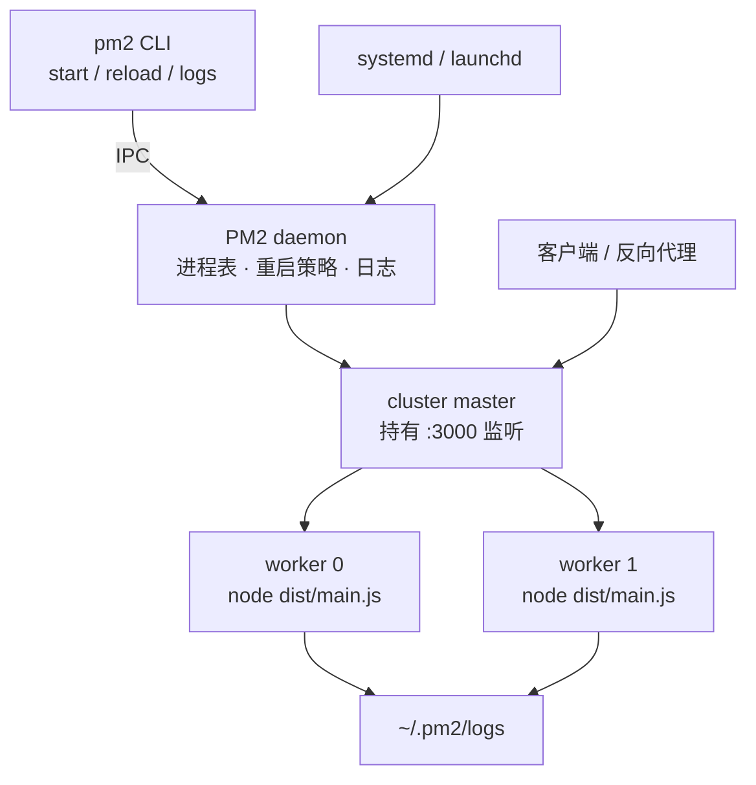

# 第 34 章 为什么 Node 应用要用 PM2 来跑

## 进程管理器解决的是哪三件事

Node 进程是普通进程：未捕获异常、OOM、`kill -9` 都会让它退出，退出后不会自己回来。一台 8 核机器上，一个 Node 进程只用一个 JS 线程，另外 7 核闲着。日志默认写 `stdout`，如果只是 `nohup ... &` 加重定向，文件没人切割，终端一关或者机器重启，进程和日志都可能没了。

**进程管理器**就是补这三件事的常驻父进程。可以把它想成工地上的工头：工头自己不砌墙，只负责点名、补人、记工；也正因为他不动手，才能活得比工人久，工人走了他还在，能继续招人。PM2 是 Node 生态里最常见的一个，[官方 quick start](https://pm2.keymetrics.io/docs/usage/quick-start/) 从安装讲到 `pm2 start`。

它和 Docker、Kubernetes 管的不是一层：容器管的是「整台运行环境」，PM2 只管「这台机器上的 Node 进程」。没有 PM2，进程死了你得自己 SSH 上去拉；没有容器，PM2 也能把一台虚拟机管得不错。两者不冲突，但职责别叠。

现在看一个真实场景。

不是所有服务都进了容器。还有大量「一台虚拟机、`nohup node dist/main.js &`、日志重定向到文件」的服务在跑生产，其中不少连 `&` 都没加。这种跑法有三个硬伤，而且都不是业务代码能修的：进程死了没人拉起来；8 核机器只用 1 核；日志跟着终端走，终端一关就进了黑洞。机器重启之后，还得有人 SSH 上去手动 `node` 一次。

PM2 自己是个 **daemon**（后台常驻进程）。你敲的 `pm2 start` 只是客户端，像去前台递一张单子：单子递完你就走，活由后台的管家盯着。客户端和 daemon 之间靠 IPC（进程间通信）传指令和配置。多副本那部分，靠的是 Node 内置的 `cluster` 模块：让多个子进程共享同一个监听端口，由主进程把新连接分给空闲的 worker。每个 worker 是独立进程，有自己的事件循环、自己的堆内存——这一点后面会反复用到。

先把预期摆正：PM2 不修内存泄漏，不做服务发现，也不是容器编排器。它只管单机上的进程生命周期。这几件事做好，大多数中小项目就够了。

## 单进程到底浪费了什么

Node 的「单线程」说的是 JavaScript 执行线程。一个进程一个事件循环，同一时刻只有一段 JS 在跑。可以想成一家店只有一个收银员：顾客要等，但收银员在等顾客掏钱的空档可以去理货——网络、文件这些 I/O 交给 libuv 线程池，所以 I/O 密集的服务一个进程能扛不少并发。可一旦遇到 CPU 密集的活，比如大 JSON 序列化、bcrypt 哈希、报表聚合，收银员就得一直埋头算账，队伍越排越长，机器上另外七个核再空也没用。

cluster 复制出 N 个进程，每个进程独立事件循环、独立内存，监听同一个端口。像同一家店开两个收银台，共用一个排队入口，叫号机把顾客分给空闲的那个：

| | 单进程 | cluster 2 实例 |
| --- | --- | --- |
| 可用 CPU | 1 核 | 2 核 |
| 一个进程崩溃 | 全站不可用 | 只影响它已经接下的连接 |
| 常驻内存 | 1 份 | 约 2 份 |
| 进程内缓存 / 会话 / 限流计数 | 唯一 | 各自一份，不共享 |

最后一行是后面所有坑的源头：限流不准、定时任务跑两遍、登录态偶尔「丢」，都是把「进程内」当成了「全局」。

别和 `worker_threads` 搞混：那是同一个进程里的线程，共享内存；cluster 是多个进程，各有一份内存。要共享状态，得放到进程外面，比如 Redis。

## PM2 长什么样



daemon 记录每个进程的 pid、重启次数、日志路径；worker 退出时按 `autorestart` 决定要不要拉起来。cluster 模式下 daemon 充当 master，持有监听句柄，所以 reload 能做到「先起新的、再停旧的」而不丢连接。

## 把参数写进 ecosystem 文件

**坑在哪**：临时敲 `pm2 start dist/main.js -i max` 能跑，但参数只活在当前 shell 的历史里。换台机器、换个人部署，实例数、环境变量、日志路径全得重来，而且没人记得上次到底敲了什么。

把配方写下来，贴在店里，而不是记在厨师脑子里。`ecosystem.config.cjs` 就是这些参数的唯一出处：

```js
// ecosystem.config.cjs
module.exports = {
  apps: [
    {
      name: 'meeting-api',
      cwd: '/srv/meeting-api',
      script: 'dist/main.js',
      instances: 2,
      exec_mode: 'cluster',
      env: {
        NODE_ENV: 'production',
        PORT: 3000,
      },
      max_memory_restart: '300M',
      kill_timeout: 5000,
      listen_timeout: 10000,
      out_file: '/var/log/meeting-api/out.log',
      error_file: '/var/log/meeting-api/error.log',
      merge_logs: true,
      time: true,
    },
  ],
};
```

扩展名必须是 `.cjs`。项目 `package.json` 里声明了 `"type": "module"` 时，`.js` 会被 Node 当成 ESM 加载，而 PM2 的配置文件本身是 CommonJS 写法，于是 PM2 7 报：

```text
[PM2][ERROR] File ecosystem.config.js malformated
ReferenceError: module is not defined in ES module scope
This file is being treated as an ES module because it has a '.js' file extension and
'/srv/meeting-api/package.json' contains "type": "module". To treat it as a CommonJS
script, rename it to use the '.cjs' file extension.
```

（实测，PM2 7.1.2 + Node 26。）

顺带一个容易忽略的点：PM2 只把名为 `ecosystem.config.*` 的文件当配置解析。你改成 `ecosystem.prod.cjs`，它会把这个文件当脚本 `fork` 起来，`pm2 list` 里出现一个叫 `ecosystem.prod` 的怪进程，真正的应用一个都没起。

几个字段值得单独说：

- `cwd`：PM2 解析 `script` 和相对日志路径的基准目录。不写就跟着启动命令的当前目录走，CI 里很容易错位。
- `instances` 与 `exec_mode`：只有 `cluster` 才复制进程、共享端口；`fork` 是单进程，适合定时任务、队列消费者这类只该跑一份的进程。容器里别写 `max`，它读的是宿主机核数——容器看到的核数来自 cgroup，第 33 章讲过。
- `max_memory_restart`：超阈值就重启，是止血带不是治疗方案。重启次数持续上涨说明有泄漏。
- `kill_timeout`：默认 1600ms。应用收到 SIGINT 后要关连接、落库、关连接池，这个时间得大于最坏耗时，否则被 SIGKILL 砍断。
- `listen_timeout`：默认 3000ms，reload 时等新进程多久，下面会实测它为什么重要。
- `out_file` / `error_file`：写绝对路径。相对路径的基准是 daemon 的工作目录，不是你敲 `pm2 start` 的目录。

## 跑一遍

先构建。Nest 12 的 `nest build` 默认把入口编译到 `dist/main.js`：

```bash
pnpm build
ls dist/main.js
# dist/main.js
```

健康检查里带上 pid，用来确认流量真的分到了不同进程：

```ts
// src/health/health.controller.ts
import { Controller, Get } from '@nestjs/common';

@Controller('health')
export class HealthController {
  @Get()
  check(): { ok: boolean; pid: number } {
    return { ok: true, pid: process.pid };
  }
}
```

启动、查看、验证：

```bash
pm2 start ecosystem.config.cjs
# [PM2][WARN] Applications meeting-api not running, starting...
# [PM2] App [meeting-api] launched (2 instances)

pm2 list
# ┌────┬─────────────┬─────────┬───────┬────────┐
# │ id │ name        │ mode    │ pid   │ status │
# ├────┼─────────────┼─────────┼───────┼────────┤
# │ 0  │ meeting-api │ cluster │ 62682 │ online │
# │ 1  │ meeting-api │ cluster │ 62683 │ online │
# └────┴─────────────┴─────────┴───────┴────────┘

for i in 1 2 3 4; do curl -s localhost:3000/health; echo; done
# {"ok":true,"pid":62682}
# {"ok":true,"pid":62683}
# {"ok":true,"pid":62682}
# {"ok":true,"pid":62683}
```

（PM2 7.1.2 + Node 26 实跑；为对齐正文，进程名与端口按文中改写，pid 每次不同。）

改完代码重新 `pnpm build`，用 reload 而不是 restart：

```bash
pm2 reload meeting-api
# Use --update-env to update environment variables
# [PM2] Applying action reloadProcessId on app [meeting-api](ids: [ 0, 1 ])
# [PM2] [meeting-api](0) ✓
# [PM2] [meeting-api](1) ✓
```

`Use --update-env` 这行是 PM2 7 的提醒：你在 shell 里改的环境变量不会自动带进已经跑着的进程，要 `pm2 reload meeting-api --update-env`。日志：

```bash
pm2 logs meeting-api --nostream --lines 6
# 0|meeting-api  | 2026-11-06T23:54:02: listening on 3000 pid=62682
# 0|meeting-api  | 2026-11-06T23:54:02: listening on 3000 pid=62683
```

`0|meeting-api` 是 PM2 加的进程前缀，后面的时间戳来自 `time: true`。cluster 下每个 worker 默认写各自的文件，`merge_logs: true` 才合成一个。

## reload 不断流，restart 会断

这两个命令的差别不是「温柔一点」和「暴力一点」，而是**旧进程什么时候死**。

`pm2 restart` 先把所有 worker 杀掉，再重新拉起。像关店重开：门一关，门口排队的顾客全被挡在外面，启动要多久就断多久。实测数据：应用启动耗时 1.5 秒，`pm2 restart` 期间连续发 246 个请求，72 个连接被拒（curl 返回 `000`），断流约 1.3 秒；同样的应用用 `pm2 reload`，300 个请求全部 200，最大延迟 2.2 毫秒。

`pm2 reload` 走的是「起一个新的 → 等它开始监听 → 给旧的发 SIGINT」。像新店员先上岗，旧店员把手上的顾客送走再下班。PM2 源码里这个等待写得很明确：不配 `wait_ready` 时等新 worker 的 `listening` 事件，配了则等应用自己发的 `ready` 消息；两者都有 `listen_timeout` 做兜底，默认 3000ms。

兜底一到，PM2 不会无限等下去，而是直接关掉旧进程——这时候如果新进程还没监听，断流就发生了。把启动延迟调到 5 秒、`listen_timeout` 设成 2000ms，再 reload：

| 场景 | 启动/就绪耗时 | 采样请求 | 失败 |
| --- | --- | --- | --- |
| `restart`（2 实例） | 1.5s | 246 | 72 |
| `reload`（2 实例） | 1.5s | 300 | 0 |
| `reload`（1 实例） | 1.5s | 300 | 0 |
| `reload`，`listen_timeout: 2000` | 5s | 300 | 89 |
| `reload`，`wait_ready` + 4s 后才 ready | 4s | 计时 | reload 耗时 4.78s |

最后一行对比：同样配置去掉 `wait_ready`，reload 0.79 秒就返回——因为它只等到 `listening`，而业务真正 ready（连上数据库、预热缓存）要晚得多。前者只是「店员站到柜台后面」，后者才是「店员举手说我准备好了」。想让 PM2 等到业务就绪，在 `main.ts` 里显式发消息：

```ts
// src/main.ts
import { NestFactory } from '@nestjs/core';
import { AppModule } from './app.module.js';

const bootstrap = async (): Promise<void> => {
  const app = await NestFactory.create(AppModule);
  app.enableShutdownHooks();
  const port = Number(process.env.PORT ?? 3000);
  await app.listen(port);

  if (process.send) {
    process.send('ready');
  }
};

await bootstrap();
```

配置里加 `wait_ready: true`，并把 `listen_timeout` 调到大于最坏启动耗时。注意 `wait_ready` 会让 PM2 改走另一条 reload 路径，等的是那条消息而不是端口监听；消息不来，照样在超时后切。

## 应用得配合的两件事

第一，能优雅退出。Nest 默认不会响应 SIGTERM 做清理，得像打烊前关煤气、结账、送客一样，按顺序把东西收好；直接拉闸，正在处理的请求就断了。

```ts
// src/database/database.lifecycle.ts
import { Injectable, OnApplicationShutdown } from '@nestjs/common';
import { db } from '../db/prisma.js';

@Injectable()
export class DatabaseLifecycle implements OnApplicationShutdown {
  async onApplicationShutdown(): Promise<void> {
    await db.close();
  }
}
```

`app.enableShutdownHooks()` 之后，Nest 才会在收到信号时依次调用 `onApplicationShutdown`。要关的不止数据库：消息队列消费者、定时器、HTTP 长连接都算。漏一个，进程就撑到 `kill_timeout` 被 SIGKILL，正在处理的请求直接断。信号和 1 号进程的关系，第 30 章用 tini 讲过；`CMD` 要用 exec 形式，第 31 章也踩过这个坑。

第二，别把状态放在进程内存里。cluster 下 session、限流计数、本地缓存各有各的副本，换班之后旧店员口袋里的账本直接消失。要么放 Redis，要么接受 reload 时的一次抖动。

还有一笔容易忘的账：数据库连接数。两个实例、每池 10 条，就是 20 条常驻；再乘预发、生产、批处理任务，很容易顶到 `max_connections`。`instances` 翻倍时，`pool.max` 要跟着降。

## 日志：PM2 只负责收

**坑在哪**：PM2 把日志收进文件，但不负责整理。文件会一直长，直到把磁盘写满——像只往抽屉里塞账单、从不清理，总有一天抽屉关不上。

PM2 把 stdout/stderr 重定向到 `~/.pm2/logs/`，命名是 `<name>-out.log` 和 `<name>-error.log`；配了 `out_file` 就写到指定位置。它**不做轮转**。

```bash
pm2 install pm2-logrotate
pm2 set pm2-logrotate:max_size 100M
pm2 set pm2-logrotate:retain 14
pm2 set pm2-logrotate:compress true
```

（模块安装实测：PM2 7.1.2 下装到 `pm2-logrotate 3.0.0`，`pm2 list` 的 Module 区能看到它 online；轮转本身没等那么久，未实测。）

`retain 14` 保留 14 个归档，按天切大约两周。`compress` 默认是 false，要省空间得自己打开。

更省事的做法是别让 PM2 管文件：容器里日志本来就该走 stdout，交给 Docker 的 `json-file` 驱动或采集器；虚拟机上用 journald 也一样。PM2 的文件日志适合「还没有日志系统，只想先有个地方查」的阶段。

## 开机自启

**坑在哪**：PM2 自己不是系统服务，机器重启后 daemon 不会回来。店员会干活，但店门没人开。

`pm2 startup` 生成对应的 init 配置：

```bash
sudo pm2 startup systemd -u deploy --hp /home/deploy
# [PM2] Writing init configuration in /etc/systemd/system/pm2-deploy.service
# [PM2] Making script booting at startup...

pm2 save
# [PM2] Saving current process list...
# [PM2] Successfully saved in /tmp/pm2-home/dump.pm2

pm2 resurrect
```

（`save` / `resurrect` 实测，路径随 `PM2_HOME` 变；`startup` 的 systemd 部分未实测，在 macOS 上它输出的是 launchd 版本：`[PM2] Init System found: launchd` 加一行要你自己执行的 sudo 命令。）

`pm2 save` 把当前进程表写进 `~/.pm2/dump.pm2`，`resurrect` 按快照恢复。两步都要做：只 startup，重启后 daemon 起来了但进程表是空的；只 save，重启后没人拉起 daemon。

如果只要「挂了自动起、开机自动起」，不需求 cluster 和 reload，直接写 systemd unit 更简单：

```ini
[Unit]
Description=meeting-api
After=network.target

[Service]
Type=simple
User=deploy
WorkingDirectory=/srv/meeting-api
EnvironmentFile=/srv/meeting-api/.env
ExecStart=/usr/bin/node dist/main.js
Restart=always
RestartSec=3
KillSignal=SIGTERM
TimeoutStopSec=15

[Install]
WantedBy=multi-user.target
```

`Restart=always` 替代 PM2 的守护，`KillSignal` + `TimeoutStopSec` 替代优雅关闭，`systemctl restart` 就是重启。少一个 daemon，少一个要维护的东西。

## 和容器、K8s 的边界

PM2 和容器不对立，但把 PM2 塞进容器通常是在重复编排器的工作——像房间里已经有人管开关灯，你又装了一个声控灯，两边都响应，反而乱：

| | 虚拟机 + PM2 | 单容器 | Kubernetes |
| --- | --- | --- | --- |
| 进程数 | PM2 cluster 管 | 1 个（PID 1） | 1 个，副本数交给 Deployment |
| 崩溃重启 | PM2 autorestart | `restart: always` | kubelet |
| 日志 | PM2 文件 + logrotate | stdout | stdout |
| 零停机 | `pm2 reload` | 滚动更新 | 滚动更新 |
| 开机自启 | systemd | Docker / compose | 集群保证 |

容器里最常见的反模式是 `pm2 start app.js -i max`：PM2 变成 PID 1，信号转发多一层，日志写进容器文件系统而不是 stdout，副本数由 PM2 和 K8s 各算一遍，实际进程数是两者的乘积。容器里就一个 Node 进程，`CMD ["node", "dist/main.js"]`，重启和扩缩容交给外面。

反过来说，一台没上编排的虚拟机、两个 PM2 实例、systemd 管 daemon，是成本最低的可用方案。选型看的是「谁负责重启」，不是「谁更现代」。

## 踩过的坑

| 现象 | 原因 | 处理 |
| --- | --- | --- |
| `[PM2][ERROR] File ecosystem.config.js malformated` | ESM 项目里用了 `.js` 配置 | 改名 `ecosystem.config.cjs` |
| 应用没起来，多了个叫 `ecosystem.prod` 的进程 | 配置文件名不是 `ecosystem.config.*` | 用标准文件名 |
| 发布时短暂连不上 | 用了 `pm2 restart` | 改 `pm2 reload`，确认 `exec_mode: cluster` |
| reload 也断流 | 启动耗时超过 `listen_timeout` | 调大，或改 `wait_ready` 等业务就绪 |
| reload 卡住最后强杀 | 没处理 SIGTERM，或 `kill_timeout` 太短 | `enableShutdownHooks`，关连接池和消费者 |
| 进程起来就崩，无限重启 | 启动即失败，autorestart 一直拉 | 看 error 日志；设 `exp_backoff_restart_delay` |
| 磁盘被日志写满 | 没装 pm2-logrotate | 装模块设 `max_size`/`retain`，或改走 stdout |
| 生产跑成 development | `NODE_ENV` 没设或 `env` 写错位置 | `pm2 env 0` 检查，配置里写死 |
| 机器重启后进程全没了 | 只做了 startup 或只做了 save | 两步都做 |
| 容器里起了宿主机核数那么多进程 | `instances: 'max'` 读宿主机 CPU | 容器里固定实例数，或不用 PM2 |

这些都不是 PM2 的 bug，是把单机工具用在了不该它管的地方。想清楚谁持有端口、谁负责重启、日志去哪，大部分问题在配置阶段就能避免。

PM2 补的是进程守护、多核利用、日志落盘、开机自启这四块短板，代价是多一层 daemon 和一份配置文件。它适合「一台机器、几个实例、没有编排系统」的阶段；上了容器和 K8s，这层职责就该交出去。


<!-- chapter-nav:start -->
---

← 上一篇：[033 Docker是怎么实现的](033-Docker是怎么实现的.md) · [本 Part 目录](_part.md) · 下一篇：[035 快速入门PostgreSQL](../part-03/035-快速入门PostgreSQL.md) →
<!-- chapter-nav:end -->
