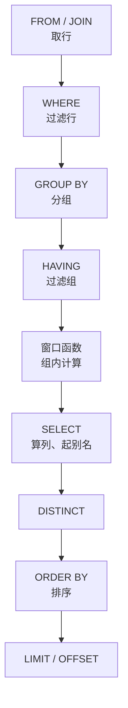

# 第 36 章 SQL 查询语句的所有语法和函数（PostgreSQL 版）

## SQL 查询在做什么

一条 SQL 查询的输入是一张或多张表，输出也是一张表：若干行、若干列，叫作结果集（result set）。它可能 0 行，可能 1 行，也可能几万行；`SELECT` 后面写哪些列，结果就长什么样。数据库不会把表原样还给你，它按你描述的条件筛、拼、分组、排序，最后交回结果集。

写查询时只描述「要什么」，不描述「怎么扫、走哪个索引、先连哪张表」。同一句需求可以写好几种 SQL，结果一样、执行路径可能差几十倍——先写对，再看快不快。

查询由几个部件拼起来：`FROM` / `JOIN` 决定从哪些表取行，`WHERE` 过滤行，`GROUP BY` 把行分组，`HAVING` 过滤组，`SELECT` 算列，`ORDER BY` 排序，`LIMIT` 截断。聚合函数（`count`、`sum`、`avg`）把一组行压成一个值；窗口函数不压行，只在每行旁边多算一列。这两类后面都会单独讲。

同一份数据，过滤条件不同、聚合方式不同，答出来的数就不同。问「哪间房最忙」，得先定义「忙」：按场次算还是按占用小时算？驳回和取消算不算？这个定义就是口径。口径没对齐，两条 SQL 都合法，答案却打架。

官方文档（先看懂正文再点）：
- [SELECT](https://www.postgresql.org/docs/17/sql-select.html)：`SELECT` 每个部件（`FROM`、`WHERE`、`GROUP BY`、`ORDER BY`）的完整语法，对着本章开头的部件表看。
- [聚合函数](https://www.postgresql.org/docs/17/functions-aggregate.html)：`count`、`sum`、`avg` 这些把一组行压成一个值的函数，本章讲聚合那几段用得到。
- [窗口函数](https://www.postgresql.org/docs/17/tutorial-window.html)：不压行、只在每行旁边多算一列的写法，和正文「窗口函数不压行」那句对着看。

现在看一个真实事故。

运营在群里问：上周哪间房最忙？你回 A302。她回得很快：那当然，五场会都在那儿。你再看一遍，A302 那五场里有一场被驳回、一场取消，真正占用的只有四小时；把状态收窄之后，A301 以五小时反超。数字刚对上，`count(*)` 和 `count(remark)` 又差 1。

两条 SQL 都没有语法错，错的是口径。这一章从「哪间房最忙」这类日常问题出发，把 `SELECT` 的主要部件走一遍：过滤、排序分页、聚合、窗口、JSON、写回。下面的结果都是**示例输出**，按第 35 章那 14 条预订推算——你自己跑，值会对得上，代价数字对不上。

## 先看一条 SELECT 是怎么执行的

开头说的「只描述要什么」，执行时由规划器接手：它看统计信息、索引和代价模型，决定怎么扫表、走哪个索引、先连哪张表。你能控制的是写法，控制不了它最终选哪条路。

但它的**逻辑**顺序是固定的，和你写的顺序不一样：

> **图 36-1** 一条 SELECT 的逻辑执行顺序



这条流水线能解释一个很常见的报错。给容量乘 10 起个别名，再拿别名去过滤：

```sql
SELECT name, capacity * 10 AS seats
FROM rooms
WHERE seats > 100;
```

```text
ERROR:  column "seats" does not exist
LINE 3: WHERE seats > 100;
              ^
```

因为 `WHERE` 排在 `SELECT` 前面，别名那时候还不存在。换成 `ORDER BY seats` 就能跑，排序发生在算列之后。`DISTINCT` 卡在 `SELECT` 和 `ORDER BY` 之间，所以 `SELECT DISTINCT` 时按没选出的列排序也会报错。

把这条顺序记住，三类日常困惑都有答案：别名只在 `SELECT` 之后才存在（`ORDER BY` 是例外，它认输出列名）；`WHERE` 过滤行、`HAVING` 过滤组，聚合条件写进 `WHERE` 会报「聚合函数不能出现在 WHERE」；窗口计算发生在分组和 `HAVING` 之后，所以想筛 `row_number()` 只能再套一层子查询。

从 MySQL 过来，这几处会直接翻车：`5 / 2` 在 PG 里是 `2`（整数除法），在 MySQL 里是 `2.5`；`DATE_FORMAT` 换 `to_char`；`IFNULL` 换 `coalesce`；反引号换双引号；`LIMIT 10, 20` 换 `LIMIT 20 OFFSET 10`；`INSERT ... ON DUPLICATE KEY UPDATE` 换 `ON CONFLICT`。整数除法这条尤其隐蔽：`sum(hours) / count(*)` 两个整数相除会截断，报表上就是「平均 2 小时」而不是 2.5，至少把一侧转成 `numeric` 再除。

## 查某一天：时间范围写成左闭右开

查 A301 在 11 月 4 日的日程：

```sql
SELECT b.start_time, b.end_time, b.status, b.remark
FROM bookings b
JOIN rooms r ON r.id = b.room_id
WHERE r.name = 'A301'
  AND b.start_time >= '2026-11-04 00:00+08'
  AND b.start_time <  '2026-11-05 00:00+08'
ORDER BY b.start_time;
```

```text
        start_time         |         end_time          |  status  |  remark
---------------------------+---------------------------+----------+---------
 2026-11-04 09:00:00+08    | 2026-11-04 10:00:00+08    | APPROVED | 销售晨会
 2026-11-04 09:30:00+08    | 2026-11-04 10:30:00+08    | PENDING  | 临时插会
(2 rows)
```

时间范围一律写成「左闭右开」：`>= 当天零点` 且 `< 次日零点`。别用 `BETWEEN`，它对 `timestamptz` 是闭区间，最后一毫秒会被算进第二天；也别对列做 `date(start_time) = '2026-11-04'`，那会让索引失效——B-tree 存的是 `start_time` 的原值，套上函数之后每行都要现算，规划器只能全表扫。这种「列上套函数导致索引不可用」的写法，术语叫**不满足 sargability**（不能按索引范围搜索），是所有数据库通用的性能陷阱。`+08` 写明偏移，比依赖会话时区可靠。

## 分页：排序键定不了序，翻页就会重复

```sql
SELECT name, capacity
FROM rooms
WHERE status = 'AVAILABLE'
ORDER BY capacity DESC, name
LIMIT 2 OFFSET 2;
```

```text
 name | capacity
------+----------
 A301 |        8
 B201 |        4
(2 rows)
```

只写 `ORDER BY capacity DESC`，容量相同的行顺序由 PG 自己定，翻页时可能重复或漏掉。`OFFSET` 越大越慢，因为它仍然要把前面的行扫出来再丢掉——`OFFSET 100000` 不是「跳过」，是「数完再扔」。翻到几百页以后，改成拿「上一页最后一行的 `(capacity, name)`」做游标条件：

```sql
SELECT name, capacity
FROM rooms
WHERE status = 'AVAILABLE'
  AND (capacity, name) < (8, 'A301')
ORDER BY capacity DESC, name
LIMIT 2;
```

行构造器比较 `(a, b) < (x, y)` 等价于「a 更小，或 a 相等且 b 更小」，正好接上 `ORDER BY capacity DESC, name`。代价是页码不能随机跳，只能「下一页」；这是体验和成本之间的取舍，不是纯技术选择。

## 时间轴：让数据库把格子生成出来

前端要一条 9 点到 11 点、每半小时一格的时间轴，不必在 Node 里循环拼。`generate_series` 是集合返回函数，给起点、终点、步长，它直接生成一行行数据：

```sql
SELECT s.slot_start, count(b.id) AS hits
FROM generate_series(
       '2026-11-04 09:00+08'::timestamptz,
       '2026-11-04 11:00+08'::timestamptz,
       interval '30 minutes'
     ) AS s (slot_start)
LEFT JOIN bookings b
  ON b.room_id = 'a1111111-1111-4111-8111-111111111111'
 AND b.status IN ('PENDING', 'APPROVED')
 AND b.start_time <= s.slot_start
 AND b.end_time   >  s.slot_start
GROUP BY s.slot_start
ORDER BY s.slot_start;
```

```text
      slot_start       | hits
-----------------------+------
 2026-11-04 09:00:00+08 |    1
 2026-11-04 09:30:00+08 |    2
 2026-11-04 10:00:00+08 |    1
 2026-11-04 10:30:00+08 |    0
 2026-11-04 11:00:00+08 |    0
(5 rows)
```

`LEFT JOIN` 保证没有预订的格子也留在结果里，所以 10:30 之后两格是 0 而不是消失。条件都写在 `ON` 里：挪到 `WHERE`，没有匹配的格子会被 `NULL` 比较过滤掉，时间轴直接缺几格。`09:30` 命中 2 条，因为两场会确实重叠——这正是第 41 章要处理的问题。时间轴只要「有没有人」，判断 `count(b.id) > 0`；要算占用率，得先把重叠区间合并，不能直接把 `hits` 加起来。

## 周报：聚合、FILTER 和 HAVING

**聚合函数**（`count`、`sum`、`avg`）把多行压成一行，**`GROUP BY`** 决定「按什么压」，**`HAVING`** 在分组之后筛组。周报就是这三个东西的组合：

```sql
SELECT r.name,
       count(b.id) AS total,
       count(*) FILTER (WHERE b.status = 'CANCELLED') AS cancelled,
       coalesce(round(
         sum(extract(epoch FROM b.end_time - b.start_time))
           FILTER (WHERE b.status IN ('PENDING', 'APPROVED')) / 3600
       , 1), 0) AS hours
FROM rooms r
LEFT JOIN bookings b
  ON b.room_id = r.id
 AND b.start_time >= '2026-11-02 00:00+08'
 AND b.start_time <  '2026-11-09 00:00+08'
GROUP BY r.id, r.name
ORDER BY hours DESC, r.name;
```

```text
 name | total | cancelled | hours
------+-------+-----------+-------
 A301 |     5 |         0 |   5.0
 A302 |     5 |         1 |   4.0
 B202 |     2 |         0 |   4.0
 B201 |     2 |         1 |   1.0
 C101 |     0 |         0 |     0
(5 rows)
```

先看第一列：`count(*)` 数的是连接后的行，C101 没有预订也会被数成 1；`count(b.id)` 只数真正匹配上的行，所以是 0。这个差别在 `LEFT JOIN` 的报表里天天出现，而且不报错，只让数字悄悄大 1。

再看状态过滤的位置。把 `b.status IN (...)` 从 `ON` 挪到 `WHERE`，C101 会连行都不剩——`WHERE` 在连接之后过滤，`NULL` 参与比较为假，外连接退化成内连接。规则是：**外连接里，对被保留侧的过滤放 `ON`，对结果集的过滤才放 `WHERE`**。

`FILTER` 是 PG 的方言，等价于 `sum(CASE WHEN ... THEN ... END)`，但读起来是一句话，而且只扫一遍。时长用 `extract(epoch FROM interval)` 换成秒：`interval` 直接相加会得到 `1 day 02:30:00`，前端不一定接得住；换成秒再除 3600，单位才是小时。`round(..., 1)` 保留一位小数，`coalesce(..., 0)` 处理「整组没有行」——`sum` 在空集上返回 `NULL`，不是 0。

分组之后筛组，用 `HAVING`：

```sql
SELECT u.name, count(*) AS bookings
FROM bookings b
JOIN users u ON u.id = b.user_id
GROUP BY u.id
HAVING count(*) >= 3
ORDER BY bookings DESC, u.name;
```

```text
 name | bookings
------+----------
 陈默 |        4
 周雨 |        3
 赵启 |        3
(3 rows)
```

`GROUP BY u.id` 就够了，`u.name` 可以直接选——因为 `id` 是主键，PG 知道其余列函数依赖于它（函数依赖）。MySQL 默认的 `ONLY_FULL_GROUP_BY` 不认这条，迁移时别照抄。`HAVING count(*) >= 3` 里的 `count(*)` 会在分组后重新算，别指望它复用 `SELECT` 里的别名。

回到开头那个差 1：`count(*)` 是 14，`count(remark)` 是 13，因为有一条备注是 `NULL`。聚合函数**跳过 NULL**，这是 SQL 的约定，不是 bug：`count(*)` 数行，`count(列)` 数非空值，`count(DISTINCT 列)` 数非空且不重复的值。同理，`WHERE remark <> '周会'` 只返回 12 行，`NULL` 既不等于也不不等于任何值；要把它算进来，写 `remark IS DISTINCT FROM '周会'`，返回 13。`IS DISTINCT FROM` 是「NULL 安全的不等」，`IS NOT DISTINCT FROM` 是「NULL 安全的等」，可空列上做比较时比 `=`/`<>` 可靠。

## 日期和字符串：在库里格式化

```sql
SELECT to_char(b.start_time, 'MM-DD HH24:MI') AS start,
       to_char(b.end_time, 'HH24:MI') AS end,
       date_trunc('day', b.start_time) AS day,
       extract(isodow FROM b.start_time) AS dow,
       format('%s / %s 人', r.name, r.capacity) AS label
FROM bookings b
JOIN rooms r ON r.id = b.room_id
WHERE b.status = 'APPROVED'
ORDER BY b.start_time
LIMIT 4;
```

```text
    start    |  end  |         day         | dow |   label
-------------+-------+---------------------+-----+-----------
 11-02 09:00 | 10:00 | 2026-11-02 00:00:00+08 |   1 | A301 / 8 人
 11-02 10:00 | 11:00 | 2026-11-02 00:00:00+08 |   1 | A302 / 12 人
 11-02 14:00 | 15:30 | 2026-11-02 00:00:00+08 |   1 | A301 / 8 人
 11-03 13:00 | 14:00 | 2026-11-03 00:00:00+08 |   2 | B201 / 4 人
(4 rows)
```

`to_char` 负责给人看，`date_trunc` 负责按天、按周分组，`extract(isodow ...)` 把周一算成 1（`dow` 则把周日算成 0，报表里经常差一天）。`format` 比一堆 `||` 好读，`concat_ws` 会自动跳过 `NULL`。

时区仍然要盯住：`date_trunc('day', timestamptz)` 用的是会话时区，服务器切到 UTC，同一条预订会被分到前一天。要固定按北京时间切，写 `date_trunc('day', b.start_time AT TIME ZONE 'Asia/Shanghai')`，返回的是不带时区的本地时间，正好用来分组。`AT TIME ZONE` 的方向容易记反：`timestamptz AT TIME ZONE 'zone'` 得到该时区的本地墙上时间（`timestamp`），`timestamp AT TIME ZONE 'zone'` 反过来，把墙上时间解释成该时区的时刻（`timestamptz`）。夏令时切换那天的 02:30 可能不存在或出现两次，做跨时区排班要用 `tstzrange` 或明确规则，别用「加 24 小时」凑。

## 窗口函数：排名、上一行、累计

**窗口函数**和聚合长得像，作用完全不同：聚合把多行压成一行，窗口不压行，它给每一行算一个「和它所在分组有关」的值，比如组内排名、上一行、累计和。

「每间房最近一次预订」是典型的 Top-N-per-group：先算序号，再在外层筛。

```sql
SELECT name, start_time, status
FROM (
  SELECT r.name, b.start_time, b.status,
         row_number() OVER (
           PARTITION BY b.room_id
           ORDER BY b.start_time DESC
         ) AS rn
  FROM bookings b
  JOIN rooms r ON r.id = b.room_id
  WHERE b.status IN ('PENDING', 'APPROVED')
) t
WHERE rn = 1
ORDER BY name;
```

```text
 name |      start_time       |  status
------+-----------------------+----------
 A301 | 2026-11-06 09:00:00+08 | APPROVED
 A302 | 2026-11-04 14:00:00+08 | APPROVED
 B201 | 2026-11-03 13:00:00+08 | APPROVED
 B202 | 2026-11-05 10:00:00+08 | APPROVED
(4 rows)
```

`row_number` 遇到并列也给不同序号；要并列同名次，用 `rank`；要并列后不跳号，用 `dense_rank`。三者在「两个 100 分」时分别给出 1、2 / 1、1 / 1、1，下一个名次则分别是 3 / 3 / 2。不能直接在同一层 `WHERE rn = 1`，窗口在 `WHERE` 之后才算，必须再套一层子查询（或用 `WITH` 命名的 CTE，第 39 章细讲）。

`PARTITION BY` 只决定窗口怎么切，不减少行数；`GROUP BY` 会把行压成每组一行。这是两者最容易混的地方：排名用窗口，报表用聚合，需要「每组一行再加组内排名」时才把两者套在一起。

看 A301 相邻两场会隔多久：

```sql
SELECT start_time,
       lag(start_time) OVER (ORDER BY start_time) AS prev,
       start_time - lag(start_time) OVER (ORDER BY start_time) AS gap
FROM bookings
WHERE room_id = 'a1111111-1111-4111-8111-111111111111'
  AND status IN ('PENDING', 'APPROVED')
ORDER BY start_time;
```

```text
      start_time       |         prev         |      gap
-----------------------+----------------------+---------------
 2026-11-02 09:00:00+08 |                      |
 2026-11-02 14:00:00+08 | 2026-11-02 09:00:00+08 | 05:00:00
 2026-11-04 09:00:00+08 | 2026-11-02 14:00:00+08 | 1 day 19:00:00
 2026-11-04 09:30:00+08 | 2026-11-04 09:00:00+08 | 00:30:00
 2026-11-06 09:00:00+08 | 2026-11-04 09:30:00+08 | 1 day 23:30:00
(5 rows)
```

`lag` / `lead` 取前后行，`first_value` / `last_value` 取窗口边界。带 `ORDER BY` 时默认窗口是从第一行到当前行，所以累计求和直接写 `sum(...) OVER (ORDER BY ...)` 就是从第一行加到当前行：

```sql
SELECT date_trunc('day', start_time)::date AS day,
       count(*) AS bookings,
       sum(count(*)) OVER (
         ORDER BY date_trunc('day', start_time)::date
       ) AS running_total
FROM bookings
WHERE status IN ('PENDING', 'APPROVED')
GROUP BY 1
ORDER BY 1;
```

```text
    day     | bookings | running_total
------------+----------+---------------
 2026-11-02 |        3 |             3
 2026-11-03 |        3 |             6
 2026-11-04 |        3 |             9
 2026-11-05 |        1 |            10
 2026-11-06 |        1 |            11
(5 rows)
```

`sum(count(*))` 看着怪，但合法：`count(*)` 先按天聚合成一行，窗口函数再在这批结果上累加，窗口比聚合晚一步。默认框架是 `RANGE BETWEEN UNBOUNDED PRECEDING AND CURRENT ROW`，`RANGE` 会把与当前行排序值相同的行一起算进来；同一天有多行时，你可能看到累计值「跳一下」，那不是算错，是框架按值而不是按行。要严格按行累计，写 `ROWS BETWEEN UNBOUNDED PRECEDING AND CURRENT ROW`。

## JSONB 和模糊搜索

前端要「每间房当天的时间轴」，也不必查两次再在 Node 里拼：

```sql
SELECT r.name,
       coalesce(
         jsonb_agg(
           jsonb_build_object('start', to_char(b.start_time, 'HH24:MI'),
                              'status', b.status)
           ORDER BY b.start_time
         ) FILTER (WHERE b.id IS NOT NULL),
         '[]'::jsonb
       ) AS schedule
FROM rooms r
LEFT JOIN bookings b
  ON b.room_id = r.id
 AND b.start_time >= '2026-11-04 00:00+08'
 AND b.start_time <  '2026-11-05 00:00+08'
GROUP BY r.id, r.name
ORDER BY r.name;
```

```text
 name |                                  schedule
------+-----------------------------------------------------------------------------
 A301 | [{"start": "09:00", "status": "APPROVED"}, {"start": "09:30", "status": "PENDING"}]
 A302 | [{"start": "14:00", "status": "APPROVED"}]
 B201 | []
 B202 | []
 C101 | []
(5 rows)
```

没有 `FILTER (WHERE b.id IS NOT NULL)`，空房间会得到 `[null]` 而不是 `[]`：`LEFT JOIN` 补出来的那一行仍然会被 `jsonb_agg` 数进去。`coalesce` 只是为了给整组没有行的情况兜底。

`->` 取出来还是 `jsonb`，`->>` 取出来才是 `text`；`@>` 判断包含，`jsonb_path_query` 走路径。给 JSONB 列建 GIN 索引用 `USING gin (payload jsonb_path_ops)`，适合「包含某个键值」的查询，不适合范围扫描。JSONB 不是万能收纳箱：经常被查询、需要约束、需要外键的字段，还是老老实实开列；它适合「结构会变、整体读写」的扩展信息，比如第三方回调的原始报文。

搜索框的模糊匹配：

```sql
SELECT name, capacity
FROM rooms
WHERE name ILIKE '%30%'
ORDER BY name;
```

```text
 name | capacity
------+----------
 A301 |        8
 A302 |       12
(2 rows)
```

`ILIKE` 是大小写不敏感的 `LIKE`，PG 独有（MySQL 的默认排序规则本来就不区分大小写，反而没有这个开关）。前后都带 `%` 用不上 B-tree 索引；量大了装 `pg_trgm`，建 `USING gin (name gin_trgm_ops)`，`%30%` 也能走索引。索引能救「匹配」，救不了「排序」：模糊搜索按相关度排，得用 `similarity()` 或全文检索 `tsvector`，那是另一套东西。

## 写操作：RETURNING 和 UPSERT

先把四类语句分清，不混着背：

| 类别 | 语句 | 会议室系统里的例子 |
| --- | --- | --- |
| DDL | `CREATE` / `ALTER` / `DROP` / `TRUNCATE` | 加 `room_details`、改列类型 |
| DML | `INSERT` / `UPDATE` / `DELETE` / `MERGE` | 改预订状态、补服务项 |
| DQL | `SELECT` | 上面那些报表 |
| DCL | `GRANT` / `REVOKE` | 给 `booking_app` 授权（第 35 章） |

PG 的 DDL 是事务性的：`BEGIN; ALTER TABLE ...; ROLLBACK;` 真的能撤销。MySQL 的 DDL 会隐式提交——迁移失败时 PG 能把半截 DDL 一起回滚，MySQL 可能留下一个改了一半的表。

约束也是 DDL 的一部分：`PRIMARY KEY`、`UNIQUE`、`NOT NULL`、`CHECK`、`FOREIGN KEY`，以及第 41 章会用到的 `EXCLUDE`（禁止两行在指定范围上重叠，比如同一房间同一时段）。能在表上表达的规则，别只写在 Nest 的 DTO 里——脚本和别的服务不会走你的 DTO。`UNIQUE` 和 `PRIMARY KEY` 会自动建索引，`FOREIGN KEY` 不会（PG 与 MySQL 的又一处差异），这也是第 38 章要专门补索引的原因。

`RETURNING` 让写操作直接带回结果，不用再查一次：

```sql
BEGIN;

INSERT INTO rooms (name, capacity, location, equipment)
VALUES ('A303', 10, 'A 座 3 层', '{projector}')
ON CONFLICT (name) DO UPDATE
SET capacity = EXCLUDED.capacity
RETURNING name, capacity, (xmax = 0) AS inserted;

INSERT INTO rooms (name, capacity, location, equipment)
VALUES ('A303', 12, 'A 座 3 层', '{projector}')
ON CONFLICT (name) DO UPDATE
SET capacity = EXCLUDED.capacity
RETURNING name, capacity, (xmax = 0) AS inserted;

ROLLBACK;
```

```text
 name | capacity | inserted
------+----------+----------
 A303 |       10 | t
(1 row)

 name | capacity | inserted
------+----------+----------
 A303 |       12 | f
(1 row)

ROLLBACK
```

`ON CONFLICT (name)` 依赖 `name` 上的唯一约束，没有约束就直接报错。`EXCLUDED` 是「这次想插入的那行」，冲突时用它覆盖旧值。`xmax = 0` 是判断「插入还是更新」的常用技巧，但它读的是系统列，属于实现细节；业务代码更稳的做法是先查再决定，或者接受「upsert 后统一按更新处理」。还有个坑：`ON CONFLICT DO NOTHING` 在冲突时不返回任何行，如果你写了 `RETURNING id` 并指望拿到 id，冲突那次会拿到空结果——要么改成 `DO UPDATE SET ...`（即使值不变也会返回），要么冲突后补一次查询。

`MERGE`（PG 15+）适合「源表与目标表批量对齐」，比如把一批 CSV 的服务价目同步进 `services`；单行 upsert 用 `ON CONFLICT` 更直接。别为了用一个新语法，把简单的插入写成三段式。

## 容易写对的错 SQL

| 现象 | 原因 | 改法 |
| --- | --- | --- |
| `WHERE` 里用别名报错 | `WHERE` 先于 `SELECT` | 重复表达式，或套一层子查询 |
| 合计比明细少 | `count(列)` 跳过 `NULL` | 要数行就用 `count(*)` |
| `LEFT JOIN` 后合计变大 | 右表一配多，行被放大 | 先聚合再连接，或 `count(DISTINCT ...)` |
| `NOT IN` 返回空 | 子查询里有 `NULL` | 换 `NOT EXISTS`（第 39 章） |
| 分组报错 | 选了没聚合、也没分组的列 | 加进 `GROUP BY`，或依赖主键函数依赖 |
| 翻页重复 | `ORDER BY` 不唯一 | 补一个能定序的列 |
| 时区差 8 小时 | 会话时区不是北京时间 | `AT TIME ZONE 'Asia/Shanghai'`，或统一用 UTC |
| 整数相除丢小数 | `5 / 2` 在 PG 是 `2` | 至少一侧转 `numeric`：`5::numeric / 2` |
| `jsonb_agg` 出 `[null]` | `LEFT JOIN` 的空行被聚合 | 加 `FILTER (WHERE ... IS NOT NULL)` |
| 模糊搜索慢 | `%x%` 用不上 B-tree | 装 `pg_trgm`，建 GIN 索引 |

判断标准很简单：先想清楚「一行是什么」，再决定 `count` 谁、`GROUP BY` 谁。语法错误数据库会告诉你，口径错误只能自己发现——而口径错误的代价通常不是一条报错，是老板拿着周报问你「A302 怎么突然变成最忙的」。

查询能筛能算，但数据还是一张张平表。下一章把表真正连起来：一对一、各种 JOIN，以及删一条主表记录时，子表到底该跟着走还是拦住你。

想更深入的话，官方文档里有这几页可以接着看：[SELECT](https://www.postgresql.org/docs/17/sql-select.html)（查询语句的总入口，补全正文没展开的 `DISTINCT`、`LIMIT` 等子句）、[聚合函数](https://www.postgresql.org/docs/17/functions-aggregate.html)（所有聚合函数和 `FILTER` 用法的清单）、[窗口函数](https://www.postgresql.org/docs/17/functions-window.html)（排名、累计求和这类「行旁边多一列」的函数参考）、[日期时间函数](https://www.postgresql.org/docs/17/functions-datetime.html)（按天、按周截断和加减时间的函数，算空档会用到）、[JSON 函数](https://www.postgresql.org/docs/17/functions-json.html)（把 JSON 列拆开、取字段的函数，遇到半结构化数据时翻）。

<!-- chapter-nav:start -->
---

← 上一篇：[035 快速入门PostgreSQL](035-快速入门PostgreSQL.md) · [本 Part 目录](_part.md) · 下一篇：[037 一对一、JOIN查询与级联](037-一对一、JOIN查询与级联.md) →
<!-- chapter-nav:end -->
