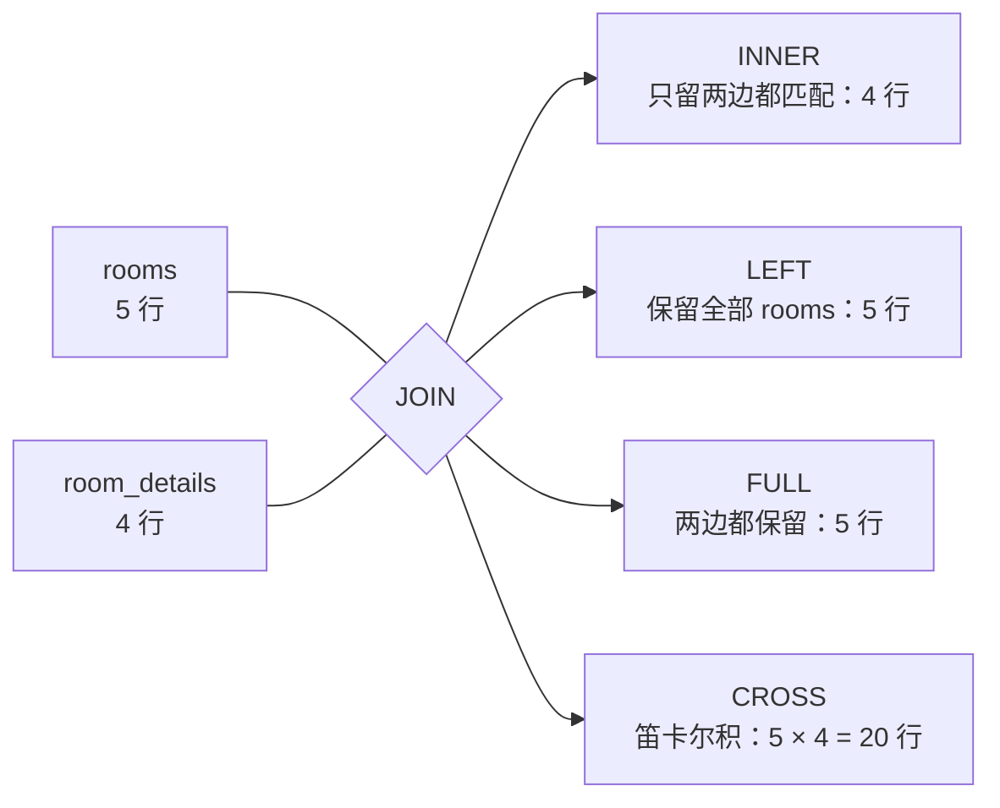

# 第 37 章 一对一、JOIN 查询与级联

## 拆表之后，怎么把数据拼回来

一张表塞下所有字段，列表页查一次就要拖着面积、隔音这些平时不用的列；所以常把「热」的字段留在主表，把「冷」的详情拆到另一张表。拆完，取一条完整信息就得把两张表按某个条件拼起来，这个动作叫 JOIN。条件通常就是「子表的外键 = 父表的主键」。

JOIN 的结果取决于你保留谁。`INNER JOIN` 只留下两边都匹配上的行：C101 没有详情，内连接一拼就整行消失——不报错，也不给你空值。`LEFT JOIN` 保留左表所有行，右表匹配不上就补 NULL，C101 因此能带着空详情回来。`RIGHT JOIN` 反过来，`FULL JOIN` 两边都保留。选哪种不取决于 SQL 好不好写，而取决于业务上「谁必须出现」。

外键（第 35 章见过）是子表列上的约束：值必须能在父表主键里找到。它顺带决定删父行时子行怎么办，这叫级联：`RESTRICT` 拦住删除，`CASCADE` 连子行一起删，`SET NULL` 把子行的外键置空。删除 A301 之前，先想清楚它的预订该不该跟着没。

官方文档（先看懂正文再点）：
- [JOIN 教程](https://www.postgresql.org/docs/17/tutorial-join.html)：用两张小表演示内连接、左连接的结果差在哪，对应本章「JOIN 保留谁」那段。
- [外键与级联动作](https://www.postgresql.org/docs/17/ddl-constraints.html#DDL-CONSTRAINTS-FK)：`RESTRICT`、`CASCADE`、`SET NULL` 在删父行时各做什么。
- [SELECT 的 JOIN 语法](https://www.postgresql.org/docs/17/sql-select.html#SQL-FROM)：`FROM` 里写连接条件的完整语法，写复杂连接时查。

现在看一个真实事故。

你给会议室加了个详情页，要显示面积、窗户、隔音。SQL 写完，列表里五间房，详情页只认得四间——C101 不见了。它没有报错，也没有空值，是整行消失：维护中的 C101 从来没人录过详情。

把这条查询改对外连接，C101 回来了，值是空的。沿着这条查询往下走：先看一对一怎么拆，再看六种 JOIN 各留下谁，最后看删房间时预订怎么办。下面的输出都是**示例输出**，写作环境没连 PostgreSQL。

## 能不能不拆表？

拆表不是为了「看起来规范」。列表页只要名称、容量、位置，详情字段（面积、窗户、隔音、备注）只有点进去才看；塞在一张表里，每次列表查询都要拖着这些不用的列，单页能放的行数变少、缓存命中变差。拆开之后 `rooms` 保持窄而热，`room_details` 冷而宽，各取所需。

代价是「取一条完整信息」要再拼一次。拆之前先回答一个问题：两行怎么算同一条？这就是**基数（cardinality）**，描述两张表行与行的对应关系——一间房最多一条详情是一对一，一间房多条预订是一对多。**外键**（第 35 章讲过）是子表上的约束，声明「这一列的值必须能在父表主键里找到」，由数据库检查，应用绕不过去。

## 一对一：主键同时是外键

```sql
CREATE TABLE room_details (
  room_id     uuid PRIMARY KEY REFERENCES rooms (id) ON DELETE CASCADE,
  area_sqm    numeric(6,1) NOT NULL CHECK (area_sqm > 0),
  has_window  boolean NOT NULL DEFAULT true,
  soundproof  boolean NOT NULL DEFAULT false,
  note        text
);
```

`room_id` 既是主键又是外键，一行就锁死了「一间房最多一条详情」。主键的本质是「唯一标识一行」，它自带唯一索引；`REFERENCES` 只是加一条「值必须存在于 rooms」的检查。两条约束落在同一列，语义正好是一对一。

换成普通 `id` 主键 + `room_id` 外键，就必须再补 `UNIQUE (room_id)`，否则同一间房能插两条，一对一悄悄变成一对多。判断是不是真一对一，看约束，不看业务口头怎么说。

| 建法 | 唯一性靠什么 | 代价 |
| --- | --- | --- |
| 共享主键 | `room_id` 是主键 | 插入时必须先有父行；主键即外键，省一条索引 |
| 独立主键 + `UNIQUE` | 额外唯一约束 | 多一条索引，子表 id 与父表解耦 |
| 合并成一张宽表 | 不需要 | 列表拖大字段，空值多，权限难分 |

灌四条详情，故意不给 C101：

```sql
INSERT INTO room_details (room_id, area_sqm, has_window, soundproof, note) VALUES
  ('a1111111-1111-4111-8111-111111111111', 28.5, true,  false, '靠近茶水间'),
  ('a2222222-2222-4222-8222-222222222222', 45.0, true,  true,  '可隔断为两间'),
  ('a3333333-3333-4333-8333-333333333333', 18.0, false, true,  '适合电话会'),
  ('a4444444-4444-4444-8444-444444444444', 80.0, true,  false, '大屏在讲台左侧');
```

回到开头那条查询：

```sql
SELECT r.name, r.capacity, d.area_sqm, d.has_window
FROM rooms r
LEFT JOIN room_details d ON d.room_id = r.id
ORDER BY r.name;
```

```text
 name | capacity | area_sqm | has_window
------+----------+----------+------------
 A301 |        8 |     28.5 | t
 A302 |       12 |     45.0 | t
 B201 |        4 |     18.0 | f
 B202 |       20 |     80.0 | t
 C101 |        6 |          | 
(5 rows)
```

把 `LEFT` 换成 `JOIN`，只剩 4 行。一对一不会像一对多那样放大行数（`room_id` 是主键，最多配一条），它只会让整行消失。这就是「空也要显示」必须用外连接的原因。

再往前一步，想筛「没有详情的房」，条件不能写 `WHERE d.area_sqm <> 20`：`NULL <> 20` 的结果是 `unknown`，不是 `true`，C101 又会被过滤掉。正确写法是 `WHERE d.room_id IS NULL`。同理，`WHERE d.area_sqm > 20` 会把外连接主动退化成内连接——这是三值逻辑定的，不是优化器多事。

约束也不是摆设。给 A301 再插一条详情，主键当场拦下：

```sql
INSERT INTO room_details (room_id, area_sqm)
VALUES ('a1111111-1111-4111-8111-111111111111', 30.0);
```

```text
ERROR:  duplicate key value violates unique constraint "room_details_pkey"
DETAIL:  Key (room_id)=(a1111111-1111-4111-8111-111111111111) already exists.
```

用的是 `id` 主键 + `UNIQUE (room_id)` 的话，报错会换成 `room_details_room_id_key`，效果一样；区别只是主键本身就是一个唯一索引，查详情直接走它，不必再维护第二条。

这条查询接到 Nest 里，还有一个类型上的坑：

```ts
// src/rooms/room-detail.repository.ts
const { rows } = await pool.query(
  `SELECT r.name, r.capacity, d.area_sqm
     FROM rooms r
     LEFT JOIN room_details d ON d.room_id = r.id
    WHERE r.id = $1`,
  [roomId],
);
// rows[0].area_sqm 是 '28.5'（字符串）或 null，不是 number
```

`numeric` 为了不丢精度，node-postgres 默认按字符串返回；只有 `int`、`float8` 会变成 JS 的 `number`。前端拿 `'28.5'` 去调 `toFixed` 会直接抛错。要么在 SQL 里写 `d.area_sqm::float8`，要么在映射层 `Number()`；C101 那行是 `null`，类型得写 `string | null`，别图省事写成 `number`。

这层代码的归位也顺手说一下：`room-detail.repository.ts` 就是第 35 章说的 **Repository**——方法名按业务语义起（`findDetailByRoomId`），SQL 收在这里，`RoomsService` 只拿结果不拼 SQL。它返回的 `rows` 更接近表结构的 **PO**，要变成接口契约里的 DTO，还得显式映射一层（把 `area_sqm` 转成 `number`、补一个 `hasDetail` 布尔）。

## 六种 JOIN，先记保留谁

`JOIN` 按连接条件把两张表的行配对，输出两张表的列。它不改变表里的数据，只决定这次查询怎么拼。写法有六种，先记「保留谁」：

> **图 37-1** JOIN 类型决定没匹配上的行留不留



| 写法 | 保留 | 什么时候用 |
| --- | --- | --- |
| `JOIN` / `INNER JOIN` | 只留匹配上的 | 确定两边都有数据 |
| `LEFT JOIN` | 左表全部 | 列表要显示「没有子记录」的父行 |
| `RIGHT JOIN` | 右表全部 | 少见，把两张表调换写成 `LEFT` 更好读 |
| `FULL JOIN` | 两边全部 | 对账、找孤儿数据 |
| `CROSS JOIN` | 笛卡尔积 | 生成「房间 × 日期」这类矩阵 |
| `LEFT JOIN LATERAL` | 左表全部，右侧逐行算 | 每间房取最近一条、Top-N-per-group |

`RIGHT JOIN` 不是新语法，`A RIGHT JOIN B` 等于 `B LEFT JOIN A`，结果一样，只是读的人要在脑子里翻个面。`NATURAL JOIN` 和 `USING` 这里没列：前者按同名列自动连，模式一变就连错；后者只是 `ON a.id = b.id` 的简写，列名不统一时反而更难读。

执行层面，规划器会在三种算法里挑：**Nested Loop** 外层每取一行、拿连接键去内层查一次，外表小、内表有索引时最快，`loops` 就是内层跑了几次；**Hash Join** 把小表在内存里建哈希表，再扫大表逐行探测，两边都大且没有可用索引时常用，内存不够会落盘；**Merge Join** 两边先按连接键排好序再像拉链一样并起来。没有哪种绝对快——5 行的表全表扫比走索引更快，别看到 `Seq Scan` 就急着加索引。

找「有房没详情、有详情没房」的孤儿，用 `FULL JOIN`：

```sql
SELECT r.name AS room, d.room_id AS detail_room
FROM rooms r
FULL JOIN room_details d ON d.room_id = r.id
WHERE r.id IS NULL OR d.room_id IS NULL;
```

```text
 room | detail_room
------+-------------
 C101 |
(1 row)
```

正常只会出现 C101 这种「有房没详情」。真出现第二行「有详情没房」，说明外键被绕过了，或者数据是从别处导进来的——比如导入时用 `session_replication_role = replica` 临时关掉了触发器，或者约束是 `NOT VALID` 之后忘了 `VALIDATE`。

生成「每间房每天」的空矩阵，用 `CROSS JOIN` 配 `generate_series`：

```sql
SELECT count(*) AS slots
FROM rooms
CROSS JOIN generate_series('2026-11-02'::date, '2026-11-04'::date, interval '1 day') AS d (day);
```

```text
 slots
-------
    15
```

5 间房 × 3 天 = 15 行。`CROSS JOIN` 没有 `ON`，两边行数上万时结果会爆炸（10 万 × 10 万是一百亿行），先用 `count(*)` 估一下再物化。

「每间房最近一条预订」用 `LATERAL`：

```sql
SELECT r.name, last.start_time, last.status
FROM rooms r
LEFT JOIN LATERAL (
  SELECT b.start_time, b.status
  FROM bookings b
  WHERE b.room_id = r.id
    AND b.status IN ('PENDING', 'APPROVED')
  ORDER BY b.start_time DESC
  LIMIT 1
) AS last ON true
ORDER BY r.name;
```

```text
 name |      start_time       |  status
------+-----------------------+----------
 A301 | 2026-11-06 09:00:00+08 | APPROVED
 A302 | 2026-11-04 14:00:00+08 | APPROVED
 B201 | 2026-11-03 13:00:00+08 | APPROVED
 B202 | 2026-11-05 10:00:00+08 | APPROVED
 C101 |                       |
(5 rows)
```

`LATERAL` 让右边的子查询能引用左边的 `r.id`，相当于对每间房各跑一次，`LIMIT 1` 只取最近一条。`ON true` 不是废话：`LEFT JOIN LATERAL` 必须有连接条件，而真正的条件已经在子查询里了。换成 `JOIN LATERAL`，C101 又会被丢掉。

同一个需求上一章用窗口函数写过：先给所有行编号，再筛 `rn = 1`，`bookings` 只扫一遍，数据量大时通常更快；`LATERAL` 是每间房一次索引查找，房间少、每间房预订多时更划算。两种都对，取决于行数分布。

## 级联：删一间房，预订去哪

第 35 章建表时已经写死了两条规则：`bookings.room_id` 是 `ON DELETE RESTRICT`，有预订的会议室删不掉；`room_details.room_id` 是 `ON DELETE CASCADE`，房没了详情也没意义。

试删 A301：

```sql
DELETE FROM rooms WHERE name = 'A301';
```

```text
ERROR:  update or delete on table "rooms" violates foreign key constraint "bookings_room_id_fkey" on table "bookings"
DETAIL:  Key (id)=(a1111111-1111-4111-8111-111111111111) is still referenced from table "bookings".
```

数据库在替业务踩刹车。要下线一间房，正确动作是把 `status` 改成 `MAINTENANCE`，而不是删行——历史预订、报表、审计都还要用它。这也是「加一个 `is_deleted` 列」在业务系统里比物理删除更常见的原因。

外键检查不是免费的。父行每删一次，PG 都要去子表确认「还有没有引用」；`bookings.room_id` 上没索引的话，这个确认就是全表扫，删一间房可能扫几百万行。PG **不会**自动给外键列建索引（MySQL 会），所以那个索引既服务「我的预订」，也服务删除和更新父行。

再看 `CASCADE` 那一侧，删陈默会带走他的四条预订：

```sql
BEGIN;
DELETE FROM users WHERE email = 'chenmo@example.com';
SELECT count(*) AS bookings_left FROM bookings;
ROLLBACK;
```

```text
 bookings_left
---------------
            10
```

14 减 4，对得上。这条规则适合「子行没有独立生命周期」的场景，比如订单明细；但用户注销就删预订，财务和审计多半不接受。生产里更常见的是软删：给 `users` 加 `deleted_at`，预订原样保留。`CASCADE` 是数据库给的能力，不是默认答案。

| 动作 | 父行被删时 | 适用 |
| --- | --- | --- |
| `CASCADE` | 子行一起删 | 详情、明细、附属关系 |
| `RESTRICT` | 有子行就报错，立即检查 | 历史数据、财务凭证 |
| `NO ACTION` | 默认，检查可推迟到事务末尾 | 需要 `DEFERRABLE` 的事务内调整 |
| `SET NULL` | 子行外键置空（列必须可空） | 「操作人删了，记录还在」 |
| `SET DEFAULT` | 子行外键改默认值 | 有兜底默认行时 |

`RESTRICT` 和 `NO ACTION` 在不延迟时行为几乎一样，差别在时机：`RESTRICT` 在语句执行中立刻拒绝，`NO ACTION` 允许把检查推迟到事务提交（约束得声明成 `DEFERRABLE INITIALLY DEFERRED`）。批量换父行 id 这种操作，靠延迟检查才能过中间态；普通业务表用 `RESTRICT` 更直接，报错更早。

`SET NULL` 下一章就会用到：`user_roles.granted_by` 指向授权人，人离职、账号被删，授权记录不该跟着消失，就把这一列置空——记录还在，只是不知道当初是谁批的。注意列必须允许 `NULL`，而且置空也会更新子表，量大的时候同样需要索引。

`ON UPDATE` 支持同样五种动作。本项目主键是 `uuid`，不会变，所以用不上；如果拿 `slug` 这类自然键做外键，改名时就得靠 `ON UPDATE CASCADE` 同步子表。

还有一个更狠的：`TRUNCATE rooms CASCADE` 会连 `bookings` 一起清空。它不触发 `DELETE` 触发器，也不走 `RESTRICT` 的逐行检查，生产环境别随手敲。

## 执行计划里看什么

**执行计划**是数据库为一条 SQL 选的取数路径，`EXPLAIN` 把这条路径打印出来，加 `ANALYZE` 会真的执行并报告实际行数。

```sql
EXPLAIN (ANALYZE, BUFFERS)
SELECT r.name, d.area_sqm
FROM rooms r
LEFT JOIN room_details d ON d.room_id = r.id
WHERE r.status = 'AVAILABLE'
ORDER BY r.name;
```

```text
Nested Loop Left Join  (cost=0.15..31.85 rows=4) (actual time=0.038..0.050 rows=4 loops=1)
  ->  Seq Scan on rooms r  (cost=0.00..15.50 rows=2) (actual rows=4 loops=1)
        Filter: (status = 'AVAILABLE'::text)
  ->  Index Scan using room_details_pkey on room_details d  (cost=0.15..8.17 rows=1) (actual rows=1 loops=4)
        Index Cond: (room_id = r.id)
Planning Time: 0.074 ms
Execution Time: 0.101 ms
```

`cost=0.15..31.85` 是估算代价，前半是返回第一行前的启动成本，后半是返回全部的成本；单位是抽象的「页读取 + CPU」，不同机器、不同版本不可直接比较，别拿 `31.85` 和同事的 `28.4` 比谁快。能下结论的是 `actual rows`、`loops` 和连接方式。

读法：外层 `rooms` 扫出 4 行，每行拿 `r.id` 去 `room_details` 的主键索引查一次，`loops=4` 就是查了四次。这是「小外表 + 内表连接键有索引」时最理想的 `Nested Loop`。估算 `rows=2`、实际 4，是因为表刚建完没跑统计信息，`ANALYZE rooms;` 之后估算会贴近。统计信息是规划器的输入，大批量写入后不更新，计划可能一直选错。

`BUFFERS` 会多打一行 `Buffers: shared hit=... read=...`：`hit` 是命中共享缓冲区，`read` 才是真的从磁盘读。

`EXPLAIN ANALYZE` 会真的执行。对 `UPDATE`/`DELETE` 要看计划，先包在 `BEGIN; ... ROLLBACK;` 里，否则「分析」完数据也改完了。

## 几个容易踩的边界

| 现象 | 原因 | 改法 |
| --- | --- | --- |
| `LEFT JOIN` 后空行没了 | 右表条件写在 `WHERE` 里 | 条件挪到 `ON`，或接受它退化成 `INNER` |
| 一对一插出两条 | 只加了外键，没加 `UNIQUE`/主键 | `room_id` 直接做主键 |
| 删父行很慢 | 子表外键列没索引 | 给 `bookings.room_id` 建索引（已有） |
| 删一间房，预订全没 | 外键写了 `CASCADE` 却没想清楚 | 改 `RESTRICT`，或改软删 |
| `FULL JOIN` 结果变少 | `WHERE` 里对某一侧列做了非空判断 | 用 `IS NULL` 找孤儿，别加普通等值条件 |
| `NATURAL JOIN` 连错列 | 自动按同名列连接，模式一变就错 | 显式写 `ON` |
| `LATERAL` 报语法错 | 忘了 `ON true` 或没写括号别名 | `LEFT JOIN LATERAL (...) AS x ON true` |
| 详情页 500 | `numeric` 被当 `number` 用 | SQL 里 `::float8`，或映射层 `Number()` |

「空也要显示」翻译成 SQL 就是「以谁为主表，就用 `LEFT JOIN` 把谁保住」。这句话在下一章会更重要：一对多和多对多会把行数放大，主表保错了，合计和明细会一起错。

想更深入的话，官方文档里有这几页可以接着看：[JOIN 语法](https://www.postgresql.org/docs/17/queries-table-expressions.html)（`FROM` 子句里各种连接写法的完整说明）、[外键与级联](https://www.postgresql.org/docs/17/ddl-constraints.html#DDL-CONSTRAINTS-FK)（建外键时可选的级联动作清单）、[`EXPLAIN`](https://www.postgresql.org/docs/17/using-explain.html)（看数据库打算怎么执行这条 JOIN，判断有没有走索引）、[`LATERAL`](https://www.postgresql.org/docs/17/queries-table-expressions.html#QUERIES-LATERAL)（连接时右边能引用左边当前行的写法，解决「每行再查一次」的需求）。

<!-- chapter-nav:start -->
---

← 上一篇：[036 SQL查询语句的所有语法和函数PostgreSQL版](036-SQL查询语句的所有语法和函数PostgreSQL版.md) · [本 Part 目录](_part.md) · 下一篇：[038 一对多、多对多的表设计](038-一对多、多对多的表设计.md) →
<!-- chapter-nav:end -->
