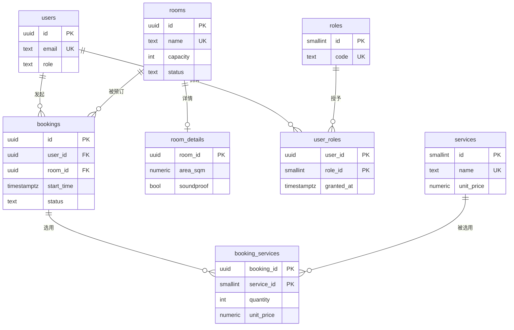

# 第 38 章 一对多、多对多的表设计

## 一对多、多对多，到底在说什么

表与表之间的对应关系叫「基数」（第 37 章讲过），最常打交道的两种是一对多和多对多。一对多：`users` 里一行（一个用户）对应 `bookings` 里多行，反过来每条预订只属于一个用户。这种关系不用在两张表之外再建东西，只要在「多」的那一侧放一个外键列（`bookings.user_id`），指向「一」那一侧的主键。父表不要存子表 id 的数组：数组元素不受外键约束，改一条预订要读写整行，并发会互相覆盖，按时间排序和建索引也别扭。

多对多：一个用户可以是多个角色，一个角色也可以给多个用户。这种关系用列表达不了——加 `is_approver`、`is_approver_sales` 会随着身份种类无限加列，查询变成一串 OR。标准解法是加第三张表，每行只存「谁和谁发生了关系」，叫中间表（junction table）。中间表还能带自己的属性，比如「这个角色是谁在什么时候授予的」。

这样拆的另一个理由是范式（normalization）：同样的信息只存一份，改的时候只有一个地方要动。范式不是越严格越好，后面会看到为了查询性能故意反着来（反范式）的场景。

外键和索引通常成对出现：外键保证值有效，索引让「按外键查子行」和「删父行时检查子行」不用全表扫。PostgreSQL 不会自动给外键列建索引，这一章会补上。

官方文档（先看懂正文再点）：
- [外键约束](https://www.postgresql.org/docs/17/ddl-constraints.html#DDL-CONSTRAINTS-FK)：外键怎么写、删改父行时怎么连带子行。
- [索引](https://www.postgresql.org/docs/17/indexes.html)：为什么外键列要单独建索引，以及索引的代价。
- [表设计与 DDL](https://www.postgresql.org/docs/17/ddl.html)：建表、改表语句的总览，本章建中间表时对照。

现在看一个真实事故。

审批功能上线前一周，周雨在群里说：以后会议室预订要经我批。你给 `users` 加了个 `is_approver boolean`，半小时搞定。

第二周赵启说，销售部的预订他来批。你又加了一列 `is_approver_sales`。第三周行政要「资产管理员」，你盯着 `users` 表意识到这条路走到头了：每多一种身份就多一列，查询变成 `WHERE is_approver OR is_approver_sales OR is_asset_manager`，索引也没法建，因为过滤的是三列 OR。

问题不在字段名，在关系。一个人可以同时是审批人、报表查看者、资产管理员，这是**多对多**——它表达不了成「这个人有哪些列」，只能表达成「谁和谁发生了关系」。这一章从已经跑起来的预订表出发，把一对多、多对多、带属性的中间表，以及配套的索引走一遍。输出都是**示例输出**。

## 一对多：外键放在多的一侧

一个用户有多条预订，一间会议室也有多条预订。两条都是「一」在 `users`/`rooms`、「多」在 `bookings`，所以外键放在 `bookings` 上：`user_id`、`room_id`。规则就这一句——**外键永远在「多」的那一侧，父表不存子表 id 的列表**。

反过来设计，在 `users` 里存 `booking_ids uuid[]`，会同时丢掉四样东西。第一，外键约束管不到数组元素，数组里可以写一个不存在的预订 id，数据库不会拦。第二，删预订要先读数组、改数组、写回，两个请求并发时后写的会覆盖先写的。第三，按用户查预订只能扫全表，或者给数组建 GIN 索引，而 GIN 不擅长「按时间排序」。第四，数组长度没有上限，一个重度用户能把一行撑得很大。数组是值，不是关系；关系要落到行上。

查陈默的预订，就是最普通的一对多：

```sql
SELECT b.start_time, b.end_time, r.name AS room, b.status
FROM bookings b
JOIN rooms r ON r.id = b.room_id
WHERE b.user_id = (SELECT id FROM users WHERE email = 'chenmo@example.com')
ORDER BY b.start_time;
```

```text
       start_time       |       end_time       | room |  status
-----------------------+----------------------+------+-----------
 2026-11-02 09:00:00+08 | 2026-11-02 10:00:00+08 | A301 | APPROVED
 2026-11-03 09:30:00+08 | 2026-11-03 10:30:00+08 | A302 | PENDING
 2026-11-04 09:30:00+08 | 2026-11-04 10:30:00+08 | A301 | PENDING
 2026-11-06 16:00:00+08 | 2026-11-06 18:00:00+08 | A302 | CANCELLED
(4 rows)
```

按房间数有效预订，注意筛选条件放在 `ON` 里：

```sql
SELECT r.name, count(b.id) AS bookings
FROM rooms r
LEFT JOIN bookings b
  ON b.room_id = r.id
 AND b.status IN ('PENDING', 'APPROVED')
GROUP BY r.id, r.name
ORDER BY bookings DESC, r.name;
```

```text
 name | bookings
------+----------
 A301 |        5
 A302 |        3
 B202 |        2
 B201 |        1
 C101 |        0
```

把 `status` 条件挪到 `WHERE`，C101 会消失——`LEFT JOIN` 补出来的 `NULL` 行不满足 `status IN (...)`，整行被过滤，外连接退化成内连接。

外键列必须有索引，这一点 PG 和 MySQL 不一样。MySQL 建外键会顺手建索引；PG 不会。`bookings.user_id` 上没索引，「我的预订」和删用户时的级联检查都会全表扫。项目里已经有 `idx_bookings_user`，看一条查询的计划（`EXPLAIN` 在第 37 章讲过：让数据库打印执行计划，不真正执行）：

```sql
EXPLAIN
SELECT start_time, end_time FROM bookings
WHERE user_id = '22222222-2222-4222-8222-222222222222'
ORDER BY start_time;
```

```text
Sort  (cost=9.51..9.52 rows=2 width=16)
  Sort Key: start_time
  ->  Bitmap Heap Scan on bookings b  (cost=4.16..9.50 rows=2 width=16)
        Recheck Cond: (user_id = '22222222-2222-4222-8222-222222222222'::uuid)
        ->  Bitmap Index Scan on idx_bookings_user  (cost=0.00..4.16 rows=2 width=0)
              Index Cond: (user_id = '22222222-2222-4222-8222-222222222222'::uuid)
```

先按索引把行号捞进位图，按物理页排好再回表，最后排序。这里还能看出一个改进点：查询要 `ORDER BY start_time`，索引只按 `user_id` 排，所以多了一步 `Sort`。改成复合索引 `(user_id, start_time)`，这些行在索引里已经按时间排好，`Sort` 就省了——「等值过滤 + 时间排序」的查询，索引顺序就是「过滤列在前、排序列在后」。代价是索引变大、写入多维护一列，值不值看这条查询的频率。

## 多对多：中间表装的是关系

`users.role` 这一列继续留着，它表示账号的主权限级别（`ADMIN` / `USER`），决定「能不能进后台」；审批人、报表查看、资产管理是业务身份，一个人可以兼好几个。两者语义不同，别合并：系统角色是「你的账号是什么级别」，业务身份是「你在组织里负责什么」。

多对多必须引入第三张表，叫**联接表**（join table）或中间表，每一行表示「谁和谁发生了关系」。这张表通常没有自己的业务 id，两个外键合起来就是主键：

```sql
CREATE TABLE roles (
  id   smallint GENERATED ALWAYS AS IDENTITY PRIMARY KEY,
  code text NOT NULL UNIQUE,
  name text NOT NULL
);

CREATE TABLE user_roles (
  user_id    uuid NOT NULL REFERENCES users (id) ON DELETE CASCADE,
  role_id    smallint NOT NULL REFERENCES roles (id) ON DELETE RESTRICT,
  granted_at timestamptz NOT NULL DEFAULT now(),
  granted_by uuid REFERENCES users (id) ON DELETE SET NULL,
  PRIMARY KEY (user_id, role_id)
);

CREATE INDEX idx_user_roles_role ON user_roles (role_id);
```

**复合主键**是两列以上联合起来唯一标识一行：单看 `user_id` 会重复，单看 `role_id` 也会重复，`(user_id, role_id)` 才唯一。它同时干两件事：保证同一个人不会被重复授予同一个身份；给「查某人的身份」提供一个现成索引。

B-tree 索引按列顺序排，`(user_id, role_id)` 能服务 `WHERE user_id = ?`，服务不了 `WHERE role_id = ?`——这叫最左前缀。所以 `idx_user_roles_role` 单独补上，管反方向「查某个身份下有哪些人」。中间表两个方向都要查，就两个方向都得有索引，只建主键等于只修了一半。

`granted_by` 用 `ON DELETE SET NULL`：授权人离职、账号被删，授权记录还在，只是不知道当初是谁批的。换成 `CASCADE`，人一走，他批过的权限全没了，审计会来找你。这也点出中间表的定位：`user_id`、`role_id` 是「关系指向谁」，`granted_at`、`granted_by` 是「这段关系本身的信息」——后者放不进任何一张主表，只能放中间表。

灌入身份和授权：

```sql
INSERT INTO roles (code, name) VALUES
  ('approver', '预订审批人'),
  ('reporter', '报表查看'),
  ('asset_manager', '会议室资产管理员'),
  ('finance', '财务');

INSERT INTO user_roles (user_id, role_id, granted_by) VALUES
  ('11111111-1111-4111-8111-111111111111', 1, '11111111-1111-4111-8111-111111111111'),
  ('11111111-1111-4111-8111-111111111111', 2, '11111111-1111-4111-8111-111111111111'),
  ('11111111-1111-4111-8111-111111111111', 3, '11111111-1111-4111-8111-111111111111'),
  ('33333333-3333-4333-8333-333333333333', 1, '11111111-1111-4111-8111-111111111111'),
  ('44444444-4444-4444-8444-444444444444', 2, '11111111-1111-4111-8111-111111111111');
```

查每个人的身份，用 `array_agg` 把多行压成数组：

```sql
SELECT u.name, array_agg(ro.code ORDER BY ro.id) AS roles
FROM users u
JOIN user_roles ur ON ur.user_id = u.id
JOIN roles ro ON ro.id = ur.role_id
GROUP BY u.id, u.name
ORDER BY u.email;
```

```text
 name |              roles
------+----------------------------------
 林岚 | {approver,reporter,asset_manager}
 赵启 | {reporter}
 周雨 | {approver}
(3 rows)
```

只有三行：孙禾、吴桐、陈默没有任何业务身份。要让他们出现，把 `JOIN user_roles` 换成 `LEFT JOIN`，数组会得到 `{NULL}`，再用 `coalesce(..., '{}')` 收干净。`array_agg` 里的 `ORDER BY` 别省——没有它，数组顺序由执行计划决定，前端渲染出来的标签顺序会飘。

反方向查每个身份有几个人，正好用上 `idx_user_roles_role`：

```sql
SELECT ro.code, count(ur.user_id) AS users
FROM roles ro
LEFT JOIN user_roles ur ON ur.role_id = ro.id
GROUP BY ro.id, ro.code
ORDER BY ro.id;
```

```text
      code      | users
----------------+-------
 approver      |     2
 reporter      |     2
 asset_manager |     1
 finance       |     0
(4 rows)
```

`finance` 还没人用，`LEFT JOIN` 让它以 0 出现；换成内连接，这个身份会从报表里消失，运营会以为角色没建成功。

重复授予同一个人同一个身份，主键会拦。接口层更常见的写法是让数据库直接忽略：

```sql
INSERT INTO user_roles (user_id, role_id, granted_by)
VALUES ('11111111-1111-4111-8111-111111111111', 1, '11111111-1111-4111-8111-111111111111')
ON CONFLICT (user_id, role_id) DO NOTHING;

SELECT count(*) AS roles_after
FROM user_roles
WHERE user_id = '11111111-1111-4111-8111-111111111111';
```

```text
INSERT 0 0
 roles_after
-------------
           3
```

`ON CONFLICT` 需要冲突目标上有唯一约束，复合主键正好提供了。只靠应用层「先查再插」的中间表，并发下一定会插出重复行——两个请求同时查到「还没有」，然后同时插入，唯一约束是最后的防线。

`DO NOTHING` 在冲突时不返回行，所以不适合「插完要拿 id」的场景；它也处理不了「这个人当前有哪些身份、旧的要不要撤」。后台的「编辑身份」通常是**整体替换**：先删这个用户的全部授权，再插新的，放在一个事务里：

```ts
// src/users/user-roles.repository.ts
const client = await pool.connect();
try {
  await client.query('BEGIN');
  await client.query('DELETE FROM user_roles WHERE user_id = $1', [userId]);
  await client.query(
    `INSERT INTO user_roles (user_id, role_id, granted_by)
     SELECT $1, unnest($2::smallint[]), $3
     ON CONFLICT DO NOTHING`,
    [userId, roleIds, grantedBy],
  );
  await client.query('COMMIT');
} catch (err) {
  await client.query('ROLLBACK');
  throw err;
} finally {
  client.release();
}
```

这里有分工。`UpdateUserRolesDto` 负责请求形状和校验（`roleIds` 是 `number[]`，每个元素都是整数）；`UsersService.replaceRoles()` 负责业务规则（不能给自己撤掉最后一个管理员）；`user-roles.repository.ts` 只负责上面这条 SQL。DTO 是跨层传输的契约，不承载业务逻辑；Repository 是第 35 章说的「面向聚合的持久化抽象」，SQL 收在这里，Service 里看不到 `INSERT`。把 SQL 散进 Controller 或 Service，换一个查询要改三处，这是最常见的分层事故。

## 关系自己也有属性：服务明细

会议室预订还能加服务：茶歇、投影、打印、保洁。一个预订可以选多种服务，一种服务也出现在很多预订里，又是多对多。但这次中间表不能只有两个外键，还要记数量和单价：

```sql
CREATE TABLE services (
  id         smallint GENERATED ALWAYS AS IDENTITY PRIMARY KEY,
  name       text NOT NULL UNIQUE,
  unit       text NOT NULL,
  unit_price numeric(8,2) NOT NULL CHECK (unit_price >= 0)
);

CREATE TABLE booking_services (
  booking_id uuid NOT NULL REFERENCES bookings (id) ON DELETE CASCADE,
  service_id smallint NOT NULL REFERENCES services (id) ON DELETE RESTRICT,
  quantity   integer NOT NULL CHECK (quantity > 0),
  unit_price numeric(8,2) NOT NULL CHECK (unit_price >= 0),
  PRIMARY KEY (booking_id, service_id)
);
```

`unit_price` 在两张表里各存一份，这不是手滑。服务价目表会调价，历史预订的金额不能跟着变，所以下单那一刻把价格抄进明细——这叫**快照价**，是有意的反范式。代价是调价后新单必须写新价，不能靠触发器回头改旧行。

`quantity` 和 `unit_price` 都加了 `CHECK`：数量必须为正、单价不能为负。规则写在表上，脚本和别的服务也绕不过去；只写在 DTO 里，绕过 API 直接导数据时就失效了。

金额用 `numeric(8,2)` 而不是 `float`：二进制浮点存不下 0.1，累加会出现 `450.00000000000006`，对账时很难看。`numeric` 是十进制精确类型，代价是运算慢一点、占空间多一点。精度按业务定：单价两位小数够用；按秒计费或汇率换算可能得 `numeric(12,4)`，一开始定窄了，后面改列类型要锁表。

```sql
INSERT INTO services (name, unit, unit_price) VALUES
  ('茶歇', '人', 25.00),
  ('投影设备', '次', 100.00),
  ('打印', '页', 0.50),
  ('保洁', '次', 80.00);

INSERT INTO booking_services (booking_id, service_id, quantity, unit_price) VALUES
  ('b6666666-6666-4666-8666-666666666666', 1, 18, 25.00),
  ('b9999999-9999-4999-8999-999999999999', 2, 1, 100.00),
  ('b9999999-9999-4999-8999-999999999999', 3, 40, 0.50),
  ('baaaaaaa-aaaa-4aaa-8aaa-aaaaaaaaaaaa', 1, 12, 25.00);
```

按预订汇总服务费：

```sql
SELECT r.name AS room, b.start_time::date AS day,
       sum(bs.quantity * bs.unit_price) AS service_total
FROM bookings b
JOIN rooms r ON r.id = b.room_id
JOIN booking_services bs ON bs.booking_id = b.id
GROUP BY b.id, r.name, b.start_time
ORDER BY day, b.start_time;
```

```text
 room |    day     | service_total
------+------------+---------------
 B202 | 2026-11-03 |        450.00
 A302 | 2026-11-04 |        120.00
 B202 | 2026-11-05 |        300.00
(3 rows)
```

三场会议，服务费合计 870 元。把茶歇从 25 调到 30，看快照价和历史价差多少：

```sql
BEGIN;
UPDATE services SET unit_price = 30.00 WHERE name = '茶歇';

SELECT sum(bs.quantity * bs.unit_price) AS snapshot_total
FROM booking_services bs
WHERE bs.booking_id = 'b6666666-6666-4666-8666-666666666666';

SELECT 18 * s.unit_price AS live_total
FROM services s WHERE s.name = '茶歇';
ROLLBACK;
```

```text
BEGIN
UPDATE 1
 snapshot_total
----------------
         450.00
 live_total
------------
     540.00
ROLLBACK
```

历史订单仍是 450，按现价重算是 540。如果 `booking_services` 只存 `service_id`、金额实时 join `services`，月底对账会发现上个月的报表跟着这个月的调价一起变了。

主键选 `(booking_id, service_id)` 也有取舍：它保证「同一预订同一服务只有一行」，适合「茶歇 18 人」这种一次性数量；业务允许同一服务分两次下单（上午 10 人、下午 8 人），就得加代理主键 `id`，再补 `UNIQUE (booking_id, service_id, seq)`。约束表达的是业务规则，先想清楚「什么算重复」。

## 整套关系长什么样

图里 `||--o{` 读作「恰好一个对零个或多个」，是一对多；`||--o|` 是「恰好一个对零个或一个」，是一对一。`PK` 是主键，`FK` 是外键，`UK` 是唯一约束。

> **图 38-1** 会议室预订系统的八张表



`bookings` 是枢纽：它同时挂着一个用户和一间房，所以有两个外键；它又被 `booking_services` 引用，所以删预订会级联删掉服务明细。`room_details` 是 `rooms` 的附属，`user_roles` 是 `users` 和 `roles` 的联接表，`booking_services` 是 `bookings` 和 `services` 的联接表。从任意一张表出发走一遍，都能回答「这条数据属于谁、删了会影响谁」——这比背表结构有用。

## 反范式：什么时候故意重复

**范式（normalization）** 是「同一事实只存一份」的设计原则，目的是避免更新异常：房间改名只改一处，所有引用自动生效。**反范式**就是故意存重复，换读取性能或历史快照，代价是写入时要同步维护。归一化不是道德要求，是默认起点；下面这些重复是权衡后的选择：

| 场景 | 做法 | 拿到的 | 付出的 |
| --- | --- | --- | --- |
| 订单价格 | `booking_services.unit_price` 抄一份 | 历史金额稳定 | 调价后新单要写新价 |
| 列表显示房间名 | 不冗余，join `rooms` | 改名立即生效 | 每次查询多一次 join |
| 首页「本周热门」 | 物化视图（预存查询结果的表）定时刷新 | 报表查询快 | 数据有延迟 |
| 房间预订数 | 计数缓存列 | 列表页少一次聚合 | 增删改都要维护计数 |

判断标准很土：这份重复的数据会不会在业务上「定格」。价格定格在成交那一刻，所以抄；房间名不会定格，改了就该到处生效，所以不抄。拿不准就先归一化，等执行计划和真实数据告诉你哪里疼，再动手冗余。

计数缓存列是另一个典型。`rooms.booking_count` 能让列表页少一次 `GROUP BY`，但每次插入、取消、删除预订都要在同一个事务里 `UPDATE rooms SET booking_count = booking_count + 1`；漏一处，数字就永久偏了，而且很难查。物化视图省事，但 `REFRESH MATERIALIZED VIEW` 默认锁整张视图，要 `CONCURRENTLY` 得先建唯一索引，刷新期间还会读到旧数据。

## 索引与外键，成对出现

中间表的索引规则可以背下来：**复合主键覆盖一个方向，另一个方向补一条普通索引**。`user_roles` 的 `(user_id, role_id)` 管「用户 → 身份」，`idx_user_roles_role` 管「身份 → 用户」；`booking_services` 同理，查「某项服务被哪些预订用了」需要 `service_id` 上的索引。

预订表还有一类查询只关心有效预订：时间线、冲突检测、审批列表。可以建**部分索引**——只对满足条件的行建索引，索引更小、写入更便宜：

```sql
CREATE INDEX idx_bookings_active_room_time
ON bookings (room_id, start_time)
WHERE status IN ('PENDING', 'APPROVED');
```

代价是查询条件必须带上同样的 `status` 过滤，规划器才认；小表上它可能根本不会被选中，先跑 `EXPLAIN` 再决定。生产环境建索引还要考虑锁：普通 `CREATE INDEX` 会阻塞写入，大表用 `CREATE INDEX CONCURRENTLY`，代价是建得更慢、失败会留下无效索引（`\d` 里能看到 `INVALID`），得删掉重来。

索引不是越多越好。每个索引都要在增删改时维护，还占磁盘和缓存；`pg_stat_user_indexes` 里 `idx_scan = 0` 的索引就是纯成本，定期查一遍。

## 几个容易踩的边界

| 现象 | 原因 | 改法 |
| --- | --- | --- |
| 同一个人有两个相同身份 | 中间表没主键或唯一约束 | `PRIMARY KEY (user_id, role_id)` |
| 按身份查人很慢 | 只建了「用户 → 身份」方向索引 | 给 `role_id` 补索引 |
| 统计里少了没人用的角色 | 内连接把 0 行过滤掉 | 从 `roles` 出发 `LEFT JOIN` |
| 历史订单金额变了 | 明细没存快照价，实时 join 价目表 | 下单时把 `unit_price` 写进明细 |
| 删用户后权限还在 | 外键写了 `SET NULL` 或没写 | 按语义选 `CASCADE`，别默认 |
| 删房间特别慢 | `bookings.room_id` 没索引 | 外键列建索引 |
| 给中间表加了代理主键 | 忘了再补 `UNIQUE (a, b)` | 复合主键，或补唯一约束 |
| 金额出现 `450.00000000000006` | 用了 `float`/`double` | 金额一律 `numeric` |
| 部分索引没被用上 | 查询没带 `WHERE status IN (...)` | 让查询条件与索引谓词一致 |

多对多的坑大多不在 SQL 写法，在「这张中间表到底该有哪些列」。两个外键是最小值；`granted_at`、`quantity`、`unit_price` 这些描述「关系本身」的字段，放主表放不进去，放中间表正合适。

表设计定下来，查询才有稳定的地基。下一章拿这些表做题库：谁还没预订过、哪间房有空档，用子查询和 `EXISTS` 怎么问。

想更深入的话，官方文档里有这几页可以接着看：[约束与外键](https://www.postgresql.org/docs/17/ddl-constraints.html#DDL-CONSTRAINTS-FK)（除主外键外还有唯一、检查等约束，建表时挑）、[索引](https://www.postgresql.org/docs/17/indexes.html)（索引类型和适用场景的总览）、[`CREATE INDEX`](https://www.postgresql.org/docs/17/sql-createindex.html)（建索引的完整选项，包括并发建索引）、[`INSERT ... ON CONFLICT`](https://www.postgresql.org/docs/17/sql-insert.html#SQL-ON-CONFLICT)（插入撞唯一键时改成更新，中间表去重会用到）。

<!-- chapter-nav:start -->
---

← 上一篇：[037 一对一、JOIN查询与级联](037-一对一、JOIN查询与级联.md) · [本 Part 目录](_part.md) · 下一篇：[039 子查询和EXISTS](039-子查询和EXISTS.md) →
<!-- chapter-nav:end -->
