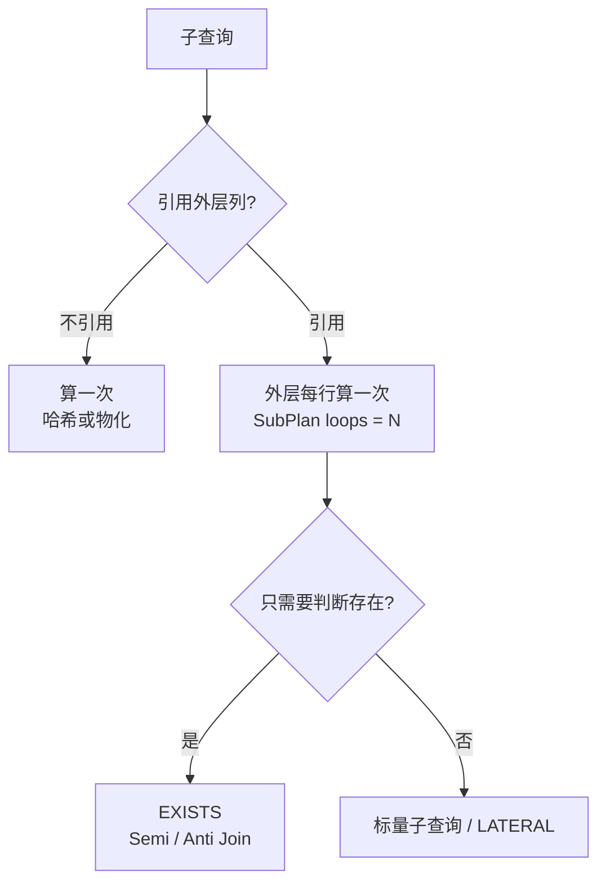

# 第 39 章 子查询和 EXISTS

## 一个问句的答案，可以当另一个问句的输入

SQL 里，一个查询的结果集可以直接嵌进另一个查询，写在括号里，这就是子查询（subquery）。外层查询叫主查询，内层叫子查询；内层算出结果，外层再拿这个结果继续过滤、比较或拼接。

子查询能放的位置不止一处，返回的形状也不同：可能是一个值（比较用），可能是一列多行（拿来跟一组值比较），也可能是一张临时表（放在 `FROM` 里）。位置放错、形状对不上，数据库会直接报错。

为什么要用它：有些问题天生是嵌套的——「谁还没预订过」「哪间房现在有 PENDING」「每间房最近一次预订是什么时候」。你可以先查一次、把结果拿回 Node 再查第二次，也可以让数据库一次问完。后者的代价是写法更绕，相关子查询还可能对外层每一行重算一次，性能要单独看。

官方文档（先看懂正文再点）：
- [子查询表达式](https://www.postgresql.org/docs/17/functions-subquery.html)：`IN`、`EXISTS`、`ANY`、`ALL` 四种写法的语义，对应本章「形状对不上」那段。
- [`FROM` 里的子查询](https://www.postgresql.org/docs/17/queries-table-expressions.html)：子查询当临时表用的语法和起别名的规则。
- [`WITH` 与 CTE](https://www.postgresql.org/docs/17/queries-with.html)：把子查询提到前面命名，长查询拆步骤时用。

现在看一个真实事故。

运营要一张「每间会议室最近一次预订」的表。你写下：

```sql
SELECT r.name, (SELECT max(b.start_time) FROM bookings b) AS last_start
FROM rooms r;
```

五间房齐了，但每一行的 `last_start` 一模一样——子查询忘了写 `WHERE b.room_id = r.id`，它每次都在算「全公司最近一次预订」。补上关联，C101 变成 `NULL`。运营接着问「最近一次是什么状态」，标量子查询一次只能返回一列，你只好再套一个。

子查询出现的位置决定语义：`SELECT` 列表里是**标量**，`WHERE` 里是**集合成员**或**存在性判断**，`FROM` 里是**派生表**，`WITH` 里是 **CTE**。下面挨个走一遍，输出都是**示例输出**。

## 标量子查询：一个格子

标量子查询占一个「值」的位置，要求一列、至多一行。返回 0 行时得到 `NULL`，返回多行直接报错：

```sql
SELECT (SELECT name FROM rooms WHERE capacity >= 10) AS room;
```

```text
ERROR:  more than one row returned by a subquery used as an expression
```

SQL 不会替你随便挑一行。要么加聚合（`max`、`min`），要么加 `LIMIT 1` 并接受「任意一行」，要么改成 `JOIN` 把多行摊开。`LIMIT 1` 不写 `ORDER BY` 时，拿到哪一行由执行计划决定，今天和生产可能不一样——要「最新的一条」，必须写清楚排序。

放在 `SELECT` 列表里、又引用了外层列，就是**相关子查询**：外层每取一行，它就得重算一次。查每个人预订过几次：

```sql
SELECT u.name,
       (SELECT count(*) FROM bookings b WHERE b.user_id = u.id) AS bookings
FROM users u
ORDER BY u.email;
```

```text
 name | bookings
------+----------
 陈默 |        4
 林岚 |        2
 孙禾 |        2
 吴桐 |        0
 赵启 |        3
 周雨 |        3
(6 rows)
```

吴桐是 0，不是 `NULL`——子查询里用了 `count(*)`，聚合函数在空集上返回 0。如果写的是 `(SELECT b.id ...)`，没预订的人会得到 `NULL`，外层再 `count` 就把他漏掉了。

看计划：

```text
Sort  (cost=8.29..8.31 rows=6 width=33)
  Sort Key: u.email
  ->  Seq Scan on users u  (cost=0.00..8.22 rows=6 width=33)
        SubPlan 1
          ->  Aggregate  (cost=1.18..1.19 rows=1 width=8)
                ->  Seq Scan on bookings b  (cost=0.00..1.18 rows=3 width=0)
                      Filter: (user_id = u.id)
```

`SubPlan` 挂在外层扫描下面：外层每扫到一个用户，内层就跑一次聚合。六行跑六次没问题，八万用户就是八万次。相关子查询的成本是「外层行数 × 内层单次成本」，这个乘法要心里有数。内层走 `Seq Scan` 只因为 `bookings` 才 14 行；行数一多，`idx_bookings_user` 会接管，但循环次数不会变。

改写成 `LEFT JOIN` + `GROUP BY`，结果一样：

```sql
SELECT u.name, count(b.id) AS bookings
FROM users u
LEFT JOIN bookings b ON b.user_id = u.id
GROUP BY u.id, u.name
ORDER BY u.email;
```

```text
 name | bookings
------+----------
 陈默 |        4
 林岚 |        2
 孙禾 |        2
 吴桐 |        0
 赵启 |        3
 周雨 |        3
(6 rows)
```

计划里没有 `SubPlan` 了：

```text
Sort  (cost=2.54..2.56 rows=6 width=49)
  Sort Key: u.email
  ->  HashAggregate  (cost=2.40..2.46 rows=6 width=49)
        Group Key: u.id
        ->  Hash Right Join  (cost=1.14..2.33 rows=14 width=57)
              Hash Cond: (b.user_id = u.id)
              ->  Seq Scan on bookings b  (cost=0.00..1.14 rows=14 width=32)
              ->  Hash  (cost=1.06..1.06 rows=6 width=41)
                    ->  Seq Scan on users u  (cost=0.00..1.06 rows=6 width=41)
```

两张表各扫一次、聚合一次。`count(b.id)` 不能写成 `count(*)`：`LEFT JOIN` 给没匹配的用户补了一行全 `NULL`，`count(*)` 会把它算成 1，吴桐就变成 1 了。计划里 `LEFT JOIN` 被翻成 `Hash Right Join`（小表做哈希表），语义不变，别被方向吓到。

也别把「相关子查询一定慢」当教条。外层几万行时连接更稳；外层只有几十行、内层有精确索引时，相关子查询每次只读一行，反而可能更快。成本和写法要一起看。

## IN、ANY、ALL：把集合当参数

`IN (子查询)` 等价于 `= ANY (子查询)`，判断某个值在不在集合里。反过来 `<`、`>` 配 `ANY`/`ALL` 是另一种问法：

```sql
SELECT name, capacity
FROM rooms
WHERE capacity >= ALL (SELECT capacity FROM rooms WHERE location LIKE 'B%');
```

```text
 name | capacity
------+----------
 B202 |       20
(1 row)
```

B 座两间房容量是 4 和 20，只有 20 满足「大于等于所有」。换成 `> ANY`，条件变成「比至少一间大」，A301、A302、B202、C101 都会入选。

`ANY` 右边不一定是子查询，也可以直接是数组：

```sql
SELECT name FROM rooms
WHERE name = ANY (ARRAY['A301', 'B202']);
```

```text
 name
------
 A301
 B202
(2 rows)
```

Node 里用 `pg` 传数组参数，写成 `WHERE name = ANY($1::text[])`，比把用户输入拼进 `IN (...)` 安全，也不用处理空数组——`= ANY('{}')` 返回 `false`，`IN ()` 是语法错误。

三值逻辑在这里照样生效。`x = ANY (集合)` 里只要有一个 `NULL` 参与比较，结果就是 `unknown`，整条不会为 `true`；`x <> ALL (集合)` 同理。还有一处更反直觉：集合为空时，`ANY` 为 `false`、`ALL` 为 `true`（「对空集中每个元素都成立」是空真）。`WHERE capacity >= ALL (SELECT ... WHERE false)` 会把所有行选出来，写动态条件时要留意。

`IN` 和 `EXISTS` 都不会放大外层行数，`JOIN` 会。A301 有 5 条预订，`JOIN` 之后它在结果里出现 5 次，`EXISTS` 只出现 1 次。做「哪些房间被订过」的去重列表，用 `EXISTS` 能省掉一个 `DISTINCT`。

`NOT IN` 有个著名的坑：

```sql
SELECT count(*) AS never_granted
FROM users
WHERE id NOT IN (SELECT granted_by FROM user_roles);
```

```text
 never_granted
---------------
             5
```

现在结果是对的：林岚授权过别人，其余五人没有。但只要 `user_roles` 里出现一行 `granted_by IS NULL`——比如系统初始化时自动授予的身份——整个查询会返回 0 行。因为 `id <> NULL` 是 `unknown`，不是 `true`，而 `NOT IN` 要求集合里每一项都「不相等」才成立。一行就能验证：`SELECT 1 WHERE 1 NOT IN (2, NULL)` 返回 0 行。

这不是性能问题，是语义问题。PG 会把不相关的子查询哈希一次再逐行比较（计划里是 `hashed SubPlan`），所以 `NOT IN` 未必慢；危险的是遇到 `NULL` 就静默清空结果。真要用，在子查询里加 `WHERE granted_by IS NOT NULL`；更稳的做法是直接换 `NOT EXISTS`。

## EXISTS：只问有没有

`EXISTS` 不返回值，只判断子查询有没有行。找到第一条就停，不关心 `SELECT` 后面写什么。

查从没预订过的人：

```sql
SELECT u.name
FROM users u
WHERE NOT EXISTS (
  SELECT 1 FROM bookings b WHERE b.user_id = u.id
)
ORDER BY u.email;
```

```text
 name
------
 吴桐
(1 row)
```

查当前有 PENDING 预订的会议室：

```sql
SELECT r.name
FROM rooms r
WHERE EXISTS (
  SELECT 1 FROM bookings b
  WHERE b.room_id = r.id AND b.status = 'PENDING'
)
ORDER BY r.name;
```

```text
 name
------
 A301
 A302
(2 rows)
```

`EXISTS` 里写 `SELECT 1` 还是 `SELECT *` 不影响计划，PG 会把目标列表丢掉；写 `1` 只是告诉读代码的人「我不需要列」。

计划会把它改写成**反连接**（anti join）——只保留「另一侧没有匹配」的行，而不是逐行跑子查询：

```text
Sort  (cost=2.42..2.43 rows=1) (actual time=0.094..0.097 rows=1 loops=1)
  Sort Key: u.email
  ->  Hash Anti Join  (cost=1.32..2.41 rows=1) (actual time=0.056..0.060 rows=1 loops=1)
        Hash Cond: (u.id = b.user_id)
        ->  Seq Scan on users u  (cost=0.00..1.06 rows=6) (actual rows=6 loops=1)
        ->  Hash  (cost=1.14..1.14 rows=14) (actual rows=14 loops=1)
              ->  Seq Scan on bookings b  (cost=0.00..1.14 rows=14) (actual rows=14 loops=1)
```

两张表各扫一次，`bookings` 建哈希，`users` 逐行探测，没匹配上的留下。`EXISTS` 那一侧对应**半连接**：找到第一条匹配就停，不复制行。看计划前先 `ANALYZE`，刚灌完数据的表统计信息是空的，估算会离谱。`NOT IN` 在可空列上通常保留成子计划，`NOT EXISTS` 能被安全改写——这是两者最实际的区别。

用数字记住半连接的好处：`SELECT r.name FROM rooms r JOIN bookings b ON b.room_id = r.id` 会返回 5 行 A301，`EXISTS` 只返回 1 行。`JOIN + DISTINCT` 也能去重，但它得先把重复行造出来再删，`EXISTS` 第一条命中就收工。

反连接也可以写成 `LEFT JOIN ... WHERE b.id IS NULL`，结果一样。判断标准：只需要「有没有」用 `NOT EXISTS`，读起来就是业务语义；还要取另一侧的其他列，才用 `LEFT JOIN`。

## 派生表与 CTE：先聚合再连接

**派生表**是写在 `FROM` 里的子查询，必须起别名：

```sql
SELECT r.name, s.active, s.cancelled
FROM rooms r
LEFT JOIN (
  SELECT room_id,
         count(*) FILTER (WHERE status IN ('PENDING', 'APPROVED')) AS active,
         count(*) FILTER (WHERE status = 'CANCELLED') AS cancelled
  FROM bookings
  GROUP BY room_id
) AS s ON s.room_id = r.id;
```

同样的逻辑用 **CTE**（`WITH` 命名的子查询）写，可以先把「每间房的统计」命名，再在主查询里引用：

```sql
WITH stats AS (
  SELECT room_id,
         count(*) FILTER (WHERE status IN ('PENDING', 'APPROVED')) AS active,
         count(*) FILTER (WHERE status = 'CANCELLED') AS cancelled
  FROM bookings
  GROUP BY room_id
)
SELECT r.name,
       coalesce(s.active, 0) AS active,
       coalesce(s.cancelled, 0) AS cancelled,
       round(coalesce(s.cancelled, 0)::numeric
             / nullif(s.active + s.cancelled, 0) * 100, 1) AS cancel_pct
FROM rooms r
LEFT JOIN stats s ON s.room_id = r.id
ORDER BY r.name;
```

```text
 name | active | cancelled | cancel_pct
------+--------+-----------+------------
 A301 |      5 |         0 |        0.0
 A302 |      3 |         1 |       25.0
 B201 |      1 |         1 |       50.0
 B202 |      2 |         0 |        0.0
 C101 |      0 |         0 |           
(5 rows)
```

`nullif(..., 0)` 防止除零，C101 的取消率是 `NULL` 而不是报错。统计先按 `room_id` 聚合成 4 行，再和 5 间房连接——比在 `SELECT` 列表里对每间房各跑一次聚合更省。

`round(numeric, 1)` 保留一位小数，`::numeric` 不能省：两个 `bigint` 相除在 PG 里还是整数，`1 / 3` 得 0。这个坑上一章提过，放到比率计算里尤其隐蔽——不报错，只是永远显示 0%。

CTE 在 PG 12 之后默认「单次引用就内联」，不是性能栅栏。上面这条查询的计划里，`stats` 会展开成 `Subquery Scan` + `HashAggregate`，和派生表没有本质区别。确实需要「只算一次、结果物化」时写 `WITH stats AS MATERIALIZED (...)`；这是 PG 的扩展，MySQL 没有对应关键字，别原样抄过去。反过来，CTE 里带 `ORDER BY` + `LIMIT`、或者被引用多次，规划器也可能选择物化——判断依据还是 `EXPLAIN`，不是关键字。

顺带一句递归 CTE：会议室有「分区—房间」两级、审批链有多级上级时，`WITH RECURSIVE` 能沿父子关系一直走到头。它和这里的普通 CTE 是两套东西，先知道有这么个工具，遇到树形数据再回来看。

## 子查询到底跑了几次

> **图 39-1** 相关与非相关，决定子查询跑几次



这条判断链可以直接落到计划上：看到 `SubPlan`，就知道它挂在某个外层节点下，`loops` 等于外层实际行数；看到 `Hash Semi Join` / `Hash Anti Join`，就知道规划器已经把「存在性」翻译成一次性连接。两者语义可能一样，成本模型完全不同。

| 你要的东西 | 首选写法 | 原因 |
| --- | --- | --- |
| 判断有没有 | `EXISTS` / `NOT EXISTS` | 可改写成 Semi/Anti Join，NULL 安全 |
| 反连接、排除一批值 | `NOT EXISTS` | `NOT IN` 遇 NULL 静默返回空 |
| 每行一个聚合值 | 标量子查询 | 写法直白，但成本是外层行数 × 内层 |
| 每行多列、Top-N | `LEFT JOIN LATERAL` | 能引用外层，配 `LIMIT` 只取需要的行 |
| 聚合后再过滤 | 派生表 / CTE + `HAVING` | 先把多行压小，再连接 |
| 大列表做过滤 | `= ANY (array)` 或临时表 | 避免超长 `IN` 列表的解析开销 |

`LATERAL` 是 `FROM` 里的一种子查询：它写在 `JOIN` 右侧，能引用左边的表，左边每来一行就跑一次。典型用法是「每间房取最近一条」——`LEFT JOIN LATERAL (SELECT ... WHERE b.room_id = r.id ORDER BY b.start_time DESC LIMIT 1) b ON true`。

Top-1 per group 用 `LATERAL` 的计划很说明问题：

```text
Nested Loop Left Join
  ->  Seq Scan on rooms r
  ->  Limit
        ->  Index Only Scan Backward using idx_bookings_room_time on bookings b
              Index Cond: (room_id = r.id)
```

每间房沿 `(room_id, start_time)` 索引倒着取第一条，`LIMIT 1` 让内层只读一行。索引顺序和 `ORDER BY ... DESC LIMIT 1` 对上了，所以没有排序。`Index Only Scan` 意味着只读索引、不回表，前提是查询要的列都在索引里——这里只要 `start_time`，正好覆盖。

改写顺序别弄反：先确认语义（`NULL`、重复行、0 行），再看 `EXPLAIN`（第 37 章讲过；看是 `SubPlan` 还是 `Hash Semi Join`），最后才动手改写法。子查询不是慢的同义词，相关才是。

## 几个容易踩的边界

| 现象 | 原因 | 改法 |
| --- | --- | --- |
| 标量子查询报多行 | 子查询没加聚合或 `LIMIT` | 加 `max`/`min`，或改 `JOIN` |
| 每行结果都一样 | 相关子查询漏了关联条件 | 补 `WHERE inner.fk = outer.id` |
| `NOT IN` 突然返回空 | 子查询结果里有 NULL | 改 `NOT EXISTS`，或过滤 `IS NOT NULL` |
| `IN` 子查询报列太多 | 子查询返回了两列以上 | 只选一列，或改 `EXISTS` |
| 派生表报语法错 | 忘了给子查询起别名 | `FROM (...) AS t` |
| 以为 CTE 一定物化 | PG 12+ 单次引用默认内联 | 需要栅栏时写 `MATERIALIZED` |
| `EXISTS` 里写 `SELECT *` 担心慢 | 目标列表会被优化器丢掉 | 写 `1` 即可，纯为可读性 |
| `ALL` 在空集上返回真 | 空真（vacuous truth） | 动态条件里先判断集合是否为空 |
| 比率永远是 0 | 两个整数相除被截断 | 至少一侧 `::numeric` |

子查询写起来像说话，执行起来却分「算一次」和「每行算一次」两种命。把这条分清，`EXISTS`、`IN`、标量子查询、`LATERAL` 就不是四套语法，而是同一件事的四种说法。

下一章把这些写法放进十个真实需求里：空档查询、冲突检测、统计报表、Top N——每个需求先给 SQL，再解释结果和容易错的地方。

想更深入的话，官方文档里有这几页可以接着看：[子查询表达式](https://www.postgresql.org/docs/17/functions-subquery.html)（`IN`、`ANY`、`ALL` 和 `EXISTS` 的完整语义）、[`EXISTS`](https://www.postgresql.org/docs/17/functions-subquery.html#FUNCTIONS-SUBQUERY-EXISTS)（只判断「有没有行」的写法，通常比 `count` 快）、[CTE 与 `MATERIALIZED`](https://www.postgresql.org/docs/17/queries-with.html)（`WITH` 什么时候物化、什么时候内联）、[`LATERAL`](https://www.postgresql.org/docs/17/queries-table-expressions.html#QUERIES-LATERAL)（子查询里引用外层当前行的写法）。

<!-- chapter-nav:start -->
---

← 上一篇：[038 一对多、多对多的表设计](038-一对多、多对多的表设计.md) · [本 Part 目录](_part.md) · 下一篇：[040 SQL综合练习](040-SQL综合练习.md) →
<!-- chapter-nav:end -->
