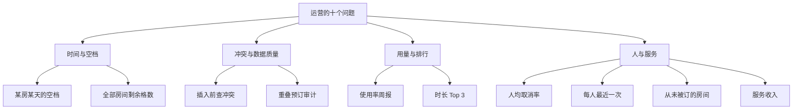

# 第 40 章 SQL 综合练习

周一早上九点，运营把一张清单拍在你桌上：十个问题，中午前要数。清单上没有一句提到 SQL，全是业务话——「A301 周三上午还剩哪些空档」「上周谁取消最多」「哪间房最抢手」。

前面几章按语法组织，`SELECT`、`JOIN`、子查询各讲一遍；这一章按**业务问题**组织，十个需求混着用这些语法。真实工作里没人说「写一个反连接」，只会问「哪些房间从来没被订过」。你的活是把业务话翻译成 SQL，而翻译错的概率远高于语法写错。表还是前几章那八张，数据是 2026 年 11 月第一周那 6 个用户、5 间房、14 条预订，输出都是**示例输出**。

> **图 40-1** 十个问题按「时间、冲突、用量、人」四类归位



## 先把「空档」定义清楚

第一个问题：A301 周三上午 9 点到 12 点，还有哪些半小时的档期空着。

**空档**不是「没有预订记录」，而是「没有任何**有效预订**与这个时间段重叠」。**有效预订**指 `PENDING` 和 `APPROVED`，`CANCELLED` 和 `REJECTED` 不占房。**重叠**用半开区间判定：`a.start < b.end AND b.start < a.end`，两个 `<` 都不能换成 `<=`，否则首尾相接的两场会被误判成冲突。

先把时间轴切成半小时格子，再逐格判断。下面的 `WITH slots AS (...)` 是第 39 章讲过的 CTE：先把时间轴算成一张临时结果，主查询再拿它逐格判断。

```sql
WITH slots AS (
  SELECT gs AS slot_start, gs + interval '30 minutes' AS slot_end
  FROM generate_series(
    '2026-11-04 09:00+08'::timestamptz,
    '2026-11-04 11:30+08',
    interval '30 minutes'
  ) AS gs
)
SELECT to_char(s.slot_start, 'HH24:MI') AS slot
FROM slots s
WHERE NOT EXISTS (
  SELECT 1 FROM bookings b
  WHERE b.room_id = 'a1111111-1111-4111-8111-111111111111'
    AND b.status IN ('PENDING', 'APPROVED')
    AND b.start_time < s.slot_end
    AND b.end_time > s.slot_start
)
ORDER BY s.slot_start;
```

```text
 slot
-------
 10:30
 11:00
 11:30
(3 rows)
```

10:30 这一格值得看一眼：b8 到 10:30 结束，按左闭右开，它不占用 10:30 之后的时间。`status` 也要过滤，`CANCELLED` 和 `REJECTED` 不占房。

`generate_series` 的上界写 `11:30`，因为最后一个格子是 `11:30–12:00`；写 `12:00` 会多出一个 `12:00–12:30` 的格子，运营会问「中午也算上午？」。时间范围一律用半开区间统一：`[09:00, 12:00)`，格子起点从 `09:00` 到 `11:30`，共 6 格。

把日期和房间换成参数，这条 SQL 就是接口里的「查空档」：`generate_series($1::timestamptz, $2::timestamptz, interval '30 minutes')`。粒度改成 15 分钟或 1 小时，只动 interval，判断逻辑不用改。

14 行数据上怎么跑都快，但生产上房间和预订一多，逐格 `NOT EXISTS` 的成本是「格子数 × 每次索引查找」。`bookings` 上要有 `(room_id, start_time)` 索引，让每次查找只扫这个房间的一段；`end_time` 不进索引前缀，所以 `b.end_time > s.slot_start` 只能在取出的行上过滤。一天 16 格、一周 80 格时这不是问题；要做全年热力图，得先按天聚合，再展开。

## 插入之前，先问一句「有人吗」

第二个问题不是查询，是预订接口的前置检查：周三 9 点到 10 点能不能订 A301。

把待订区间当成一条「新预订」，用同样的重叠条件去撞现有记录：

```sql
SELECT b.id,
       to_char(b.start_time, 'HH24:MI') AS start,
       to_char(b.end_time, 'HH24:MI') AS finish,
       b.status
FROM bookings b
WHERE b.room_id = 'a1111111-1111-4111-8111-111111111111'
  AND b.status IN ('PENDING', 'APPROVED')
  AND b.start_time < '2026-11-04 10:00+08'::timestamptz
  AND b.end_time > '2026-11-04 09:00+08'::timestamptz
ORDER BY b.start_time;
```

```text
                  id                  | start | finish |  status
--------------------------------------+-------+--------+----------
 b7777777-7777-4777-8777-777777777777 | 09:00 | 10:00  | APPROVED
 b8888888-8888-4888-8888-888888888888 | 09:30 | 10:30  | PENDING
(2 rows)
```

两条都撞上了：b7 完全覆盖，b8 从 9:30 开始。接口拿到非空结果就该返回 409，而不是先 INSERT 再道歉。409 表示「请求本身合法，但与当前资源状态冲突」；422 是参数校验失败，400 是格式错误，别混用。

这个检查有竞态。两个请求同时查到「没人」，就会一起插入。真正的兜底在下一章：锁，或者排他约束。应用层的「先查再插」只能降低概率，不能保证正确。

这个查询能走 `idx_bookings_room_time`：房间等值、`start_time` 范围。别在 `start_time` 上套函数，比如 `date(start_time) = '2026-11-04'`，那会让索引失效变成全表扫。

## 一张周报：每间房用了多少

第三个问题要进周报：本周每间房的有效预订数、总时长、使用率。工作日按 5 天、每天 8 小时算，分母 40 小时。

```sql
SELECT r.name,
       count(b.id) AS bookings,
       round(coalesce(sum(extract(epoch FROM (b.end_time - b.start_time)) / 3600), 0), 1) AS hours,
       round(coalesce(sum(extract(epoch FROM (b.end_time - b.start_time)) / 3600), 0) / 40 * 100, 1) AS utilization_pct
FROM rooms r
LEFT JOIN bookings b
  ON b.room_id = r.id
 AND b.status IN ('PENDING', 'APPROVED')
GROUP BY r.id, r.name
ORDER BY hours DESC, r.name;
```

```text
 name | bookings | hours | utilization_pct
------+----------+-------+-----------------
 A301 |        5 |   5.0 |            12.5
 A302 |        3 |   4.0 |            10.0
 B202 |        2 |   4.0 |            10.0
 B201 |        1 |   1.0 |             2.5
 C101 |        0 |   0.0 |             0.0
(5 rows)
```

`LEFT JOIN` 保住了 C101，用 `count(b.id)` 而不是 `count(*)` 才能让它显示 0。状态过滤写在 `ON` 里，不是 `WHERE`——写进 `WHERE`，`LEFT JOIN` 退化成 `INNER JOIN`，C101 直接消失。这就是上周报表少一行的事故原因。

分母 40 小时是业务约定，不是 SQL 算出来的。工作日、每天 8 小时、要不要扣午休，每家公司都不一样；把它写成参数，注释里写清楚口径，报表页脚也标一句「按 5×8 小时计」。

如果预订跨天，按 `start_time` 归日会把整段时长算进开始那天。日报要按天切，得用 `GREATEST(b.start_time, 当天零点)` 和 `LEAST(b.end_time, 次日零点)` 把区间裁到当天，再算时长。周报同理：跨周的预订要么按实际重叠时长分摊，要么在业务上禁止跨周，不能假装看不见。

还有一个红旗：同一间房有重叠的有效预订时，时长会重复累加，使用率可能超过 100%。看到 `utilization_pct > 100`，先别解释成「房间很忙」，去跑第十个问题。

## 谁在放鸽子

第四个问题：取消率，按人排。只统计至少有两次预订的人，样本太小的不算。

```sql
SELECT u.name,
       count(*) AS total,
       count(*) FILTER (WHERE b.status = 'CANCELLED') AS cancelled,
       round(count(*) FILTER (WHERE b.status = 'CANCELLED')::numeric / count(*) * 100, 1) AS cancel_pct
FROM users u
JOIN bookings b ON b.user_id = u.id
GROUP BY u.id, u.name, u.email
HAVING count(*) >= 2
ORDER BY cancel_pct DESC, u.email;
```

```text
 name | total | cancelled | cancel_pct
------+-------+-----------+------------
 周雨 |     3 |         1 |       33.3
 陈默 |     4 |         1 |       25.0
 林岚 |     2 |         0 |        0.0
 孙禾 |     2 |         0 |        0.0
 赵启 |     3 |         0 |        0.0
(5 rows)
```

`FILTER` 比 `CASE WHEN` 短，也只扫一遍。`HAVING count(*) >= 2` 过滤的是组不是行；写成 `WHERE` 会报「聚合函数不能出现在 WHERE」。

`::numeric` 不能省。`count(*)` 是 `bigint`，两个整数相除在 PG 里会截断，`1 / 3` 得 `0`，取消率全是 `0.0`，看着像「没人取消」。乘 `100.0` 也能得到小数，但那是隐式转 `numeric`，不如显式写清楚。

吴桐一次没订过，`INNER JOIN` 自然把他排除了。报表要求「所有人都列出」时得换 `LEFT JOIN`，并把 `count(*)` 改成 `count(b.id)`；分母为 0 时用 `nullif` 兜一下，否则除零报错。样本量 `>= 2` 也是口径：两次里取消一次就是 50%，这种数字不该进绩效。

## 抢手的房间，Top 3

第五个问题：本周有效预订时长最长的三间房。

```sql
SELECT r.name,
       round(sum(extract(epoch FROM (b.end_time - b.start_time)) / 3600), 1) AS hours
FROM bookings b
JOIN rooms r ON r.id = b.room_id
WHERE b.status IN ('PENDING', 'APPROVED')
  AND b.start_time >= '2026-11-02 00:00+08'::timestamptz
  AND b.start_time < '2026-11-09 00:00+08'::timestamptz
GROUP BY r.id, r.name
ORDER BY hours DESC, r.name
LIMIT 3;
```

```text
 name | hours
------+-------
 A301 |   5.0
 A302 |   4.0
 B202 |   4.0
(3 rows)
```

A302 和 B202 都是 4.0，只按时长排序，谁进前三由执行计划决定。加一个 `r.name` 做第二排序键，结果才稳定。分页和 Top N 都一样：排序键不唯一，翻页就会重复或漏行。

这是全局 Top 3，不是「每间房 Top 3」。后者要按房间分组排名，用 `row_number() OVER (PARTITION BY room_id ORDER BY ...)` 或 LATERAL 逐房取，不能直接 `LIMIT`。

时间窗口 `[11-02, 11-09)` 也值得核对：11 月 2 日是周一，11 月 9 日是下周一，正好一整周。写成 `<= 11-09` 会把下周一零点的预订算进来。凡是「本周」「本月」的范围，都在注释里把半开区间写出来，评审时一眼能懂。

## 每个人最近的一次预订

第六个问题：给每个用户显示最后一次预订的房间、时间和状态。PG 有 `DISTINCT ON`，比窗口函数少一层子查询：

```sql
SELECT DISTINCT ON (u.id)
       u.name,
       to_char(b.start_time, 'MM-DD HH24:MI') AS last_start,
       r.name AS room,
       b.status
FROM bookings b
JOIN users u ON u.id = b.user_id
JOIN rooms r ON r.id = b.room_id
ORDER BY u.id, b.start_time DESC;
```

```text
 name | last_start  | room |  status
------+-------------+------+-----------
 林岚 | 11-05 09:00 | A302 | REJECTED
 陈默 | 11-06 16:00 | A302 | CANCELLED
 周雨 | 11-05 15:00 | B201 | CANCELLED
 赵启 | 11-06 09:00 | A301 | APPROVED
 孙禾 | 11-05 10:00 | B202 | APPROVED
(5 rows)
```

`DISTINCT ON (u.id)` 取每个用户的第一行，`ORDER BY` 必须以 `u.id` 开头、后面跟「最近」的排序。顺序写反，拿到的是最早一次。它只看预订表里有的用户：吴桐一次没订过，不会出现；要全员列出，得从 `users` 出发 `LEFT JOIN LATERAL`。

同一用户在同一时刻有两条预订时，取哪条不确定——`ORDER BY u.id, b.start_time DESC` 只排到时间。要稳定，再加 `b.id` 作为第三排序键。报表里「并列随便取一条」很危险，今天和明天的结果可能不同。

MySQL 没有这个语法，只能开窗或写相关子查询。迁移时改成：

```sql
SELECT name, last_start, room, status
FROM (
  SELECT u.name, b.start_time AS last_start, r.name AS room, b.status,
         row_number() OVER (PARTITION BY u.id ORDER BY b.start_time DESC) AS rn
  FROM bookings b
  JOIN users u ON u.id = b.user_id
  JOIN rooms r ON r.id = b.room_id
) t
WHERE rn = 1;
```

`row_number` 版本还能顺手加 `b.id` 打破并列，语义比 `DISTINCT ON` 更明确，代价是多一层子查询。

## 从来没被订过的房间

第七个问题：哪些房间一次都没被订过。C101 在维护，答案应该只有它。

```sql
SELECT r.name, r.status
FROM rooms r
WHERE NOT EXISTS (
  SELECT 1 FROM bookings b WHERE b.room_id = r.id
);
```

```text
 name |   status
------+-------------
 C101 | MAINTENANCE
(1 row)
```

`NOT EXISTS` 对 `NULL` 安全，`NOT IN` 不是。子查询里出现 `NULL`，整个条件会变成未知，一行都查不出来。这里 `room_id` 有 `NOT NULL` 约束，两种写法都对；换到可空列上就是事故。

口径也要问清楚：只订过一次又取消的房间，算不算「被订过」？上面的写法算，因为子查询没过滤状态。业务意思是「从未产生过有效预订」，子查询要加 `status IN ('PENDING', 'APPROVED')`；C101 的答案不变，别的数据下可能多出几间。同一个问题两种口径，先确认再交付。

## 周四每间房还剩几格

第八个问题：周四 9 点到 17 点，每间房各剩多少个半小时空档。把房间和格子做笛卡尔积，再对每个组合判断。

```sql
WITH slots AS (
  SELECT gs AS slot_start, gs + interval '30 minutes' AS slot_end
  FROM generate_series(
    '2026-11-05 09:00+08'::timestamptz,
    '2026-11-05 16:30+08',
    interval '30 minutes'
  ) AS gs
)
SELECT r.name,
       count(*) FILTER (
         WHERE NOT EXISTS (
           SELECT 1 FROM bookings b
           WHERE b.room_id = r.id
             AND b.status IN ('PENDING', 'APPROVED')
             AND b.start_time < s.slot_end
             AND b.end_time > s.slot_start
         )
       ) AS free_slots
FROM rooms r
CROSS JOIN slots s
GROUP BY r.id, r.name
ORDER BY free_slots DESC, r.name;
```

```text
 name | free_slots
------+------------
 A301 |         16
 A302 |         16
 B201 |         16
 C101 |         16
 B202 |         12
(5 rows)
```

16 格是 9:00 到 16:30 的 16 个起点。B202 被 b10 占了 10:00 到 12:00 的 4 格，其余全空。`count(*) FILTER (WHERE ...)` 把「判断」和「计数」放在一条语句里；`NOT EXISTS` 在 `FILTER` 里引用外层 `r.id` 和 `s.slot_start`，是相关子查询，但每格只探一次索引。

`CROSS JOIN` 在这里是 5 × 16 = 80 个组合，每个组合一次索引查找；房间或格子任一变大，乘机会很明显。真要优化，先把每间房的忙碌区间合并，再用区间减法算出空闲段，最后按 30 分钟切格——那是另一套复杂度，数据量不到十万级不必上。

还有个语义细节：`CROSS JOIN slots` 之后再 `GROUP BY r.id`，没有预订的房间也会出现，因为 `rooms` 是驱动表；反过来从 `bookings` 出发，空房间就全丢了。周报和空档表都遵循同一条规则：**以「必须出现」的那一侧为驱动表**。

## 服务收入，别被 JOIN 放大

第九个问题：按房间统计增值服务收入。预订和服务是多对多，中间表带数量和下单时的单价。

```sql
SELECT r.name,
       sum(bs.quantity * bs.unit_price) AS service_revenue
FROM bookings b
JOIN rooms r ON r.id = b.room_id
JOIN booking_services bs ON bs.booking_id = b.id
GROUP BY r.id, r.name
ORDER BY service_revenue DESC;
```

```text
 name | service_revenue
-----------------+-----------------
 B202 |          750.00
 A302 |          120.00
(2 rows)
```

两次 `INNER JOIN` 把没有服务的预订丢掉了，所以只出现两间房。报表要求所有房间都出现，就从 `rooms` 开始 `LEFT JOIN`。

更隐蔽的坑：同时 JOIN 两张一对多表（服务明细和参会人），行数会相乘，`sum` 直接翻倍。假设一场会议 2 条服务、3 个参会人，连接后变成 6 行，服务费被算 3 遍，人数被算 2 遍。正确做法是先把每张明细表按主表聚合，再 JOIN 聚合结果：

```sql
SELECT r.name, coalesce(svc.total, 0) AS service_revenue
FROM rooms r
LEFT JOIN (
  SELECT b.room_id, sum(bs.quantity * bs.unit_price) AS total
  FROM bookings b
  JOIN booking_services bs ON bs.booking_id = b.id
  GROUP BY b.room_id
) AS svc ON svc.room_id = r.id
ORDER BY service_revenue DESC;
```

中间表存 `unit_price` 快照，服务后来涨价，历史账单也不会跟着变。这就是第 38 章那笔账：多存一列，换来历史可复现。

## 反过来查：已经重叠的预订

最后一个问题：数据里有没有同一房间、时间重叠、且都还有效的预订。这是数据质量审计，不是业务查询。

```sql
SELECT a.id AS booking_a,
       b.id AS booking_b,
       r.name,
       to_char(a.start_time, 'MM-DD HH24:MI') AS a_start,
       to_char(a.end_time, 'HH24:MI') AS a_end,
       to_char(b.start_time, 'HH24:MI') AS b_start,
       to_char(b.end_time, 'HH24:MI') AS b_end
FROM bookings a
JOIN bookings b ON a.room_id = b.room_id AND a.id < b.id
JOIN rooms r ON r.id = a.room_id
WHERE a.status IN ('PENDING', 'APPROVED')
  AND b.status IN ('PENDING', 'APPROVED')
  AND a.start_time < b.end_time
  AND b.start_time < a.end_time;
```

```text
              booking_a              |             booking_b              | name |    a_start    | a_end | b_start | b_end
-------------------------------------+------------------------------------+------+---------------+-------+---------+-------
 b7777777-7777-4777-8777-777777777777 | b8888888-8888-4888-8888-888888888888 | A301 | 11-04 09:00   | 10:00 | 09:30   | 10:30
(1 row)
```

查出一对：b7 和 b8 在 A301 周三上午重叠。这条 SQL 用**自连接**（同一张表取两个别名），`a.id < b.id` 保证每对只出现一次，否则会查两遍。四条状态/时间条件缺一条，都会漏掉或误报。

它能查出来，说明应用层的前置检查不是原子的——两个人同时通过检查，就都写进去了。这条审计 SQL 应该进监控，每天跑一次，结果大于 0 就告警；等财务对账才发现，损失已经发生了。

## 这十条查询，在 Nest 里长什么样

这些 SQL 不会直接躺在 Controller 里。以「查空档」为例，落到代码里是三层：

```ts
// src/bookings/dto/availability-query.dto.ts
export class AvailabilityQueryDto {
  @IsUUID() roomId!: string;
  @IsISO8601() from!: string;
  @IsISO8601() to!: string;
}
```

```ts
// src/bookings/bookings.repository.ts
async findFreeSlots(roomId: string, from: string, to: string) {
  const { rows } = await pool.query(
    `WITH slots AS (
       SELECT gs AS slot_start, gs + interval '30 minutes' AS slot_end
       FROM generate_series($2::timestamptz, $3::timestamptz - interval '30 minutes',
                            interval '30 minutes') AS gs
     )
     SELECT slot_start
     FROM slots s
     WHERE NOT EXISTS (
       SELECT 1 FROM bookings b
       WHERE b.room_id = $1
         AND b.status IN ('PENDING', 'APPROVED')
         AND b.start_time < s.slot_end
         AND b.end_time > s.slot_start
     )
     ORDER BY slot_start`,
    [roomId, from, to],
  );
  return rows.map((r) => r.slot_start as Date);
}
```

DTO 负责请求形状和格式校验，Repository 负责 SQL，Service 负责业务判断（比如「结束时间必须晚于开始时间」「不能查超过 30 天」），Controller 只取参数、调 Service、包成 `{ data }`。返回给前端的空档列表是 VO：它可能还要补 `label`、`available` 这些展示字段，不该把数据库行原样丢出去。

参数用 `$1` 而不是字符串拼接，除了防注入，还有计划缓存：同一条 SQL 反复执行，PG 能复用解析和计划；把用户输入拼进去，每次都是新语句，缓存全废。冲突检查放在 Service 里，查到冲突抛 `ConflictException`，Nest 返回 409；但竞态还在，真正的保证在下一章。

## 结果对不上时，按这个顺序查

| 现象 | 先看什么 |
| --- | --- |
| 总数比明细多 | JOIN 是否一对多放大，先聚合再连接 |
| 空档多出一格 | 边界条件，`<`/`>` 是否被写成 `<=` 或 `BETWEEN` |
| 报表少一行 | 状态过滤在 `ON` 还是 `WHERE`，LEFT JOIN 有没有退化 |
| Top N 不稳定 | 排序键是否唯一，有没有加次级键 |
| 取消率是 0 或 NULL | 分母是否被过滤成空组，整数除法有没有截断 |
| 使用率超过 100% | 同一房间有重叠的有效预订，先跑冲突审计 |
| 「从未被订」多出几间 | 口径没对齐，取消的预订算不算「被订过」 |

十条跑完，中午前能交差。交差前拿四个数对一遍：有效预订 11 条、总时长 14 小时、服务收入 870.00、重叠冲突 1 对。四个数对得上，十个问题的口径基本一致；对不上，先回明细，别急着改 SQL。

回头看一眼，真正的新东西不多：时间区间用半开区间、状态过滤放对位置、聚合前想清楚粒度、排序键要能定序。剩下的都是这四件事的组合。

下一章处理最后那个漏洞：两个人同时预订同一间房，检查都通过，怎么保证只有一个成功。那要靠事务、隔离级别和锁。

想更深入的话，官方文档里有这几页可以接着看：[SELECT](https://www.postgresql.org/docs/17/sql-select.html)（十个练习都用得到的查询总语法）、[聚合函数](https://www.postgresql.org/docs/17/functions-aggregate.html)（数数、求和、平均的写法，和 `GROUP BY` 怎么配合）、[日期时间函数](https://www.postgresql.org/docs/17/functions-datetime.html)（按天分组、算时长时用的函数）、[EXPLAIN](https://www.postgresql.org/docs/17/using-explain.html)（练习里查询变慢时，用它看执行计划）。

<!-- chapter-nav:start -->
---

← 上一篇：[039 子查询和EXISTS](039-子查询和EXISTS.md) · [本 Part 目录](_part.md) · 下一篇：[041 PostgreSQL的事务和隔离级别](041-PostgreSQL的事务和隔离级别.md) →
<!-- chapter-nav:end -->
