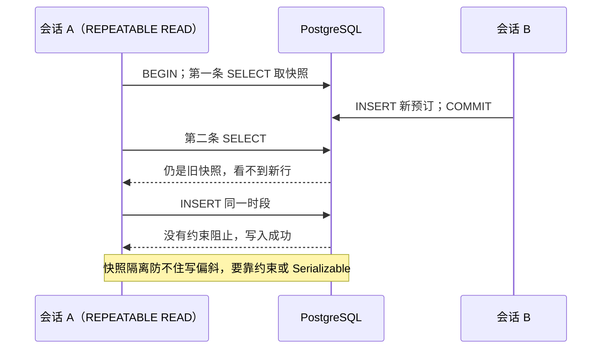

# 第 41 章 PostgreSQL 的事务和隔离级别

## 先看两个真实场景

A301 的 14:00–15:00，两条预订几乎同时成功，页面都转出绿色对勾，日历上并排躺着两条记录。

翻接口日志：两个请求都先查了「这个时段有没有人」，都得到 0 行，然后各自 `INSERT`。检查没有错，错在检查和写入之间，别人也能插进来。这不是 SQL 写错，是并发。

同一周还有另一件事。运营给一条预订加了两项服务，代码先写预订、再写服务明细，第二句因为服务 id 填错失败了。结果库里留下一条「有预订、没服务」的记录，账单少算钱，对账时才发现。

两件事看着都是「数据库不听话」，其实是两个不同的问题：

- 第一件是**几步写入要绑在一起**。写预订和写服务明细，要么都成功，要么都当没发生。这个打包动作叫**事务**。
- 第二件是**两个人同时动同一份数据**。你查的时候没人，你写的时候别人也写进来了。这由**隔离级别**和**锁**管。（四个级别的现象对照：[事务隔离](https://www.postgresql.org/docs/17/transaction-iso.html)）

这一章就按「事务 → 隔离级别 → 锁 → 约束」四层往下走。先记住一句话：事务保证「一起成功或一起失败」，保证不了「业务上不该重叠」——后面你会看到，最后还得靠数据库约束兜底。

文中的 SQL 输出都是**示例输出**；涉及两个会话交替执行的 transcript 不是单连接能复现的，标为「双会话示例」。

> **图 41-1** 两个事务各自看到的数据版本



## 事务：这几步要么一起成功，要么一起当没发生

最熟悉的例子是转账：A 账户扣 100，B 账户加 100。扣钱成功了、加钱失败了，这 100 块就凭空消失。所以你要求这两步绑死：一起成，或者一步都别算。

数据库里表达这件事只要三个词：

- `BEGIN`：从这里开始，后面的语句算一组。
- `COMMIT`：这一组全部生效。
- `ROLLBACK`：这一组全部撤销，像没执行过。

注意 PG 默认是 autocommit：你单发一条 `INSERT`，它自己就是一个事务，执行完立刻生效。只有显式写了 `BEGIN`，多条语句才会被绑在一起。

回到会议室系统。一次预订通常不止写一张表：`bookings` 里一行预订，`booking_services` 里若干行服务明细，可能还有审计记录。下面先写预订，再写一条服务明细，故意把 `service_id` 填成不存在的 999：

```sql
BEGIN;

INSERT INTO bookings (id, user_id, room_id, start_time, end_time, status, remark)
VALUES ('bfffffff-ffff-4fff-8fff-ffffffffffff',
        '22222222-2222-4222-8222-222222222222',
        'a3333333-3333-4333-8333-333333333333',
        '2026-11-06 14:00+08', '2026-11-06 15:00+08',
        'PENDING', '事务演示');

INSERT INTO booking_services (booking_id, service_id, quantity, unit_price)
VALUES ('bfffffff-ffff-4fff-8fff-ffffffffffff', 999, 1, 10.00);
```

```text
BEGIN
INSERT 0 1
ERROR:  insert or update on table "booking_services" violates foreign key constraint "booking_services_service_id_fkey"
DETAIL:  Key (service_id)=(999) is not present in table "services".
```

第二条撞了外键，失败了。这时候如果直接 `ROLLBACK`，那条已经写进去的预订也会一起消失：

```sql
ROLLBACK;

SELECT (SELECT count(*) FROM bookings) AS bookings,
       (SELECT count(*) FROM booking_services) AS links;
```

```text
 bookings | links
----------+-------
       14 |     4
```

预订数还是 14，没有多出来。把 999 换成真实存在的服务 id，两条都成功，`COMMIT` 之后就是 15 和 5。这就是事务的全部意义：**它不保证你的业务对，只保证这一组写入不会只完成一半**。

有一件事必须提前说，不然你会踩坑：第二条失败之后，这个事务不是「这一条没成」，而是**整个事务已经废了**（PG 里的状态叫 aborted）。这时候你再发任何 SQL，都会得到：

```text
ERROR:  current transaction is aborted, commands ignored until end of transaction block
```

这时候发 `COMMIT` 也没用，PG 不会提交，只打印一个 `ROLLBACK`。所以应用代码的 `catch` 里必须显式回滚。用 node-postgres 时尤其注意：`client.release()` 把连接还给池子时**不会**替你回滚，一个带着 aborted 事务的连接回到池里，下一个请求借到它，第一条查询就会莫名其妙报上面这个错。

四个常一起提的性质，合称 ACID，用会议室的话说一遍：

| 性质 | 一句话 | 谁在保证 |
| --- | --- | --- |
| 原子性 | 一组写入要么全成，要么全不算 | 事务本身 |
| 一致性 | 事务前后外键、`CHECK` 这些约束都成立 | 数据库约束 |
| 隔离性 | 并发事务互相能看到多少 | 隔离级别 + 锁 |
| 持久性 | `COMMIT` 返回后即使断电也不丢 | WAL 日志（默认 `synchronous_commit = on`） |

前两个好懂，持久性也直白，难的是隔离性，下一节单独讲。

顺带一个 PG 和 MySQL 的差别，做迁移时会救命：PG 的 DDL（建表、改表）也在事务里，`BEGIN; ALTER TABLE ...; ROLLBACK;` 能完整退回去；MySQL 8 的很多 DDL 会隐式提交，回滚不了。脚本写错一半时，这个差别决定了你是「重跑一次」还是「手工修表」。

## SAVEPOINT：错一步，不用整笔重来

有些失败是预期内的：服务 id 填错，换一个就行，没必要把已经写好的预订也丢掉。`SAVEPOINT` 就是在事务里打个标记，出错后回滚到标记处，事务还能继续往下走。

```sql
BEGIN;

INSERT INTO bookings (id, user_id, room_id, start_time, end_time, status, remark)
VALUES ('bfffffff-ffff-4fff-8fff-ffffffffffff',
        '22222222-2222-4222-8222-222222222222',
        'a3333333-3333-4333-8333-333333333333',
        '2026-11-06 14:00+08', '2026-11-06 15:00+08',
        'PENDING', '事务演示');

SAVEPOINT sp_service;

INSERT INTO booking_services (booking_id, service_id, quantity, unit_price)
VALUES ('bfffffff-ffff-4fff-8fff-ffffffffffff', 999, 1, 10.00);

ROLLBACK TO SAVEPOINT sp_service;

INSERT INTO booking_services (booking_id, service_id, quantity, unit_price)
VALUES ('bfffffff-ffff-4fff-8fff-ffffffffffff', 1, 2, 25.00);

COMMIT;
```

```text
BEGIN
INSERT 0 1
SAVEPOINT
ERROR:  insert or update on table "booking_services" violates foreign key constraint "booking_services_service_id_fkey"
ROLLBACK
INSERT 0 1
COMMIT
```

`ROLLBACK TO` 只撤销标记之后的语句，前面那条预订还在；锁也还握着，直到 `COMMIT`。它不能当分支用——SAVEPOINT 不能「提交一部分」，只能「丢掉一部分」。

`RELEASE SAVEPOINT` 是另一回事：它只是销毁这个标记，把这段工作并进外层事务，不是提交。标记名字可以复用，后建的会遮住先建的，回滚时按最近的那个算。

SAVEPOINT 有成本。PG 内部会为它分配子事务 id，一个循环里给每行都打一个，长事务的子事务数会迅速膨胀，撤销日志和快照判断都变慢。它适合「一次请求里两三次可选的附带写入」，不适合当成逐行容错。能提前校验的先校验（比如查一下服务 id 存不存在），比事后回滚便宜。

## 两个人同时改同一行：隔离级别到底在管什么

现在换到第二个场景。你开两个终端，两个会话都连同一个库，同时改 `rooms` 表里同一行：

```text
会话 A（你）                                会话 B（同事）
BEGIN;
UPDATE rooms SET name = 'A301-大' WHERE id = 'a111...';
                                             BEGIN;
                                             UPDATE rooms SET name = 'A301-中' WHERE id = 'a111...';
                                             -- 卡住，等 A 提交或回滚
COMMIT;
                                             -- 轮到 B，改名成功
```

这里有两层东西在起作用，很多人会混：

- **写同一行会排队**。这是行锁，跟隔离级别无关。B 想改 A 正在改的那一行，就得等 A 结束。
- **读的时候能看到什么，才由隔离级别决定**。A 没提交时 B 去 `SELECT`，看到的是旧值还是新值？A 提交后 B 再查，能不能看到？这就是隔离级别要回答的。

并发读会撞上三种「看起来像 bug、其实是机制」的现象，都用上面这个两个人改同一行的场景说：

- **脏读**：A 改完还没提交，B 就看到了 A 的新值；结果 A 回滚了，B 拿到的是一份根本不存在的数。像你偷看了同事还没保存的草稿，他最后一键撤销，你的汇报就成了假的。
- **不可重复读**：B 在同一个事务里读两次同一行，第一次是「A301-大」，中间 A 提交了，第二次变成「A301-中」。同一次事务里，同一行的值变了。
- **幻读**：B 按同一个条件查两次，第一次查出 5 条，中间 A 插了一条符合条件的，第二次变成 6 条。它盯的不是某一行的值，而是「结果集里多出来/少掉了行」。

还有一个更阴的，叫**写偏斜**：两个事务各自检查都通过，合起来却违反业务规则。开头那两条重叠预订就是它——两个会话都查「这个时段没人」，都得到 0 行，然后各自插入，各自都合法。

## 四个档位，PG 实际只有三档

隔离级别就是数据库用来挡这些现象的档位。档位越高，挡得越多，并发代价也越大。SQL 标准定义了四档，PostgreSQL 实现了后三档（`READ UNCOMMITTED` 语法上接受，行为等同于 `READ COMMITTED`）：

| 级别 | PG 的实现 | 脏读 | 不可重复读 | 幻读 | 序列化异常 |
| --- | --- | --- | --- | --- | --- |
| READ UNCOMMITTED | 语法接受，行为等同 RC | 不会 | 可能 | 可能 | 可能 |
| READ COMMITTED（默认） | 语句级快照 | 不会 | 可能 | 可能 | 可能 |
| REPEATABLE READ | 事务级快照，无幻读 | 不会 | 不会 | 不会 | 可能（40001） |
| SERIALIZABLE | 快照隔离 + SSI | 不会 | 不会 | 不会 | 冲突时中止一方 |

查当前会话的档位：

```sql
SHOW transaction_isolation;
```

```text
 transaction_isolation
-----------------------
 read committed
(1 row)
```

PG 能做到这些，靠的是 **MVCC**（多版本并发控制）。说人话：**更新一行时不去覆盖原来的行，而是另写一个新版本**，旧版本留着给还在读旧数据的事务。所以读不会挡写，写也不会挡读——大家各看各的版本。

每行有两个隐藏字段：`xmin` 是创建这个版本的事务号，`xmax` 是删除或更新它的事务号。索引指向行的物理位置（`ctid`），到底哪个版本可见，要结合快照判断。`VACUUM` 负责回收没人再看的旧版本，但它只能回收「所有活跃快照都不再需要」的版本。

这就解释了一个运维现象：长事务不结束，旧版本收不掉，表只涨不降。更隐蔽的是「开了事务忘了关」——连接池里的连接停在 `idle in transaction`，它拿着的快照会一直挡住 `VACUUM`。所以要设 `idle_in_transaction_session_timeout`，比如 30 秒，让这种连接自己断开。

默认的 RC 是**语句级快照**：每条语句开始时取一次。同一个事务里两条相同的 `SELECT`，中间别人提交了，结果就会变——这就是不可重复读。大多数 Web 请求用 RC，因为「看到最新已提交的数据」正是你要的。

```text
会话 A（RC）                                  会话 B
BEGIN;
SELECT count(*) FROM bookings
WHERE room_id = 'a111...' AND status IN ('PENDING','APPROVED');
-- 5
                                              BEGIN;
                                              INSERT INTO bookings (...) VALUES (A301 周五 14:00-15:00);
                                              COMMIT;
SELECT count(*) ...;
-- 6
ROLLBACK;
```

RR 是**事务级快照**：第一条语句时取一次，之后整个事务都看这份快照。PG 的 RR 连幻读也挡住了，比 SQL 标准要求的更强。代价是：你要更新一行在快照之后被别人改过的记录，PG 不会让你静默覆盖，直接报错：

```text
ERROR:  could not serialize access due to concurrent update
```

错误码 `40001`。遇到它，正确的动作是重读最新值、重跑整笔事务。

```text
会话 A（RR）
BEGIN ISOLATION LEVEL REPEATABLE READ;
SELECT count(*) ...;  -- 5
-- 会话 B 插入同一时段并提交
SELECT count(*) ...;  -- 5
INSERT 同一时段;       -- 成功
COMMIT;
```

两条 `SELECT` 一致（都是 5），但两个事务都基于「0 条冲突」的旧快照插入，结果还是重叠。这就是写偏斜：每个事务读到的集合都没变，写出去的动作合在一起却破坏了不变量。快照隔离防不住它，因为冲突不在「同一行」上，只在「同一个业务约束」上。经典例子是值班表：规则要求至少两名医生在岗，两位医生各自查到「还有 3 人」，都提交请假，最后只剩 1 人。

所以记住一句话：**光提高隔离级别不够**。

Serializable 在 RR 之上加了 **SSI**（Serializable Snapshot Isolation）：它检测事务之间的读写依赖，发现环就中止一方，报

```text
ERROR:  could not serialize access due to read/write dependencies among transactions
```

附带 `Reason code` 和重试提示。注意它不是「不会冲突」，而是「冲突时让你重试」。重试要重跑**整笔**事务，接口还得幂等——否则第一次其实提交成功了、客户端超时又重试，会写出第二条。重试还要加退避和次数上限。

还有一个容易踩的顺序问题：RR 下 `SELECT ... FOR UPDATE` 等锁之后，后续普通 `SELECT` 仍用旧快照，可能看不到对方刚提交的预订。所以「锁房间再查冲突」这套适合 RC，不适合 RR。一定要用 RR，就在锁完之后再用 `FOR UPDATE` 查一遍，或者升到 Serializable 让 SSI 兜底。

## 锁房间这一行，而不是锁预订

开头那个问题，最直接的解法是：**在查冲突之前，先把「这间房」锁住**，让同一间房的第二个请求排队。

```sql
BEGIN;

SELECT id FROM rooms
WHERE id = 'a1111111-1111-4111-8111-111111111111'
FOR UPDATE;

SELECT 1 FROM bookings
WHERE room_id = 'a1111111-1111-4111-8111-111111111111'
  AND status IN ('PENDING', 'APPROVED')
  AND start_time < '2026-11-06 15:00+08'
  AND end_time > '2026-11-06 14:00+08';
-- 0 rows

INSERT INTO bookings (user_id, room_id, start_time, end_time, status)
VALUES ('22222222-2222-4222-8222-222222222222',
        'a1111111-1111-4111-8111-111111111111',
        '2026-11-06 14:00+08', '2026-11-06 15:00+08', 'PENDING');

COMMIT;
```

为什么锁 `rooms` 而不是 `bookings`？因为**空档里根本没有行可锁**。`FOR UPDATE` 在 `bookings` 上查到 0 行，就什么也没锁住——没有行，就没有行锁。锁住房间这一行，等于给「这间房的预订」加了门闩：第二个请求会在 `FOR UPDATE` 上等着，等第一个提交后再查冲突，就能看到新预订了。

`FOR UPDATE` 不是唯一的行锁。PG 的行级锁有四种模式，区别主要在「锁住之后还允不允许别人做外键检查」：

| 模式 | 典型用途 | 与 `KEY SHARE` 冲突 |
| --- | --- | --- |
| `FOR UPDATE` | 要改这行，且不希望别人并发改 | 是 |
| `FOR NO KEY UPDATE` | 要改非键列（如状态） | 否 |
| `FOR SHARE` | 读的时候防止别人改 | 否（但阻止 `FOR UPDATE`） |
| `FOR KEY SHARE` | 外键检查时自动加，防主键被删 | — |

往 `bookings` 插一行时，外键检查会对 `rooms` 那一行自动加 `KEY SHARE`；如果应用里用 `FOR UPDATE` 锁房间，这两种锁冲突，插入会排队。用 `FOR NO KEY UPDATE` 就不冲突，因为你不改房间的主键。下面 Prisma 代码用 `forNoKeyUpdate()` 就是这个原因。

前提是所有人都走同一把锁。有的接口锁房间、有的直接 `INSERT`，门闩就形同虚设。这个约定要写进代码评审清单，或者干脆用数据库约束兜底。

没有业务行可锁时，可以用咨询锁（advisory lock）：`SELECT pg_advisory_xact_lock(hashtextextended($1, 0));`。它不锁任何表，只锁一个 64 位整数键；`xact` 版本在事务结束时自动释放，`session` 版本要手动 `pg_advisory_unlock`。键通常由「业务名 + 资源 id」哈希得到，所有写入方必须用同一种算法，否则各锁各的。

Prisma 8 里把锁和检查放进同一个回调：

```ts
// src/modules/bookings/bookings.service.ts（节选）
await db.transaction(async (tx) => {
  const start = startTime.toISOString();
  const end = endTime.toISOString();

  const room = await tx.orm.public.Room
    .where({ id: roomId })
    .forNoKeyUpdate()
    .first();
  if (!room) throw new NotFoundException('会议室不存在');

  const conflict = await tx.orm.public.Booking.where((row, { fns }) =>
    fns.and(
      row.roomId.eq(roomId),
      row.status.in([BookingStatus.PENDING, BookingStatus.APPROVED]),
      row.startTime.lt(end),
      row.endTime.gt(start),
    ),
  ).first();
  if (conflict) throw new ConflictException('该时段已被预订');

  return tx.orm.public.Booking.create({
    userId,
    roomId,
    startTime: start,
    endTime: end,
    status: BookingStatus.PENDING,
  });
});
```

`db.transaction` 把回调里的操作绑在同一个连接、同一个事务里。回调抛异常，Prisma 回滚；正常返回，才提交。默认隔离级别沿用数据库的 RC。Prisma 8 的 `db.transaction` 没有隔离级别参数，确实要 Serializable，就在回调第一步用 `tx.execute` 执行 `SET TRANSACTION ISOLATION LEVEL SERIALIZABLE`——这条必须是事务里的第一条语句，前面不能有任何查询，否则报 `SET TRANSACTION ISOLATION LEVEL must be called before any query`。然后捕获 `SqlQueryError` 的 `sqlState`（`40001` 序列化失败、`40P01` 死锁），重试整笔事务。

事务里别等第三方接口：连接和锁都被占着，等久了还会撞上 `lock_timeout`。发通知、传文件、调支付，都放到提交之后。

## 让数据库自己拒绝重叠

锁能解决「同一套代码」的并发，解决不了「有人绕过接口直接写库」。最终兜底是约束。

`EXCLUDE` 是 PG 独有的约束，可以理解成「唯一约束的推广」：唯一约束说「这一列不许相等」，`EXCLUDE` 说「这些列按这些操作符不许冲突」。这里用 `room_id WITH =` 加时间区间的 `&&`（重叠），合起来就是「同一房间、时间不许重叠」。

```sql
CREATE EXTENSION IF NOT EXISTS btree_gist;

-- 先清理历史重叠，否则加约束会失败
UPDATE bookings SET status = 'REJECTED'
WHERE id = 'b8888888-8888-4888-8888-888888888888';

ALTER TABLE bookings
ADD CONSTRAINT bookings_no_overlap
EXCLUDE USING gist (
  room_id WITH =,
  tstzrange(start_time, end_time, '[)') WITH &&
) WHERE (status IN ('PENDING', 'APPROVED'));
```

`btree_gist` 让 GiST 索引支持 `uuid` 的等值比较；GiST 本身擅长区间、几何这类「相交/包含」判断。`tstzrange(..., '[)')` 和前面算空档时用的是同一个半开区间规则：结束时间不算进去，否则 10:00 结束和 10:00 开始会被判成重叠。`WHERE` 让约束只作用于有效预订，取消和拒绝的记录可以重叠——这叫**部分约束**，和部分索引是同一个思路。

再插一条撞车的：

```sql
INSERT INTO bookings (user_id, room_id, start_time, end_time, status)
VALUES ('22222222-2222-4222-8222-222222222222',
        'a1111111-1111-4111-8111-111111111111',
        '2026-11-04 09:30+08', '2026-11-04 10:30+08', 'PENDING');
```

```text
ERROR:  conflicting key value violates exclusion constraint "bookings_no_overlap"
DETAIL:  Key (room_id, tstzrange(start_time, end_time, '[)'::text))=(...)
         conflicts with existing key (...).
```

错误码是 `23P01`（exclusion_violation），接口要单独捕获返回 409，而不是 500。加约束时会校验存量数据，线上要先大扫除：先查重叠、再清理、最后 `ALTER`。约束还是局部的——把一条 `REJECTED` 改成 `APPROVED` 时同样会检查，可能当场撞上。

大表上加 `EXCLUDE` 要有维护窗口：它在建约束时一起建索引，期间持有强锁、阻塞写入。`UNIQUE` 约束可以 `ADD CONSTRAINT ... USING INDEX` 挂一个已经 `CREATE INDEX CONCURRENTLY` 建好的索引，`EXCLUDE` 没有这个选项；所以要么安排停机窗口，要么建新表、迁数据、切换。

MySQL 没有 `EXCLUDE`，只能用触发器或 Serializable 模拟。排班、会议室、酒店这类「同一资源时间不能重叠」的需求，这是 PG 的实打实优势。

> 说明：上面的 `CREATE EXTENSION btree_gist` 和 `EXCLUDE` 的报错文本没有在真实 PG 17 实例上实测，取自 PostgreSQL 17 文档的标准行为；你自己跑，`DETAIL` 里的 UUID 会和这里不同。

## 死锁：互相等对方手里的锁

两个事务按相反顺序锁两间房，就会各持一把、等另一把。PG 有死锁检测器，默认每秒检查一次（`deadlock_timeout`），发现环就杀掉其中一个，报 `deadlock detected`（`40P01`）。被杀的那个事务回滚，另一个继续。

```text
会话 A                                      会话 B
BEGIN;                                       BEGIN;
UPDATE rooms SET status = status WHERE id = 'a111...';
                                             UPDATE rooms SET status = status WHERE id = 'a222...';
UPDATE rooms SET status = status WHERE id = 'a222...';  -- 等待
                                             UPDATE rooms SET status = status WHERE id = 'a111...';
                                             ERROR: deadlock detected
                                             DETAIL: Process 214 waits for ShareLock on transaction 215;
                                                     blocked by process 216.
                                             ROLLBACK;
COMMIT;
```

哪个事务被杀是随机的，别依赖顺序。避免办法很土但有效：所有事务按同一顺序加锁，比如房间 id 升序；多行操作合并成一条 `UPDATE ... WHERE id = ANY($1)`，减少往返和持锁时间——但一条语句的加锁顺序由执行计划决定，它不保证按你写的顺序来，要绝对有序还是得在应用里排好再逐行锁。事务尽量短，别在事务里等网络。

排查时先看谁在等：

```sql
SELECT pid, state, wait_event_type, wait_event, left(query, 60) AS query
FROM pg_stat_activity
WHERE datname = 'booking' AND pid <> pg_backend_pid();

SELECT pid, pg_blocking_pids(pid) AS blocked_by
FROM pg_stat_activity
WHERE cardinality(pg_blocking_pids(pid)) > 0;
```

`pg_blocking_pids` 直接告诉你谁堵了谁；再查 `pg_locks` 里 `granted = false` 的行，能看到锁类型和对象。给 `lock_timeout` 设上限，比如 3 秒，让等不到锁的请求快速失败，而不是把连接池拖干；`statement_timeout` 防慢查询，`idle_in_transaction_session_timeout` 防占着事务不干活。三个超时管的是不同的事，别只设一个。

> 说明：上面这段双会话 transcript 未在两个真实会话里跑过，检测行为（`deadlock_timeout`、随机回滚一方、`40P01`）以 PG 17 文档和标准的两连接行为为准。

## 几个反复出现的坑

| 现象 | 原因 | 处理 |
| --- | --- | --- |
| 两个请求都提示预订成功 | 检查和插入不在一个原子动作里 | 锁房间行，或加 EXCLUDE 约束 |
| 报错后 COMMIT，却提示 ROLLBACK | 事务已 aborted | 显式 ROLLBACK，或 ROLLBACK TO SAVEPOINT |
| 连接还池后下个请求报 aborted | release 前没回滚，脏连接被复用 | catch 里必 ROLLBACK，再 release |
| RR 下锁完仍查不到新预订 | 事务快照停在第一条语句 | 改用 RC + 行锁，或 Serializable |
| 更新报 40001 | 快照后行被并发修改 | 重读最新值，重试整笔事务 |
| 两个事务互等，一个报 40P01 | 加锁顺序不一致 | 固定顺序，捕获后整笔重试 |
| 加了 EXCLUDE 却建不上 | 存量数据有重叠，或缺 btree_gist | 先清理，再建扩展和约束 |
| 表越来越大，VACUUM 不回收 | 长事务、长快照、复制槽 | 监控 idle in transaction，设置超时 |

回到开头那两条重叠记录：检查没错，错在检查和写入不是一个原子动作。现在有三层防线：事务保证一次写入要么全成；房间行锁把同一间房的检查串起来；`EXCLUDE` 约束兜住所有绕过接口的写入。

事务不是银弹。它能保证「一起成功或一起失败」，保证不了「业务上不该重叠」——那要靠约束。下次先问一句：这个不变量能不能写成数据库约束？能，就别只写在 Service 里。

视图、函数和存储过程会把这类判断再往数据库推一步，下一章见。


<!-- chapter-nav:start -->
---

← 上一篇：[040 SQL综合练习](040-SQL综合练习.md) · [本 Part 目录](_part.md) · 下一篇：[042 PostgreSQL的视图、存储过程和函数](042-PostgreSQL的视图、存储过程和函数.md) →
<!-- chapter-nav:end -->
