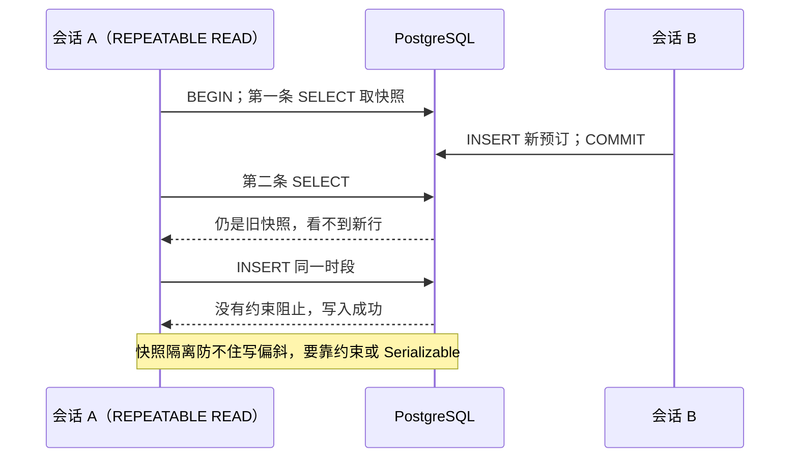

# 第 41 章 PostgreSQL 的事务和隔离级别

## 事务、隔离级别、锁：先弄懂这几个词

一次预订往往不止写一张表：预订本身、服务明细、审计记录。如果第一条写入成功、第二条失败，库里就留下一条「没有服务」的预订，账单和对账都会错。事务（transaction）就是把这些操作打包成一个整体：用 `BEGIN` 开始，`COMMIT` 全部生效，中间任何一条失败就 `ROLLBACK` 全部撤销。数据库向你保证的「要么全成、要么全不成」，叫原子性（atomicity）。

围绕事务有四个常一起提的性质，合称 ACID：原子性（全成或全不成）、一致性（事务前后都满足约束，比如外键、`CHECK`）、隔离性（并发事务之间互相看到多少）、持久性（提交后即使断电也不丢，PG 先把日志刷盘）。A、C、D 都直白，真正难的是 I——隔离性。

为什么难：两个事务同时跑，交错的顺序会带来几种「看起来像 bug、其实是并发」的现象。脏读：读到了别人还没提交、后来可能回滚的数据。不可重复读：同一个事务里前后读同一行，值变了。幻读：按同一个条件查两次，第二次多出（或少掉）了行。写偏斜：两个事务各自检查都通过，合起来却违反业务规则——两个人同时查「这个时段没人」，然后各自插入。

隔离级别就是数据库用来挡这些现象的档位。档位越高，挡得越多，并发代价也越大。SQL 标准定义了四档（READ UNCOMMITTED、READ COMMITTED、REPEATABLE READ、SERIALIZABLE），PostgreSQL 实际只实现后三档。往下会看到：默认的 READ COMMITTED 挡不住「检查完再插入」的竞态，REPEATABLE READ 也挡不住写偏斜，最后还得靠锁或约束。

锁是更直接的排队手段：`SELECT ... FOR UPDATE` 把选中的行锁住，别的事务想改要等。约束则是最后一道防线，比如用 `EXCLUDE` 禁止同一房间同一时段出现两条有效预订。三者不是替代关系，是不同层次的防线。

官方文档（先看懂正文再点）：
- [事务与隔离级别](https://www.postgresql.org/docs/17/transaction-iso.html)：四档隔离级别各挡哪种并发现象，对应本章「档位」那段。
- [MVCC（多版本并发控制）](https://www.postgresql.org/docs/17/mvcc.html)：PG 怎么让读不阻塞写，是隔离级别的地基。
- [显式锁](https://www.postgresql.org/docs/17/explicit-locking.html)：`FOR UPDATE` 这类行锁、表锁的行为。

现在看一个真实事故。

周五下午两点，陈默和周雨几乎同时点了「预订」：A301，14:00 到 15:00。页面都转出绿色对勾。十分钟后，日历上并排躺着两条记录。

你翻接口日志：两个请求都先查了「这个时段有没有人」，都得到 0 行，然后各自 `INSERT`。检查没有错，错在检查和写入之间，别人也能插进来。这不是 SQL 写错，是并发。

这一章按「事务 → 隔离级别 → 锁 → 约束」的顺序走，输出都是**示例输出**；涉及两个会话的 transcript 不是单连接能复现的，标注为「双会话示例」。

> **图 41-1** 两个事务各自看到的数据版本



## 一次预订不止写一张表

服务、参会人、审计记录，往往要跟预订一起写。第一条成功、第二条失败，留下一条没有服务的预订，比直接报错更麻烦：账单少算钱，对账时才发现，还得人工补。

```sql
BEGIN;

INSERT INTO bookings (id, user_id, room_id, start_time, end_time, status, remark)
VALUES ('bfffffff-ffff-4fff-8fff-ffffffffffff',
        '22222222-2222-4222-8222-222222222222',
        'a3333333-3333-4333-8333-333333333333',
        '2026-11-06 14:00+08', '2026-11-06 15:00+08',
        'PENDING', '事务演示');

INSERT INTO booking_services (booking_id, service_id, quantity, unit_price)
VALUES ('bfffffff-ffff-4fff-8fff-ffffffffffff', 999, 1, 10.00);
```

```text
BEGIN
INSERT 0 1
ERROR:  insert or update on table "booking_services" violates foreign key constraint "booking_services_service_id_fkey"
DETAIL:  Key (service_id)=(999) is not present in table "services".
```

```sql
ROLLBACK;

SELECT (SELECT count(*) FROM bookings) AS bookings,
       (SELECT count(*) FROM booking_services) AS links;
```

```text
 bookings | links
----------+-------
       14 |     4
```

`BEGIN` 之后，后续语句共享一个事务边界；`COMMIT` 让它们一起生效，`ROLLBACK` 让它们一起消失。PG 默认是 autocommit：你单发一条 `INSERT`，它自己就是一个事务；只有显式 `BEGIN` 才把多条语句绑在一起。

第二条失败后，事务进入 **aborted** 状态。这个状态很关键：它不是「这一条失败」，而是「整个事务已经废了」。此时再发任何 SQL，都会得到 `current transaction is aborted, commands ignored until end of transaction block`；此时发 `COMMIT`，PG 不会提交，只打印 `ROLLBACK`。

所以应用代码里的 `catch` 必须显式 `ROLLBACK`。node-postgres 的 `client.release()` 把连接还给池子时不会替你回滚；连接带着一个 aborted 事务回到池里，下一个请求借到它，第一条查询就会莫名其妙报这个错。

把 999 换成 1，两条都成功，`COMMIT` 之后是 15 和 5。这里能看出 ACID 的分工：原子性由事务保证，一致性交给外键和 `CHECK`（数据库只保证你**声明过**的约束），持久性交给 WAL——`COMMIT` 返回时日志已经落盘（默认 `synchronous_commit = on`），进程立刻崩了也能恢复。隔离性最难，下一节单独说。

还有个 PG 与 MySQL 的差异：PG 的 DDL 也在事务里，`BEGIN; ALTER TABLE ...; ROLLBACK;` 能全身而退；MySQL 8 的很多 DDL 会隐式提交，回滚不了。迁移脚本写错一半时，这个差别决定了你是「重跑一次」还是「手工修表」。

## SAVEPOINT：错一步，不用整笔重来

有些失败是预期的：服务 ID 填错，换一个就行，不必丢掉已经写好的预订。`SAVEPOINT` 在事务里打个标记，回滚到标记，事务继续。

```sql
BEGIN;

INSERT INTO bookings (id, user_id, room_id, start_time, end_time, status, remark)
VALUES ('bfffffff-ffff-4fff-8fff-ffffffffffff',
        '22222222-2222-4222-8222-222222222222',
        'a3333333-3333-4333-8333-333333333333',
        '2026-11-06 14:00+08', '2026-11-06 15:00+08',
        'PENDING', '事务演示');

SAVEPOINT sp_service;

INSERT INTO booking_services (booking_id, service_id, quantity, unit_price)
VALUES ('bfffffff-ffff-4fff-8fff-ffffffffffff', 999, 1, 10.00);

ROLLBACK TO SAVEPOINT sp_service;

INSERT INTO booking_services (booking_id, service_id, quantity, unit_price)
VALUES ('bfffffff-ffff-4fff-8fff-ffffffffffff', 1, 2, 25.00);

COMMIT;
```

```text
BEGIN
INSERT 0 1
SAVEPOINT
ERROR:  insert or update on table "booking_services" violates foreign key constraint "booking_services_service_id_fkey"
ROLLBACK
INSERT 0 1
COMMIT
```

`ROLLBACK TO` 只撤销标记之后的语句，前面的预订还在；锁也还握着，直到 `COMMIT`。别把 SAVEPOINT 当分支——它不能提交一部分，只能丢掉一部分。`RELEASE SAVEPOINT` 是另一回事：只销毁标记，把这段工作并入外层事务，不是提交。名字可以复用，后建的会遮住先建的，回滚时按最近的那个算。

SAVEPOINT 有成本。PG 内部会为它分配子事务 ID，一个循环里给每行都打一个，长事务的子事务数会迅速膨胀，撤销日志和快照判断都变慢。它适合「一次请求里两三次可选的附带写入」，不适合当成逐行容错。能提前校验的（比如服务 ID 存不存在），先校验再写，比事后回滚便宜。

## 隔离级别：PG 只实现三档

开头用白话过了一遍，这里补两处容易混的边界。**不可重复读**是同一行的值变了；**幻读**是同一个条件的结果集多了或少掉了行——前者盯一行，后者盯一个范围。**序列化异常**（写偏斜是它的典型）不表现为「读到了脏数据」，而是两个事务各自单独跑都对，交错跑出来的结果违反业务约束，所以最难查。

| 级别 | PG 的实现 | 脏读 | 不可重复读 | 幻读 | 序列化异常 |
| --- | --- | --- | --- | --- | --- |
| READ UNCOMMITTED | 语法接受，行为等同 RC | 不会 | 可能 | 可能 | 可能 |
| READ COMMITTED（默认） | 语句级快照 | 不会 | 可能 | 可能 | 可能 |
| REPEATABLE READ | 事务级快照，无幻读 | 不会 | 不会 | 不会 | 可能（40001） |
| SERIALIZABLE | 快照隔离 + SSI | 不会 | 不会 | 不会 | 冲突时中止一方 |

```sql
SHOW transaction_isolation;
```

```text
 transaction_isolation
-----------------------
 read committed
(1 row)
```

PG 用 **MVCC**（多版本并发控制）实现隔离：更新不覆盖旧行，而是写一个新版本，旧版本留给还在读旧快照的事务，读不阻塞写。每行隐藏的 `xmin` 是创建版本的事务号，`xmax` 是删除或更新它的事务号；索引项指向行的物理位置（`ctid`），可见性要结合快照判断。`VACUUM` 负责回收没人再看的旧版本，但它只能回收「所有活跃快照都不再需要」的版本。

这就解释了一个运维现象：长事务不结束，旧版本收不掉，表只涨不降。更隐蔽的是「开了事务忘了关」——连接池里的连接处于 `idle in transaction`，它拿着的快照会一直挡住 `VACUUM`。所以要设 `idle_in_transaction_session_timeout`，比如 30 秒，让这种连接自己断开。

RC 的快照是语句级的：每条语句开始时取一次。同一事务里两条相同 `SELECT`，中间别人提交，结果会变——不可重复读。大多数 Web 请求用 RC，看到最新已提交数据正是期望行为。

```text
会话 A（RC）                                  会话 B
BEGIN;
SELECT count(*) FROM bookings
WHERE room_id = 'a111...' AND status IN ('PENDING','APPROVED');
-- 5
                                              BEGIN;
                                              INSERT INTO bookings (...) VALUES (A301 周五 14:00-15:00);
                                              COMMIT;
SELECT count(*) ...;
-- 6
ROLLBACK;
```

RR 的快照是事务级的，第一条语句时取，之后不变；PG 的 RR 连幻读也挡住了，比 SQL 标准更强。代价是：要更新一行在快照之后被改过的记录，PG 不让静默覆盖，直接报 `could not serialize access due to concurrent update`（`40001`）。

```text
会话 A（RR）
BEGIN ISOLATION LEVEL REPEATABLE READ;
SELECT count(*) ...;  -- 5
-- 会话 B 插入同一时段并提交
SELECT count(*) ...;  -- 5
INSERT 同一时段;       -- 成功
COMMIT;
```

两条 `SELECT` 一致，但两个事务都基于「0 条冲突」的旧快照插入，结果还是重叠。这就是**写偏斜**（write skew）：每个事务读到的集合都没变，写出去的动作合在一起却破坏了不变量。快照隔离防不住它，因为冲突不在「同一行」上，只在「同一个业务约束」上。经典例子是值班表：规则要求至少两名医生在岗，两位医生各自查到「还有 3 人」，都提交请假，最后只剩 1 人。

回到周五那两条记录，它们在 RR 下的成因就是写偏斜：两个会话都看不见对方的新行，各自插入都合法。这也说明一件事——**光提高隔离级别不够**。

Serializable 在 RR 之上加 **SSI**（Serializable Snapshot Isolation），检测读写依赖环，发现环就中止一方，报 `could not serialize access due to read/write dependencies among transactions`，带 `Reason code` 和重试提示。它不是「不会冲突」，是「冲突时让你重试」。

重试要重跑**整笔**事务，接口还要幂等——否则第一次其实提交成功了、客户端超时重试，会写出第二条。重试要加退避和次数上限。

还有一个容易踩的顺序问题：RR 下 `SELECT ... FOR UPDATE` 等锁之后，后续普通 `SELECT` 仍用旧快照，可能看不到对方刚提交的预订。所以「锁房间再查冲突」这套适合 RC，不适合 RR。一定要 RR，就在锁完之后用 `FOR UPDATE` 再查一遍，或者升到 Serializable 让 SSI 兜底。

## 锁房间，而不是锁预订

```sql
BEGIN;

SELECT id FROM rooms
WHERE id = 'a1111111-1111-4111-8111-111111111111'
FOR UPDATE;

SELECT 1 FROM bookings
WHERE room_id = 'a1111111-1111-4111-8111-111111111111'
  AND status IN ('PENDING', 'APPROVED')
  AND start_time < '2026-11-06 15:00+08'
  AND end_time > '2026-11-06 14:00+08';
-- 0 rows

INSERT INTO bookings (user_id, room_id, start_time, end_time, status)
VALUES ('22222222-2222-4222-8222-222222222222',
        'a1111111-1111-4111-8111-111111111111',
        '2026-11-06 14:00+08', '2026-11-06 15:00+08', 'PENDING');

COMMIT;
```

为什么锁 `rooms` 而不是 `bookings`？因为空档里没有行可锁。`FOR UPDATE` 在 `bookings` 上查到 0 行，什么也没锁住——没有行，就没有行锁。锁住房间这一行，等于给「这间房的预订」加了门闩：第二个请求会在 `FOR UPDATE` 上等，等第一个提交后再查冲突，就能看到新预订。

`FOR UPDATE` 不是唯一的行锁。PG 的行级锁有四种模式，区别在于「锁住之后还允不允许别人加外键」：

| 模式 | 典型用途 | 与 `KEY SHARE` 冲突 |
| --- | --- | --- |
| `FOR UPDATE` | 要改这行，且不希望别人并发改 | 是 |
| `FOR NO KEY UPDATE` | 要改非键列（如状态） | 否 |
| `FOR SHARE` | 读的时候防止别人改 | 否（但阻止 `FOR UPDATE`） |
| `FOR KEY SHARE` | 外键检查时自动加，防主键被删 | — |

往 `bookings` 插一行时，外键检查会对 `rooms` 那一行加 `KEY SHARE`；如果应用里用 `FOR UPDATE` 锁房间，这两种锁冲突，插入会排队。用 `FOR NO KEY UPDATE` 就不冲突，因为你不改房间的主键。下面 Prisma 代码用 `forNoKeyUpdate()` 就是这个原因。

前提是所有人都走同一把锁。有的接口锁房间、有的直接 `INSERT`，门闩形同虚设。约定要写进代码评审清单，或者干脆用数据库约束兜底。

没有业务行可锁时，可以用咨询锁：`SELECT pg_advisory_xact_lock(hashtextextended($1, 0));`。它不锁任何表，只锁一个 64 位整数键；`xact` 版本在事务结束时自动释放，session 版本要手动 `pg_advisory_unlock`。键通常由「业务名 + 资源 id」哈希得到，所有写入方必须用同一种算法，否则各锁各的。

Prisma 8 里把锁和检查放进同一个回调：

```ts
// src/modules/bookings/bookings.service.ts（节选）
await db.transaction(async (tx) => {
  const start = startTime.toISOString();
  const end = endTime.toISOString();

  const room = await tx.orm.public.Room
    .where({ id: roomId })
    .forNoKeyUpdate()
    .first();
  if (!room) throw new NotFoundException('会议室不存在');

  const conflict = await tx.orm.public.Booking.where((row, { fns }) =>
    fns.and(
      row.roomId.eq(roomId),
      row.status.in([BookingStatus.PENDING, BookingStatus.APPROVED]),
      row.startTime.lt(end),
      row.endTime.gt(start),
    ),
  ).first();
  if (conflict) throw new ConflictException('该时段已被预订');

  return tx.orm.public.Booking.create({
    userId,
    roomId,
    startTime: start,
    endTime: end,
    status: BookingStatus.PENDING,
  });
});
```

`db.transaction` 把回调里的操作绑在同一个连接、同一个事务里。回调抛异常，Prisma 回滚；正常返回，才提交。默认隔离级别沿用数据库的 RC；Prisma 8 的 `db.transaction` 没有隔离级别参数，确实要 Serializable，就在回调第一步用 `tx.execute` 执行 `SET TRANSACTION ISOLATION LEVEL SERIALIZABLE`——这条必须是事务里的第一条语句，前面不能有任何查询，否则报 `SET TRANSACTION ISOLATION LEVEL must be called before any query`。然后捕获 `SqlQueryError` 的 `sqlState`（`40001` 序列化失败、`40P01` 死锁），重试整笔事务。

事务里别等第三方接口：连接和锁都被占着，等久了还会撞上 `lock_timeout`。发通知、传文件、调支付，都放到提交之后。

## 让数据库拒绝重叠

锁能解决「同一套代码」的并发，解决不了「有人绕过接口直接写库」。最终的兜底是约束。

`EXCLUDE` 是 PG 独有的约束，可以理解成「唯一约束的推广」：唯一约束声明「这一列不许相等」，`EXCLUDE` 声明「这些列按这些操作符不许冲突」。这里用 `room_id WITH =` 加时间区间的 `&&`（重叠），合起来就是「同一房间、时间不许重叠」。

```sql
CREATE EXTENSION IF NOT EXISTS btree_gist;

-- 先清理历史重叠，否则加约束会失败
UPDATE bookings SET status = 'REJECTED'
WHERE id = 'b8888888-8888-4888-8888-888888888888';

ALTER TABLE bookings
ADD CONSTRAINT bookings_no_overlap
EXCLUDE USING gist (
  room_id WITH =,
  tstzrange(start_time, end_time, '[)') WITH &&
) WHERE (status IN ('PENDING', 'APPROVED'));
```

`btree_gist` 让 GiST 索引支持 `uuid` 的等值比较；GiST 本身擅长区间、几何这类「相交/包含」判断。`tstzrange(..., '[)')` 和前面几章的半开区间保持一致，否则 10:00 结束和 10:00 开始会被判成重叠。`WHERE` 让约束只作用于有效预订，取消和拒绝的记录可以重叠——这是**部分约束**，和部分索引同一个思路。

再插一条撞车的：

```sql
INSERT INTO bookings (user_id, room_id, start_time, end_time, status)
VALUES ('22222222-2222-4222-8222-222222222222',
        'a1111111-1111-4111-8111-111111111111',
        '2026-11-04 09:30+08', '2026-11-04 10:30+08', 'PENDING');
```

```text
ERROR:  conflicting key value violates exclusion constraint "bookings_no_overlap"
DETAIL:  Key (room_id, tstzrange(start_time, end_time, '[)'::text))=(...)
         conflicts with existing key (...).
```

错误码是 `23P01`（exclusion_violation），接口要单独捕获返回 409，而不是 500。加约束会校验存量数据，线上要大扫除：先查重叠、再清理、最后 `ALTER`。约束还是局部的——把一条 `REJECTED` 改成 `APPROVED` 时同样会检查，可能撞上。

大表上加 `EXCLUDE` 要有维护窗口：它在建约束时一起建索引，期间持有强锁、阻塞写入。`UNIQUE` 约束可以 `ADD CONSTRAINT ... USING INDEX` 挂一个已经 `CREATE INDEX CONCURRENTLY` 建好的索引，`EXCLUDE` 没有这个选项；所以要么安排停机窗口，要么建新表、迁数据、切换。

MySQL 没有 `EXCLUDE`，只能用触发器或 Serializable 模拟。排班、会议室、酒店这类「同一资源时间不能重叠」的需求，这是 PG 的实打实优势。

> 说明：上面的 `CREATE EXTENSION btree_gist` 和 `EXCLUDE` 的报错文本没有在真实 PG 17 实例上实测，取自 PostgreSQL 17 文档的标准行为；你自己跑，`DETAIL` 里的 UUID 会和这里不同。

## 死锁：互相等对方手里的锁

两个事务按相反顺序锁两间房，就会各持一把、等另一把。PG 有死锁检测器，默认每秒检查一次（`deadlock_timeout`），发现环就杀掉其中一个，报 `deadlock detected`（`40P01`）。被杀的那个事务回滚，另一个继续。

```text
会话 A                                      会话 B
BEGIN;                                       BEGIN;
UPDATE rooms SET status = status WHERE id = 'a111...';
                                             UPDATE rooms SET status = status WHERE id = 'a222...';
UPDATE rooms SET status = status WHERE id = 'a222...';  -- 等待
                                             UPDATE rooms SET status = status WHERE id = 'a111...';
                                             ERROR: deadlock detected
                                             DETAIL: Process 214 waits for ShareLock on transaction 215;
                                                     blocked by process 216.
                                             ROLLBACK;
COMMIT;
```

哪个事务被杀是随机的，别依赖顺序。避免办法很土但有效：所有事务按同一顺序加锁，比如房间 id 升序；多行操作合并成一条 `UPDATE ... WHERE id = ANY($1)`，减少往返和持锁时间——但一条语句的加锁顺序由执行计划决定，它不保证按你写的顺序来，要绝对有序还是得在应用里排好再逐行锁。事务尽量短，别在事务里等网络。

排查时先看谁在等：

```sql
SELECT pid, state, wait_event_type, wait_event, left(query, 60) AS query
FROM pg_stat_activity
WHERE datname = 'booking' AND pid <> pg_backend_pid();

SELECT pid, pg_blocking_pids(pid) AS blocked_by
FROM pg_stat_activity
WHERE cardinality(pg_blocking_pids(pid)) > 0;
```

`pg_blocking_pids` 直接告诉你谁堵了谁；再查 `pg_locks` 里 `granted = false` 的行，能看到锁类型和对象。给 `lock_timeout` 设上限，比如 3 秒，让等不到锁的请求快速失败，而不是把连接池拖干；`statement_timeout` 防慢查询，`idle_in_transaction_session_timeout` 防占着事务不干活。三个超时管的是不同的事，别只设一个。

> 说明：上面这段双会话 transcript 未在两个真实会话里跑过，检测行为（`deadlock_timeout`、随机回滚一方、`40P01`）以 PG 17 文档和标准的两连接行为为准。

## 几个反复出现的坑

| 现象 | 原因 | 处理 |
| --- | --- | --- |
| 两个请求都提示预订成功 | 检查和插入不在一个原子动作里 | 锁房间行，或加 EXCLUDE 约束 |
| 报错后 COMMIT，却提示 ROLLBACK | 事务已 aborted | 显式 ROLLBACK，或 ROLLBACK TO SAVEPOINT |
| 连接还池后下个请求报 aborted | release 前没回滚，脏连接被复用 | catch 里必 ROLLBACK，再 release |
| RR 下锁完仍查不到新预订 | 事务快照停在第一条语句 | 改用 RC + 行锁，或 Serializable |
| 更新报 40001 | 快照后行被并发修改 | 重读最新值，重试整笔事务 |
| 两个事务互等，一个报 40P01 | 加锁顺序不一致 | 固定顺序，捕获后整笔重试 |
| 加了 EXCLUDE 却建不上 | 存量数据有重叠，或缺 btree_gist | 先清理，再建扩展和约束 |
| 表越来越大，VACUUM 不回收 | 长事务、长快照、复制槽 | 监控 idle in transaction，设置超时 |

回到周五那两条重叠记录：检查没错，错在检查和写入不是一个原子动作。现在有三层防线：事务保证一次写入要么全成；房间行锁把同一间房的检查串起来；`EXCLUDE` 约束兜住所有绕过接口的写入。

事务不是银弹。它能保证「一起成功或一起失败」，保证不了「业务上不该重叠」——那要靠约束。下次先问一句：这个不变量能不能写成数据库约束？能，就别只写在 Service 里。

视图、函数和存储过程会把这类判断再往数据库推一步，下一章见。

想更深入的话，官方文档里有这几页可以接着看：[事务隔离](https://www.postgresql.org/docs/17/transaction-iso.html)（隔离级别的官方定义和现象对照表）、[显式锁](https://www.postgresql.org/docs/17/explicit-locking.html)（各种锁模式和冲突关系）、[MVCC](https://www.postgresql.org/docs/17/mvcc.html)（版本可见性和清理机制）、[`CREATE TABLE`](https://www.postgresql.org/docs/17/sql-createtable.html)（用 `EXCLUDE` 约束防重叠时，表定义怎么写）、[监控统计](https://www.postgresql.org/docs/17/monitoring-stats.html)（看锁等待、长事务的视图）。

<!-- chapter-nav:start -->
---

← 上一篇：[040 SQL综合练习](040-SQL综合练习.md) · [本 Part 目录](_part.md) · 下一篇：[042 PostgreSQL的视图、存储过程和函数](042-PostgreSQL的视图、存储过程和函数.md) →
<!-- chapter-nav:end -->
