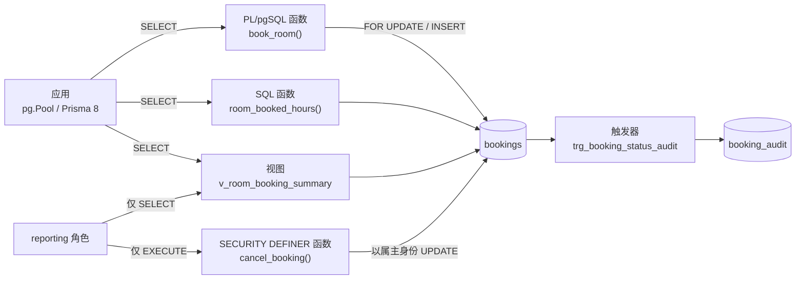

# 第 42 章 PostgreSQL 的视图、存储过程和函数

## 先把这几样「数据库对象」认清楚

平时你写 `SELECT`，语句执行完就没了。数据库允许你把一段查询或一段逻辑**存进库里、起个名字、单独授权限**，之后就像表一样被引用。这一章用到的五种东西都属于这一类，先把它们是什么说清楚，再看事故。

**视图（view）**是一条起了名字、存进库的 `SELECT`。它不存数据，每次被查询时把定义展开成对基表（背后真正存数据的表）的查询。为什么需要它——同一段「本周会议室利用率」的 SQL，报表复制一份、接口复制一份、导出脚本再复制一份，改口径时漏掉一处，数字就对不上。视图让这段口径只存在一个地方。没有它行不行？行，靠代码规范和 review 也能维持，但人一定会漏。

**物化视图（materialized view）**是视图的变体，区别只有一句：结果真的写到磁盘上，查询直接读，不重算。代价是数据会旧，要刷新。**函数（function）**接收参数、返回结果，逻辑也留在数据库里；**存储过程（procedure）**是它的兄弟，不返回结果集，用 `CALL` 调用，适合批处理和运维脚本。**触发器（trigger）**则是挂在表上的钩子：表上发生 `INSERT`/`UPDATE` 时自动执行一段函数。它们共同的取舍是——逻辑离数据更近、跨语言跨服务都能用，但改一次要走迁移、要评审，不像应用代码那样随手改。

官方文档（先看懂正文再点）：
- [视图](https://www.postgresql.org/docs/17/sql-createview.html)：把一段查询存成名字的语法，对应本章「视图」那段。
- [物化视图](https://www.postgresql.org/docs/17/sql-creatematerializedview.html)：结果落盘、需要手动刷新的视图。
- [函数](https://www.postgresql.org/docs/17/sql-createfunction.html)：建函数的参数、返回值和语言选择。
- [存储过程](https://www.postgresql.org/docs/17/sql-createprocedure.html)：和函数的区别就在这页，重点看 `CALL`。
- [触发器](https://www.postgresql.org/docs/17/trigger-definition.html)：挂在表上、随增删改自动执行的钩子。

现在看一个真实事故。

周一早上运营在群里贴了两张报表，都是上周的会议室利用率：一张 62%，一张 48%。查下来不是谁算错了——一份 SQL 过滤了 `status = 'APPROVED'`，另一份漏了；第三份更离谱，把已取消的预订时长也算进去了。同一套口径，在三个地方各长了一个版本。

另一件事更让人坐不住。给外包分析师的只读账号，能直接 `SELECT * FROM bookings`，客户写在 `remark` 里的特殊要求一览无余。在应用层加权限判断没有意义，那个账号本来就不该有表的读权限。

两件事是同一个动作：把「怎么查」和「谁能查」从散落的应用代码里收进数据库，收成一份带名字、有权限、能进迁移的定义（迁移就是有版本号、能重复执行的建表改表脚本，第 48 章会展开）。数据库正好提供了五种这样的东西——视图、物化视图、函数、存储过程、触发器。下面一个一个上手，每个都真跑一遍。

## 把那段查询固定成视图

先说视图（view）：它是一条**带名字的查询**，不存数据，每次被引用时把定义展开成对基表的查询。解决的就是上面那种「同一段 SQL 复制三份」的问题——只写一次，谁用谁引用。

把利用率报表的口径定下来：

```sql
CREATE OR REPLACE VIEW v_room_booking_summary AS
SELECT
  r.id       AS room_id,
  r.name     AS room_name,
  r.capacity,
  r.location,
  count(b.id) AS booking_count,
  coalesce(
    sum(extract(epoch FROM (b.end_time - b.start_time)) / 3600),
    0
  )::numeric(10, 1) AS booked_hours
FROM rooms r
LEFT JOIN bookings b
  ON b.room_id = r.id
 AND b.status = 'APPROVED'
 AND b.start_time >= date_trunc('week', now())
 AND b.start_time <  date_trunc('week', now()) + interval '7 days'
GROUP BY r.id, r.name, r.capacity, r.location;
```

时间窗和 `status` 这两个条件写在 `ON` 里，不是 `WHERE` 里，这是这条 SQL 唯一需要盯住的地方。写进 `WHERE`，`LEFT JOIN` 会退化成内连接：本周一条预订都没有的会议室直接从结果里消失。报表少一行比数字算错更难发现——没人会去数会议室是不是少了一个。

建完查一下：

```bash
psql "$DATABASE_URL" -c "SELECT room_name, capacity, booking_count, booked_hours
                           FROM v_room_booking_summary
                          ORDER BY booked_hours DESC, room_name;"
```

```text
 room_name | capacity | booking_count | booked_hours
-----------+----------+---------------+--------------
 木星厅    |       12 |             2 |          3.5
 土星厅    |        6 |             0 |          0.0
```

（示例输出，示例库只有两间会议室；你的数据会不同。）

视图不占存储，`EXPLAIN`（查看执行计划的命令）看到的是展开后的基表扫描，所以它不能被单独 `VACUUM`（PostgreSQL 回收旧行版本的维护命令）、也不能建索引——快不快完全取决于基表的索引。改视图也比改表挑剔：`CREATE OR REPLACE VIEW` 只能往列末尾追加，改列名、改类型、删列都不行，只能 `DROP VIEW` 重建；重建前先查系统表 `pg_depend`（记录对象之间依赖关系的地方），可能有别的视图或函数挂在这个视图上。

它还有一个绕不开的限制：**视图不能带参数**。查询条件只能写死在定义里，或者在引用视图时再套一层 `WHERE`。「某间会议室、某段时间被占了多少小时」这种带输入的计算，视图表达不了，得用函数——这也是两者最实际的分工，视图固化「查哪些行、哪些列」，函数接收「这一次的输入」。

## 报表变慢了，换成物化视图

视图每次查询都重算。数据量一上来，运营每刷新一次页面就把百万行扫一遍，数据库开始喘。这时候把「算好的结果」写到磁盘上，就是物化视图（materialized view）：它长得像视图，但真的占存储，查询时直接读结果，不再展开定义。

```sql
CREATE MATERIALIZED VIEW mv_daily_room_load AS
SELECT
  b.room_id,
  b.start_time::date AS booking_date,
  count(*)           AS booking_count,
  sum(extract(epoch FROM (b.end_time - b.start_time)) / 3600)::numeric(10, 1) AS booked_hours
FROM bookings b
WHERE b.status = 'APPROVED'
GROUP BY b.room_id, b.start_time::date
WITH NO DATA;

CREATE UNIQUE INDEX mv_daily_room_load_pk
  ON mv_daily_room_load (room_id, booking_date);

REFRESH MATERIALIZED VIEW mv_daily_room_load;
```

`WITH NO DATA` 建出来是个空壳，必须手动刷一次才有数据——不加这个子句，建表时就会同步算一遍，大表上会把这次迁移卡住。唯一索引也不是可选项，`REFRESH ... CONCURRENTLY` 靠它判断哪些行要改，没索引直接报错。

两种刷新的差别全在锁上：

| 方式 | 加的锁 | 刷新时能查吗 | 什么时候用 |
| --- | --- | --- | --- |
| `REFRESH MATERIALIZED VIEW` | `ACCESS EXCLUSIVE` | 不能，查询排队 | 夜间窗口、数据量小 |
| `REFRESH ... CONCURRENTLY` | 较弱的锁，逐行比对 | 能 | 白天也要刷 |

`CONCURRENTLY` 慢，因为它要把新旧结果做一次全量 diff；它也不能在事务块里跑——`BEGIN; REFRESH ... CONCURRENTLY; COMMIT;` 会直接报错。用 `psql -c` 单条执行，或者交给调度器。

托管 PostgreSQL 一般带 `pg_cron`，可以直接排：

```sql
SELECT cron.schedule(
  'refresh-room-load',
  '*/10 * * * *',
  $$REFRESH MATERIALIZED VIEW CONCURRENTLY mv_daily_room_load$$
);
```

自建库要先在 `shared_preload_libraries`（PostgreSQL 启动时预加载的扩展列表，改完要重启）里加载 `pg_cron` 才能 `CREATE EXTENSION`。没有 `pg_cron` 就让应用里的定时任务去调，但记住只让一个实例执行——多实例同时刷会互相等锁。

## 把「用了多少小时」写成函数

「某间会议室在任意时间段被占用了多少小时」这个计算，报表要、冲突校验要、账单也要。写成函数（function），参数是会议室和时间窗，返回小时数：

```sql
CREATE OR REPLACE FUNCTION room_booked_hours(
  p_room_id uuid,
  p_from    timestamptz,
  p_to      timestamptz
) RETURNS numeric
LANGUAGE sql
STABLE
AS $$
  SELECT coalesce(
    sum(extract(epoch FROM (
      least(b.end_time, p_to) - greatest(b.start_time, p_from)
    )) / 3600),
    0
  )::numeric(10, 1)
  FROM bookings b
  WHERE b.room_id = p_room_id
    AND b.status = 'APPROVED'
    AND b.start_time < p_to
    AND b.end_time   > p_from;
$$;
```

两个细节值得停一下。

第一，区间按半开区间 `[start, end)` 判断重叠：`start_time < p_to AND end_time > p_from`。这样 14:00–15:00 和 15:00–16:00 不算相交，前后两场预订可以背靠背排。

第二，用 `least` / `greatest` 把每段预订裁剪到查询窗口里。不加这一步，查 14:00–15:00 会把一整段 13:00–17:00 的预订按 4 小时算进去。

最后那个 `STABLE` 是在告诉优化器：同一条语句里参数相同，结果就相同。它依赖表数据，所以不能标 `IMMUTABLE`（那个承诺的是「永远不变」，优化器可能据此把结果缓存到不该缓存的地方）。反过来，能标 `STABLE` 就别留默认的 `VOLATILE`，否则每行都要重算。

跑一下：

```bash
psql "$DATABASE_URL" -c "SELECT room_booked_hours(
  (SELECT id FROM rooms WHERE name = '木星厅'),
  '2026-11-10 14:00+08',
  '2026-11-10 15:00+08'
);"
```

```text
 room_booked_hours
-------------------
               1.0
```

（示例输出。）一小时窗口里正好有一场被批准的预订，返回 `1.0`。

## 需要判断、加锁、抛错时，上 PL/pgSQL

`LANGUAGE sql` 的函数体只能是一条查询。预订会议室有校验、有锁、有异常，得换成 PL/pgSQL——PostgreSQL 自带的过程语言，支持变量、条件、异常和循环：

```sql
CREATE OR REPLACE FUNCTION book_room(
  p_user_id uuid,
  p_room_id uuid,
  p_start   timestamptz,
  p_end     timestamptz,
  p_remark  text DEFAULT NULL
) RETURNS uuid
LANGUAGE plpgsql
AS $$
DECLARE
  v_booking_id uuid;
  v_conflict   integer;
BEGIN
  IF p_end <= p_start THEN
    RAISE EXCEPTION '结束时间必须晚于开始时间'
      USING ERRCODE = '22023';
  END IF;

  PERFORM 1
    FROM rooms
   WHERE id = p_room_id
     AND status = 'AVAILABLE'
     FOR UPDATE;

  IF NOT FOUND THEN
    RAISE EXCEPTION '会议室 % 不存在或正在维护', p_room_id
      USING ERRCODE = 'P0002';
  END IF;

  SELECT count(*) INTO v_conflict
    FROM bookings
   WHERE room_id = p_room_id
     AND status IN ('PENDING', 'APPROVED')
     AND start_time < p_end
     AND end_time   > p_start;

  IF v_conflict > 0 THEN
    RAISE EXCEPTION '时段冲突: 会议室 % 在该时段已有预订', p_room_id
      USING ERRCODE = '23P01',
            HINT = '换一个时段，或者先取消冲突的预订';
  END IF;

  INSERT INTO bookings (user_id, room_id, start_time, end_time, remark)
  VALUES (p_user_id, p_room_id, p_start, p_end, p_remark)
  RETURNING id INTO v_booking_id;

  RETURN v_booking_id;
END;
$$;
```

整段的关键是 `FOR UPDATE` 锁在 `rooms` 那一行上，不是 `bookings`。两个请求同时订同一间会议室时，第二个会卡在锁上，等第一个提交后再做冲突检查，因此能看到刚插入的那条记录。没有这把锁，两个事务会同时查到「没有冲突」，然后各插一条——`READ COMMITTED` 下这是标准竞态，不是偶发 bug。锁只锁这一间会议室，不同会议室互不影响。

锁在语句结束时释放。单独 `SELECT book_room(...)` 本身就是一条语句、一个事务，检查、插入、释放锁都在里面，能防住并发；如果在应用里先 `BEGIN`、再调函数、再写别的表，锁会一直持有到 `COMMIT`——通常这正是你想要的，但别把慢查询夹在中间。

跑一次正常的，再跑一次同一时段：

```bash
psql "$DATABASE_URL" -c "SELECT book_room(
  (SELECT id FROM users WHERE email = 'alice@example.com'),
  (SELECT id FROM rooms WHERE name = '木星厅'),
  '2026-11-10 14:00+08',
  '2026-11-10 15:00+08'
);"
```

```text
                book_room
--------------------------------------
 9c1f2b7e-4a3d-4f8e-9b2a-1d6c5e7f8a90
```

第二次拿到的是业务错误，不是数据库崩溃：

```text
meeting=# \set VERBOSITY verbose
meeting=# SELECT book_room(...);
ERROR:  23P01: 时段冲突: 会议室 6f1c2d3e-... 在该时段已有预订
HINT:   换一个时段，或者先取消冲突的预订
```

时间倒着传会拿到 `22023`。SQLSTATE 是 PostgreSQL 错误对象上的五位标准错误码，和错误文案、语言环境都无关——应用层只认它，不用去解析中文 `message`，也不用担心升级 PostgreSQL 后文案变了导致分支失效。

| SQLSTATE | 含义 | 应用层对应动作 |
| --- | --- | --- |
| `22023` | 参数不合法 | 400，提示检查时间 |
| `P0002` | 会议室不存在或维护中 | 404 |
| `23P01` | 时段冲突 | 409，让用户换时间 |

想更彻底，可以在 `bookings` 上加排他约束，让数据库在索引层面就拒绝重叠：

```sql
CREATE EXTENSION IF NOT EXISTS btree_gist;

ALTER TABLE bookings
  ADD CONSTRAINT bookings_no_overlap
  EXCLUDE USING gist (
    room_id WITH =,
    tstzrange(start_time, end_time) WITH &&
  ) WHERE (status IN ('PENDING', 'APPROVED'));
```

GiST 是 PostgreSQL 的一种索引类型，擅长判断范围和几何对象是否相交，这里的 `&&` 就是「时间区间相交」；`btree_gist` 扩展让它也能处理 `room_id` 的等值比较。这条约束比函数里那句 `count(*)` 更硬，代价是迁移更重，冲突时错误会同时命中两个来源，排查时看 `CONSTRAINT` 名字比看错误码更快。

## 存储过程：给批处理和运维脚本用

函数有返回值，存储过程（procedure）不返回结果集，用 `CALL` 调用。它适合「一组按顺序执行、可能要自己控制事务」的操作，比如清理超时未审批的预订：

```sql
CREATE OR REPLACE PROCEDURE cancel_stale_bookings(
  p_older_than interval DEFAULT '30 minutes'
)
LANGUAGE plpgsql
AS $$
DECLARE
  v_count integer;
BEGIN
  UPDATE bookings
     SET status = 'CANCELLED'
   WHERE status = 'PENDING'
     AND created_at < now() - p_older_than;

  GET DIAGNOSTICS v_count = ROW_COUNT;
  RAISE NOTICE '已取消 % 条超时未审批的预订', v_count;
END;
$$;

CALL cancel_stale_bookings(interval '30 minutes');
```

```text
CALL
NOTICE:  已取消 0 条超时未审批的预订
```

（示例输出。）

函数和过程的分工，记住这张表就够：

| | 函数 | 存储过程 |
| --- | --- | --- |
| 调用方式 | `SELECT fn(...)` | `CALL proc(...)` |
| 返回值 | `RETURNS` 一个值或一张表 | 无返回值，可用 `OUT` 参数 |
| 事务控制 | 不能 `COMMIT` / `ROLLBACK` | 不在事务块内时可以 |
| 典型用途 | 计算、单条业务写入、返回结果集 | 批处理、运维脚本、多步事务 |

过程里的 `COMMIT` 只在「直接 `CALL`、外面没有 `BEGIN`」时有效。被应用包在事务里调用时，提交会报错——写运维脚本时这个坑迟早遇到一次。

## 触发器：审计别指望人记得

状态变更要留痕，靠应用层「记得再写一条日志」一定会漏：有人直接连库改了状态，或者某次重构忘了加调用。触发器（trigger）挂在表上，业务 `UPDATE` 和审计 `INSERT` 在同一个事务里，要么都成功，要么一起回滚：

```sql
CREATE TABLE IF NOT EXISTS booking_audit (
  id         bigint GENERATED ALWAYS AS IDENTITY PRIMARY KEY,
  booking_id uuid NOT NULL,
  old_status text,
  new_status text,
  changed_at timestamptz NOT NULL DEFAULT now(),
  changed_by text NOT NULL DEFAULT current_user
);

CREATE OR REPLACE FUNCTION log_booking_status() RETURNS trigger
LANGUAGE plpgsql
AS $$
BEGIN
  IF NEW.status IS DISTINCT FROM OLD.status THEN
    INSERT INTO booking_audit (booking_id, old_status, new_status)
    VALUES (NEW.id, OLD.status, NEW.status);
  END IF;
  RETURN NEW;
END;
$$;

DROP TRIGGER IF EXISTS trg_booking_status_audit ON bookings;
CREATE TRIGGER trg_booking_status_audit
AFTER UPDATE OF status ON bookings
FOR EACH ROW
EXECUTE FUNCTION log_booking_status();
```

`AFTER UPDATE OF status` 只在 `status` 出现在 `SET` 里时触发，改 `remark` 不会写审计——这一点比在触发器函数里再判断一次省事得多。`IS DISTINCT FROM` 是专门处理 `NULL` 的比较：普通 `<>` 遇到 `NULL` 会返回 `NULL`，条件永远不成立，状态从 `NULL` 变成 `APPROVED` 就漏记了。

验证：

```text
meeting=# UPDATE bookings SET status = 'APPROVED' WHERE id = '9c1f2b7e-...';
UPDATE 1
meeting=# SELECT booking_id, old_status, new_status, changed_by
           FROM booking_audit ORDER BY id DESC LIMIT 1;
              booking_id              | old_status | new_status | changed_by
--------------------------------------+------------+------------+------------
 9c1f2b7e-4a3d-4f8e-9b2a-1d6c5e7f8a90 | PENDING    | APPROVED   | postgres
```

触发器方便，也容易变成隐形逻辑：新人翻遍应用代码也看不到这段审计，改表时更不会想到还有触发器在跑。两条纪律——只做审计、同步冗余列这类「表级副作用」，不写业务流程；触发器函数的变更和表结构一起进迁移。

## 权限：只给视图和函数，不给表

回到开头那个外包账号。建一个只读角色，只授视图，不授基表：

```sql
CREATE ROLE reporting LOGIN PASSWORD 'reporting_pw';
GRANT USAGE ON SCHEMA public TO reporting;
GRANT SELECT ON v_room_booking_summary TO reporting;
```

（密码别这么写，这里只是为了能立刻跑通；生产上用密钥管理注入。）

切过去试试：

```text
meeting=# \c meeting reporting
meeting=> SELECT count(*) FROM v_room_booking_summary;
 count
-------
     2
meeting=> SELECT count(*) FROM bookings;
ERROR:  permission denied for table bookings
```

视图能查，表不能查。`remark` 没进视图，分析师自然看不到。默认情况下视图以属主身份访问基表，所以只授视图就够；PG 15 起还能加 `WITH (security_invoker = true)` 强制按调用者自己的权限检查，那是配合行级安全（RLS，给表配策略、按行过滤谁能看到哪些数据）时用的。

如果连视图都不想给，而要让对方通过一个受控的写操作改数据，就用 `SECURITY DEFINER` 函数。它是函数的执行身份开关：默认的 `SECURITY INVOKER` 按调用者自己的权限检查表；改成 `DEFINER` 后，函数体以创建者（通常是迁移角色）的权限执行，调用者只需要 `EXECUTE`。这把「能不能碰表」和「能不能做这个操作」拆成了两件事：

```sql
CREATE OR REPLACE FUNCTION cancel_booking(p_booking_id uuid, p_user_id uuid)
RETURNS boolean
LANGUAGE plpgsql
SECURITY DEFINER
SET search_path = public, pg_temp
AS $$
BEGIN
  UPDATE bookings
     SET status = 'CANCELLED'
   WHERE id = p_booking_id
     AND user_id = p_user_id
     AND status IN ('PENDING', 'APPROVED');

  RETURN FOUND;
END;
$$;

REVOKE ALL ON FUNCTION cancel_booking(uuid, uuid) FROM PUBLIC;
GRANT EXECUTE ON FUNCTION cancel_booking(uuid, uuid) TO reporting;
```

三个安全点，缺一个都可能出事：

- 函数默认把 `EXECUTE` 授给 `PUBLIC`，所以必须显式 `REVOKE ALL ... FROM PUBLIC`，再单独授权。
- `SET search_path = public, pg_temp` 把 `pg_temp` 放到最后，防止调用者临时建一个同名表或函数来劫持函数体里的引用。
- `SECURITY DEFINER` 的函数体要当成「以管理员身份运行的代码」来审：参数必须校验、`WHERE` 必须带够条件，别把 `UPDATE` 写成全表更新。

`FOUND` 在 `UPDATE` 之后表示有没有行被影响，直接当返回值用——调用者拿到的 `true` / `false` 就是「取消成功 / 没有可取消的预订」。

> **图 42-1** 应用、报表角色与数据库对象之间的调用与权限关系。
>



## 什么该进数据库，什么不该

| 放数据库更合适 | 留在应用层更合适 |
| --- | --- |
| 多个服务共享的读模型（视图、物化视图） | 只服务一个接口、随时会改的查询 |
| 数据权限隔离（只给视图/函数，不给表） | 需要调外部 API、发消息、写缓存的流程 |
| 大数据量聚合、批处理、报表 | 复杂业务编排、要 mock 和快速迭代的逻辑 |
| 审计、合规——应用绕不过去 | 团队没有迁移和代码评审习惯 |

一个实用的判断：这段逻辑变更频率低、跨语言跨服务都要用、性能敏感，放数据库；变更频繁、依赖外部系统、需要快速迭代，放应用层。视图和函数不是越多越好，它们是 schema 的一部分，改一次要迁移、要评审、要留回滚预案。

还有件容易忽略的事：Prisma 8 的契约（contract，第 44 章会讲）描述的是表和列，视图、函数、存储过程、触发器、角色权限都不在契约里。它们得跟表结构一样进迁移文件，在 CI 里跑一遍，而不是某个晚上在 psql 里手敲完就上线。否则新环境一拉起来，报表接口先报一句「关系不存在」。

视图负责「怎么查」，函数负责「怎么算、怎么写」，触发器负责「变更时别漏」，权限负责「谁能碰」。这四样收进数据库，应用层就只剩调用和错误映射。下一章把调用侧补齐：用 Node 连 PostgreSQL，一条是 `pg` 的原生 SQL，一条是 Prisma 8 的契约查询。

想更深入的话，官方文档里有这几页可以接着看：[CREATE VIEW](https://www.postgresql.org/docs/17/sql-createview.html)（视图的完整选项，包括可更新视图）、[物化视图](https://www.postgresql.org/docs/17/sql-creatematerializedview.html)（建物化视图和刷新它的命令）、[PL/pgSQL](https://www.postgresql.org/docs/17/plpgsql.html)（函数体里写循环、条件、异常的语法）、[CREATE PROCEDURE](https://www.postgresql.org/docs/17/sql-createprocedure.html)（存储过程的定义和事务控制）、[触发器](https://www.postgresql.org/docs/17/trigger-definition.html)（触发器的建法和执行时机）、[权限](https://www.postgresql.org/docs/17/ddl-priv.html)（给视图、函数单独授权的规则）。

<!-- chapter-nav:start -->
---

← 上一篇：[041 PostgreSQL的事务和隔离级别](041-PostgreSQL的事务和隔离级别.md) · [本 Part 目录](_part.md) · 下一篇：[043 使用Node操作PostgreSQL的两种方式](043-使用Node操作PostgreSQL的两种方式.md) →
<!-- chapter-nav:end -->
