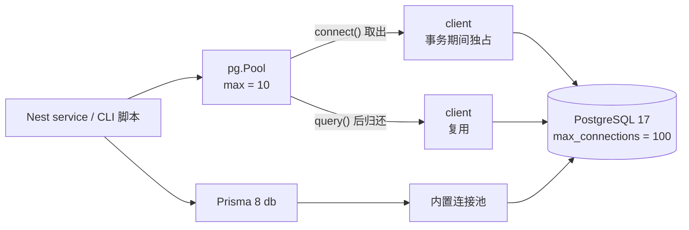

# 第 43 章 使用 Node 操作 PostgreSQL 的两种方式

## 先认四个词：驱动、连接、连接池、ORM

**驱动（driver）**是 Node 里真正实现 PostgreSQL 协议的库。你的代码调 `pool.query()`，最后是它把 SQL 按协议发给数据库、把结果解析回来。`pg` 是最常用的一个，Prisma 8 的运行时底层也用它。没有驱动，Node 就没法和 PostgreSQL 说话，这一层绕不过去。

**连接（connection）**不是一根网线，而是数据库里一个真实的后端进程：占内存、有会话状态、数量有上限（`max_connections`）。每次查询都新建一条连接，要付 TCP 三次握手、认证、分配进程的成本，高并发下光建连就能把数据库拖垮。**连接池（pool）**就是为此存在的：进程启动时建一小队连接，查询来了借一条，用完还回去，下个请求接着用。池子省的是建连成本，不是把数据库的连接上限变大——池子里的 `max` 乘以实例数，仍然要落在 `max_connections` 以内。

**ORM（Object-Relational Mapping，对象关系映射）**是另一条路：把表映射成代码里的类型和对象，用链式 API 代替手写 SQL。好处是类型安全、改表时编译期就能发现漏改；代价是多一层抽象，复杂查询最终还是要落回 SQL。这一章两条路都走一遍：`pg` 的原生 SQL，和 Prisma 8 的契约查询（契约是什么，下一章拆）。

官方文档（先看懂正文再点）：
- [node-postgres（`pg`）](https://node-postgres.com/)：驱动本身的用法，本章 `pool.query` 那段对应它的接口。
- [PostgreSQL 连接与 `max_connections`](https://www.postgresql.org/docs/17/runtime-config-connection.html)：数据库最多允许多少连接，池子大小要照着它算。
- [Prisma](https://www.prisma.io/docs)：另一条 ORM 路线的总入口，下一章细讲。

现在看一个真实事故。

报表服务上线第二周，数据库开始间歇性拒绝连接，日志里是 `FATAL: sorry, too many clients already`。没人改过连接数。查下来是 PM2（Node 的进程管理器，cluster 模式起多个实例）起了 4 个实例，每个 `pg.Pool` 都吃默认的 `max: 10`，40 条常驻连接，再加上迁移脚本、psql 和监控探针，正好把 `max_connections = 100` 吃满——默认值乘以实例数，悄悄越过了上限。

同一天还出了另一件事。一个导出接口把查询参数直接拼进 SQL 字符串，测试时传的都是正常会议室名，上线后有人传了带引号的字符串，语句结构当场就变了。

这两件事都不是「会不会写 SQL」的问题，而是把连接和输入当成了不受约束的字符串。Node 连 PostgreSQL 有两条路：直接用驱动写 SQL，或者通过 ORM 把表映射成类型和查询 API。两条路都得先把这两件事处理对，否则换哪条都一样出事。

## 把池子建起来

概念上面说过了，这里直接写代码。先装驱动。虽然它作为 Prisma 的依赖可能已经在 `node_modules` 里，但别依赖传递依赖——版本跟着 ORM 走，哪天 ORM 换驱动，你的代码先崩：

```bash
pnpm add pg
pnpm add -D @types/pg
```

```ts
// src/db/pool.ts
import { Pool } from 'pg';

const connectionString = process.env.DATABASE_URL;

if (!connectionString) {
  throw new Error('缺少 DATABASE_URL：先复制 .env.example 为 .env');
}

export const pool = new Pool({
  connectionString,
  max: 10,
  idleTimeoutMillis: 30_000,
  connectionTimeoutMillis: 2_000,
  statement_timeout: 5_000,
  query_timeout: 10_000,
  application_name: 'meeting-report',
});

pool.on('error', (error) => {
  console.error('idle client error', error);
});
```

查一条真实数据：

```ts
// src/report.ts
import { pool } from './db/pool.js';

const rows = await pool.query<{ name: string; capacity: number }>(
  'SELECT name, capacity FROM rooms ORDER BY capacity DESC',
);

for (const row of rows.rows) {
  console.log(row.name, row.capacity);
}

await pool.end();
```

```bash
pnpm tsx src/report.ts
```

```text
木星厅 12
土星厅 6
```

（示例输出。）到这里一切正常。真正会咬人的是上面那几个参数——它们每一个都改过默认值，而且默认值大多是「能跑，但生产上会出事」的那种。

## 池子为什么会满

- `max`：每个进程最多持有的连接数。总数是 `实例数 × max`，还要留出迁移、`psql`、监控的余量。把 `max_connections` 当成「每个进程的配额」是连接打满的头号原因。
- `idleTimeoutMillis`：空闲连接多久回收，`pg` 默认 10 秒。太长占着连接不放，太短频繁重连。
- `connectionTimeoutMillis`：池子空了、排队等连接的超时。默认是 0，也就是永远等——数据库慢的时候请求会一直挂着，而不是快速失败。
- `statement_timeout`：服务端执行超时，到点 PostgreSQL 主动取消，报 `57014`。它保护的是数据库，防止一条烂查询拖垮实例。
- `query_timeout`：客户端等待响应的超时，包含网络和排队时间。它和服务端超时互补，两个都设。
- `application_name`：出现在 `pg_stat_activity` 里，排障时一眼看出是哪个服务。

`pool.on('error')` 不能省。空闲连接被服务端掐断（重启、`pg_terminate_backend`（管理员主动断开某条连接的函数）、网络抖动）时，错误发在空闲 client 上，没人监听就是未捕获的 `error` 事件，Node 进程直接退出。

池子健康不健康不用猜，`pg` 把实时计数挂在实例上：

```ts
console.log({
  total: pool.totalCount,
  idle: pool.idleCount,
  waiting: pool.waitingCount,
});
```

```text
{ total: 4, idle: 3, waiting: 0 }
```

`waiting` 持续大于 0，说明 `max` 不够，或者有慢查询占着连接不放。`total` 长期等于 `max`、`idle` 为 0，先去查慢查询，再考虑加连接。数据库侧也能看（`pg_stat_activity` 是 PostgreSQL 的活动会话视图，每条连接一行）：

```sql
SELECT application_name, state, count(*)
  FROM pg_stat_activity
 WHERE application_name = 'meeting-report'
 GROUP BY application_name, state;
```

```text
 application_name | state  | count
------------------+--------+-------
 meeting-report   | idle   |     1
```

一条连接在 PostgreSQL 里就是一个后端进程，占几 MB 到几十 MB 内存，所以 `max` 不是越大越好，它是「用内存换并发」的旋钮。算配额先做减法：`max_connections = 100`，给迁移、备份、`psql`、监控留 20 条，剩下 80 条分给 4 个应用实例，每个实例的 `max` 最多 20，还别用满——连接池会随着并发慢慢爬到上限，不会刚好停在配额线上。

`waiting` 持续大于 0 时也别急着加 `max`。多数情况是某条慢查询占着连接不放，或者事务里夹了外部调用；加连接只是把排队从池子挪到数据库，`max_connections` 迟早还会被打满。

## 参数化：`$1` 不是拼字符串

上面那个事故的修法只有一行：

```ts
const findRoomsByCapacity = async (minCapacity: number) => {
  const { rows } = await pool.query<{ id: string; name: string; capacity: number }>(
    `SELECT id, name, capacity
       FROM rooms
      WHERE capacity >= $1
      ORDER BY capacity DESC, name`,
    [minCapacity],
  );
  return rows;
};

console.log(await findRoomsByCapacity(8));
```

```text
[ { id: '6f1c2d3e-...', name: '木星厅', capacity: 12 } ]
```

`$1` 是占位符，驱动把它单独发送，PostgreSQL 只当值，不参与语法解析。传 `8` 和传 `8; DROP TABLE rooms` 在解析器眼里没有区别，后者只是一个匹配不到任何行的字符串。拼接则是把用户输入塞进语法结构，注入就是从这里开始的。

两个边界容易忽略。第一，参数只能替代「值」，不能替代表名、列名、`ORDER BY` 的方向；这些位置要白名单映射，不能把用户输入拼进去。第二，`rowCount` 的类型是 `number | null`，`INSERT ... RETURNING` 用 `rows` 取结果，别拿 `rowCount` 当行数。

## 事务：连接必须自己拿、自己还

事务（transaction）是一组要么全成功、要么全回滚的语句，它必须绑定在同一条连接上。`pool.query('BEGIN')` 是错的：Pool 每次 `query()` 可能换一条连接，`BEGIN` 在 A 上、`INSERT` 在 B 上、`COMMIT` 又回到 A，事务根本没包住任何东西。

正确做法是从池子里取一条连接，全程用它：

```ts
// src/db/transaction.ts
import type { PoolClient } from 'pg';
import { pool } from './pool.js';

export const withTransaction = async <T>(
  work: (client: PoolClient) => Promise<T>,
): Promise<T> => {
  const client = await pool.connect();
  try {
    await client.query('BEGIN');
    const result = await work(client);
    await client.query('COMMIT');
    return result;
  } catch (error) {
    await client.query('ROLLBACK').catch(() => undefined);
    throw error;
  } finally {
    client.release();
  }
};
```

`client.release()` 必须在 `finally` 里。少写一次，这条连接就永远回不到池子；几十次请求之后池子空、请求全卡在 `connectionTimeoutMillis` 上，现象和数据库挂了几乎一样。

用它订一次会议室：

```ts
// src/book.ts
import { withTransaction } from './db/transaction.js';

const bookingId = await withTransaction(async (client) => {
  const { rows } = await client.query<{ id: string }>(
    `INSERT INTO bookings (user_id, room_id, start_time, end_time)
     VALUES ($1, $2, $3, $4)
     RETURNING id`,
    [userId, roomId, start, end],
  );

  const [booking] = rows;
  if (!booking) {
    throw new Error('INSERT ... RETURNING 没有返回行');
  }
  return booking.id;
});
```

抛异常时先 `ROLLBACK` 再 `release`。如果连接在事务中途出现过协议错误，回滚也可能失败，这时 `release(error)` 会销毁连接而不是放回池子——宁可少一条连接，也别把状态可疑的连接交给下一个请求。

## 错误处理：认 SQLSTATE，不认 message

`pg` 抛出的错误是 `DatabaseError`，关键字段是 `code`（SQLSTATE）、`constraint`、`detail`、`table`、`column`。SQLSTATE 是 PostgreSQL 错误对象上的五位标准错误码，和错误文案、语言环境都无关，是应用层唯一该用来做分支的东西。

```ts
// src/db/errors.ts
import { DatabaseError } from 'pg';

type MappedError = { status: number; message: string };

export const mapDatabaseError = (error: unknown): MappedError => {
  if (error instanceof DatabaseError) {
    switch (error.code) {
      case '23505':
        return { status: 409, message: `已存在：${error.constraint ?? '唯一约束'}` };
      case '23503':
        return { status: 409, message: '引用的记录不存在' };
      case '57014':
        return { status: 504, message: '查询超时，请缩小时间范围' };
      default:
        console.error('database error', {
          code: error.code,
          detail: error.detail,
          constraint: error.constraint,
        });
        return { status: 500, message: '数据库错误' };
    }
  }

  return { status: 500, message: '未知错误' };
};
```

同一个会议室名插两次，拿到的是：

```text
{
  code: '23505',
  constraint: 'rooms_name_key',
  detail: 'Key (name)=(木星厅) already exists.'
}
```

`23505` 唯一键冲突，`23503` 外键引用失败，`57014` 查询被取消。`40001`（序列化失败）和 `40P01`（死锁）是另一类：它们不是业务错误，重试整个事务通常就能成功。重试包在事务外层，并且保证事务幂等：

```ts
const RETRYABLE = new Set(['40001', '40P01']);

export const withRetry = async <T>(work: () => Promise<T>, attempts = 3): Promise<T> => {
  for (let attempt = 1; ; attempt += 1) {
    try {
      return await work();
    } catch (error) {
      const code = error instanceof DatabaseError ? error.code : undefined;
      if (!code || !RETRYABLE.has(code) || attempt >= attempts) {
        throw error;
      }
      await new Promise((resolve) => setTimeout(resolve, 50 * 2 ** (attempt - 1)));
    }
  }
};
```

不要在事务内部重试单条语句。事务已经中止，后续语句只会报 `25P02`（当前事务已回滚）。要重试就重试整个 `withTransaction`。

`pool` 是长生命周期对象。脚本结束 `await pool.end()` 收尾；Nest 应用里不要在每个请求里 `end()`，那会把共享池关掉，应该放到 `onApplicationShutdown`（Nest 的关闭钩子，应用停机时触发）里。

## 方式二：Prisma 8，同一件事换个写法

Prisma 8 是 contract-first 的。契约（contract）是描述模型与关系的源文件 `contract.prisma`，`contract emit` 把它编译成运行时读的 JSON 和给 TypeScript 用的类型；下一章会把这条链路整个拆开。安装时两个包必须成对：CLI 用 `8.0.0-rc.29`，运行时用 `@prisma/orm-postgres@8.0.0-rc.21`。版本错配不会提示「版本不匹配」，只会给你各种看不懂的解析错误。

```bash
pnpm add @prisma/orm-postgres@8.0.0-rc.21 temporal-polyfill
pnpm add -D prisma@8.0.0-rc.29
```

```ts
// prisma.config.ts
import { defineConfig as definePostgresConfig } from '@prisma/orm-postgres/config';
import { definePrismaConfig } from 'prisma/config';

export default definePrismaConfig({
  orm: definePostgresConfig({
    contract: 'prisma/contract.prisma',
    output: 'src/generated/prisma8',
    db: { connection: process.env.DATABASE_URL ?? '' },
    migrations: { dir: 'prisma/migrations' },
  }),
});
```

```prisma
// prisma/contract.prisma
// use prisma-8

model Room {
  id       Uuid   @id @onCreate(uuid())
  name     String @unique
  capacity Int
  location String

  @@map("rooms")
}
```

```bash
pnpm prisma contract emit
pnpm prisma db init
```

运行时用生成的 `contract.json` 建客户端，没有 `new PrismaClient()`：

```ts
// src/db/prisma.ts
import postgres from '@prisma/orm-postgres/runtime';
import { contractFromJson } from '@prisma/orm-postgres/static';
import type { Contract } from '../generated/prisma8/contract.js';
import contractJson from '../generated/prisma8/contract.json' with { type: 'json' };

const url = process.env.DATABASE_URL;

if (!url) {
  throw new Error('缺少 DATABASE_URL');
}

export const db = postgres({
  contract: contractFromJson<Contract>(contractJson),
  url,
});
```

同一条「容量不小于 8」的查询：

```ts
const rooms = await db.orm.public.Room
  .where((room, { fns }) => fns.gte(room.capacity, 8))
  .orderBy((room) => room.capacity.desc())
  .all();
```

事务形状和 `pg` 一样，只是把 `client` 换成了 `tx`：

```ts
await db.transaction(async (tx) => {
  const room = await tx.orm.public.Room.where({ id: roomId }).forUpdate().first();
  if (!room) {
    throw new Error('会议室不存在');
  }

  await tx.orm.public.Booking.create({
    userId,
    roomId,
    startTime: start,
    endTime: end,
  });
});
```

错误形态不一样。Prisma 8 的 `SqlQueryError` 没有 `code`，唯一键冲突在 `sqlState` 上，`constraint`、`detail` 仍可读：

```ts
const isUniqueViolation = (error: unknown): boolean =>
  typeof error === 'object'
  && error !== null
  && 'sqlState' in error
  && (error as { sqlState?: string }).sqlState === '23505';
```

把 `pg` 那套 `error.code === '23505'` 直接搬过来，会永远进不了分支，然后被当成 500 吞掉。

## 两条路怎么选，怎么混

| 场景 | 建议 |
| --- | --- |
| 业务 CRUD、需要类型约束 | Prisma 8，契约就是类型来源 |
| 报表、窗口函数、`EXPLAIN ANALYZE`（看真实执行耗时） | `pg`，SQL 直接写 |
| 批量导入、`COPY`（PostgreSQL 自带的批量导入命令） | `pg`，`COPY FROM STDIN` 比 ORM 快一个量级 |
| 迁移 | Prisma 8 的 `migration plan` + `db migrate` |
| 一次性脚本 | 要复用契约就用 Prisma，不要就 `pg` |

`pg` 不是「低级所以差」，它就是 Prisma 8 的底层驱动——`@prisma/orm-postgres` 自己就依赖 `pg`。理解 Pool 的行为，排障时用得上；理解契约流程，日常开发快得多。

混用最常见的坑是连接数翻倍：Prisma 8 内部有一个池，你自己再 `new Pool()` 又是一个池，两个 `max` 相加才是真实占用。混用时把两边都调小，监控里分开看。

第二个坑是事务不能跨客户端。用 `pg` 的 `client` 开的事务，Prisma 的 `db` 看不到；反过来也一样。一个业务事务只能在一个客户端里完成，别指望两边共享同一个 `BEGIN`。

第三个坑出在代理层。PgBouncer 是应用和数据库之间的连接池代理，让几百个应用连接复用几十条数据库连接。事务模式（transaction pooling）下，同一个客户端的不同事务可能落到不同后端连接，命名 prepared statement（预编译语句，名字绑在会话上）会失效。这不是它的 bug，是语义决定的：它复用的是事务，不是会话，`PREPARE`、`SET`、`LISTEN`、临时表这些会话级状态都不保证跟着走。`pg` 默认查询不带名字，影响小；一旦用了 `name` 选项，或者连接串走 Supabase 的 6543 端口，先确认 pooler 参数，别把「本地能跑」当成「线上能跑」。

> **图 43-1** 两种客户端到 PostgreSQL 的连接路径。
>



生产上常见的组合是：业务模块走 Prisma 8，报表和运维脚本走 `pg`；两边都用 `DATABASE_URL`，但连接数预算单独算，给迁移和监控留余量。真正要避免的是「同一个查询维护两套实现」——那才是成本的来源。

`pg` 让你看清连接、事务、超时这些底层行为，Prisma 8 把它们包起来，用契约换开发效率。先把池和事务用对，再学契约流程，顺序反过来也能走，但排障时会缺一块拼图。下一章把 Prisma 8 拆开：契约、emit、迁移、CRUD，以及它和 5/6/7 到底差在哪。

想更深入的话，官方文档里有这几页可以接着看：[node-postgres Pool](https://node-postgres.com/apis/pool)（连接池的配置项和借用、归还接口）、[node-postgres 事务](https://node-postgres.com/features/transactions)（拿同一条连接跑 `BEGIN`、`COMMIT` 的写法）、[PostgreSQL 错误码](https://www.postgresql.org/docs/17/errcodes-appendix.html)（凭 `code` 判断是唯一键冲突还是连接断开）、[Prisma 文档](https://www.prisma.io/docs)（契约和客户端 API 的入口）。

<!-- chapter-nav:start -->
---

← 上一篇：[042 PostgreSQL的视图、存储过程和函数](042-PostgreSQL的视图、存储过程和函数.md) · [本 Part 目录](_part.md) · 下一篇：[044 快速掌握Prisma8](044-快速掌握Prisma8.md) →
<!-- chapter-nav:end -->
