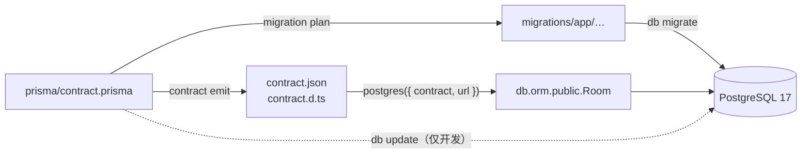

# 第 44 章 快速掌握 Prisma 8

## 先把 ORM 和契约说清楚

ORM 第 43 章提过一句：把表映射成代码里的类型和对象，用链式 API 代替手写 SQL。Prisma 是 Node 生态里最常用的 ORM 之一，替你做的事有三件——根据模型定义生成类型、把链式调用翻译成 SQL、把结果映射回对象。没有 ORM 也能开发（上一章的 `pg` 就是裸 SQL），换来的是类型安全和改表时的编译期检查，代价是多一层「模型定义」需要和数据库保持同步。

Prisma 8 同步这件事的方式叫 **contract-first（契约优先）**：只保留一份 `contract.prisma` 作为唯一真相，`contract emit` 把它编译成两个产物——运行时读的 `contract.json` 和给 TypeScript 用的 `contract.d.ts`。契约（contract）就是「数据库长什么样」的声明；「优先」的意思是先改契约、再编译、再迁移，而不是先改库或先改代码。旧版 Prisma 不是这么做的，下一节会对比。

官方文档（先看懂正文再点）：
- [Prisma 文档](https://www.prisma.io/docs)：整个 Prisma 的入口，先知道有哪些块。
- [什么是 Prisma ORM](https://www.prisma.io/docs/orm/overview/introduction/what-is-prisma)：它替你做的三件事，对应本章第一段。
- [Prisma Migrate](https://www.prisma.io/docs/orm/prisma-migrate)：改契约之后怎么落到数据库。

现在看一个真实事故。

周六下午，你照着半年前的教程建好 `prisma/schema.prisma`，敲下 `pnpm prisma generate`，终端只回了一行：没有 `generate` 这个命令。你以为只是改名了，换成教程评论区里说的 `contract emit`，结果又弹出一句完全看不懂的报错，说解析器在一个叫 `typeChoice` 的字段上崩了。

这两句报错之间没有任何字面联系，因为它们不是同一类问题。Prisma 8 换掉的不是几个命令，是整个工作方式：从 schema-first（先写 schema 再生成客户端）变成 contract-first。不把这条流水线走通，你会一直在「命令不存在」和「看不懂的解析错误」之间打转。

## Prisma 8 改了什么

Prisma 5/6/7 的流程是：写 `schema.prisma`，`prisma generate` 生成一个 `PrismaClient`，运行时 `new PrismaClient()` 连库。这里有两条真相——schema 文件和生成的客户端。升级 CLI、换 Node 版本、部署时裁掉 `node_modules`，任何一处不同步，就可能出现「类型里有、运行时没有」。Prisma 5/6 还要在镜像里带一个按平台编译的查询引擎二进制，Serverless 打包经常在这里翻车；7 开始往 driver adapter（驱动适配器，把查询交给 `pg` 这类驱动执行）方向收，但那一步只是把引擎拿掉，工作方式没变。

Prisma 8 把中间层整个去掉了。契约（contract）是描述模型与关系的源文件 `contract.prisma`，它是唯一真相；`contract emit` 把它编译成两个产物：`contract.json`（运行时读的契约）和 `contract.d.ts`（TypeScript 类型）。运行时没有 `PrismaClient`，也没有引擎二进制，`postgres({ contract, url })` 拿着 JSON 建一个惰性客户端，底层就是上一章那个 `pg`。

> **图 44-1** 契约同时流向运行时查询和迁移两条路径。
>



两个产物都要提交。`contract.json` 不是缓存，是运行时真正加载的东西；`contract.d.ts` 给编辑器和 `tsc` 提供类型。CI 里不跑 `emit` 也能构建，但改了契约不重新 emit，类型和运行时就会对不上——这类问题在本地通常看不出来。

代价是每一步都显式：改契约要 emit、产物要提交、迁移要 plan。跳一步，就在别处炸。

## 版本配对是第一条规矩

Prisma 8 的 CLI 和运行时是两个包，版本必须严格配对：

| 包 | 版本 | 装在哪 |
| --- | --- | --- |
| `prisma` | `8.0.0-rc.29` | `devDependencies` |
| `@prisma/orm-postgres` | `8.0.0-rc.21` | `dependencies` |
| `temporal-polyfill` | `^1.0.6` | `dependencies`（peer） |

```bash
pnpm add @prisma/orm-postgres@8.0.0-rc.21 temporal-polyfill
pnpm add -D prisma@8.0.0-rc.29
```

用 `^` 或 `~` 都可能在下一次安装时把运行时升到 rc.22，而 CLI 还停在 rc.29。两个版本的契约 schema 有差异，`contract emit` 报的就是开头那句 `Cannot use 'in' operator to search for 'kind' in typeChoice`——它不会说「版本不匹配」，只会说解析器在一个字段上崩了。

错配现场长这样：

```bash
pnpm add @prisma/orm-postgres@8.0.0-rc.22
pnpm prisma contract emit
```

```text
✘ [CLI.UNEXPECTED] Cannot use 'in' operator to search for 'kind' in typeChoice
```

换回 rc.21，同一条命令立刻成功。为什么会撞得这么隐蔽？8.0.0 还在 rc，契约 DSL 和运行时解析器一起在改；rc.21 与 rc.22 差的不是补丁，是契约字段的形状。而 npm 的 `^8.0.0-rc.21` 会放行同一 major 下的后续预发布版（包括 rc.22），`~` 也放行同一 minor 的预发布版。所以第一条纪律：两个包都写死精确版本，锁文件一起提交，CI 用 `--frozen-lockfile`；升级时两个一起升，先 `emit`，再跑业务。

## 三个文件，一条流水线

一个最小的 Prisma 8 项目只有三个关键文件。

`package.json` 声明 ESM，并把命令固化成脚本，免得每个人敲的参数都不一样：

```json
{
  "type": "module",
  "scripts": {
    "db:emit": "prisma contract emit",
    "db:init": "prisma db init",
    "db:update": "prisma db update",
    "dev": "tsx --env-file=.env src/index.ts"
  },
  "dependencies": {
    "@prisma/orm-postgres": "8.0.0-rc.21",
    "temporal-polyfill": "^1.0.6"
  },
  "devDependencies": {
    "prisma": "8.0.0-rc.29",
    "tsx": "4.23.15",
    "typescript": "~6.0.2"
  }
}
```

`"type": "module"` 意味着相对导入要带 `.js` 后缀，入口可以用 top-level await。`tsx --env-file=.env` 是给运行时读环境变量的——Prisma CLI 只自动读 `.env`，`tsx` 不会。

```ts
// prisma.config.ts
import { defineConfig as definePostgresConfig } from '@prisma/orm-postgres/config';
import { definePrismaConfig } from 'prisma/config';

export default definePrismaConfig({
  orm: definePostgresConfig({
    contract: 'prisma/contract.prisma',
    output: 'src/generated/prisma8',
    db: { connection: process.env.DATABASE_URL ?? '' },
    migrations: { dir: 'prisma/migrations' },
  }),
});
```

顶层只能有 `composer`、`orm`、`skills` 三个 section。把 `contract`、`output` 直接写在最外层，会得到 `[CLI.CONFIG_UNKNOWN_SECTION]`——从旧版配置迁移过来时最常见的错。

```prisma
// prisma/contract.prisma
// use prisma-8

model Room {
  id        Uuid             @id @onCreate(uuid())
  name      String           @unique
  capacity  Int
  location  String
  status    RoomStatus       @default(AVAILABLE)
  createdAt TimestamptzString @default(now()) @map("created_at")

  @@map("rooms")
}

enum RoomStatus {
  AVAILABLE
  MAINTENANCE

  @@type("pg/text@1")
}
```

首行 `// use prisma-8` 不能省。语言服务只对带这行头的文件提供补全和诊断，少了它，你得到的是一个「合法但没人管」的文本文件。

几个类型映射值得记住：`Uuid` 对应 `uuid`，`TimestamptzString` 对应 `timestamptz`，`@onCreate(uuid())` 让数据库在插入时生成主键，`@@map("rooms")` 把模型名映射到表名。枚举上的 `@@type("pg/text@1")` 指定存成 `text` 而不是 PG 原生 enum——后者加值要 `ALTER TYPE`，迁移更麻烦。

## emit 之后才有人认识这个契约

```bash
pnpm db:emit
```

```text
✔ Emitted contract.json and contract.d.ts
```

产物在 `src/generated/prisma8/`：

```text
src/generated/prisma8/
├── contract.d.ts
└── contract.json
```

`contract emit` 会先校验契约，再原子写入两个文件；校验不过就一个都不写。命令打印的 `storageHash`、`executionHash`、`profileHash` 是契约内容的指纹，迁移规划会用到，日常不用记。`contract.d.ts` 里的 `Contract` 类型就是 `db.orm.public.Room` 能补全的依据——编辑器提示「模型不存在」，先看这个文件是不是旧的。

要换输出目录用 `--output-path`，不是旧文档里常见的 `--out`。产物不对时先查三处：契约首行有没有 `// use prisma-8`、`prisma.config.ts` 里 `contract` 的路径对不对、两个包的版本配没配对。这三处占 emit 失败的绝大多数。

空库第一次同步结构，用 `db init`：

```bash
pnpm db:init
```

```text
✔ Applied 2 operation(s) across 1 contract space
  App space
  ├─ Create table "rooms"
  ├─ Add unique constraint on "rooms" (name)
  └─ marker <hash>
```

它做三件事：按契约建表、建索引和约束、在 `prisma_contract.marker` 里写一行指纹。指纹是后面 `db verify` 判断「库和契约是否一致」的依据。

改完契约，开发库用 `db update` 快速追平：

```bash
pnpm db:update
```

```text
✔ Applied 1 operation(s) across 1 contract space
  App space
  └─ Add column "floor" to "rooms"
```

`db update` 直接对比契约和库，生成并执行 DDL（建表改表的 SQL），不写迁移文件、不留历史。本地、开发环境、PR 预览库用它都合适；生产环境用它，等于把「这次改了什么」永久丢掉。生产路径是 `migration plan` 生成迁移包、`db migrate` 应用，048 章会把每一步的退出码和失败分支走全。

三个动作分开记：`emit` 只编译契约，不碰数据库；`plan` 只生成迁移包，也不碰数据库；`migrate` 才真正执行 SQL。前两步可以离线跑、可以在 CI 里审查，最后一步才需要数据库权限。

## 第一次查询

```ts
// src/db.ts
import postgres from '@prisma/orm-postgres/runtime';
import { contractFromJson } from '@prisma/orm-postgres/static';
import type { Contract } from './generated/prisma8/contract.js';
import contractJson from './generated/prisma8/contract.json' with { type: 'json' };

const url = process.env.DATABASE_URL;

if (!url) {
  throw new Error('缺少 DATABASE_URL');
}

export const db = postgres({
  contract: contractFromJson<Contract>(contractJson),
  url,
});
```

`postgres()` 是惰性的：创建客户端时不连库，第一条查询才建连接。这一点和 Nest 的启动顺序配合得很好——数据库没起来，应用不会卡在启动阶段。

`contractFromJson<Contract>` 只是把 JSON 断言成生成的类型；`import ... with { type: 'json' }` 是 Node 22 ESM 加载 JSON 的固定写法，少了这个 attribute 会报 `ERR_IMPORT_ATTRIBUTE_MISSING`。`Contract` 从 `contract.d.ts` 导入，是纯类型，编译后消失。

顺手把增删改查跑一遍：

```ts
// src/index.ts
import { db } from './db.js';

const created = await db.orm.public.Room.create({
  name: '木星厅',
  capacity: 12,
  location: '3F-A',
});
console.log(created);

const found = await db.orm.public.Room.where({ id: created.id }).first();
console.log('found:', found?.name, found?.capacity);

const bigRooms = await db.orm.public.Room
  .where((room, { fns }) => fns.gte(room.capacity, 8))
  .orderBy((room) => room.capacity.desc())
  .all();
console.log('big rooms:', bigRooms.map((room) => room.name));

const updated = await db.orm.public.Room
  .where({ id: created.id })
  .update({ capacity: 20 });
console.log('updated:', updated?.capacity);

await db.orm.public.Room.where({ id: created.id }).delete();
const gone = await db.orm.public.Room.where({ id: created.id }).first();
console.log('gone:', gone);

await db.close();
```

```bash
pnpm dev
```

```text
{
  id: 'e5690f3a-1b2c-4d5e-8f90-...',
  name: '木星厅',
  capacity: 12,
  location: '3F-A',
  status: 'AVAILABLE',
  createdAt: 2026-11-06T15:05:37.187Z
}
found: 木星厅 12
big rooms: [ '木星厅' ]
updated: 20
gone: null
```

（示例输出。）几个 API 的形状和旧版完全不同，记住它们就不容易写错：

- 模型入口是 `db.orm.public.Room`，命名空间是 `schema.模型`，不是 `prisma.room`。
- 查询是链式的：`where` → `orderBy` → `limit` / `offset` → `first()` / `all()`。`first()` 找不到返回 `null`，不抛错。
- 要组合多个条件时用 `where((row, { fns }) => fns.and(...))`，`fns.or`、`fns.gte`、`row.status.in([...])` 都在这个上下文里。
- 聚合没有集合上的 `.count()`。计数写成 `aggregate((a) => ({ total: a.count() }))`，返回 `{ total }`。
- `create` 直接返回插入后的行，`update` 返回更新后的行或 `null`，`delete()` 只影响一行。

启动成功也不等于数据库可用。健康检查要真查一条 `SELECT 1`，别只看进程起没起来；连接池在第一条查询时才创建。`db.close()` 之后整个客户端作废，「重建实例重连」这条路不存在。

## 查出来的行不能直接返回

`created`、`found` 的类型是表行的形状，字段和 `rooms` 表一一对应。这种和表一一对应的对象，叫 PO（Persistent Object，持久化对象），它回答的是「这一行在库里怎么存」。直接把它交给 Controller，等于把表结构当成了接口契约：今天多一列 `internal_note`，明天就会出现在响应里；用户表更严重——密码哈希跟着一起返回。

接口该返回的是 VO（View Object，视图对象）：只保留当前页面需要的字段。入口接收的是 DTO（Data Transfer Object，数据传输对象）：只装请求里该有的字段，配合 `class-validator` 在入口校验。中间的转换叫 Mapper，有转换就集中写 `toRoomVo` / `toDto`，别在 Controller 里手拼。

```ts
// src/modules/rooms/rooms.service.ts（节选）
const room = await db.orm.public.Room.where({ id }).first();
if (!room) {
  throw new NotFoundException('会议室不存在');
}

return {
  id: room.id,
  name: room.name,
  capacity: room.capacity,
  location: room.location,
};
```

这四个名字（Entity、PO、DTO、VO）经常被混着用。Entity 是业务里的对象，有身份、有生命周期，比如 `User`、`Booking`，它回答「业务里这个东西是什么」；PO 是它在库里的样子。小项目里两者常常是同一个类，但概念上别混：Entity 可以带 `canBook()` 这样的行为，PO 只是数据。业务写入方向也一样，DTO 在入口被 `ValidationPipe` 校验，Mapper 转成 `create` / `update` 的输入，最后落表。

再往下是「去哪儿查」的组织方式。DAO（Data Access Object）面向表和条件，方法像 `findByEmail`、`insertBooking`，机械而底层；Repository 面向业务语义，方法像 `findActiveBookingsForUser`，调用方不感知 SQL。两者都能把 SQL 从 Service 里隔出去，名字不重要，重要的是别让 `db.orm` 散落在每个 Service 里。在 Nest 里，DAO 通常就是一个 `@Injectable()` 的 `RoomsRepository`：构造器注入 `PRISMA` token，方法只做查询。项目小的时候在 Service 里直接用 `db` 也合理；一旦同一条查询被两个 Service 复制，就该抽出来，方法名用业务语义，别叫 `query1`。

## 事务只有一个入口

```ts
const before = await db.orm.public.Room.aggregate((a) => ({ total: a.count() }));

try {
  await db.transaction(async (tx) => {
    await tx.orm.public.Room.create({
      name: '海王厅',
      capacity: 8,
      location: '5F-B',
    });

    throw new Error('模拟后续步骤失败');
  });
} catch {
  // 预期回滚
}

const after = await db.orm.public.Room.aggregate((a) => ({ total: a.count() }));
console.log(before.total, after.total);
```

```text
0 0
```

`db.transaction` 收到一个回调，正常返回就 `COMMIT`，抛异常就 `ROLLBACK`。回调里的 `tx` 是事务句柄，所有查询必须走它：`tx.orm`、`tx.sql`、`tx.raw`、`tx.execute`。

要理解这条边界，得知道 `db` 内部持有一个连接池：事务开始时从池里借一条连接，`tx` 就是这条连接的句柄，回调结束才归还。所以拿外层的 `db` 再查一次，等于另借一条连接、跑在事务之外——读不到未提交的数据，写进去的数据也不会回滚。这条边界第 49、50 章还会反复出现，因为它最容易写错，也最难在本地复现：本地数据量小，时序对不上也不会有人发现。

旧版的 `db.$transaction([...])` 数组形式不存在了。要批量、要顺序、要条件回滚，都写成回调。事务里需要锁行时用 `forUpdate()`：

```ts
await db.transaction(async (tx) => {
  const room = await tx.orm.public.Room.where({ id: roomId }).forUpdate().first();
  // 这里到 COMMIT 之间，别的会话改不了这一行
});
```

锁不能和 `include`、`groupBy`、`aggregate` 一起用，混用会报 `ORM.LOCK_INCOMPATIBLE`。

## 和 Prisma 5/6/7 差在哪

| 维度 | Prisma 5/6/7 | Prisma 8 |
| --- | --- | --- |
| schema 文件 | `schema.prisma` | `contract.prisma`，首行 `// use prisma-8` |
| 生成步骤 | `prisma generate` 生成客户端 | `prisma contract emit` 生成 JSON + `.d.ts` |
| 客户端 | `new PrismaClient()` | `postgres({ contract, url })` |
| 查询入口 | `prisma.room.findMany()` | `db.orm.public.Room.where(...).all()` |
| 事务 | 数组或回调两种 | 只有 `db.transaction(fn)` |
| 关闭 | `$disconnect()` | `db.close()`，终态不可重连 |
| 迁移 | `migrate dev` / `migrate deploy` | `migration plan` + `db migrate`，开发可用 `db init` / `db update` |
| 错误 | `PrismaClientKnownRequestError`，`P2002` | `SqlQueryError`，`sqlState: '23505'` |
| 运行时 | 查询引擎 / driver adapter | 纯 TypeScript + `pg` |

差异的根因只有一条：8 把「生成客户端」换成了「编译契约」。理解这一点，`generate` 不存在、`PrismaClient` 不存在、`$transaction` 不存在，就都是同一个答案。

7 已经能通过 driver adapter 去掉 Rust 查询引擎，但 schema-first 的工作方式没变：仍然要 `generate`，仍然 `new PrismaClient()`。8 把生成客户端这一步也去掉了，这才是 contract-first 的真正分界。所以迁移时别只盯着「引擎有没有了」，先看你的启动代码里还有没有 `PrismaClient`。

## 生产里真正会踩的坑

| 现象 | 原因 | 怎么处理 |
| --- | --- | --- |
| `No command registered for 'generate'` | 还在用旧流程 | 改跑 `prisma contract emit`，别装 5/6/7 的插件 |
| `CLI.UNEXPECTED ... typeChoice` | CLI 与运行时版本错配 | 两个包精确配对，删 `node_modules` 重装 |
| `CONFIG_UNKNOWN_SECTION` | 把 `contract` 写在 config 顶层 | 包进 `orm: definePostgresConfig({...})` |
| 类型里没有新字段 | 改了契约没 emit | 每次改契约先 `pnpm db:emit`，提交产物 |
| 手改 `contract.json` 后行为怪异 | 产物被当成源码改 | 永不手改，重新 emit |
| 唯一键冲突没被捕获 | 用 `error.code === '23505'` | 用 `error.sqlState === '23505'` |
| 生产库结构对不上迁移历史 | 在生产跑了 `db update` | 生产只用 `migration plan` + `db migrate` |
| 服务跑一会儿就报 client closed | 在请求里调了 `db.close()` | 只在进程退出钩子里关一次 |

最后一个坑值得多说一句。`db.close()` 和旧版的 `$disconnect()` 语义不同：`$disconnect` 之后还能重连，`db.close()` 之后客户端进入终态，再查询直接报 `Postgres client is closed`。它只该出现在优雅关闭的钩子里。

Prisma 8 的学习成本不在 API 数量，在流程：契约改完要 emit、产物要提交、迁移要走 plan，任何一步跳过都会在别处炸出来。把这四步固化成脚本，剩下的查询 DSL 半天就能熟。下一章从单表走向关系：一对一怎么建、关联数据怎么一次查出来、写入时怎么保证两边一致。

想更深入的话，官方文档里有这几页可以接着看：[Prisma 文档](https://www.prisma.io/docs)（查 API 和概念的总目录）、[Prisma Migrate](https://www.prisma.io/docs/orm/prisma-migrate)（迁移命令和工作流）、[Nest + Prisma](https://docs.nestjs.com/recipes/prisma)（把 Prisma 接进 Nest 的官方做法，第 50 章会展开）。

<!-- chapter-nav:start -->
---

← 上一篇：[043 使用Node操作PostgreSQL的两种方式](043-使用Node操作PostgreSQL的两种方式.md) · [本 Part 目录](_part.md) · 下一篇：[045 Prisma8一对一映射与关联CRUD](045-Prisma8一对一映射与关联CRUD.md) →
<!-- chapter-nav:end -->
