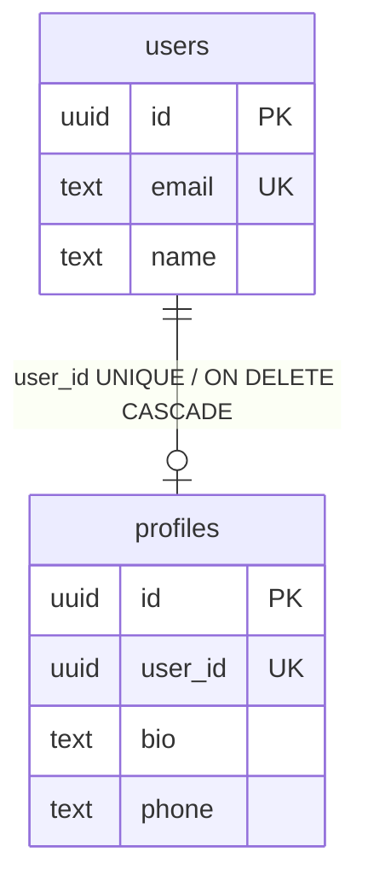

# 第 45 章 Prisma 8 一对一映射与关联 CRUD

## Prisma 里的「关系」是什么

关系数据库里两张表靠**外键**连起来：一张表的列存另一张表的主键值，数据库保证引用的行真实存在（第 37 章建 `bookings.room_id` 时已经用过）。表本身没有「一对一」「一对多」这种类型，关系由外键列上的约束决定——这一章处理的是一对一。

ORM 把外键映射成对象字段，写代码时不用手拼 JOIN。Prisma 8 的契约里，**持有外键的一侧**写 `@relation`（这里是 `Profile.userId`），另一侧写一个不落库的反向字段（这里是 `User.profile`）。反向字段的类型是单个对象还是数组，必须和外键上的约束对得上：外键加了唯一约束，反向字段才是单值；没加，它就得是数组。这个一致性不靠人记，`contract emit` 会在编译契约时校验——`PSL_NON_UNIQUE_BACKRELATION` 就是它发现两边对不上时给的报错。

官方文档（先看懂正文再点）：
- [PostgreSQL 外键](https://www.postgresql.org/docs/17/ddl-constraints.html#DDL-CONSTRAINTS-FK)：一对一靠外键加唯一约束实现，这页讲约束怎么写。
- [Prisma 关系](https://www.prisma.io/docs/orm/fundamentals/relations-and-joins)：`@relation` 和反向字段的写法，对应本章关系映射那段。

现在看一个真实事故。

给用户加一份个人资料，本来是这次迭代里最小的一个改动：新建 `profiles` 表，挂到 `users` 上，两边的字段都写好了，`@relation` 也没漏。结果 `pnpm db:emit` 直接退出 2，甩回来一句：

```text
PSL_NON_UNIQUE_BACKRELATION: Backrelation field "User.profile" is singular,
but the matching FK on "Profile" (fields "user_id") is not unique.
```

报错里的 `Backrelation` 就是 `User.profile`：它是单值，数据库却允许一个用户挂多条资料，两边对不上。你确实漏了一个东西，但不是 `@relation`，是外键列上的 `@unique`。

## 一对一在库里就是「外键 + 唯一」

关系数据库里没有专门的一对一类型，它就是「外键 + 唯一约束」：子表存父表的主键，再在这一列上建唯一索引，数据库就只允许一个父行对应一个子行。ORM 把这层映射成两个对象各自持有对方一个实例：`User.profile` 是单值，`Profile.user` 是单值；真正落库的只有持外键那一侧的列。

Prisma 8 对这条规则的要求很硬：外键列必须有 `@unique`。这不是风格问题，而是基数问题（基数就是「一个父行最多能有几个子行」）——没有唯一约束，数据库允许同一个用户挂两条资料，契约只能把关系理解成 N:1；反向的 `profile` 是单值字段，Prisma 8 找不到「最多一条」的依据，在 emit 阶段就拦下来。

> **图 45-1** 一对一在表结构里就是一条带唯一约束的外键。
>



打开 `prisma/contract.prisma`，只动这两个模型：

```prisma
// prisma/contract.prisma
model User {
  id           Uuid    @id @onCreate(uuid())
  name         String
  email        String  @unique
  passwordHash String  @map("password_hash")
  role         Role    @default(USER)
  avatarUrl    String? @map("avatar_url")
  createdAt    TimestamptzString       @default(now()) @map("created_at")
  updatedAt    temporal.UpdatedAtString @map("updated_at")
  profile      Profile?

  @@map("users")
}

model Profile {
  id        Uuid    @id @onCreate(uuid())
  userId    Uuid    @unique @map("user_id")
  bio       String  @default("")
  phone     String?
  createdAt TimestamptzString       @default(now()) @map("created_at")
  updatedAt temporal.UpdatedAtString @map("updated_at")
  user      User    @relation(fields: [userId], references: [id], onDelete: Cascade)

  @@map("profiles")
}
```

关键只有一行：`userId Uuid @unique`。`@unique` 会在 `profiles.user_id` 上建唯一索引，一个用户最多一条资料。`@relation` 只写在持外键的 `Profile` 一侧，`User.profile` 是裸类型，不需要再写一遍。但两侧字段都得显式写出来——Prisma 8 不会凭外键替你补一个 `profile` 字段，漏了它，后面 `include('profile')` 连编译都过不了。

为什么不让两张表互相存对方 id？那会造出循环外键：插用户要先有资料，插资料又要先有用户，插入顺序变成死结，删除时还要处理两边。一对一只需要一侧持外键、加唯一约束，另一侧用反向字段读。`Profile` 是真正拥有 `user_id` 的一侧，`User.profile` 只是查询入口，不落列。

为什么不干脆在 `users` 上开一个 JSON 列？能跑，但关系一旦要按 `phone` 查、要单独授权、要给 `bio` 做全文索引，JSON 就会变成负担。拆表多一次关联，换来每列自己的类型、约束和索引；`profiles.user_id` 上的唯一索引还顺手让 `where({ userId })` 走索引而不是全表扫。

改契约时还有两个旧写法会撞墙。`@id @onCreate(uuid())` 里的 `@onCreate` 值得停一下：`@default` 表达的是数据库默认值，`uuid()` 是客户端生成的值，两者不是一回事。把旧项目的 `@default(uuid())` 照搬过来，emit 会给你另一条报错：

```text
PSL_GENERATOR_IN_DEFAULT: Field "User.id": uuid() is a value the client generates,
and @default sets a database default only. Write @onCreate(uuid()) instead.
```

时间字段用 `TimestamptzString`，读写都是 ISO 字符串；`temporal.UpdatedAtString` 负责在更新时刷新 `updated_at`。别改回 `DateTime`：它会落到 `pg/timestamptz-temporal@1`，Node 22 运行时没有内置 Temporal，第一次读写就报 `RUNTIME.TEMPORAL_UNAVAILABLE`。

改完先 emit：

```bash
pnpm db:emit
```

```text
✔ Emitted contract.json and contract.d.ts
```

（退出码 0，`src/generated/prisma8/` 下两个产物被重写。）

这里最容易误解：emit 只重写类型和契约产物，不碰数据库。要把 `profiles` 真的建出来，还得 `plan` + `migrate`（048 章）。只 emit 不迁移，查询会报 `relation "profiles" does not exist`。

## 查：`include` 的返回类型为什么带 null

从用户侧取资料，`include` 的回调可以继续 `select`，只带需要的列：

```ts
// src/modules/users/users.service.ts
async findWithProfile(id: string) {
  const user = await this.db.orm.public.User.where({ id })
    .select('id', 'name', 'email', 'avatarUrl')
    .include('profile', (profile) => profile.select('bio', 'phone'))
    .first();

  if (!user) {
    throw new NotFoundException('用户不存在');
  }
  return user;
}
```

`user.profile` 的类型是 `{ bio: string; phone: string | null } | null`。即使你确信每个用户都建了资料，类型里仍然有 `null`：to-one（指向单个对象的那一侧）的 `include` 按左连接处理，用户存在、资料不存在是合法状态。要用 `bio` 就老实判空，别用 `!` 压掉。

这段代码为了看清关系形状直接把 `user` 返回了；真实接口还要用 Mapper 裁成 `UserVo`，至少别把 `passwordHash`、`role` 带出去。`select` 只保证「这次没查」，不保证「以后没人加字段」，出口再裁一次才稳。

从资料侧反查路径更短，也不需要处理 `profile` 这一层：

```ts
const profile = await this.db.orm.public.Profile.where({ userId })
  .select('bio', 'phone')
  .first();
```

`where({ userId })` 能这么写，是因为 `user_id` 上有唯一索引，`userId` 在生成类型里是单值而不是数组。这也是前面必须加 `@unique` 的另一个原因——它不只约束数据，还决定了代码里的形状。

列表页只需要头像和昵称时，别顺手 `include('profile')`。资料里的 `bio` 可能有几千字，带进列表会让每行都变宽；把资料查询留给详情页，列表只 `select` 用户字段。`include` 解决的是「一次取回」，不是「所有页面都该取」。

## 建：两张表放进一个事务

注册时用户和资料要一起出现，分两条 insert 写，失败任意一条都不能留下半份数据：

```ts
// src/modules/users/users.service.ts
async createWithProfile(input: {
  name: string;
  email: string;
  passwordHash: string;
  bio?: string;
}) {
  return this.db.transaction(async (tx) => {
    const user = await tx.orm.public.User
      .select('id', 'name', 'email')
      .create({
        name: input.name,
        email: input.email,
        passwordHash: input.passwordHash,
      });

    await tx.orm.public.Profile.create({
      userId: user.id,
      bio: input.bio ?? '',
      phone: null,
    });

    return user;
  });
}
```

`db.transaction` 的回调拿到 `tx`，模型路径和 `db` 一样，只是所有语句绑在同一条连接、同一个事务里。第二条 insert 撞上唯一约束，第一条会一起回滚。`Profile.id` 由 `@onCreate(uuid())` 生成，不用你传。

这里有个容易混的点：`tx.orm.public.Profile` 和 `db.orm.public.Profile` 的写法一模一样，区别只在你手里的句柄。回调里用外层 `db` 写第二条，写进去的数据不会跟着回滚——这个坑 044 章提过，在一对一这种「两次写必须同时成立」的场景里，代价就是一份没有用户的孤儿资料。

## 改：`upsert` 把「有没有」交给数据库

资料可能已经存在，也可能是老用户第一次补资料。与其先查再判断，不如用 `upsert`（有则更新、无则插入），把冲突判断交给唯一索引：

```ts
// src/modules/users/users.service.ts
async saveProfile(userId: string, input: { bio: string; phone: string | null }) {
  return this.db.orm.public.Profile.upsert({
    create: { userId, bio: input.bio, phone: input.phone },
    update: { bio: input.bio, phone: input.phone },
    conflictOn: { userId },
  });
}
```

`conflictOn` 必须指向一个唯一键，这里正好是 `userId`。没有冲突就执行 `create`，有冲突就执行 `update`，整条语句在数据库里原子完成。两个请求同时给同一个用户建资料，也不会一个成功一个报唯一约束——这正是「先查再写」做不到的。原子性由数据库保证，不是应用层加锁；但冲突目标必须精确匹配一个唯一约束，写错列名或拿普通索引顶替，数据库不会兜底。

如果业务上只允许更新、不允许顺手创建，就别用 `upsert`：

```ts
const updated = await this.db.orm.public.Profile.where({ userId })
  .select('bio', 'phone')
  .update({ bio, phone });

if (!updated) {
  throw new NotFoundException('资料不存在，请先创建');
}
```

`update` 返回更新后的行；没有匹配行时返回 `null`，不是抛异常。这个 `null` 必须处理，否则接口会假装更新成功。

## 删：级联是数据库兜底，不是业务开关

`Profile.user` 上的 `onDelete: Cascade` 会生成数据库级外键。删除用户时，资料行由 PostgreSQL 一起删掉：

```ts
await this.db.orm.public.User.where({ id }).delete();
```

验证一下，别只看 ORM 返回值：

```bash
psql "$DIRECT_URL" -c "select count(*) from profiles where user_id = '9f1c...';"
```

```text
 count
-------
     0
```

（示例输出。）有两点要分清。第一，级联只在迁移真正应用后生效；契约里写了 `Cascade`、数据库里还是旧外键，删除用户会直接报外键冲突。第二，级联删除是兜底，不是业务流程：用户注销往往还要撤销会话、保留订单审计、发通知，这些都不该由一条 `DELETE` 顺手完成。真要保留历史，`Profile` 可以改成软删除（标记一个 `deleted_at` 而不是物理删除），或者把 `onDelete` 设成 `Restrict`，让删除先经过业务层。

外键方向也决定级联方向。删除资料只删 `profiles` 这一行，不会动用户；删除用户才会顺着 `Cascade` 删资料。把 `onDelete` 改成 `SetNull` 可以保住用户，但 `userId` 必须可空，一对一就退成「0..1 对 0..1」，业务上得接受一条没有主人的资料。

| `onDelete` | 删除 `users` 行时 | 什么时候选 |
| --- | --- | --- |
| `Cascade` | 一起删掉 `profiles` 行 | 资料脱离用户没有独立意义 |
| `Restrict` / `NoAction` | 有资料就拒绝删除 | 删除前必须走业务审核 |
| `SetNull` | 把 `user_id` 置空，资料留下 | 需要保留历史资料（`userId` 必须可空） |

选哪种不是语法问题，是「资料脱离用户还有没有意义」的问题。选完还要走一遍 `plan` + `migrate`，数据库里的外键动作才会真的换掉；只在契约里改、没应用迁移，线上仍是旧行为。

## 坑与边界

| 现象 | 原因 | 怎么处理 |
| --- | --- | --- |
| emit 报 `PSL_NON_UNIQUE_BACKRELATION` | 外键没加 `@unique`，单值反向字段不成立 | 给外键加 `@unique`，或把反向字段改成数组 |
| emit 报 `PSL_GENERATOR_IN_DEFAULT` | 把 `@default(uuid())` 当成客户端生成 | 改成 `@onCreate(uuid())` |
| `include('profile')` 的参数类型是 `never` | 反向字段没声明，或契约改了没 emit | 两侧都写字段，重跑 `pnpm db:emit` |
| 每个用户的 `profile` 都是 `null` | 只建了用户没建资料，或资料被级联删了 | 用同一个事务创建，查询时判空 |
| 删除用户报外键冲突 | `onDelete` 是默认的 Restrict，或迁移没应用 | 明确选 `Cascade`，再 plan + migrate |
| 读写时间字段报 `RUNTIME.TEMPORAL_UNAVAILABLE` | 用了 `DateTime`，运行时缺 Temporal | 换 `TimestamptzString` |

还有一条容易忽略：`Profile` 的 `userId` 既是外键又是唯一键，Prisma 8 生成的类型会把它当单值。如果你后来把关系改成一对多，记得把 `@unique` 去掉，否则数据库仍然只允许一条，代码却按数组写，问题会拖到运行时才暴露。

一对一到这里就闭环了：唯一外键决定基数，`include` 决定一次查询带不带资料，事务决定两条记录是否同生共死。下一章把这条线换成一对多——同一个 `include` 会返回数组，子集合的范围、顺序和数量都得在查询里约束住，否则一次请求能把用户三年的预订全拖回来。

想更深入的话，官方文档里有这几页可以接着看：[一对一关系](https://www.prisma.io/docs/orm/fundamentals/relations-and-joins#one-to-one)（一对一在契约里的完整示例）、[upsert](https://www.prisma.io/docs/orm/fundamentals/writing-data#upsert-a-record)（有就更新、没有就插入，关联 CRUD 里常用）、[错误参考](https://www.prisma.io/docs/orm/reference/error-reference)（`P2002` 这类错误码分别代表什么）。

<!-- chapter-nav:start -->
---

← 上一篇：[044 快速掌握Prisma8](044-快速掌握Prisma8.md) · [本 Part 目录](_part.md) · 下一篇：[046 Prisma8一对多映射与关联CRUD](046-Prisma8一对多映射与关联CRUD.md) →
<!-- chapter-nav:end -->
