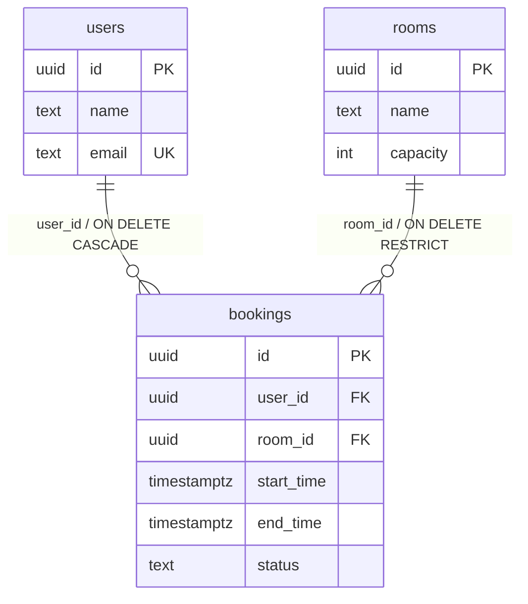

# 第 46 章 Prisma 8 一对多映射与关联 CRUD

## 一对多和 N+1 是什么

一对多是关系数据库里最常见的关系：一条用户记录对应多条预订记录，一条会议室记录也对应多条预订记录。它的表示只有一种——子表（`bookings`）存一个外键指回父表（`users` / `rooms`），父表里不存数组。关系数据库的列只能放标量，放不下一组 id，所以「多」的那一侧永远由子表的外键表达。

ORM 会在父模型上生成一个数组字段（`User.bookings`），但那个字段不落库，只是查询入口：它告诉 ORM「可以顺着 `bookings.user_id` 往回查」。没有这个字段，`include` 无法编译，你只能先查父行、再对每一行循环查子行——这种「1 次列表 + N 次逐行」的查询模式就叫 **N+1**。N+1 不是 ORM 的默认行为，是关系没声明、没法一次取回时最自然的退路。

官方文档（先看懂正文再点）：
- [PostgreSQL 外键](https://www.postgresql.org/docs/17/ddl-constraints.html#DDL-CONSTRAINTS-FK)：子表存外键指回父表，这页是底层约束。
- [Prisma 一对多关系](https://www.prisma.io/docs/orm/fundamentals/relations-and-joins#one-to-many)：父模型上的数组字段怎么声明，对应本章 N+1 那段。

现在看一个真实事故。

运营要一张「每位用户最近三条预订」的名单。第一版代码很直白：先 `User.all()` 取 20 个用户，再在 `for` 循环里逐个 `Booking.where({ userId }).all()`。功能上线当天接口还算快，第二周 P99（99% 的请求耗时）从 180ms 涨到 2.7s，数据库日志里一次请求留下 21 条几乎一样的 SQL——1 条查用户，20 条查预订。

你想改成 `include('bookings')`，TypeScript 又直接拒绝：`'bookings'` 不能赋给 `never`。原因是契约里根本没有这个反向字段。两个问题其实是一个：关系没写全，查询就只能靠自己循环。

## 一对多在库里只有外键，数组是 ORM 的入口

回到刚才那 21 条 SQL：父表那一侧的 `bookings Booking[]` 只是 ORM 的查询入口，不会在 `users` 或 `rooms` 里生成列。没有这个入口，`include` 编译不过，你就只能先查父行、再对每一行循环查子行——1 次父列表加 20 次逐行子查询，这就是 N+1。

Prisma 8 不会替你在 `User` 上自动补一个 `bookings` 数组；`include` 也不是懒加载，它要求契约里先把关系声明出来，再明确告诉 ORM 这次要带哪些子行。

在 Prisma 8 里，`User`、`Room`、`Booking` 既是 Entity 也是 PO；`include` 查出来的 `user.bookings` 是 PO 数组，不是接口 DTO。列表页要的 `BookingVo`（只带 id、时间、状态）得自己用 Mapper 裁，别把整行 PO 直接序列化出去：PO 跟着表走，接口契约不能跟着表走。

> **图 46-1** 一对多：父表不存数组，子表存外键。
>



## 两侧都写，只有子侧落列

示例项目的 `Booking` 已经持有外键和 `@relation`，缺的是父模型上的反向数组。打开 `prisma/contract.prisma`，在 `User` 和 `Room` 里各补一行：

```prisma
// prisma/contract.prisma：User 模型里新增
bookings Booking[]

// prisma/contract.prisma：Room 模型里新增
bookings Booking[]
```

`Booking` 侧不用动，它已经有两行：

```prisma
// prisma/contract.prisma：Booking 里已有的关系
user User @relation(fields: [userId], references: [id], onDelete: Cascade)
room Room @relation(fields: [roomId], references: [id], onDelete: Restrict)
```

`bookings Booking[]` 是纯关系字段，不会在 `users` 或 `rooms` 表里生成列。真正落库的是 `bookings.user_id` 和 `bookings.room_id`；反向数组只是告诉 ORM「这条外键可以从父模型往回看」。`@relation` 仍然只写在持外键的一侧，反向数组是裸类型，不需要再写一遍。

改完 emit：

```bash
pnpm db:emit
```

```text
✔ Emitted contract.json and contract.d.ts
```

（退出码 0，`contract.d.ts` 里 `User.bookings` 的基数变成 1:N。）

反向数组不会替你建索引。PostgreSQL 不会因为一条外键就自动加索引，`where({ userId })` 要快，得靠 `bookings.user_id` 上的索引；按房间查时间冲突，则要靠 `@@index([roomId, startTime, endTime])`。示例项目两条都写了。复合索引的列顺序不是装饰：先等值、再范围，`roomId` 在前、时间在后，才能把扫描压到一个房间的一小段；反过来把时间放第一列，房间条件就用不上这棵索引。

## 父带子：把子集合的范围写进 include

有了反向字段，最近三条预订可以一条查询拿到：

```ts
// src/modules/bookings/bookings.service.ts
async findUserWithRecentBookings(id: string) {
  const user = await this.db.orm.public.User.where({ id })
    .select('id', 'name')
    .include('bookings', (booking) => booking
      .where({ status: 'APPROVED' })
      .select('id', 'roomId', 'startTime', 'endTime')
      .orderBy((row) => row.startTime.desc())
      .limit(3))
    .first();

  if (!user) {
    throw new NotFoundException('用户不存在');
  }
  return user;
}
```

`user.bookings` 的类型是 `{ id: string; roomId: string; startTime: string; endTime: string }[]`：数组一定存在，没有匹配时是空数组，不是 `null`。回调里的 `where` 只过滤子行，不会把没有预订的用户过滤掉；要让父模型也受子行影响，得把条件写在外层：

```ts
this.db.orm.public.User.where((user) =>
  user.bookings.some((booking) => booking.status.eq('APPROVED')),
);
```

`limit(3)` 是每个用户各三条，不是整张结果集三条。这是 `include` 回调最容易被误读的地方：它描述的是「每个父行带多少子行」。不写 `limit`，一个用了三年的账号会把所有历史预订一起拖出来；`select` 再窄也救不了行数。

`include` 也不会退化成 N+1。官方实现是在同一条 SQL 里用 correlated subquery（相关子查询，子查询里引用外层父行的 id）读关联，父行和子行一次往返。你在日志里看到 21 条 SQL，只可能是代码里真的循环了 20 次。

为什么不是先 JOIN 再裁？一个父行带三条子行，JOIN 会把父行复制三份；再叠一层 `include('room')`，行数还会继续乘。相关子查询按父行取子集，既避免笛卡尔积，也让 `limit(3)` 真的是「每个父行三条」而不是「整张结果集三条」。代价是父行很多时子查询次数跟着涨，所以父模型要先分页，别一次 `User.all()` 把几万行拖进来再让每行带三条。

列表页常常还要房间名。`include` 回调里可以再嵌一层 `include('room', ...)`，仍然走同一条 SQL；但每多带一层，结果集就多一份重复的父行数据。只取 `room.name` 时，用回调收窄字段，别把整个房间对象拖进来：

```ts
.include('bookings', (booking) => booking
  .select('id', 'startTime')
  .include('room', (room) => room.select('name'))
  .limit(3))
```

## 子带父：to-one 的 null 取决于你有没有精化

从预订详情反查用户和房间，写法对称：

```ts
// src/modules/bookings/bookings.service.ts
async findBookingDetail(id: string) {
  const booking = await this.db.orm.public.Booking.where({ id })
    .include('room')
    .include('user', (user) => user.select('id', 'name', 'email'))
    .first();

  if (!booking) {
    throw new NotFoundException('预订不存在');
  }
  return booking;
}
```

这里有个 rc.29 的类型细节，值得单独记：`booking.room` 是非空类型，`booking.user` 却是 `{ id: string; name: string; email: string } | null`。两条外键都非空，为什么一个可空一个不可空？因为 `room` 用的是裸 `include`，`user` 用了带 `select` 的精化回调；精化过的 to-one（指向单个父行的那一侧）在类型层按左连接处理，运行时行还在，类型却要求你判空。

处理方式二选一：要么别精化，接受整行 `user`，拿到非空类型；要么保留 `select`，在使用前判空。不要用 `!` 把 `null` 压掉——今天外键非空，明天关系改成可选，`!` 会把这个改动变成线上 500。

## 分页：总数别拿 items.length

列表页需要「当前页 + 总数」。`limit/offset` 取当前页，`aggregate`（聚合查询，这里只用 `count`）单独计数：

```ts
// src/modules/bookings/bookings.service.ts
async listUserBookings(userId: string, page: number, pageSize: number) {
  const filtered = this.db.orm.public.Booking.where((row, { fns }) =>
    fns.and(
      row.userId.eq(userId),
      row.status.in(['PENDING', 'APPROVED']),
    ),
  );

  const [items, totals] = await Promise.all([
    filtered
      .select('id', 'roomId', 'startTime', 'endTime', 'status')
      .orderBy((row) => row.startTime.desc())
      .limit(pageSize)
      .offset((page - 1) * pageSize)
      .all(),
    filtered.aggregate((a) => ({ total: a.count() })),
  ]);

  return { items, total: totals.total, page, pageSize };
}
```

`filtered` 只描述条件，不带 `limit`；两个分支各自补自己的收尾。`items.length` 最多等于 `pageSize`，拿它当总数，第二页就会显示「共 10 条」。`aggregate` 返回的是 `{ total: number }`，跟分页参数无关。

`offset` 在页码很深时会扫过前面所有行。后台列表还能接受，面向用户的「加载更多」最好换成 keyset（按上一页最后一条的排序键定位，而不是跳过前 N 行）：按 `startTime` 和 `id` 排序，下一页传上一页最后一条的值，条件写成 `startTime < last`。这里先不展开，知道 `offset` 的代价随页码线性增长就够了。

## 批量创建：一次写多行，别在循环里 create

写入的方向由外键决定：先插父行拿到 id，再插子行带上外键；反过来数据库会报外键冲突。批量补录时，父行必须已经存在，子行的 `userId` / `roomId` 只是引用，不会替你创建父行。

补录一批预订时，逐条 `create` 是 N 次往返。`createAll` 一次提交整个数组：

```ts
// src/modules/bookings/bookings.service.ts
async createPending(
  input: Array<{ userId: string; roomId: string; startTime: string; endTime: string }>,
) {
  return this.db.orm.public.Booking.createAll(
    input.map((booking) => ({ ...booking, status: 'PENDING' as const })),
  );
}
```

返回的数组与入参顺序一致，`id`、`createdAt` 这些由 `@onCreate` / `@default` 生成的字段都会回填。它是一条多值 INSERT，失败时整条语句回滚；如果这批写入还要跟别的表一起成功或失败，再套一层 `db.transaction`。

批量写绕过了「逐条检查时间冲突」的机会。补录接口要么在写入前用一次范围查询把冲突找出来，要么给 `bookings` 加排他约束；只靠 `createAll`，两条重叠的预订会安静地写进去。

重试也是同一类问题。客户端超时后重发，`createAll` 会再插一遍，不会自动去重；要么让客户端带幂等键（同一个请求重发多次，服务端只真正处理一次），要么在 `bookings` 上加一个能识别重复的复合唯一键。批量接口的「快」不该拿数据一致性换。

## 坑与边界

| 现象 | 原因 | 怎么处理 |
| --- | --- | --- |
| `include('bookings')` 报参数不能赋给 `never` | 父模型没写反向数组，或改了契约没 emit | 两侧都声明，重跑 `pnpm db:emit` |
| 用户列表带出了全部历史预订 | include 回调只写了 `select`，没写 `limit` | 在回调里补 `where/orderBy/limit` |
| `booking.user` 类型是 `... \| null` | 用了带 `select` 的精化 include | 判空，或改回裸 `include('user')` |
| 第二页显示的总数不对 | 用 `items.length` 当总数 | 单独 `aggregate(a => ({ total: a.count() }))` |
| 删除房间报外键冲突 | `onDelete: Restrict`，且房间还有预订 | 先取消/迁移预订，或改软删除 |
| 深页码越来越慢 | `offset` 随页码扫描 | 改 keyset 分页，按时间与 id 定位 |

还有一个边界：`include` 只适合「父行不多、每父子行有限」的场景。导出全站预订时先分页父模型，再按这批 id 用 `in` 查子行，往往比一条巨大的 `include` 更可控。关系字段解决的是「一起取」，不解决「取多少」；后者永远要你自己写。

一对多的主线到这里清楚了：外键在子表，反向数组在父模型，`include` 负责一次取回，回调用 `where/orderBy/limit` 控制每个父行带多少。下一章把「一条预订对应多个服务」摆上桌，多对多没有外键可以直接指过去，得先造一张连接表——那张表的主键怎么定，决定了 `include` 拿到的是服务，还是连接行。

想更深入的话，官方文档里有这几页可以接着看：[一对多关系](https://www.prisma.io/docs/orm/fundamentals/relations-and-joins#one-to-many)（一对多的契约写法和 `include` 用法）、[按关联数据过滤](https://www.prisma.io/docs/orm/fundamentals/relations-and-joins#filter-parent-records-by-relation-data)（按子行条件筛父行，避免先查一遍再筛）、[聚合](https://www.prisma.io/docs/orm/reference/orm-client-methods)（`count`、`groupBy` 这些方法的参数）。

<!-- chapter-nav:start -->
---

← 上一篇：[045 Prisma8一对一映射与关联CRUD](045-Prisma8一对一映射与关联CRUD.md) · [本 Part 目录](_part.md) · 下一篇：[047 Prisma8多对多映射与关联CRUD](047-Prisma8多对多映射与关联CRUD.md) →
<!-- chapter-nav:end -->
