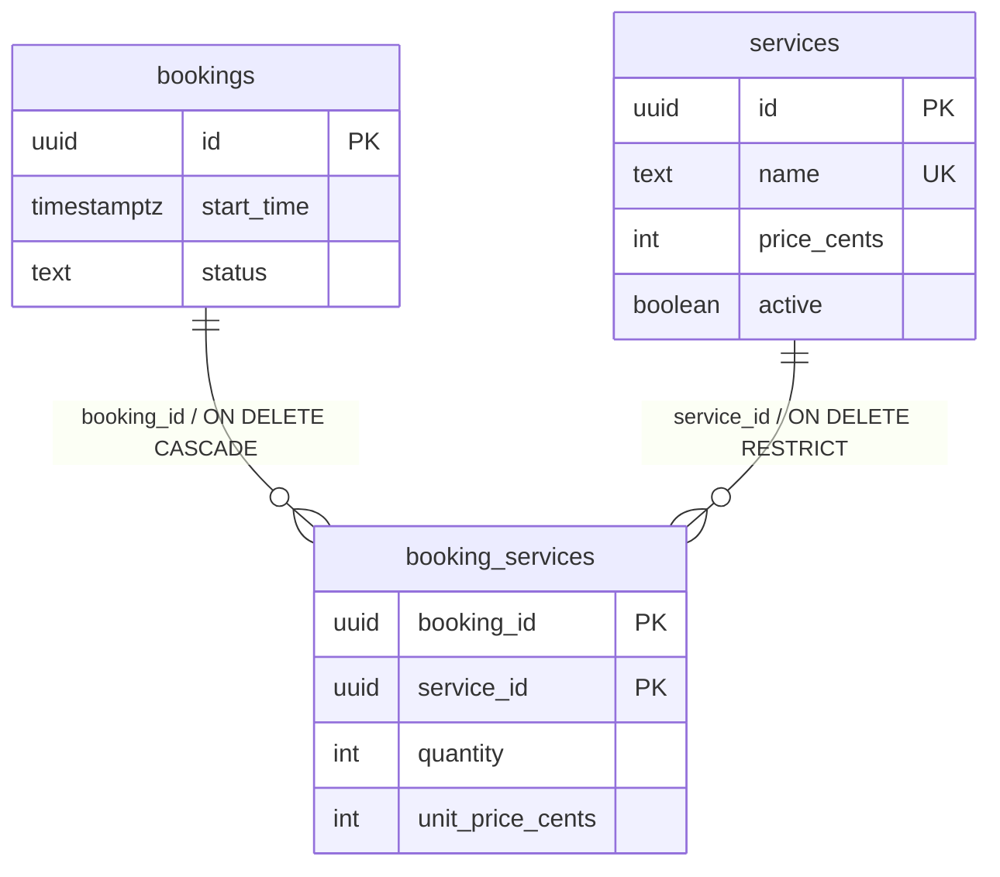

# 第 47 章 Prisma 8 多对多映射与关联 CRUD

一条预订可以加好几个增值服务（投影、茶歇、白板），一个服务也会被很多条预订选中。这种「两边都是一堆」的关系叫**多对多**。

它难的地方不在概念，在存法。一对多只需要在「多」的那边放一列外键；多对多两边都是「多」，放哪边都会把另一头压成一条。`bookings` 上放 `service_id`，一条预订就只能选一个服务；`services` 上放 `booking_id`，一个服务就只能被一条预订选。把多个 id 拼成 `"1,2,3"` 塞进字符串？外键约束没了，按服务反查要靠 `LIKE`，索引也基本失效。

生活里的解法是另起一张签到簿。一场婚礼有很多客人，一位客人也参加过很多场婚礼；请柬上写不下「参加过的所有婚礼」，宾客名单里也塞不下他参加过的每一场。门口摆一本簿子，一行写「谁 + 哪一场」，两边的「多」就都有了着落。

这张簿子就是**连接表**（join table）：里面两条外键，一条指向 `bookings`、一条指向 `services`，一行表示「某条预订选了某个服务」。这样 N:M 就被拆成两个 1:N——预订对连接表是一对多，服务对连接表也是一对多。簿子上还能写「这一次」的信息：数量、下单时的单价、经手人。这些字段既不属于预订，也不属于服务，只属于这一次关联。

官方文档（先看懂正文再点）：
- [PostgreSQL 外键约束](https://www.postgresql.org/docs/17/ddl-constraints.html#DDL-CONSTRAINTS-FK)：连接表的两条外键就是普通外键，规则一样。
- [Prisma 多对多关系](https://www.prisma.io/docs/orm/fundamentals/relations-and-joins#many-to-many)：显式连接表在契约里怎么建，对应下面中间表那段。

给预订加增值服务，第一版只改了两行：`Booking` 加 `services Service[]`，`Service` 加 `bookings Booking[]`。看上去就是上一章的反向数组再来一份，结果 `pnpm db:emit` 退出 2：

```text
PSL_ORPHANED_BACKRELATION: ... use an explicit join model for many-to-many.
```

`ORPHANED_BACKRELATION` 说的就是：两个数组字段互相指，却没有一方持有外键，关系悬空了。多对多必须有一个显式的连接模型，Prisma 不会替你猜表名，也不会猜连接列。

补一张 `BookingService` 连接表之后，emit 过了，`include('services')` 也能编译。但返回的每个元素都带着 `quantity`、`unitPriceCents`，唯独没有 `name`——因为 `Booking.services` 写成了 `BookingService[]`。列表字段指向谁，`include` 就返回谁。

## 连接表是张真表，不是框架替你管的中间产物

Prisma 8 在 PostgreSQL 上不接受隐式多对多，也没有 `@ManyToMany` 让框架代管连接表。契约里必须有一个真实模型，自己持有两条外键。这不是退步，是把「关联本身也是数据」摆到明面上：谁在什么时候订了这个服务、几份、下单时什么价，这些总得有地方放。

Prisma 5/6 的项目里，你可能习惯只写两边的 `tags Tag[]`，让迁移工具自动建一张 `_PostToTag`。把这种契约原样抄到 8，emit 会停在 `PSL_ORPHANED_BACKRELATION`。另一种常见误解是「两侧裸数组会被推导成 N:M，并自动带上 through 元数据」，在 rc.29 上同样不成立。连接模型、复合主键、两侧列表字段，三样都写出来，`include` 才有东西可穿。

连接表怎么建模，取决于它有没有业务字段。只有两条外键时，它是纯关联，查询里可以透明穿过；一旦带上数量、下单价、授权人，它自己就是 Entity/PO——有主键、有生命周期，要单独读、单独写。

先写连接模型，再把两侧的列表字段指向对方：

```prisma
// prisma/contract.prisma：Booking 模型里新增
services Service[]

// prisma/contract.prisma：服务模型
model Service {
  id         Uuid    @id @onCreate(uuid())
  name       String  @unique
  priceCents Int     @map("price_cents")
  active     Boolean @default(true)
  bookings   Booking[]

  @@map("services")
}

// prisma/contract.prisma：连接模型
model BookingService {
  bookingId      Uuid @map("booking_id")
  serviceId      Uuid @map("service_id")
  quantity       Int  @default(1)
  unitPriceCents Int  @map("unit_price_cents")

  booking Booking @relation(fields: [bookingId], references: [id], onDelete: Cascade)
  service Service @relation(fields: [serviceId], references: [id], onDelete: Restrict)

  @@id([bookingId, serviceId])
  @@index([serviceId])
  @@map("booking_services")
}
```

`BookingService` 的主键恰好是 `bookingId + serviceId`，这告诉 Prisma：它可以被当作 `Booking` 与 `Service` 之间的连接模型，`include` 能透明穿过。像签到簿上「婚礼 + 客人」这一对只能出现一次，同一人同一场签两回，就说明簿子记错了。

但这不代表它在业务上不是实体——有 payload 时，读数量、单价仍然要单独查它。payload（连接行上除两条外键之外的业务字段，比如 `quantity`、`unitPriceCents`）不能进主键：它们描述的是「这一次关联」，放进 `@@id` 会让同一对预订与服务可以重复出现，连接就失去唯一性。随礼金额属于「这一次参加」，不能拿来当签到的身份，是一个道理。

两侧列表字段再分别指向 `Service` 和 `Booking`，`include` 才会把中间表当透明管道。三个条件缺一个，你要么拿到连接行，要么 emit 直接拒绝。

`@@index([serviceId])` 不是可有可无的装饰。复合主键的索引以 `bookingId` 开头，按预订查服务很快；从服务反查预订只带 `serviceId`，用不上这棵索引，PostgreSQL 也不会因为外键自动补一个。这份契约如果没写这一行，反查就会退化成全表扫。像签到簿按婚礼装订成册，按婚礼翻很快；想按客人查，得另做一本客人索引。

`onDelete` 两边不同：删预订，连接行跟着 `Cascade` 清掉；删服务，`Restrict` 挡住，因为历史订单里还留着价格快照，服务本身不该被物理删除。要下架服务，把 `active` 改成 `false`，别删行。

判断一张连接表是不是「业务实体」，看三个信号：有没有 payload、要不要单独授权或审计、会不会被独立查询。三个都没有，就让 `include` 穿过去，把它当透明管道；有一个，就按实体对待，读要走连接模型，写也要走连接模型。

| 形态 | 主键 | `include('services')` 返回 | 典型场景 |
| --- | --- | --- | --- |
| 纯连接表 | `@@id([aId, bId])` | 对方模型 | 标签、分类 |
| 带 payload 的关联实体 | `@@id([aId, bId])` 或代理主键 + 复合唯一键 | 对方模型，payload 要另查 | 订单行、选课、预订增值服务 |

用代理主键（单独一列自增或 uuid 当主键）也不是不行，但必须补一个 `@@unique([bookingId, serviceId])`；否则同一对能重复插入，连接表就失去了「唯一关联」的语义。

> **图 47-1** 多对多拆成两条一对多，连接表带着业务字段。
>



## 读：让 include 穿过连接表，payload 另查

按预订读服务，列表字段指向 `Service` 之后，`include` 的返回就是服务数组：

```ts
// src/modules/bookings/bookings.service.ts
async findServices(bookingId: string) {
  const booking = await this.db.orm.public.Booking.where({ id: bookingId })
    .select('id', 'startTime', 'status')
    .include('services', (service) => service.select('id', 'name', 'priceCents'))
    .first();

  if (!booking) {
    throw new NotFoundException('预订不存在');
  }
  return booking.services;
}
```

`booking.services` 的类型是 `{ id: string; name: string; priceCents: number }[]`，没有 `quantity`，也没有 `unitPriceCents`。这不是漏了字段，而是 `include` 的目标是 `Service`，连接行不在结果里。要数量，直接查连接模型：

```ts
// src/modules/bookings/bookings.service.ts
async findServiceLines(bookingId: string) {
  return this.db.orm.public.BookingService.where({ bookingId })
    .select('serviceId', 'quantity', 'unitPriceCents')
    .include('service', (service) => service.select('name', 'priceCents'))
    .all();
}
```

每行的 `service` 类型是 `{ name: string; priceCents: number } | null`。又是精化 include 的可空问题：外键非空，但带 `select` 的 to-one 在类型层按左连接处理。要么判空，要么用裸 `include('service')` 拿非空整行。这里建议判空——服务被 `Restrict` 保护着，理论上不会缺，但类型要求你把这条路径写完整。

`findServices` 和 `findServiceLines` 是两条不同的读路径，别硬合并。前者回答「订了哪些服务」，后者回答「每项多少钱、几份」。把 `quantity` 塞进 `include('services')` 的 `select` 会直接编译失败，因为 `Service` 上没有这个字段。

反方向也一样。`Service.where({ name }).include('bookings', (b) => b.select('id', 'startTime', 'status')).first()` 返回的是 `Booking[]`；要数量，仍然回 `BookingService`。两个方向都透明，前提都是列表字段指向对方模型，而不是指向连接模型。

中间表的存在不会把查询拆成三次往返。`include('services')` 仍然是一条 SQL，ORM 按契约生成 join；连接表只改变 SQL 的形状，不改变调用次数。真正决定慢不慢的，是过滤条件能不能用上索引，以及一次带回了多少行。

## 写：预订和连接行在同一个事务里

创建带服务的预订，先读服务、拿当前价，再写预订和连接行：

```ts
// src/modules/bookings/bookings.service.ts
async createWithServices(input: {
  userId: string;
  roomId: string;
  startTime: string;
  endTime: string;
  serviceIds: string[];
}) {
  const serviceIds = [...new Set(input.serviceIds)];

  return this.db.transaction(async (tx) => {
    const services = serviceIds.length === 0
      ? []
      : await tx.orm.public.Service
          .where((row, { fns }) => row.id.in(serviceIds))
          .select('id', 'priceCents')
          .all();

    if (services.length !== serviceIds.length) {
      throw new BadRequestException('包含不存在的服务');
    }

    const booking = await tx.orm.public.Booking
      .select('id')
      .create({
        userId: input.userId,
        roomId: input.roomId,
        startTime: input.startTime,
        endTime: input.endTime,
      });

    if (services.length > 0) {
      await tx.orm.public.BookingService.createAll(
        services.map((service) => ({
          bookingId: booking.id,
          serviceId: service.id,
          quantity: 1,
          unitPriceCents: service.priceCents,
        })),
      );
    }

    return booking;
  });
}
```

`unitPriceCents` 存的是下单那一刻的价格，不是外键。服务明天涨价，历史订单的金额不能跟着变；要展示「当前价」，再查一次 `Service.priceCents`，两个数字在页面上分开写。

连接表有必填 payload 时，不要指望嵌套写。`Booking.create({ services: (s) => s.create([...]) })` 或 `connect` 都没法给 `quantity`、`unitPriceCents` 赋值，Prisma 8 会拒绝这种形状；直接对 `BookingService` 调 `createAll`，是唯一能把 payload 填进去的路径。

重复的服务 id 先去重。复合主键会让第二条相同连接撞唯一约束，事务整体回滚；`new Set` 把这种输入错误挡在 SQL 之前。真要做「同一服务加购两次」，就得把 `quantity` 合并，而不是插两行。

## N+1：别在预订列表里逐条查连接表

N+1 第 46 章讲过：1 次列表查询，加 N 次逐行查询。放到多对多上，逐行查的就是连接表。

列表页最容易写成这样：先取 20 条预订，再对每条 `BookingService.where({ bookingId }).all()`。21 条 SQL，和上一章的循环查子表一模一样。

- 只需要服务名：一次 `Booking.include('services')`，中间表透明。
- 需要数量和单价：用这一页的预订 id 一次性查连接行，再在内存里按 `bookingId` 分组：

```ts
const lines = await this.db.orm.public.BookingService
  .where((row, { fns }) => row.bookingId.in(bookingIds))
  .select('bookingId', 'serviceId', 'quantity', 'unitPriceCents')
  .all();
```

`in` 把 20 次查询压成 1 次；分组是纯内存操作，不碰数据库。Prisma 8 不会主动提示 N+1，日志里的 SQL 条数才是证据。上线前把列表接口的查询数打出来，比事后猜快得多。

## 坑与边界

| 现象 | 原因 | 怎么处理 |
| --- | --- | --- |
| emit 报 `PSL_ORPHANED_BACKRELATION` | 两侧只写了数组，没有连接模型 | 建 `BookingService`，两条外键 + 复合主键 |
| `include('services')` 返回连接行 | `Booking.services` 指向了 `BookingService` | 改成 `Service[]`，反向写 `Booking[]` |
| 同一服务能重复挂到同一预订 | 连接表用了自增 id，没约束两条外键 | 用 `@@id([bookingId, serviceId])` 或复合唯一键 |
| 嵌套 `create` / `connect` 被拒 | 连接表有必填 payload，关系写入填不了 | 直接 `BookingService.createAll` |
| 反查服务的历史预订很慢 | 只有 `(bookingId, serviceId)` 索引，缺 `serviceId` 前缀 | 加 `@@index([serviceId])` |
| 服务涨价后历史订单金额变了 | 读的是 `Service.priceCents`，没存快照 | 下单时写 `unitPriceCents`，展示时分开展示 |
| 删除服务报外键冲突 | 连接行还在，`onDelete: Restrict` | 下架用 `active = false`，别删历史服务 |

多对多的复杂度不在语法，在「连接行是不是业务实体」这个判断。纯关联可以完全透明，`include` 直接穿过去；一旦带上数量、价格、授权人，就得承认它是一张有自己生命的表，读要走它，写也要走它。下一章离开查询，把契约改动到数据库落地的整条命令链走一遍：emit 之后的迁移规划、审查、应用和漂移校验，每一步都有独立的退出码。


<!-- chapter-nav:start -->
---

← 上一篇：[046 Prisma8一对多映射与关联CRUD](046-Prisma8一对多映射与关联CRUD.md) · [本 Part 目录](_part.md) · 下一篇：[048 Prisma8常用命令与迁移工作流](048-Prisma8常用命令与迁移工作流.md) →
<!-- chapter-nav:end -->
