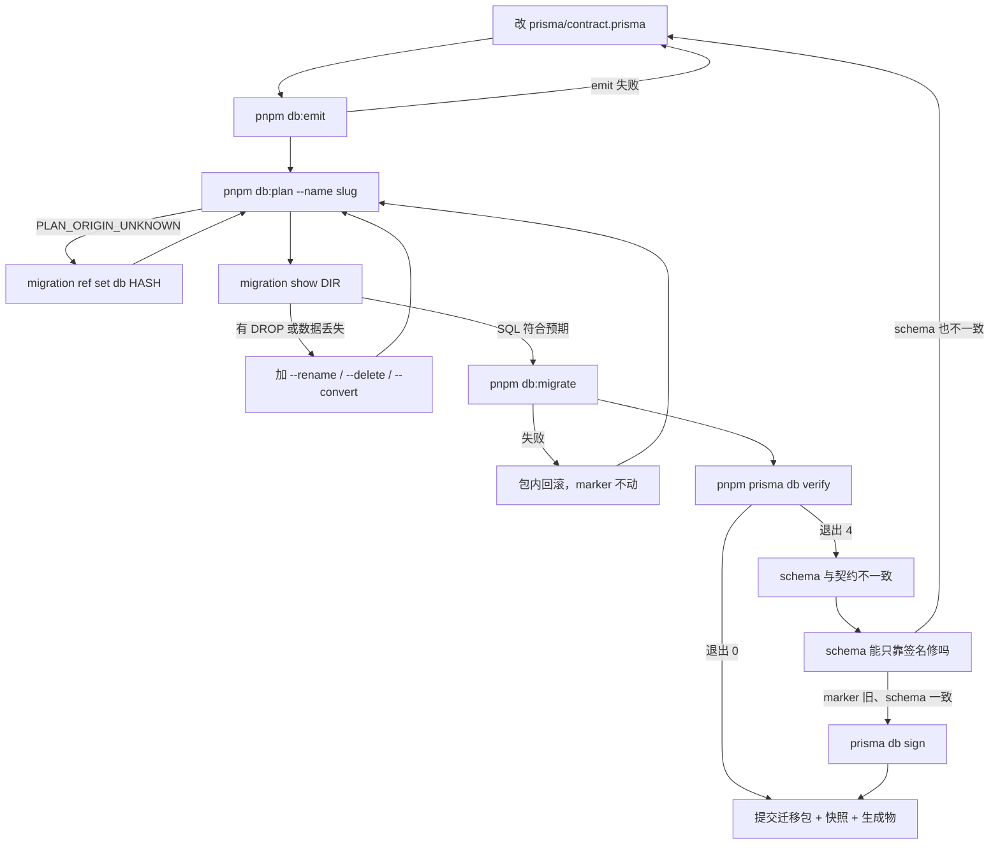

# 第 48 章 Prisma 8 常用命令与迁移工作流

## 迁移是什么，和契约什么关系

契约（第 44 章）描述数据库「现在应该长什么样」，迁移描述「怎么从上一次的样子走到现在」。两者分工不同：契约是目标状态，迁移是路径。只有目标状态不够——生产库不能按当前契约整个重建，得一步一步改；把每一步写成有版本号、能重复执行的脚本，按顺序重放，任何环境才能得到同一套 schema。

没有迁移也能开发：直接改库，或者用 `db update` 把当前契约硬套上去。但这样改了什么、按什么顺序改的，没有记录；换环境、回滚、多人协作时，没人说得清数据库是怎么变成现在这样的。迁移换来的就是这份可追溯、可重放。

官方文档（先看懂正文再点）：
- [Prisma Migrate 如何工作](https://www.prisma.io/docs/orm/migrations/how-migrations-work)：迁移文件怎么生成、怎么按顺序重放，对应本章「路径」那段。
- [生成迁移](https://www.prisma.io/docs/orm/migrations/generating-a-migration)：改完契约后生成迁移的命令。

现在看一个真实事故。

周五合并完分支，CI 在 `pnpm db:plan` 这一步退出 2：

```text
[MIGRATION.PLAN_ORIGIN_UNKNOWN] Cannot determine the plan origin:
migrations exist but no origin is named
```

本地明明跑过 `db:plan`，迁移目录也在。问题出在分支合并：迁移目录从另一个分支带过来，`migrations/app/refs/db.json` 里的 hash（内容指纹）不在这张图里，甚至这个文件根本没跟过来。还有一种不报错的情况：你只改了契约、忘了 emit，plan 出来是 0 个 operation，你以为迁移已经生成，其实什么都没发生。

迁移的价值在可追溯、可回放，不是「把 SQL 跑一遍」这么简单：一个迁移包要记录从哪个契约节点走到哪个节点、中间做了哪些 operation、内容哈希是多少；换一台机器、换一个环境，按顺序重放这些包，才能得到同一套 schema。Prisma 8 把一次改动拆成四步——emit 编译契约、plan 生成包、show 审查、migrate 应用——每一步都落文件，都能离线重放。

旧教程里 `migrate dev` 一条命令包办「对比、生成、应用」，快，但中间结果不可审查；一旦有人手改 SQL 让 CI 过，线上 schema 和 marker 就对不上，而且没人说得清差在哪。Prisma 8 宁可停下，也不猜一个起点继续走。读懂它的报错，先认识三个词：

- **ref**：仓库里的一个指针文件，记「当前环境应该从哪个契约节点出发」，跟着分支走。
- **marker**：数据库里的一行记录，记「这个库是从哪个节点签过来的」，跟着环境走。
- **plan**：沿着契约图从 ref 走到目标节点的一条路径，落成一个迁移包。

三者任何一个对不上，plan 或 verify 都会失败。ref 和 marker 最容易混：分支合并把 ref 带过来、数据库还是旧的，plan 和 verify 就会各说各话——一个说该加列，一个说已经加过。

## 先分清八条命令的边界

表里的 `contract` 就是 44 章讲的 `contract.prisma`，`emit` 的产物是运行时和类型的唯一来源。一个 operation 就是一次 DDL 动作——加列、建索引、加外键——`plan` 把它们按顺序装进包里。

`example/package.json` 固化了 `db:emit`、`db:plan`、`db:migrate`、`db:init`、`db:update`、`db:seed`；`show`、`check`、`verify`、`sign` 这类一次性审查命令直接用 `pnpm prisma migration show`、`pnpm prisma migration check`、`pnpm prisma db verify`、`pnpm prisma db sign`，不必再加一层脚本。

| 命令 | 做什么 | 什么时候用 |
| --- | --- | --- |
| `prisma contract emit` | 读 `contract.prisma`，写 `contract.json` 与 `contract.d.ts` | 每次改完契约；离线 |
| `prisma migration plan --name x` | 对比 emitted contract 与磁盘最新迁移，生成迁移包 | 开发、分支；离线 |
| `prisma migration show <dir>` | 预览一个包的 operations、SQL 与元数据 | 提交前审查；离线 |
| `prisma db migrate --advance-ref db` | 按顺序应用 pending 迁移，成功后推进 db ref | 开发环境应用 |
| `prisma db verify` | 先查 marker，再查 live schema 是否满足契约 | CI 门禁、发布后 |
| `prisma db init` | 只用 additive（只增不改不删）操作把空库引导到当前契约并签名 | 新环境、本地空库 |
| `prisma db update` | 直接比较 live DB 与 emitted contract，就地补差异 | 原型期，不写迁移历史 |
| `prisma db sign` | schema 验证通过后写 marker，把库「认领」到当前契约 | 接管已有库、修 marker |

先记住一条分界线：`db init` 和 `db update` 不产生迁移历史，只适合本地或一次性环境；要进版本库、要在别的环境重放的，只有 `migration plan` + `db migrate` 这条路。

`db update` 还有一个容易误解的地方：它成功后会自己 verify 并推进 marker，看起来「什么都做了」。但它没有迁移文件，换一台机器无法重放；数据库被改坏了，也没有历史版本可以回滚。原型期用它省时间可以，别把它写进发布脚本。

## 改一次契约的完整循环

假设刚给 `Booking` 加了 `services` 关系（上一章那张连接表）。顺序是固定的：

```bash
pnpm db:emit

pnpm db:plan --name add_booking_services
# ✔ Planned 1 operation(s)（数量取决于你的改动）
# 新目录：prisma/migrations/app/20261107T0930_add_booking_services

MIGRATION=$(ls -dt prisma/migrations/app/*_add_booking_services | head -1)
pnpm prisma migration show "$MIGRATION"
# 输出 CreateTable / AddForeignKey / CreateIndex 等 operations 与 SQL 预览

pnpm db:migrate
# ✔ Applied 1 migration(s) (1 operation(s)) across 1 contract space(s)

pnpm prisma db verify
# 退出码 0：marker 与 schema 都匹配
```

（以上为示例输出；本机没有可连的 PostgreSQL，未实测。）

`plan` 读的是 `contract.json`，不是 `contract.prisma`。为什么不直接读 DSL？plan 要比较的是规范化后的模型和节点哈希；`contract.prisma` 里还有注释、格式和只在客户端生效的信息，不是稳定的比较基准。emit 之后才有统一形状。只改源码不跑 `db:emit`，plan 会拿旧契约去 diff，结果常常是 `Planned 0 operation(s)`。等发现字段没进库，往往已经过去几个提交。把 emit 当成保存键，改完契约先按一次，再谈 plan。

`db:plan` 的起点默认是 `refs/db.json`。第一次没有任何迁移时，它按空库规划；图里已经有迁移、ref 又缺失或指向不存在的节点，就报上面那个 `PLAN_ORIGIN_UNKNOWN`。这时别删迁移目录重来，先确认 ref 应该指向哪个 hash，再用 `prisma migration ref set db <hash>` 修正，或者用 `--from <hash>` 显式指定起点。

`db:migrate` 应用的是「所有 pending（已生成还没应用）」，不是「刚生成的那一个」。本地如果积了几个没应用的包，它会一起走；应用前用 `db migrate --show` 看一眼路线，确认不会跨过你不想跨的版本。PostgreSQL 上每个迁移包在一个事务里执行，包内任何一步失败都回滚，marker 不动；修好 SQL 或数据后重跑，不会留下半套 schema。跨包的顺序由迁移图保证，别把两个包当成一个原子操作。

`--advance-ref db` 只在成功后推进 ref。漏了它，下一次 plan 还从旧起点开始，可能生成一个重复的迁移。CI 或生产更常见的是 `db migrate --to <ref>`：把目标状态说死，而不是依赖本地 ref 恰好正确。

> **图 48-1** 从契约改动到数据库落地，失败分支分别停在哪一步。
>



## 迁移包里哪一行能碰

一个包长这样：

```text
prisma/migrations/
├── app/
│   ├── refs/
│   │   └── db.json
│   └── 20261107T0930_add_booking_services/
│       ├── migration.json
│       ├── migration.ts
│       └── ops.json
└── snapshots/
    └── <contract-hash>/
        ├── contract.json
        └── contract.d.ts
```

`refs/db.json` 通常在第一次 `db migrate --advance-ref db` 成功后出现；没有它，下一次 plan 会按空库规划，或者在图里已有迁移时直接报 `PLAN_ORIGIN_UNKNOWN`。

`migration.json` 是元数据：`from`、`to`、`createdAt`、`migrationHash`。它不能改，改了哈希就对不上。

`migration.ts` 是框架渲染出来的 TypeScript，可以编辑。需要数据回填时，就改这个文件里的 operations，然后重新生成操作清单：

```bash
node prisma/migrations/app/20261107T0930_add_booking_services/migration.ts
```

这一步会重写同目录的 `ops.json`。只改 `migration.ts` 不重跑，`db migrate` 执行的还是旧的 `ops.json`；提交前用 `migration check` 确认哈希对得上。

`ops.json` 是 `db migrate` 真正执行的内容，也是 `migration show` 展示的来源。**不要手改**。它按内容寻址，手改之后 hash 与 `migration.json` 对不上，`migration check` 会报完整性失败；就算你连 hash 一起改，CI 上的包和本地也不再是同一个东西。

提交时四样一起走：`prisma/contract.prisma`、`src/generated/prisma8/contract.{json,d.ts}`、新的 `migrations/app/<dir>/`、新的 `migrations/snapshots/<hash>/`。只提交迁移目录、不提交生成物，别人拉下来类型对不上；只提交生成物、不提交迁移，库永远追不上代码。快照目录存的是那个契约节点的 `contract.json` / `contract.d.ts`，plan 要拿它和当前契约做 diff；删掉快照，历史节点就断了。

还有一个和命令无关、但决定迁移能不能上线的维度：兼容性。滚动发布期间新旧代码同时跑，数据库结构必须同时满足两边。加一个必填列，先加成可空、回填数据、再改 `NOT NULL`；改列名，先新增列、双写一段时间、再删旧列。这些不是 Prisma 的语法，是迁移顺序的设计——一次破坏性变更拆成几个可回滚的小步，比一条「看起来很完整」的迁移安全得多。

提交前跑一次：

```bash
pnpm prisma migration check
# 退出码 0：包内哈希、manifest（包内文件清单与哈希）、图连接都通过
# 退出码 4：完整性失败，先修再提交
# 退出码 2：命令没跑起来（路径或参数问题）
```

`2` 和 `4` 要分开看：`2` 是命令根本没跑起来（路径、参数、连接），`4` 是跑起来了但完整性或漂移检查没过。CI 里两个都该红，排查方向却相反——先看退出码，再看日志，别一上来就怀疑 SQL。

## verify 是裁判，sign 是签字

`db verify` 先看 marker，再看 live schema。三个退出码要分清：

- `0`：marker 与 schema 都匹配契约。
- `4`：有漂移（数据库实际结构与契约对不上）或 marker 发现。CI 必须失败。
- `2`：检查根本没跑起来——连不上库、缺 emitted contract、参数冲突。CI 也要失败，但它不是「schema 有问题」，别混为一谈。

只想看 schema、跳过 marker，用 `--schema-only`；只想看 marker，用 `--marker-only`；想连「库里多出来的表/列」也算失败，加 `--strict`。`--strict` 适合发布门禁，不适合还在手工探索的库。

`db sign` 不是「强行让 verify 通过」。它先做 schema 验证，匹配才写 marker；schema 不匹配，退出 4，什么也不写。它适合两种场景：接管一个已经存在、结构与契约一致的库；或者 marker 丢了、但 schema 没漂移。默认会推进 db ref，CI 里通常加 `--no-advance-ref`，只签名，不动版本指针。

`db init` 只对空库做 additive 引导，碰到已有数据或破坏性差异会停下。它不是 `db push` 的替代品，别拿它去修一个已经有数据的生产库。`db update` 能就地补差异，但遇到删列会追问 `--rename` / `--delete`；改类型、数据转换它做不了，`--convert` / `--backfill` 会直接拒绝，把你推回 `migration plan`；权限变更要 `--allow`。

## 版本配对与旧命令

`prisma` CLI 和运行时库是两个包，版本号也不一样：

```json
{
  "dependencies": {
    "@prisma/orm-postgres": "8.0.0-rc.21"
  },
  "devDependencies": {
    "prisma": "8.0.0-rc.29"
  }
}
```

这不是笔误。CLI 是 `8.0.0-rc.29`，Postgres 运行时是 `8.0.0-rc.21`，按仓库锁定的配对装，别想着把两个 rc 号凑成一样。运行时版本不对，`contract emit` 会在生成阶段炸：

```text
[CLI.UNEXPECTED] Cannot use 'in' operator to search for 'kind' in typeChoice
```

`@prisma/client` 属于 v7，不是 Prisma 8 的包；8 的查询客户端在 `@prisma/orm-postgres/runtime`。装错包的症状不是报「版本不对」，而是一堆找不到模型、include 参数退化成 `never` 的类型错误。

还有一种更隐蔽的配置错误：`package.json` 里没声明 `@prisma/orm-postgres`，emit 仍能跑，但生成的代码 import 的是 `@internal/*` 下的路径（例如 `@internal/target-postgres/*`）。类型当场退化，`include` 的回调参数变成 `never`。把依赖补上、重新 emit，import 才会回到 `@prisma/orm-postgres/*`。

旧命令的报错也值得记住，省得在搜索引擎里绕圈：

| 现象 | 原因 | 怎么处理 |
| --- | --- | --- |
| `migrate dev` 报 `CLI.COMMAND_MOVED` | 8 把一步拆成 emit / plan / migrate | 按 `emit → plan → db migrate` 走；`--create-only` 对应只 plan 不 apply |
| `db push` 报 `CLI.UNKNOWN_COMMAND` | 8 没有 push，提示 `did you mean update?` | 原型期用 `db update`，正式路径用 plan |
| `db seed` 报 `CLI.UNKNOWN_COMMAND` | seed 不再是 CLI 子命令 | 用 `pnpm db:seed` 跑 `tsx prisma/seed.ts` |
| `PLAN_ORIGIN_UNKNOWN` | ref 缺失，或指向不在图里的 hash | `migration ref set db <hash>`，或 plan 加 `--from` |
| `MIGRATION.MARKER_MISMATCH` | marker 不是图里的节点 | 先 `db verify --schema-only`；schema 一致再 `db sign` |
| `MIGRATION.HASH_NOT_IN_GRAPH` | ref 指向了不存在的契约 | `migration ref set` 改到图上节点，别删迁移 |
| `CLI.CONSENT_REQUIRED` | 破坏性操作没回答 | 补 `--rename` / `--delete`，或 `--convert` / `--backfill` |
| `migration check` 退出 4 | 包内哈希或 manifest 不一致 | 别手改 `ops.json`；重跑 `migration.ts` 再 check |

迁移工作流看起来命令多，核心只有一句话：契约是源，emit 出类型，plan 出可审查的包，migrate 把包重放上去，verify 证明库没有偷偷漂移。把这五步固定成脚本，谁执行都一样；出问题时，先看退出码，再看 ref 和 marker，最后才怀疑 SQL。

想更深入的话，官方文档里有这几页可以接着看：[迁移如何工作](https://www.prisma.io/docs/orm/migrations/how-migrations-work)（迁移表的记录方式和冲突处理）、[生成迁移](https://www.prisma.io/docs/orm/migrations/generating-a-migration)（生成迁移时的命名和检查步骤）、[db verify](https://www.prisma.io/docs/cli/db-verify)（检查数据库和迁移记录是否对得上）、[错误参考](https://www.prisma.io/docs/orm/reference/error-reference)（迁移失败时按错误码定位）。

<!-- chapter-nav:start -->
---

← 上一篇：[047 Prisma8多对多映射与关联CRUD](047-Prisma8多对多映射与关联CRUD.md) · [本 Part 目录](_part.md) · 下一篇：[049 Prisma8知识点查缺补漏](049-Prisma8知识点查缺补漏.md) →
<!-- chapter-nav:end -->
