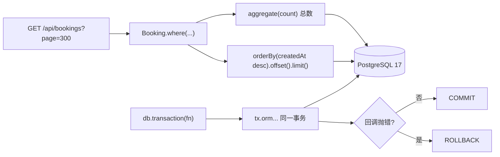

# 第 49 章 Prisma 8 知识点查缺补漏

## 分页、聚合、事务，先各说一句

`offset 29900 limit 100` 的意思是「跳过前 29900 行，取 100 行」。跳过不是免费的：数据库仍要把前面那些行定位出来再丢掉，页码越深，读出来扔掉的行越多；排序的列上没索引时，每次还要把整个筛选结果排一遍。这是下面这个 504（网关等待超时）的技术前提，和网关本身关系不大。

聚合（aggregate）是在数据库里算 `count` / `sum` / `avg`，不是把行拉回内存再算，省的是传输和内存、不是扫描。事务（transaction）把多条语句绑在同一条连接上，要么一起提交、要么一起回滚；边界按业务不变量画，不按一个 HTTP 请求画。

官方文档（先看懂正文再点）：
- [Prisma 分页](https://www.prisma.io/docs/orm/prisma-client/queries/pagination)：`skip` / `take` 和游标分页的写法，对应本章深分页那段。
- [Prisma 聚合](https://www.prisma.io/docs/orm/prisma-client/queries/aggregation-grouping-summarizing)：`count`、`sum`、`groupBy` 的用法。
- [Prisma 事务](https://www.prisma.io/docs/orm/prisma-client/queries/transactions)：批量事务和交互式事务的区别。

现在看一个真实事故。

周五下午运营要导上个月的预订，列表翻到第 300 页开始转圈，最后网关直接 504。日志里只有两条 SQL：一条 `count(*)`，一条带 `offset 29900 limit 100` 的查询。表里 300 万行，筛选后 40 万行，两万九千行被读出来又扔掉，前端还每隔几秒重试一次。

写 CRUD 的时候 Prisma 8 很省心：`where`、`include`、`create`，链式调用读起来像自然语言。真正出事的地方往往不在这些主路径上，而在计数怎么写、分页用哪种、关系是顺带取还是循环查、事务边界画在哪。这几个点单独看都不难，凑在一个列表接口里，就是这个 504。

先交代三样东西的边界：`db` 是一个进程级客户端，内部持有一个连接池；一条查询的路径是从池里借一条连接、发送、解码、归还；`db.transaction` 把同一条连接借给整个回调，`tx` 上所有语句都走它，回调结束才提交或回滚、归还连接。客户端、连接、事务边界画错，就会出现「查询越来越多、连接一直不还、查重和写入之间插进另一个请求」。

> **图 49-1** 一次列表请求和一次写请求各自在 Prisma 8 里的走向。
>



## 一条列表查询，实际发了几条 SQL

先把 example 里 `BookingsService.findAll` 的核心摘出来：

```ts
// src/modules/bookings/bookings.service.ts（节选）
const [items, totals] = await Promise.all([
  filtered
    .include('room')
    .include('user', (relation) => relation.select('id', 'name', 'email'))
    .orderBy((row) => row.createdAt.desc())
    .limit(pageSize)
    .offset((page - 1) * pageSize)
    .all(),
  filtered.aggregate((aggregate) => ({ total: aggregate.count() })),
]);

return paginate(items, totals.total, page, pageSize);
```

`filtered` 是一个还没执行的查询描述，两次调用各自从它派生出一条 SQL。`Promise.all` 让它们并发，省掉一次串行等待，但没有省掉任何一次扫描：计数要扫一遍筛选结果，取页还要再扫一遍并排序。

这里最容易写错的是计数。有人为了省事，先 `.all()` 把当前页拉回来，再用 `items.length` 当总数；也有人把 `total` 写成当前页长度的倍数。前者拿到的是每页 20 条，分页器永远只有一页；后者在筛选条件变化后立刻对不上。`aggregate` 的 `count()` 返回 `number`，空结果集是 `0`，可以直接交给分页器。

聚合省的是传输和内存，不是扫描：`count()` 仍然要扫一遍筛选结果，只是结果不占网络。顺带记住 `sum`、`avg`、`min`、`max` 的空集语义：SQL 里它们对零行返回 `NULL`，Prisma 8 也如实返回 `null`，不是 `0`。财务报表接口把 `null` 直接塞进 `toFixed`，线上就是一个 `Cannot read properties of null`。真要给前端一个 0，在映射层写 `?? 0`，别在 SQL 层猜。

## offset 的分水岭

回到那个 504：`offset` 的代价随页码线性增长——数据库仍然要定位并丢弃前面 29900 行。页码越大，丢得越多；如果 `orderBy` 的列上还没有索引，每次还要把整个筛选结果排序一遍。example 的 `Booking` 只有 `@@index([roomId, startTime, endTime])`，列表却按 `createdAt` 倒序，这就是那个 504 的根因之一。

先补索引，再谈游标：

```prisma
// prisma/contract.prisma（节选）
model Booking {
  // ...
  @@index([roomId, startTime, endTime])
  @@index([createdAt])
}
```

改完契约不是立刻生效，要走一遍生成和迁移：

```bash
pnpm db:emit
pnpm db:plan --name add_booking_created_at_index
pnpm db:migrate
```

`db:emit` 重新产出 `src/generated/prisma8/contract.json` 和 `contract.d.ts`；`db:plan` 生成迁移目录；`db:migrate` 才真正打到库上。跳过 `db:emit` 直接跑应用，类型还是旧的，运行时会拿旧 contract 去校验，报的错和索引一点关系都没有。

索引只能把排序成本压下去，深 offset 的丢弃成本还在。数据量再上一个量级，就该换成游标。游标（cursor）是「从上一页最后一条之后继续」的定位方式，和 offset 的「跳过前 N 行」是两种成本模型：

```ts
// src/modules/bookings/bookings.service.ts（新增）
async pageByCursor(cursor: string | undefined, pageSize = 20) {
  const rows = await this.db.orm.public.Booking
    .orderBy((row) => row.createdAt.desc())
    .cursor(cursor ? { createdAt: cursor } : {})
    .limit(pageSize + 1)
    .all();

  const hasMore = rows.length > pageSize;
  const items = hasMore ? rows.slice(0, pageSize) : rows;

  return {
    items,
    nextCursor: hasMore ? items[items.length - 1]!.createdAt : null,
  };
}
```

几个边界得说清楚。`cursor()` 必须写在 `orderBy()` 之后，方向也跟着排序走：降序是「比游标小」，升序是「比游标大」。多取一条是为了判断还有没有下一页，比再发一条 `count` 便宜。游标分页不能跳页，产品上要接受「上一页/下一页」，或者把页码藏起来。

还有一个坑：`createdAt` 可能重复。同一毫秒插入的两条记录，单列游标可能漏行或者重复。生产上要么加一个唯一且单调的第二排序键，要么就别拿时间戳当游标。

## include、select 和 N+1

`include` 解决的是「这条记录的关系数据一起拿」，`select` 解决的是「只拿这几列」。两者经常被混着用。

列表页只需要会议室名字和预订人姓名，却 `include('room').include('user')` 把整行都拉回来，多出来的列会一路经过解码、序列化、再被前端忽略。收窄写法是这样：

```ts
const bookings = await this.db.orm.public.Booking
  .select('id', 'roomId', 'startTime', 'endTime', 'status')
  .include('room', (relation) => relation.select('name', 'location'))
  .include('user', (relation) => relation.select('id', 'name'))
  .orderBy((row) => row.createdAt.desc())
  .limit(20)
  .all();
```

`select` 收窄的是当前模型的行类型，`include` 的回调里还能继续收窄关系。两个都写，返回的对象就只剩你要的字段，TypeScript 也会跟着变窄。

N+1 是另一种形态：先查出 20 条预订，再在 `map` 里逐条 `Room.where({ id }).first()`。日志里就是 1 条列表 SQL 加 20 条详情 SQL，本地看不出问题，线上 20 次往返加起来就是几百毫秒。把关系放进 `include`，让 ORM 一次取回来；如果一对多关系只需要数量，别把整段明细拉回来，在 include 回调里用 `count()` 或 `combine()` 精化，形式是 `include('bookings', (relation) => relation.count())`。

example 的契约里 `Room` 没有声明反向的 `bookings` 关系，所以这条查询在这个项目里暂时用不上。真要用，先给契约补上 `bookings Booking[]`，走一遍 `db:emit` 和迁移，再写查询。`combine` 适合「既要最近几条，又要总数」的场景，它返回的是命名的对象，不是你原来那个数组，接的时候留意类型。

## 事务：查重和写入之间的窗口

example 的 `create` 原来是这么写的：先 `Room.where` 查会议室，再 `hasConflict` 查冲突，最后 `Booking.create`。三步都对，但三步不在一个事务里。两个请求同时进来，都查到「没有冲突」，然后都插入成功——会议室的同一时段就被订了两次。

把这三步塞进 `db.transaction`，并且在查会议室时锁住那一行：

```ts
// src/modules/bookings/bookings.service.ts（节选）
return this.db.transaction(async (tx) => {
  // 同一会议室的并发预订在这里排队，后到的事务会等前一个提交。
  const room = await tx.orm.public.Room
    .where({ id: dto.roomId })
    .forNoKeyUpdate()
    .first();

  if (!room) {
    throw new NotFoundException('会议室不存在');
  }
  if (room.status !== RoomStatus.AVAILABLE) {
    throw new ConflictException('会议室正在维护，暂不可预订');
  }

  const conflict = await tx.orm.public.Booking.where((row, { fns }) =>
    fns.and(
      row.roomId.eq(dto.roomId),
      row.status.in(OCCUPYING_STATUSES),
      row.startTime.lt(endTime.toISOString()),
      row.endTime.gt(startTime.toISOString()),
    ),
  ).first();

  if (conflict) {
    throw new ConflictException('该时间段与已有预订冲突，请选择其他时间');
  }

  return tx.orm.public.Booking.create({
    userId: user.id,
    roomId: dto.roomId,
    startTime: startTime.toISOString(),
    endTime: endTime.toISOString(),
    status: BookingStatus.PENDING,
    remark: dto.remark ?? null,
  });
});
```

`forNoKeyUpdate`（PostgreSQL 的行锁模式之一，见文末链接）而不是 `forUpdate`，是因为另一个事务往 `bookings` 插外键时会对 `rooms` 那一行加 `FOR KEY SHARE`，它和 `FOR UPDATE` 冲突，和 `FOR NO KEY UPDATE` 不冲突。用错了不会报错，只会让并发预订在高峰期互相等。

事务里还有一条铁律：**所有查询都走 `tx`**。在单连接客户端上，`db` 的普通读会悄悄跑进同一个事务；而单行 `update`、`delete`、带关联写入的 `create`、嵌套 `transaction` 这类需要自己连接的操作，会一直等 `tx` 占着的那条连接，请求就挂住了。规则简单点：回调里只认 `tx`，不要出现 `this.db`。

回调正常返回就提交，抛异常就回滚。不要在事务里 `try/catch` 之后把异常吞掉再返回 `null`，那会提交一个半成品。

事务边界要按业务不变量画，不是按 HTTP 请求画。一次「查冲突 + 插预订」必须在一个事务里；而「写库 + 发通知 + 调支付」不该全塞进去——外部调用慢，会把连接和行锁一起占住，后面排队的请求全被拖死。正确做法是先提交事务，再用 outbox（把待发事件和业务写入放进同一个事务，由后台任务负责投递）或消息队列做后续动作，失败就重试那一步，而不是回滚已经成功的写入。

## 原生 SQL 不是退路，是手术刀

ORM 表达不了的报表，可以走 `db.raw.sql`。比如「每个会议室已通过预订数 Top 10」：

```ts
// src/modules/stats/stats.service.ts（新增）
const rows = await this.db.query(
  this.db.raw.sql`
    select r.name as room_name,
           count(b.id)::int as booking_count
    from public.rooms r
    left join public.bookings b
      on b.room_id = r.id and b.status = 'APPROVED'
    group by r.name
    order by booking_count desc, r.name asc
    limit 10
  `.returnsRow({
    room_name: 'pg/text@1',
    booking_count: 'pg/int4@1',
  }).build(),
);
```

几个细节。表名是 `@@map` 之后的 `rooms`、`bookings`；列名不是 TypeScript 里的属性名——`Booking.roomId` 在契约里写了 `@map("room_id")`，落到库里就是 `room_id`，SQL 必须照存储名写，写成 `"roomId"` 只会得到「列不存在」。有没有 `@map` 不一样，改 SQL 前先翻一眼契约。`count(...)::int` 是故意转的，为了让返回值落到 `pg/int4@1` 这个 codec 上；不转的话 `count` 是 `int8`，解码类型对不上。

codec 是 Prisma 8 对列类型的编解码标识，比如 `pg/int4@1`，原生 SQL 的返回值靠它解码。`returnsRow` 里写的 codec id 必须出现在 `contract.d.ts` 的 `CodecTypes` 里，否则编译期就过不去。拿不准就打开生成物搜一下，别凭记忆写。

原生 SQL 适合聚合、窗口函数、CTE（公用表表达式，`WITH ... AS`）这类 ORM 不擅长的查询。日常 CRUD 别为了「性能」全改写 SQL：你失去的不只是类型，还有 `include`、软删除扩展、中间件这些统一入口。写之前先问一句，这个查询是不是真的复杂到 ORM 表达不了。

## seed 脚本和迁移，最容易在演示前翻车

seed 是给开发库、演示库灌初始数据的脚本，不是迁移的一部分：它不改结构，可以重复执行，失败了大不了清库重来。example 的 `prisma/seed.ts` 不长，但几个顺序不能错：

```ts
// prisma/seed.ts（节选）
import bcrypt from 'bcryptjs';
import { Role, RoomStatus } from '../src/common/enums.js';
import { loadEnvFiles } from '../src/config/load-env.js';
import { createDatabase } from '../src/database/prisma.js';

loadEnvFiles();

const url = process.env.DIRECT_URL ?? process.env.DATABASE_URL;
if (!url) throw new Error('缺少 DIRECT_URL / DATABASE_URL');

const db = createDatabase(url);

try {
  // 有外键：先删子表，再删父表。
  await db.orm.public.Booking.where({}).deleteAll();
  await db.orm.public.Room.where({}).deleteAll();
  await db.orm.public.User.where({}).deleteAll();

  const [admin, member] = await db.orm.public.User.createAll([
    {
      name: '管理员',
      email: 'admin@example.com',
      passwordHash: await bcrypt.hash('Admin123456', 10),
      role: Role.ADMIN,
    },
    {
      name: '张三',
      email: 'user@example.com',
      passwordHash: await bcrypt.hash('User123456', 10),
      role: Role.USER,
    },
  ]);

  await db.orm.public.Room.create({
    name: '星河会议室',
    capacity: 12,
    location: 'A 座 3 层',
    equipment: ['投影仪', '白板'],
    status: RoomStatus.AVAILABLE,
  });

  console.log(`seed 完成：${admin.email} / ${member.email}`);
} finally {
  await db.close();
}
```

`loadEnvFiles()` 不能省。Prisma CLI 只自动读 `.env`，这个项目还支持 `.env.local`，seed 又是 `tsx` 直接跑的，入口不手动加载就会拿到 `undefined`。`DIRECT_URL ?? DATABASE_URL` 也是故意的：迁移和 seed 走直连，应用运行时才走连接池。

`finally` 里的 `db.close()` 同样是必须的。脚本跑完不关连接，`tsx` 进程会一直挂着，CI 里表现为「seed 成功了但命令不退出」。`close()` 会等在途查询结束，然后关掉连接池；关掉之后不能再查，要重新 `createDatabase`。

版本这块别自作聪明。`prisma@8.0.0-rc.29` 配 `@prisma/orm-postgres@8.0.0-rc.21`，是当前 example 验证过的组合；只升 CLI 不升运行时，`emit` 出来的 contract 和运行时解析器对不上，报错信息通常不会直接告诉你「版本不匹配」。升级就两个一起升，升完重跑 `db:emit` 和迁移。

验证 seed 有没有真的写进去，别只看脚本输出：

```bash
psql "$DATABASE_URL" -c 'select count(*) from users;'
```

预期是一行 `2`（管理员加普通用户）。数字不对，先看 `DIRECT_URL` 指到哪个库了。（示例输出，本机没有可连的数据库。）

## 生产里真正会踩的坑

| 现象 | 原因 | 怎么处理 |
| --- | --- | --- |
| 列表越翻越慢，最后 504 | 深 `offset` 加无索引排序 | 给排序列建索引；数据量大改游标分页 |
| 空表时报表接口 500 | `sum`/`avg` 空集返回 `null` | 映射层兜底 `?? 0`，别假设一定有值 |
| 并发下同一时段被订两次 | 查重和写入不在一个事务 | `db.transaction` + `forNoKeyUpdate` 锁会议室行 |
| 事务里请求卡住直到超时 | 回调里用了 `this.db` 的单行写或嵌套事务 | 事务内所有查询只走 `tx` |
| 原生 SQL 报列不存在 | 照抄了 TS 属性名，实际列名被 `@map` 成 snake_case | 打开契约看 `@map`，SQL 用存储名 |
| seed 报外键冲突 | 删除顺序反了 | 先删 `bookings`，再删 `rooms`、`users` |
| 改了契约类型没更新 | 漏了 `db:emit` 或 dev 进程没重启 | 重跑 `db:emit`，重启 `pnpm start:dev` |

再补两条不常被写进文档、但很致命的：

- **`count()` 不是免费的**。带复杂 `where` 的计数在百万行表上可能比取一页还慢。列表首屏可以只返回 `hasMore`，把精确总数放到单独的统计接口，或者用近似值。
- **别在循环里 `await` 查询**。哪怕是 20 条，串行往返也足够把 P99 拉高；能 `include` 就 `include`，不能就一次 `in` 查回来在内存里拼。

查询层的东西到这里差不多了。下一章换个角度：这些查询最终都跑在一个 `Database` 实例上，这个实例怎么接进 Nest 的依赖注入、怎么在进程退出时关干净、怎么让健康检查真的反映数据库状态，是另一类问题。

想更深入的话，官方文档里有这几页可以接着看：[聚合与分组](https://www.prisma.io/docs/orm/prisma-client/queries/aggregation-grouping-summarizing)（分组统计的完整参数）、[分页](https://www.prisma.io/docs/orm/prisma-client/queries/pagination)（深分页为什么慢、游标分页怎么换）、[事务](https://www.prisma.io/docs/orm/prisma-client/queries/transactions)（事务边界和超时设置）、[原生 SQL](https://www.prisma.io/docs/orm/prisma-client/queries/raw-database-access/raw-queries)（ORM 表达不了时直接写 SQL 的入口）、[行锁](https://www.postgresql.org/docs/17/sql-select.html#SQL-FOR-UPDATE-SHARE)（`FOR UPDATE` 的加锁范围）。

<!-- chapter-nav:start -->
---

← 上一篇：[048 Prisma8常用命令与迁移工作流](048-Prisma8常用命令与迁移工作流.md) · [本 Part 目录](_part.md) · 下一篇：[050 在Nest里集成Prisma8](050-在Nest里集成Prisma8.md) →
<!-- chapter-nav:end -->
