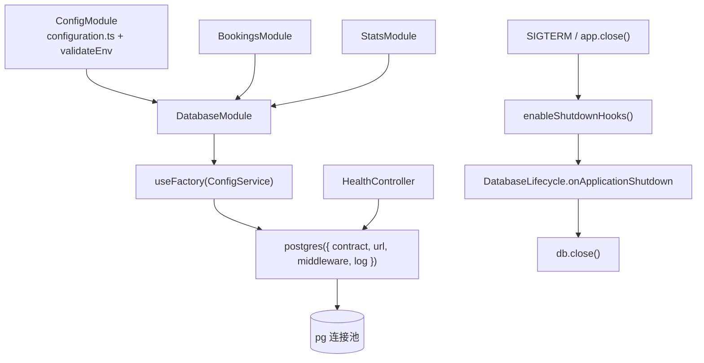

# 第 50 章 在 Nest 里集成 Prisma 8

## 集成要回答的四个问题

集成不是写个 Provider 就完了。客户端从哪来、什么时候连、什么时候关、健康检查问谁，四个问题各对应一个 Nest 机制，任何一个答错，都会在发布或故障切换时暴露。

Provider 是交给 IoC 容器（控制反转容器，Nest 负责创建对象并把依赖注进来）管理、可被注入的对象：Service、Repository、工厂、Guard 都是 Provider，`@Injectable()` 或 `useFactory` 只是提供它的方式；它和 Service 不是并列关系，Service 是 Provider 的一种。Module 把一组 Provider 圈在一起，`@Global()` 让别的模块不用逐个 import。生命周期钩子（`onApplicationShutdown`）让进程在收到 SIGTERM（终止信号）后有机会排空连接。健康检查要分 liveness（进程有没有死）和 readiness（能不能接流量），只有后者该查库。

对象也要分清：Database 客户端是进程级单例，内部持有一个连接池；连接是池里借出的一条；事务是固定在这条连接上的边界。客户端创建还是惰性的——`postgres()` 只做初始化，第一次查询才建连接，所以 import 成功、应用启动成功，都不代表数据库可用。

官方文档（先看懂正文再点）：
- [Nest Provider](https://docs.nestjs.com/providers)：Provider 是什么、怎么注册和注入，对应本章第一个问题。
- [Nest 模块](https://docs.nestjs.com/modules)：模块怎么圈 Provider、`@Global()` 的作用。
- [Nest 生命周期事件](https://docs.nestjs.com/fundamentals/lifecycle-events)：`onApplicationShutdown` 在什么时候触发。
- [Nest 健康检查（Terminus）](https://docs.nestjs.com/recipes/terminus)：怎么把数据库检查挂到 readiness 上。
- [Prisma 8 文档](https://www.prisma.io/docs/orm)：客户端连接和关闭的接口。

现在看一个真实事故。

凌晨一点，滚动发布完成，六个 Pod（Kubernetes 的实例单元）全是 Ready。五分钟后告警响了：所有业务接口 500，但 `/api/health` 从始至终返回 200，负载均衡没有摘掉任何一个实例。登上容器看日志，第一行是 `DRIVER.NOT_CONNECTED`——数据库那边刚做完主备切换，旧连接全断了。问题不在 Prisma，也不在 Nest，而在两者中间那层「集成」。

这四个问题不是并列的配置项，而是一条链：配置进工厂、工厂建客户端、进程退出时关池、探针通过客户端查库。

> **图 50-1** 数据库客户端在 Nest 进程里的位置，以及退出时经过哪条路径。
>



## 现状：三个文件拼起来的接法

example 里现在的写法是这样：

```ts
// src/database/prisma.ts（节选）
export const createDatabase = (url: string) => postgres({ contract, url });

export const db: Database = new Proxy({} as Database, {
  get: (_target, property) => {
    const client = getDb(); // 第一次取属性时读 process.env.DATABASE_URL
    const value = Reflect.get(client as object, property, client);
    return typeof value === 'function' ? value.bind(client) : value;
  },
});
```

```ts
// src/database/database.module.ts
@Global()
@Module({
  providers: [{ provide: PRISMA, useValue: db }],
  exports: [PRISMA],
})
export class DatabaseModule {}
```

能跑，演示也够用，但放在生产里立刻暴露四个问题。

第一，`useValue: db` 传的是模块加载时就已经确定的 Proxy，连接串来自 `process.env.DATABASE_URL`，绕过了 `ConfigModule` 的校验和类型。你在 `configuration.ts` 里把 `database.url` 改成必填、加了默认值，这个 Provider 一概不知道。

第二，`useValue` 把创建时机固定在 import 阶段，测试替换、按环境切库、加中间件都没有插口。

第三，没有关库逻辑。`app.enableShutdownHooks()` 在 `main.ts` 里是开着的，但没有任何 `onApplicationShutdown` 去调 `db.close()`，滚动发布时连接池跟着进程一起被 SIGKILL。

第四，`AppController` 的健康检查只返回 uptime：

```ts
// src/app.controller.ts（节选）
@Get('health')
health() {
  return { status: 'ok', timestamp: new Date().toISOString(), uptime: process.uptime() };
}
```

数据库挂了它照样 200，K8s 也就照样把流量打进来。下面按配置 → 日志 → 生命周期 → 健康检查 → 事务的顺序改。

## 让 Provider 从 ConfigService 拿连接串

先给 `createDatabase` 开一个口子，把运行时可调的选项透传进去：

```ts
// src/database/prisma.ts
import postgres from '@prisma/orm-postgres/runtime';
import type { PostgresOptions } from '@prisma/orm-postgres/runtime';
import { contractFromJson } from '@prisma/orm-postgres/static';

import type { Contract } from '../generated/prisma8/contract.js';
import contractJson from '../generated/prisma8/contract.json' with { type: 'json' };

export const contract = contractFromJson<Contract>(contractJson);

export type DatabaseOptions = Pick<
  PostgresOptions<Contract>,
  'middleware' | 'log' | 'poolOptions'
>;

export const createDatabase = (url: string, options: DatabaseOptions = {}) =>
  postgres({ contract, url, ...options });

export type Database = ReturnType<typeof createDatabase>;
```

`postgres()` 是惰性的：import 不连库，第一次查询才建连接。所以没有 `DATABASE_URL` 的时候，`pnpm build` 和 `pnpm typecheck` 仍然能过，这一点别改掉。

然后模块里换成工厂：

```ts
// src/database/database.module.ts
import { Global, Module } from '@nestjs/common';
import { ConfigService } from '@nestjs/config';
import { PRISMA } from './database.constants.js';
import { DatabaseLifecycle } from './database.lifecycle.js';
import { createDatabase } from './prisma.js';
import { slowQueryWarning } from './slow-query.middleware.js';
import { TransactionService } from './transaction.service.js';

@Global()
@Module({
  providers: [
    {
      provide: PRISMA,
      inject: [ConfigService],
      useFactory: (config: ConfigService) =>
        createDatabase(config.getOrThrow<string>('database.url'), {
          middleware: [slowQueryWarning({ thresholdMs: 200 })],
          log: console,
          poolOptions: {
            connectionTimeoutMillis: 2_000,
            idleTimeoutMillis: 30_000,
          },
        }),
    },
    TransactionService,
    DatabaseLifecycle,
  ],
  exports: [PRISMA, TransactionService],
})
export class DatabaseModule {}
```

`getOrThrow` 在配置缺失时直接让应用起不来，这比运行到第一个请求才报「连接串为空」好查得多。`configuration.ts` 里已经有 `database.url`，`validateEnv` 也校验过，这里只是把它取出来。

`@Global()` 是个取舍：业务模块不用逐个 import `DatabaseModule`，代价是依赖关系变隐式。团队小、模块少时省事；模块边界严格的项目可以去掉 `@Global()`，让每个用到数据库的模块显式 import，编译器会帮你抓漏。

换完工厂先确认应用还能起来：

```bash
pnpm start:dev
curl -s http://localhost:3000/api/health
```

预期仍是旧的 `{"data":{"status":"ok","timestamp":"...","uptime":...}}`——这一节还没动健康检查。外面那层 `data` 是全局 `ResponseInterceptor` 加的，不是健康检查自己包的。（示例输出，本机未实测。）

## 慢查询得能看到 SQL

Prisma 8 的运行时支持 `SqlMiddleware`，钩子挂在编码前和语句结束后。把官方给的慢查询中间件落到项目里：

```ts
// src/database/slow-query.middleware.ts
import type { SqlMiddleware } from '@prisma/orm-postgres/family-runtime';

const statementSql = Symbol('slow-query-warning.sql');

export interface SlowQueryOptions {
  readonly thresholdMs?: number;
}

export const slowQueryWarning = (options: SlowQueryOptions = {}): SqlMiddleware => {
  const thresholdMs = options.thresholdMs ?? 200;

  return {
    name: 'slow-query-warning',
    familyId: 'sql',
    async beforeEncode(plan, ctx) {
      ctx.state(statementSql)['sql'] = plan.sql;
    },
    async activityEnded(activity, result, ctx) {
      if (result.kind !== 'statement' || result.latencyMs <= thresholdMs) {
        return;
      }
      ctx.log.warn({
        code: 'APP.SLOW_QUERY',
        message: `慢查询 ${result.latencyMs}ms（阈值 ${thresholdMs}ms）`,
        details: {
          sql: ctx.state(statementSql)['sql'],
          source: result.source,
          activityId: activity.id,
        },
      });
    },
  };
};
```

`beforeEncode` 把 `plan.sql` 存进这次活动的 state，`activityEnded` 再按 `latencyMs` 判断要不要报。`result.kind === 'statement'` 这个判断不能省，事务提交、连接建立这些活动也会走 `activityEnded`，但它们没有 `latencyMs`。

关键的一点：**不传 `log`，这些事件会被运行时直接丢掉**。中间件里的 `ctx.log.warn` 不是写到控制台，而是交给 `postgres` 的 `log` 处理；模块里写了 `log: console`，它才会真的打出来。上生产前把 `console` 换成 pino 或 Nest `Logger` 的桥接，别把整段 SQL 和参数直接打进公共日志。

临时把阈值改成 `1`，刷一次预订列表，预期看到类似这样一行：

```json
{"code":"APP.SLOW_QUERY","message":"慢查询 42ms（阈值 1ms）","details":{"sql":"select ...","source":"driver","activityId":"..."}}
```

SQL 进了日志，下一步才是决定加索引还是改查询。没有 SQL 的「慢查询告警」只能让你猜。

## 关库要关在进程退出之前

`main.ts` 里已经有 `app.enableShutdownHooks()`，它负责把 `SIGTERM`、`SIGINT` 转成 Nest 的生命周期事件。还缺一个监听者：

```ts
// src/database/database.lifecycle.ts
import { Inject, Injectable, Logger, type OnApplicationShutdown } from '@nestjs/common';
import { PRISMA } from './database.constants.js';
import type { Database } from './prisma.js';

@Injectable()
export class DatabaseLifecycle implements OnApplicationShutdown {
  private readonly logger = new Logger(DatabaseLifecycle.name);

  constructor(@Inject(PRISMA) private readonly db: Database) {}

  async onApplicationShutdown(signal?: string): Promise<void> {
    this.logger.log(`收到 ${signal ?? 'shutdown'}，关闭数据库连接池`);
    await this.db.close();
  }
}
```

`db.close()` 的语义要说清楚：它会拒绝新查询（之后报 `DRIVER.NOT_CONNECTED`），等待在途查询和事务结束，然后释放连接池；关掉之后不能重连，再要用只能重新 `createDatabase`。它是幂等的，调两次不会炸，但也别在请求作用域里调。

验证方式：

```bash
kill -TERM $(pgrep -f 'nest start')
```

预期日志里出现「收到 SIGTERM，关闭数据库连接池」，进程在连接排空后正常退出，而不是卡在 30 秒后被 K8s 强杀。生产上再配一个 `preStop`（Pod 终止前执行的钩子）的几秒 sleep，让 Service 先把流量摘掉，close 才不会撞上正在处理的请求。

## 健康检查要真的查库

把 `AppController` 里那个只看 uptime 的接口换掉，单独建一个健康模块：

```ts
// src/modules/health/health.controller.ts
import {
  Controller,
  Get,
  Inject,
  Logger,
  ServiceUnavailableException,
} from '@nestjs/common';
import { Public } from '../../common/decorators/public.decorator.js';
import { PRISMA } from '../../database/database.constants.js';
import type { Database } from '../../database/prisma.js';

@Controller('health')
export class HealthController {
  private readonly logger = new Logger(HealthController.name);

  constructor(@Inject(PRISMA) private readonly db: Database) {}

  @Public()
  @Get()
  async check(): Promise<{ status: 'ok'; database: 'up' }> {
    try {
      const [row] = await this.db.query(
        this.db.raw.sql`select 1 as ok`.returnsRow({ ok: 'pg/int4@1' }).build(),
      );
      if (!row || row.ok !== 1) {
        throw new Error('健康检查返回了非预期结果');
      }
      return { status: 'ok', database: 'up' };
    } catch (error) {
      const message = error instanceof Error ? error.message : String(error);
      this.logger.warn(`数据库健康检查失败：${message}`);
      throw new ServiceUnavailableException('数据库不可用');
    }
  }
}
```

```ts
// src/modules/health/health.module.ts
import { Module } from '@nestjs/common';
import { HealthController } from './health.controller.js';

@Module({ controllers: [HealthController] })
export class HealthModule {}
```

把 `HealthModule` 加进 `AppModule` 的 `imports`，同时删掉 `AppController` 里原来的 `@Get('health')`，否则两个路由都注册，谁生效取决于模块顺序。

`select 1` 走的是同一个连接池，能真实反映「应用能不能拿到连接」。连接池的 `connectionTimeoutMillis` 是 2 秒，数据库没起来时这个请求两秒内就会失败，不会把 K8s 探针一起拖死。

验证：

```bash
curl -s -o /dev/null -w '%{http_code}\n' http://localhost:3000/api/health
# 200

docker compose stop postgres
curl -s http://localhost:3000/api/health
# {"statusCode":503,"message":"Service Unavailable","error":"Service Unavailable",...}
docker compose start postgres
```

example 的 `AllExceptionsFilter` 会把 5xx 的 `message` 统一改成状态文案，所以这里看不到「数据库不可用」这句；没有这层过滤器时，body 才是 `{"message":"数据库不可用","error":"Service Unavailable","statusCode":503}`。

Liveness 和 readiness 最好分开：liveness 只判断进程有没有死锁，别查库，否则数据库抖一下 K8s 会把所有 Pod 重启一遍；readiness 查库，失败就摘流量，等库恢复再放回来。上面这个接口适合挂 readiness，挂 liveness 的话把 `select 1` 去掉。

探针的超时也要和连接池对齐：`connectionTimeoutMillis` 是 2 秒，K8s 的 `timeoutSeconds` 就得大于 2 秒，`failureThreshold` 也要给够。否则数据库只是慢了一下，探针先超时，Pod 被当成坏实例重启，反而把连接风暴放大。

## 事务封装，别散落在 service 里

`db.transaction()` 本身够简单，但每个 service 都写一遍 `this.db.transaction(async (tx) => ...)`，会带来两个长期问题：类型 `tx` 在每个文件里重复声明；有人在回调里顺手用了 `this.db`，请求就挂住了。

抽一个薄封装：

```ts
// src/database/transaction.service.ts
import { Inject, Injectable } from '@nestjs/common';
import type { PostgresTransactionContext } from '@prisma/orm-postgres/runtime';
import { PRISMA } from './database.constants.js';
import type { Contract } from '../generated/prisma8/contract.js';
import type { Database } from './prisma.js';

export type Transaction = PostgresTransactionContext<Contract>;

@Injectable()
export class TransactionService {
  constructor(@Inject(PRISMA) private readonly db: Database) {}

  run<T>(work: (tx: Transaction) => Promise<T>): Promise<T> {
    return this.db.transaction(work);
  }
}
```

它只做两件事：给出一个项目内统一的 `Transaction` 类型；让业务代码只依赖 `TransactionService`，不直接碰 `db.transaction`。`DatabaseModule` 已经把它导出，业务模块的构造器直接注入即可：

```ts
// src/modules/bookings/bookings.service.ts（节选）
constructor(
  @Inject(PRISMA) private readonly db: Database,
  private readonly transactions: TransactionService,
) {}

create(dto: CreateBookingDto, user: AuthUser) {
  return this.transactions.run((tx) => this.insertBooking(tx, dto, user));
}

private insertBooking(tx: Transaction, dto: CreateBookingDto, user: AuthUser) {
  return tx.orm.public.Booking.create({
    userId: user.id,
    roomId: dto.roomId,
    startTime: new Date(dto.startTime).toISOString(),
    endTime: new Date(dto.endTime).toISOString(),
    status: BookingStatus.PENDING,
    remark: dto.remark ?? null,
  });
}
```

真实业务里 `insertBooking` 前面还要有锁会议室、查冲突，那部分上一章写全了。这里看的是边界：**事务的开启只在 `TransactionService` 里发生，`tx` 只在回调内部流转**。service 的公开方法不接收 `tx`，避免调用方传进来一个已经提交的事务。

## 连接池不是越大越好

`poolOptions` 里最容易拍脑袋的是最大连接数。`pg` 的默认 `max` 是 10，看起来很小，但乘上副本数就不小了：10 个 Pod 就是 100 条常驻连接，而 PostgreSQL 的 `max_connections` 默认也是 100，还要留给迁移、备份和运维。结果就是业务一扩容，数据库先报 `too many clients already`。

算的时候用「数据库能接受的总连接数 ÷ 副本数」，再留 20% 余量。比如数据库给 200 条，跑 8 个副本，每个池配 20 就够，而不是配 100。连接不是线程，池里 20 条足够撑住绝大多数 Web 请求；真正卡住吞吐的是慢查询占着连接不放，不是池太小。

还有一个 DI 作用域陷阱：Nest 的 Provider 默认是单例，数据库客户端正好该单例；一旦把 Provider 标成 `Scope.REQUEST`，每个请求都会 new 一个客户端、建一个池，压测时连接数会指数级上涨。数据库客户端不要跟着请求走，请求作用域里只放请求自己的东西。

`idleTimeoutMillis` 控制空闲连接多久回收，`connectionTimeoutMillis` 控制拿不到连接时等多久。后者一定要设，默认是无限等，数据库网络分区时请求会一直挂到网关超时，健康检查也跟着挂。连接总数再上一个量级，就上 PgBouncer（PostgreSQL 的连接池代理），让几百个应用连接复用几十条数据库连接；这时候 Prisma 的连接串指向 PgBouncer，事务模式下的注意事项以 PgBouncer 文档为准。

## 生产里真正会踩的坑

| 现象 | 原因 | 怎么处理 |
| --- | --- | --- |
| 健康检查一直 200，业务全 500 | 只检查了进程 uptime | readiness 里 `select 1`，失败返回 503 |
| 滚动发布时一部分请求 502 | 收到 SIGTERM 直接退出，没排空 | `enableShutdownHooks()` + `onApplicationShutdown` 里 `db.close()` |
| 关库后还有查询报错 | 流量没摘就先关了池 | readiness 先失败，再等几秒关池 |
| 慢查询日志里没有 SQL | 创建客户端时没传 `log`，事件被丢弃 | `log: console` 或桥接 pino/Nest Logger |
| 事务里的请求卡到超时 | 回调里用了 `this.db` 的单行写 | 事务内所有查询只走 `tx` |
| Postgres 连接数打满 | 副本数 × 每个池的最大连接 | 按 `副本数 × pool max` 算总量，必要上 PgBouncer |
| 改了配置不生效 | Provider 里直接读 `process.env` | 一律走 `ConfigService.getOrThrow` |

还有两个不明显的：

- **不要在请求作用域里 `await using` 一个 client**。每次请求新建一个 `postgres()` 就是一个新连接池，压测时连接数会指数级上涨。客户端就该是进程级单例。
- **`log: console` 只适合开发**。它会把运行时事件（包括 SQL）打到 stdout，量大时日志成本比数据库还高；生产上至少按 level 过滤，并且不要记录参数里的手机号、邮箱。

数据库这层稳了，接下来该处理读多写少的场景。统计页每次都扫全表，Redis 就在旁边，下一章先把它跑起来。

想更深入的话，官方文档里有这几页可以接着看：[Prisma 8 文档](https://www.prisma.io/docs/orm)（客户端和连接池的配置项）、[Nest 生命周期事件](https://docs.nestjs.com/fundamentals/lifecycle-events)（关闭钩子的执行顺序）、[Nest 健康检查](https://docs.nestjs.com/recipes/terminus)（liveness 和 readiness 分开写的示例）。

<!-- chapter-nav:start -->
---

← 上一篇：[049 Prisma8知识点查缺补漏](049-Prisma8知识点查缺补漏.md) · [本 Part 目录](_part.md) · 下一篇：[051 快速入门Redis](051-快速入门Redis.md) →
<!-- chapter-nav:end -->
